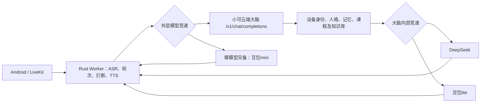
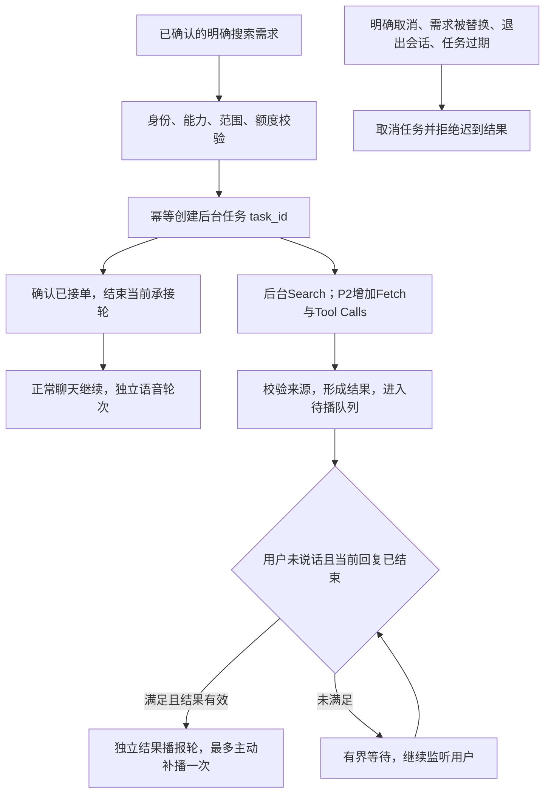

# P003 小可：DeepSeek搜索与Tool Calls接入可行性评估

结论：**可行，官方接口及现有账号已经通过最小实测；但当前小可没有可直接开启的完整工具调用链，不能只加tools参数就上线。建议把检索与工具执行集中在云端大脑，Worker补后台任务接收、语音轮次隔离与空闲播报调度。搜索作为独立后台任务，普通对话可连续进行；先上线受控Search，再加入Fetch及有边界的Tool Calls。开发采用“专用分支＋独立工作树”，大脑和Worker各一套。**

日期：2026-10-21。版本：v2，已整合后台搜索不阻塞对话要求。性质：决策评估与阶段规划，尚未实施功能改造。未修改线上业务源码、配置、数据库或服务；未重启、未对真机发探针。已做少量官方API合成请求，可能产生按次及token费用，未发送儿童对话、画像、设备身份或凭据正文。

> v2取代v1的同步等待方案：不延长当前轮800ms竞速来等搜索；普通插话不取消后台搜索；结果完成后进入待播队列。原始探针和生产快照保持原字节，证据时间未刷新。本次只更新文档，未重新检查服务器运行状态。

## 一、证据范围与当前架构

本轮读取两份指定官方指南及其API参考、思考模式和价格说明；只读核对香港大脑生产源码、现役Worker进程环境、Air当前Rust源码。现役Worker通过Air既有SSH密钥严格校验后访问；旧地址的主机指纹不匹配，没有绕过检查。

| 层次 | 本轮实查 | 对接入的含义 |
|---|---|---|
| 大脑 | aliyun-hk，p003-voice PID3873258，restart24，online | 工具应放在已有身份、人格和记忆边界内 |
| 大脑内部模型 | LLM_PROVIDER=race；DeepSeek配置名deepseek-v4-flash，备用doubao-seed-2.0-lite | 首个正文delta获胜；不能让“没检索的答案”淘汰“正在检索的答案” |
| 现役Worker | voice-worker-hk2，voice-worker-rust PID839，NRestarts0，active | 与旧skill所列机器区分；以本轮活体为准 |
| Worker外层备用 | doubao-seed-2.0-mini，火山/api/plan/v3；主路让步800ms | 搜索任务不能进入此竞速；请求确认及后续普通聊天仍需一致的路由协议 |
| 语音 | TTS=xfyun；Worker最大job配置20 | 本轮未压测，20是配置值，不是已验证容量 |
| 源码基线 | 8个大脑相关文件与已发布6c2cc932工作树一致；主仓4个关键文件不一致 | 不从主仓旧副本直接开发后覆盖生产 |
| Rust源码 | Air的p003/story-truncation-20260914分支，HEAD491e068a，项目范围clean | 本机origin/feat/rust-worker不是已确认最新基线 |

Worker当前二进制SHA已取证，但尚未完整证明其构建产物对应Air哪一个源提交。**运行配置已确认；源码行为分析以Air当前代码为据；正式改造前仍须补齐构建来源。** 证据见同目录runtime-evidence.json及brain-files.json。

另有版本事实：官方当前将旧模型名deepseek-v4-flash映射到DeepSeek-V4.1-Flash-1017，建议使用deepseek-flash。本次以旧名请求，响应确实返回deepseek-flash。因此不能仅看env中的旧名，认定模型行为仍固定在旧V4。[官方模型说明](https://api-docs.deepseek.com/zh-cn/quick_start/pricing/)

## 二、两项能力的区别及文档中的接入约束

**Search/Fetch负责取得资料，Tool Calls负责表达“要调用什么函数”。** 工具函数仍由我们的代码执行。可以由大脑直接调用Search，不必先更换主对话模型；也可以让模型选择search_web，再由工具执行器调用Search。不能把发送tools参数等同于搜索已经发生。[Search指南](https://api-docs.deepseek.com/zh-cn/guides/search/)；[Tool Calls指南](https://api-docs.deepseek.com/zh-cn/guides/tool_calls/)

| 能力 | 官方接口/约束摘要 | 对小可的设计选择 |
|---|---|---|
| Search | POST /v1/tools/search；query为1～128个Unicode字符；count为1～50；可返回摘要或正文 | 初版count=3、need_content=false，限制输入和结果总量 |
| Fetch | POST /v1/tools/fetch；抓取单个HTTP(S)网页，返回Markdown；并非每页都能取得正文 | 初版不开放任意URL；第二阶段只抓已筛选搜索结果 |
| 搜索结果 | 含URL、摘要、排序分、权威分及可能缺失的日期 | 分数用于排序，不能作为事实正确或适合儿童的保证 |
| 工具协议 | assistant工具请求后接对应tool_call_id的tool结果，再请求最终答案 | 在大脑内部保留完整临时调用序列，向Worker只输出可播内容 |
| 流式工具 | 函数参数分片到达，按index拼接；参数仍须代码校验 | 不能逐片执行，也不能把arguments当正文播出 |

参数及返回结构以[Search API](https://api-docs.deepseek.com/zh-cn/api/search/)、[Fetch API](https://api-docs.deepseek.com/zh-cn/api/fetch/)和[Chat Completions API](https://api-docs.deepseek.com/zh-cn/api/create-chat-completion/)为准。

三个容易漏掉的约束：

1. strict是Beta，需要独立使用beta入口，所有函数开启strict；对象字段全部required且additionalProperties=false，部分字符串/数组长度关键字不支持。初期采用稳定入口＋本地校验，strict单独验证后再引入，不改全局Base URL。[Tool Calls指南](https://api-docs.deepseek.com/zh-cn/guides/tool_calls/)
2. 实时语音先保持非思考模式。若以后启用思考并携带tools，官方要求后续请求完整回传reasoning_content，包括没有实际调用工具的相关历史轮次；当前系统的纯文本历史无法承担这一协议。[思考模式](https://api-docs.deepseek.com/zh-cn/guides/thinking_mode/)
3. Chat Completions可正常在当前调用末尾追加工具结果；文档另指出，不支持把非模型产生的工具调用任意插进既有历史中间。不要为“把历史搜索记录变成工具记录”伪造调用。暂不因这一限制迁移整个系统到Responses/Anthropic协议。[Tool Calls指南](https://api-docs.deepseek.com/zh-cn/guides/tool_calls/)

## 三、不是纸面推断：本轮最小接口实测

测试从香港大脑服务器直接访问DeepSeek官方，现有Key只在服务器进程内使用。搜索为公开科技馆信息，工具为纯本地合成加法，无真实用户上下文。

| 探针 | 结果 | 本次耗时 | 能证明/不能证明 |
|---|---|---:|---|
| Search，count3 | HTTP200，3条结果 | 465ms | 账号与接口可用；不能代表中文长尾召回率 |
| Fetch，官方文档页面 | HTTP200，正文6405字符 | 160ms | 该页面能抓取；不能保证任意网页成功 |
| 非思考Tool Calls | HTTP200，finish_reason=tool_calls | 1199ms | 模型生成了合法probe_add调用 |
| 回填tool结果后续答 | HTTP200，答案为5 | 607ms | 最小函数调用闭环通过 |
| 当前配置旧模型名＋流式工具 | HTTP200，响应模型deepseek-flash | 1020ms | 16个SSE块、13个参数片段，拼接后合法，结束标记正确 |

每项只有一个样本，耗时是该HTTP响应完成时间，**不是TTFT、P95或用户听到声音的时间**。未实测strict、思考工具链、真实儿童问题质量、语音取消、并发、故障注入或长稳；没有通过生产小可入口触发记忆写入。

本次搜索返回的官网结果中存在较早发布时间，说明“来自权威官网”不自动等于“今天有效”。开放安排、比赛结果等时效问题仍需核查日期和当日公告。探针元数据见api-probes.json与stream-tool-probe.json。

## 四、当前代码缺口：为什么不能直接加一个开关

以下路径中B代表2-Projects/P003GameDemo20260513/apps/server，W代表2-Projects/realtime-voice-agent/rust-worker。行号针对本轮取回的生产/Air快照。

| 缺口 | 代码证据 | 直接接入的后果 |
|---|---|---|
| 大脑入口不是完整工具代理 | B/src/routes/custom-llm.ts:73–85仅接messages/model，只保留user/assistant文本 | 入站role=tool及tool_calls不会按协议保留下来 |
| 模型客户端只消费正文 | B/src/providers/deepseek-llm.ts:58–120未发送tools，解析仅取delta.content | 工具专用响应可能变成空回复；添加请求字段仍不够 |
| 内层竞速按正文先到选胜者 | B/src/providers/race-llm.ts:45–52 | 若一路检索、一路直接回答，直接回答容易胜出 |
| Worker也只解析正文 | W/src/llm.rs:335–410 | 原样转发工具参数无法形成执行闭环 |
| 外层800ms让步 | W/src/llm.rs:464–545＋活体环境 | 正常搜索等待可能被当作主路慢，切到无检索灾备 |
| 预生成没有请求阶段标记 | W/src/pipeline.rs:1733–1760；W/src/llm.rs:609起 | 同一句在用户未说完、被取消、重发时可能重复付费检索 |
| 取消未显式贯通大脑入口 | B/src/routes/custom-llm.ts未见onAbort/请求signal接入provider；provider自身有abort | Worker停止消费不等于大脑停止搜索、续答或后续记忆任务 |
| 长期记忆与最终正文绑定 | B/src/routes/custom-llm.ts:210–233 | 网页事实、工具中间文本若混入对话，可能污染画像抽取 |
| Worker请求有30秒总超时 | W/src/llm.rs:572–579 | SSE心跳不能绕过总超时；无限工具循环不适合语音 |

这些是源码集成缺口，不等于已经在生产观察到对应故障。本轮没有将它们归因为此前的“间歇不回复”。此前调查还存在媒体协商、端侧提前退出及回声过滤等独立路径；搜索无法修复那些问题，反而会增加等待和取消分支。

## 五、方案比较与推荐

| 路线 | 行为 | 判断 |
|---|---|---|
| A. 当前轮等检索后回答 | 大脑搜索后把证据交给模型，当前语音轮等待 | 不满足用户要求，不作为本次交付路线 |
| B. 大脑后台任务＋Worker空闲播报 | 搜索独立运行，前台继续聊天，完成后在合适停顿补充结果 | 推荐；P1受控Search，P2增加Fetch和Tool Calls |
| C. Worker直接做通用Agent | Rust内运行多轮工具和检索 | 改造范围大，复制大脑治理能力，现阶段不选 |

两类能力均纳入目标方案，但分阶段交付，不把“全部规划”写成“全部已上线”：

| 能力 | P1 | P2 |
|---|---|---|
| Search网页搜索 | 大脑直接调用，每任务一次，形成可查来源 | 也可由模型提出search_web请求 |
| Fetch网页抓取 | 不启用 | 摘要不足时按需抓取已筛选的搜索结果 |
| Tool Calls | 不依赖模型自主选工具 | 模型规划→服务端校验执行→回填tool结果→整理结论 |

产品目标：用户说“帮我查科技馆周末开不开”，小可接受任务后简短确认；用户马上可以聊其他话题。查到后，小可在安全停顿说“刚才查的科技馆……”，补充简短结果与来源。普通聊天、故事创作、本地玩法继续原链。天气等需要结构化数据的能力另行评估专用工具。

联网证据属于该搜索任务，不自动成为用户经历、人格成长依据或本地回复语素材，也不能触发设备控制。初版只在当前会话有效，退出后取消任务，不跨会话追着用户播报。

## 六、建议的运行流程与硬边界

### 6.1 前台与后台的职责边界

- 普通轮保持既有竞速，不增加一次通用LLM分类请求。先识别明确搜索候选；“今天心情不好”“最新编一个故事”不能因关键词误触发。歧义需求先澄清，不凭弱关键词外发信息。
- 在已确认轮次、复用投机正文和启动裸模型竞速之前完成搜索路由判断。明确搜索请求走任务提交与确认路径；普通问题才进入既有聊天竞速。确认轮不等待Search结果，不以扩大800ms让步换取联网时间。
- 只有服务端确认接单后才能说“好，我查一下”；服务端明确拒绝时说明未接单；提交超时或ACK丢失表示接单状态未知，用相同幂等键查询/重试一次，仍未确认就告知状态未知，不能重复创建或声称一定没有任务。明确取消也须核对服务端结果，未确认不能提前声称已取消。后台不可用不阻塞下一轮普通聊天。
- 大脑持有任务、授权、工具凭据及证据；Worker持有语音活动状态与播放调度。新增独立任务API，不能把后台任务绑定在原聊天HTTP连接的生命周期上。
- 初版建议采用独立、可取消的Worker异步轮询任务：每会话有在途任务时每1秒轮询一次，无任务时停止；请求3秒超时，失败退避但不超任务期限。它不占主循环锁、不长期占用聊天连接。任务API的最终路径需开工核对既有路由后冻结。
- 搜索结果与后续普通聊天并行。后台最终整理首版采用单路模型并限制输出，避免争抢两路前台模型资源；未来若使用竞速，两路必须取得同一份证据并计入共同预算。
- “不影响前台”是必须验收的产品要求，不是已验证的零资源开销保证。后台使用独立并发和模型预算；容量不足优先拒绝新搜索，保留语音主链。

### 6.2 两套生命周期、幂等与播报

**语音轮次**用turn_id；**后台搜索任务**用task_id，另有session_id、origin_turn_id、revision及绝对expires_at。身份由既有凭据与房间归属解析，不能相信模型提交的SN或account_id。

任务状态建议：queued→running→ready→delivered；终态另有failed、cancelled、expired。播报单独记录pending/claimed/started/completed/interrupted/dropped，不能将模型生成完成当作用户已听见。

- prewarm与speculative禁止提交外部任务。只有committed需求可创建；同一可信主体＋session＋origin_turn＋规范化请求摘要为提交幂等键。执行工具按task_id＋revision＋工具调用标识去重。
- 普通插话：立即停止当前语音播报，后台搜索继续。后续普通聊天turn变化不得令原task失效。
- 明确“别查了”：取消对应任务。多任务指代不明时先澄清，不能误取消其他设备或会话任务。
- 明确修改查询：取消旧revision并创建新revision，旧结果即使迟到也不能播。用户的新查询不会无条件取消其他独立查询；初版容量上限见6.4。
- 退出会话、显式取消、任务过期：贯通规划模型、Search、Fetch与整理请求的AbortSignal；对已完成第三方调用无法撤销计费。普通聊天HTTP断开不代表搜索取消；房间退出事件负责会话取消，失联时TTL兜底。
- 任务完成后先查session/revision/取消状态/时效，再排播。用户正在说话、ASR处理中、当前回答生成或TTS播放中均不得插播。建议完整空闲800ms后再次检查，通过Worker同一播放仲裁器原子领取；领取后用户开口仍须正常打断。
- 一次task/revision只允许一个delivery_id主动播放。结果采用短摘要，初版上限150个汉字；字幕与实际播出对应，来源链接留后台。
- 结果播报被打断：标记interrupted，保留已播进度，不自动重播整段；用户说“继续刚才的结果”才按进度续讲。取消前已经播放的声音无法撤回，应准确记录。
- 结果就绪后最多等60秒安全空闲，始终无空闲就放弃主动播报；用户在同一会话且结果有效期内主动询问仍可取得结果。过期、已取消和旧会话结果不再回答为最新。
- 为避免进程故障后的重复播报，Worker领取结果前由大脑原子写入delivery claim。初版对领取后崩溃采用“不自动重播”的策略，可能漏播但不主动重复，后台标记delivery_unknown；不承诺跨崩溃恰好一次。
- 大脑任务元数据采用小型独立持久账本，单独存储状态、幂等键、来源摘要和播报回执，不放原始聊天或网页全文。待执行的规范化查询仅放内存，账本保存查询摘要哈希；运行中的网络任务不跨进程恢复；重启后将queued/running标记中断失败，已领取结果不自动重播。保留期建议24小时，过期清理。具体存储路径在隔离环境确认后落入配置，不与生产人格数据库混用。
- 工具临时消息和网页证据不进入长期记忆抽取；搜索结果播报通过专门事件记账。正常用户表达仍按既有规则处理，不能将整段会话一并屏蔽。

### 6.3 工具与资源范围

第一阶段只提供受控search_web；第二阶段允许受控fetch_page及少量确有数据源的只读工具。每个后台任务最多一次Search、一次Fetch、两次工具规划，再做最终整理；不允许递归无上限调用。每个tool_call均有对应结果或受控错误，不能静默丢一个call使历史不完整。

Fetch仅允许服务端认可的公开站点，初期URL来自当前搜索结果并再次校验；拒绝凭据URL、IP字面量、本地/内网地址和任意端口。第三方Fetch自身的安全拒绝不代替我们的访问策略。其返回结构不提供完整重定向链，无法验证的目标初版不抓，不承诺已经实现端到端SSRF防护。

网页及摘要视为不可信证据：不执行其中的工具指令，不允许覆盖小可system规则；结果中的DEV等控制标记不得进入可执行设备意图通道。源站域名实校验，不能只靠query中的site:字符串。权威分和排序分不承担安全授权。

默认不发送ori_question和localization，不将整段聊天、昵称、SN、学校、住址或家长信息用作搜索词。需要城市时取用户明确提供的城市，不用设备IP推位置。公开信息可共享短期缓存；涉及个人上下文的请求不跨设备缓存。

检索证据包含来源ID、标题、URL、来源时间与抓取时间、短摘要。语音只简短说明来源；完整URL留后台或后续端侧来源卡，不把链接念给孩子。初版Android可沿现有音频与字幕消费，显示搜索状态/来源卡则是另一个端侧改动范围。

### 6.4 时延、资源与预算

以下均为建议初值，待单机和负载验收校准，不是已达成SLO：

| 项目 | 初始目标/上限 |
|---|---|
| 普通聊天首声P95 | 相比同条件基线新增≤150ms；还须比较打断延迟与错误率 |
| 任务提交与确认 | 提交截止1.5秒；接受后的确认首声P95目标≤1.5秒；不计为搜索答案首声 |
| 外部工具 | Search单次3秒，Fetch单次3秒，规划单次3秒；整理最多5秒 |
| 后台任务 | 创建起20秒绝对执行期限，排队和重试都包含其中 |
| 等待播报 | ready后最多主动等待60秒；会话内结果有效期上限5分钟，时效性更强的问题可更短 |
| 并发初值 | 全局最多2个执行任务、8个排队；每会话最多1个执行＋1个排队 |
| 调用数量 | 每任务最多一次Search、一次Fetch、两次规划；瞬时故障允许至多一次网络重试且受总预算约束 |

总截止优先于各步骤预算，时间不足就跳过Fetch或后续规划，不能无限续命。瞬时408/429/5xx按Retry-After且有余量时有限重试，确定性4xx不盲重试；402告警并拒绝新搜索。最终错误只在可安全播报时提示一次，不阻塞普通聊天。[官方错误说明](https://api-docs.deepseek.com/zh-cn/guides/search/)

控制后台整理与工具规划并发，给前台保留模型/连接资源。仅凭本地异步不能证明不会影响外部API账号配额，需观察限流、聊天首声和事件循环延迟；超标时暂停接收新任务，清理队列，恢复后再小流量开启。

分别记录：接单延迟、确认音首声、搜索耗时、结果就绪耗时、就绪至播报等待、有效答案首声、实际播出完成。用户持续说话导致的礼貌等待应单独统计，不能用承接音伪装搜索已经回答。

## 七、预计改动点

下表是评估级改动清单，新增文件名为建议，尚未创建业务模块。

| 模块 | 文件/位置 | 具体职责 |
|---|---|---|
| Search适配器 | 新增B/src/tools/deepseek-search.ts | 固定官方origin、鉴权、超时、返回校验、大小上限；搜索凭据留大脑 |
| 工具执行器 | 新增B/src/tools/tool-runner.ts | 工具白名单、本地参数校验、额度、去重、取消和受控错误 |
| 搜索策略 | 新增B/src/tools/search-policy.ts | 候选识别、隐私裁剪、域名/时效筛选、缓存及证据封装 |
| 后台任务服务 | 新增B/src/tools/search-task-service.ts、search-task-store.ts及B/src/routes/search-tasks.ts | 独立任务API、持久幂等账本、状态/revision、并发队列、TTL、领取及回执 |
| Worker后台任务 | 新增W/src/search_tasks.rs | 独立提交、轮询、取消与结果通知；不占聊天HTTP连接或主循环锁 |
| 工具编排 | 新增B/src/tools/tool-orchestrator.ts | 有界规划→执行→回填→最终回答；与普通聊天分开 |
| 模型协议类型 | 新增B/src/providers/llm-protocol.ts | text/tool_call/tool_result/usage/finish分离，不把所有内容压成string |
| DeepSeek客户端 | B/src/providers/deepseek-llm.ts | tools请求、分片组装、finish_reason处理、外部AbortSignal与调用级预算 |
| 竞速接口 | B/src/providers/race-llm.ts、volc-llm.ts | 普通聊天保持既有竞速；后台首版单路整理；若后续开放竞速，两路使用同证据并受任务取消约束 |
| 大脑HTTP入口 | B/src/routes/custom-llm.ts | 请求阶段与能力协商、搜索路由、普通对话断开取消；后台取消由独立任务入口处理 |
| Prompt和记忆 | B/src/device-brain-prompt.ts、prompt-orchestrator.ts；必要时相关抽取入口 | 联网证据低信任处理、引用与过期信息、阻止网页内容写成人格/用户经历 |
| Worker协议 | W/src/llm.rs | 请求阶段与搜索意图路由接口、提交确认与普通竞速分离、传递trace |
| Worker轮次 | W/src/pipeline.rs；必要时job.rs | commit与投机区分、空闲播放仲裁、语音与搜索分别取消、只拒绝失效任务结果 |
| 配置/后台 | 既有设备配置注册与admin路由、运营台页面 | 默认关闭、服务端主闸＋设备范围、工具轨迹与费用/延迟计数 |
| 验收 | 新增search/tool测试；扩展race、设备意图和Rust取消测试 | 见下一节，包含真实RTC而非仅HTTP200 |

后台建议记录：trace/turn/task/revision/delivery、脱敏设备、请求阶段、触发原因、工具名、耗时、命中缓存/重复、结果数量、来源、失败码、最终使用模型、取消终态及费用估算。不记录凭据、完整查询原文或网页全文。必须显式区分“工具被提出”“实际执行”“结果被采用”“回答已播出”。

拟议配置：SEARCH_ENABLED、SEARCH_DEVICE_ALLOWLIST、SEARCH_TIMEOUT_MS、SEARCH_TASK_DEADLINE_MS、SEARCH_TASK_CONCURRENCY、SEARCH_TASK_QUEUE_LIMIT、SEARCH_RESULT_TTL_MS、TOOL_MAX_CALLS及独立费用上限。采用已有配置管理渠道，不在多个env文件复制同值；灰度授权由服务端判定。历史“所有内测设备全量发布”针对本地回复语，不能自动扩成新联网能力全量授权。

## 八、验收、发布和回滚

| 验收组 | 必须覆盖的正反例 | 通过依据 |
|---|---|---|
| 基础检索 | 有结果、空结果、旧日期、无日期、低质量及相互矛盾结果 | 不伪造来源；无证据时不装作查到 |
| 工具协议 | 参数跨块、多个index、非法JSON、未知工具、超大参数、length截断 | 校验前零执行，完整配对结果，终态不悬挂 |
| 权限与隐私 | 未授权设备、伪造phase/SN、网页提示注入、恶意URL、敏感搜索词 | 不跨设备、不传敏感信息、不触发设备命令 |
| 前后台隔离 | 搜索执行时连续聊至少3轮；搜索提交失败；普通备用先到 | 聊天继续、无等搜索空窗、搜索确认不被裸模型事实回答抢占 |
| 投机和重放 | prewarm、speculative取消、相同turn重发、不同turn同问题 | 前两者零外部工具；同轮去重；跨轮缓存按策略 |
| 生命周期 | 普通插话、明确取消、修改查询、离房、TTL、真人假打断 | 普通插话保搜索；取消/替换/离房拒绝对应迟到结果 |
| 播报调度 | ready时用户在说话、当前TTS未结束、领取时开口、重复轮询、播报中打断 | 不抢话、只主动播一次、字幕对应、打断后不自动整段重播 |
| 重启与重放 | ACK丢失、Worker重连、领取后崩溃、大脑重启、超时队列 | 幂等无重复外部任务；未知播报标记准确；不跨会话补播 |
| 用户通道 | 音频、字幕、metrics，正常问题及搜索问题均覆盖 | 真机/RTC有证据；不能只证明SSE或TTS发起 |
| 人格与记忆 | 多设备、反馈/onboarding/课程、本地回复语、取消生成 | 人格不漂、记忆不串、网页不改成长基线 |
| 性能和故障 | 分阶段逐步加并发、429/402/504、连接断开、后台不可用 | 有限时间内正常回答或明确失败；无重试风暴 |

建议先建立不少于100条人工审阅的合成问题集，覆盖普通聊天/时效检索/不应联网/不安全资料；分别评估触发准确性、资料相关性、引用支持和年龄适配。单机真人对话再验证打断与体验。测试集数量不是“质量已达标”的替代品。

发布次序：冻结协议→隔离测试→Worker新版本但功能关闭→大脑新版本关闭→一台内测设备开启→验收后再扩。只在真实设备idle窗口按现有Worker部署纪律stop、清理sidecar、start；本轮没有执行这些动作。

回滚先关搜索主闸及设备范围，停止接单、取消在途/排队任务并清空待播队列，确认不再主动补播，保留审计账本；恢复普通对话；再按兼容矩阵回退大脑或Worker。新Worker应能读旧大脑，旧Worker不得收到已启用的新控制协议；缺少能力协商时默认不开。保留各自已知健康二进制、源码提交、哈希及配置差异，不回灌整库、不丢人格和埋点数据。

本轮不需要换服务器。首阶段是外部HTTP IO与少量编排，先用当前大脑承载有界并发、缓存和熔断；当前机器能承载多少必须补量。只有观测到事件循环/内存/长尾影响语音，或要大量抓取索引时，才把工具执行器拆成独立服务，不凭“有搜索”就升级机型。

## 九、费用与收益

官方Search和Fetch均按每1000次成功请求5元计算，模型token另计。当前文档关于11月1日起计费的说明针对Harness/Claude Code/Codex的服务器端工具调用，不应据此把小可直接调用Search/Fetch当作免费。[官方计费说明](https://api-docs.deepseek.com/zh-cn/guides/search/)

以下为预算示例，不是现有用量预测。假设每台每天100轮、10%触发搜索、其中20%再Fetch、每月30天、每次仅一项调用且不计缓存节省：

| 设备数 | Search/日 | Fetch/日 | 工具费用/月 |
|---:|---:|---:|---:|
| 14 | 140 | 28 | 25.2元 |
| 1000 | 10000 | 2000 | 1800元 |

模型规划、证据输入、最终竞速两路和TTS是额外费用；失败前已发生的模型token也要算。不能只记胜者费用。按设备和全局分别设预算，余额或授权异常不会拖死普通语音。官方账号级Search/Fetch限速分别100/25 QPS，不同Key仍共享账号限制；实际应从更低的本地并发开始。[限速说明](https://api-docs.deepseek.com/zh-cn/guides/search/)

主要收益是回答可核查、能覆盖时效知识，以及将来接入只读业务工具的统一入口。它不会天然修复ASR、媒体连接、本地播放、设备控制成功率，也不会自动获得“自我成长”。搜索提高有据可查的能力，人格成长仍应服从原来的证据与更新规则。

## 十、分支还是工作树：两者一起用，建议两套隔离目录

分支隔离提交历史，工作树提供独立文件目录；依赖、构建产物与运行数据需显式配置隔离；两者不是二选一。当前主仓有其他任务未提交改动，且本机主仓的大脑关键文件与生产不一致，直接切分支仍可能带入脏文件或错误基线。

| 用途 | 建议分支 | 建议工作树 | 起点 |
|---|---|---|---|
| 大脑Search/Tool编排 | codex/p003-brain-search-tools-20261021 | ~/.codex/worktrees/p003-brain-search-tools-20261021 | 已发布6c2cc932相关文件基线，开工前再次核生产哈希及所需依赖 |
| Worker后台任务/播报/取消 | codex/p003-worker-tool-lifecycle-20261021 | ~/.codex/worktrees/p003-worker-tool-lifecycle-20261021 | 先取回Air最新相关提交并核构建来源；不能盲用本机旧origin/feat/rust-worker |

大脑和Worker都属于mycc仓，但已有不同发展线。分开可使Node改动与Rust构建分别审查、发布和回退；两者共享一份明确版本的协议fixture及兼容矩阵，避免各自解释字段。集成时按审过的提交合并，禁止整树rsync或整分支覆盖线上。

服务器没有Git部署真源，worktree隔离也不隔离生产。开发实例必须用独立端口、测试数据目录和凭据范围；禁止把生产SQLite或整份生产env链接到测试实例，也不能在两个工作树共用一个可写data目录。

本轮没有创建开发分支/工作树、没有修改已有分支或push。上述目录和分支是建议名，待确定范围后再建立。实现由codex亲写；不将代码任务默认委派Cursor或其他代理。

## 十一、建议执行阶段与投入

| 阶段 | 交付与顺序 | 粗估投入及放行条件 |
|---|---|---|
| P0 基线与协议 | 补构建来源→冻结任务/播报合同→建两套隔离工作树→采普通语音基线及回滚清单 | 1～2工程日；不从未核实源构建覆盖生产 |
| P1 后台Search | 任务账本与API→Worker独立任务客户端→空闲播报仲裁→Search及安全证据整理→脱敏后台轨迹 | 4～7工程日；先通过连续聊天、取消与播报回归 |
| P2 Fetch与Tool Calls | 流式调用组装→参数校验及回填→有界规划→受控Fetch→费用和失败策略 | 2～4工程日；所有工具仅在后台执行 |
| P3 灰度与回滚验收 | 音频/字幕/metrics→单机→故障矩阵→并发→关闸/二进制回退→观察 | 2～3工程日加观察周期；通过后再扩面 |

合计约9～16工程日，取代v1的6.5～12.5工程日；P0＋P1约5～9工程日。增加的工作是独立任务生命周期、跨轮结果交付、播放仲裁与故障恢复边界。估算不是固定交付承诺，Worker构建溯源发现缺失提交时需重新评估。代码由codex亲写，不默认委派。

### 执行检查点（未执行）

- [ ] P0-A：读取开工时生产哈希、分支、配置与现役二进制，核对Air提交到产物；保存回滚清单和原件，记录恢复命令及验证项。
- [ ] P0-B：建立大脑、Worker专用分支和工作树，确认基线测试；冻结版本化任务合同、状态机、兼容矩阵和共同fixture。测试实例使用独立端口/数据，外部工具默认为mock。
- [ ] P1-A：实现并验证任务服务。覆盖跨设备拒绝、幂等重试、revision替换、满队列、TTL、重启终态；提交一组可独立回退的代码。
- [ ] P1-B：实现Worker后台客户端及播放仲裁。模拟搜索延迟10秒，期间连续完成3轮聊天；覆盖ready与用户开口同刻、重复回执、播报被打断及明确取消。
- [ ] P1-C：接Search与整理模型，校验来源/隐私/控制标记；mock覆盖空结果、超时、429、402及恶意网页文本，再用合成问题实测官方API。
- [ ] P1-D：接入现有后台查看任务与播报状态、延迟/错误/预算；默认关闭总闸，验证普通聊天、人格、本地回复语及埋点回归。
- [ ] P2-A：实现工具分片和调用闭环；覆盖多index、非法JSON、未知工具、超大参数、截断及每个tool_call_id配对错误。
- [ ] P2-B：接入Fetch与有界规划；覆盖不允许的URL、过期来源、调用上限、取消中途及预算耗尽。前台不引入工具等待。
- [ ] P3-A：按发布顺序关闭功能部署；只开一台明确目标设备，取音频、字幕、metrics证据。完成后台搜索时连续聊天、结果不抢话、取消不误伤等验收。
- [ ] P3-B：演练关闸、在途清理及兼容回退，比较普通聊天P95、打断延迟和错误率；达到指标并取得扩面授权后扩大范围。

每个代码任务遵循“先写行为回归用例→确认旧行为失败→最小实现→检查相关回归→按范围提交”；现有测试命令和构建脚本在P0从真实基线确认，本文不是可直接复制执行的逐文件补丁。没有把尚未运行的检查勾选为通过。

购买、发消息、修改设备、写人格状态等有副作用工具不在本次范围；任务跨会话恢复、任意URL抓取、安卓任务列表/来源卡也不包含在首版估算中。

## 十二、本轮边界与证据交付

- 已完成：官方文档核对、当前生产拓扑及源码边界、账号Search/Fetch/Tool Calls/流式工具最小实测、分阶段方案、改动点及工作树建议。
- 未完成且未声称完成：生产小可已联网、真实语音端到端验收、strict及思考工具链、并发性能、自动搜索质量、所有安全攻击测试、费用长稳数据。
- 工具脚本和取回源码只作本次只读审计；没有作为新业务模块部署。
- 同目录：api-probes.json、stream-tool-probe.json、brain-files.json、worker-source-state.json、runtime-evidence.json。无用户原始对话、音频或密钥。

署名：codex（OpenAI）| 2026-10-21（北京时间；原证据采集约16:30～16:34，v2在后续需求确认后修订）
