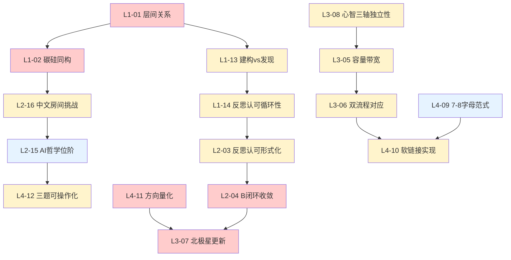

# 16 个逻辑缺口清单（L1-L4 分级）

> 从"建构姿态"识别。不是反驳，是"要让这个框架成立，还缺什么理论支撑"。每个缺口带文档证据、核心追问、优先理论方向。

---

## L1 — 基础缺口（存在论 / 认识论根基）

### 缺口 L1-01：9 层本体论的层间关系未定义
- **文档证据**：Doc1 §1.1（9 层栈：形式科学→物理→物化→化学→生化→生物→心理→社会→综合哲学）
- **追问**：层与层之间是物理主义还原？强涌现？弱涌现？独立层级？——文档全程未言明
- **严重度**：⚠️ critical（没有层间关系的元理论，整个 9 层框架没有根基）
- **理论方向**：物理主义/还原论、弱涌现/强涌现、非还原物理主义（Davidson、Fodor 特殊科学）

### 缺口 L1-02：碳硅同构的存在论假设未阐明
- **文档证据**：Doc3 第二部分"以碳基总结指导硅基设计，以硅基结构反证碳基抽象"
- **追问**：意识/认知是否"基质无关"？没有功能主义或多重可实现性做支撑
- **严重度**：⚠️ critical（FUTURUS 愿景"碳硅共荣"的立身之本）
- **理论方向**：多重可实现性（Putnam 1967）、功能主义（Fodor、Armstrong）、IIT（Tononi）否定基质独立性

### 缺口 L1-13：建构 vs 发现的认识论立场冲突
- **文档证据**：Doc1 叫"建构主义折中"（建构）+ 9 层栈暗含"世界有客观层级"（发现）+ Doc3"以自构世界观为最高准则"（强建构）
- **追问**：三个立场同时存在，张力未解
- **严重度**：⚠️ major（影响整体可信度）
- **理论方向**：结构实在论（Worrall、Ladyman-Ross）、内部实在论（Putnam 后期）、Goodman《Ways of Worldmaking》

### 缺口 L1-14：反思认可的循环性（是-应桥第二层追问）
- **文档证据**：Doc1 §4.3"规范不是从心理事实推出，而是从理性主体的反思认可建构（Korsgaard/Rawls）"
- **追问**：反思认可本身是否需要经验支撑？如果需要 → 回到自然主义谬误；如果不需要 → 神秘的先验
- **严重度**：⚠️ major（这是康德以来伦理学的核心难题）
- **理论方向**：Hume 问题、Moore 开放问题、Korsgaard 反思认可、Rawls 反思均衡、Williams 内在/外在理由

---

## L2 — 接口缺口（规范性 / 认识论接口）

### 缺口 L2-03：反思认可机制的形式化
- **文档证据**：Doc1 §4.3 提到但未展开
- **追问**：几轮反思？谁来认可？收敛准则？少数派怎么办？
- **严重度**：⚠️ major（工程落地时必须有协议）
- **理论方向**：Rawls 反思均衡、Habermas 理想言语情境、Scanlon 契约主义、Brandom 推论主义

### 缺口 L2-04：B 闭环的迭代收敛性
- **文档证据**：Doc1 §1.2 + §4.3"迭代=知行 gap 缩小"
- **追问**：什么条件下收敛？发散？局部最优？——"会收敛"目前是口号
- **严重度**：⚠️ critical（AI Agent 核心机制）
- **理论方向**：Free Energy Principle（Friston）、Predictive Processing、贝叶斯更新、Ashby 必要多样性、杜威 Inquiry

### 缺口 L2-15：AI 哲学"横切议题"vs"主战场"张力
- **文档证据**：Doc1 §4.2 把 AI 哲学列为横切议题 ③，但 §7 把技术哲学升格为主战场
- **追问**：AI 哲学逻辑上也应是主战场，位阶被压低了
- **严重度**：⚠️ minor（结构整洁性）
- **理论方向**：AI 哲学分支、价值对齐（Russell、Gabriel）、具身 AI（Brooks）

### 缺口 L2-16：中文房间对"硅基意识"的挑战
- **文档证据**：Doc3 主张碳硅并列，但 Searle 中文房间论证（1980）专门反对，文档完全没提
- **追问**：必须直面 Searle，否则"硅基意识"只是修辞
- **严重度**：⚠️ major（哲学严谨性）
- **理论方向**：Searle 中文房间、系统回应、Dennett 功能主义回应、Chalmers《Reality+》（2022）对 LLM 意识判断

---

## L3 — 认知架构缺口（工程可操作性前提）

### 缺口 L3-05：注意力-记忆-信念系统的容量带宽未定
- **文档证据**：Doc3"注意力→传感器→多级处理→意思/感觉→上下文→信念"
- **追问**：各段容量是多少？怎么映射到 LLM 有限上下文？
- **严重度**：⚠️ major（硅基实现必须定量）
- **理论方向**：Miller 7±2、Cowan 4 chunk、Baddeley 工作记忆、ACT-R、Landauer 脑容量估计

### 缺口 L3-06：序列流程 vs 空间流程对应脑科学哪个区分
- **文档证据**：Doc3"两类核心流程：序列流程（时序执行链）+ 空间流程（模块关联网）"
- **追问**：这两个分类是杜撰还是有脑科学对应？
- **严重度**：⚠️ major
- **理论方向**：GWT（Baars、Dehaene）、双流假说（Milner-Goodale）、Kahneman 系统 1/2、DMN/TPN、Predictive Processing

### 缺口 L3-07："北极星需求"的更新机制（目标漂移）
- **文档证据**：Doc3"迭代北极星需求，越来越懂我"
- **追问**：怎么避免 goal drift？怎么避免 value hijacking？
- **严重度**：⚠️ critical（AI 安全核心难题）
- **理论方向**：Russell 辅助博弈（Human Compatible）、IRD、Mesa-optimization、Goodhart 定律、Concrete Problems in AI Safety

### 缺口 L3-08：心智三轴独立性假设
- **文档证据**：Doc1 §4.1"先天三轴：理性 IQ、感性 EQ/美感、本性驱力 × 后天 = 能力+心智"
- **追问**：三轴实证上独立吗？可线性相乘吗？
- **严重度**：⚠️ major
- **理论方向**：Big Five、Gardner 多元智能、双过程理论、Deci-Ryan 自我决定、Cloninger 气质-性格模型

---

## L4 — 工程缺口 & 技术哲学缺口

### 缺口 L4-09：7-8 字母紧凑方法论范式的最优性
- **文档证据**：Doc3"7-8 个字母构成，避免过简/过繁"
- **追问**：为什么是 7-8？凭什么？2-3 真的无效吗？
- **严重度**：⚠️ minor
- **理论方向**：Miller 7±2、chunk 理论、Shannon 编码、PDCA/OODA 抽象原则

### 缺口 L4-10：软链接式空间映射的实现
- **文档证据**：Doc3"模块间软链接 + 空间映射 + 可调用定位"
- **追问**：知识表示用什么？符号 or 嵌入？
- **严重度**：⚠️ major
- **理论方向**：Symbol Grounding（Harnad）、知识图谱、向量数据库、RAG、符号 vs 子符号之争

### 缺口 L4-11：自我进化方向性的量化
- **文档证据**：Doc3"自动闭环、方向越来越准"
- **追问**：方向怎么量化？朝哪进化？
- **严重度**：⚠️ critical
- **理论方向**：Free Energy、Intrinsic Motivation（Schmidhuber、Oudeyer）、Open-Ended Evolution、Anthropic RSP、OpenAI Preparedness

### 缺口 L4-12：技术哲学三题的产品可操作化
- **文档证据**：Doc1 §7 三题（Gestell / Pharmakon / Cyborg）但未落地
- **追问**：哲学概念→产品 KPI 的桥怎么搭？
- **严重度**：⚠️ major（FUTURUS 使命承载）
- **理论方向**：Borgmann Device Paradigm、Stiegler Pharmakon 治理、Calm Tech（Weiser）、Humane Tech、IEEE EAD、EU AI Act

---

## 缺口间依赖图（mermaid）

**优先修补顺序**（从根往叶）：
1. L1-01 层间关系 → 决定整个栈是否自洽
2. L1-02 碳硅同构 → 决定 FUTURUS 愿景是否成立
3. L1-13/14 + L2-03 → 解决建构主义立场与规范性产出
4. L2-04 + L4-11 → 给 B 闭环和方向量化上数学锚
5. L3-05/06/07/08 → 给认知架构上参数
6. L4-09/10/12 → 落到产品

---
*维护者：cc（Claude Opus 4.7）| 最后更新：2026-04-18*
