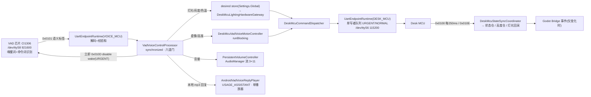

# 原厂 Launcher v12 语音控制设备链路反编译分析（音量 / 灯光 / 亮度 / 色温 / 虚像距离）

> 目的：回答「原厂 Launcher 是怎样保证语音控制设备的稳定性与可靠性的」。
> 证据等级：除特别标注外，全部为 **已验证**（直接读 Studio 上的 jadx 反编译 Java 与 apktool smali）。带「推断」标签的句子是我的判断，不是源码事实。
> 设备与凭据：本文不含 SN、不含凭据、不含 ASR 文本。

## 0. 结论先行

原厂 v12 的可靠性不是靠某一个重试机制，而是把整条链压缩成**五层本地闭环**，云端在设备控制路径里**零参与**：

| 层 | 原厂做法 | 效果 |
|---|---|---|
| 识别 | 命令词识别全部在 CI1306 VAD 语音芯片内完成，Android 只收到 2 字节语义标签（`0x0101` 帧） | 无 ASR、无 LLM、无网络，识别到执行 < 1 帧 UART 往返 |
| 门控 | 六道门：帧校验 → 标签已知 → 已唤醒会话 → 日常聊天开启 → MCU `workState==4` → `synchronized` 单线程 | 未唤醒、休眠、OTA 中一律静默忽略，不会误动设备 |
| 决策 | 边界与幂等判断只看**本机缓存真值**（灯光 desired store、MCU 250 ms 状态快照的 `ipdDeciUnits`） | 到顶/到底/同值直接回话，不发 UART，不等设备 |
| 执行 | 所有 MCU 帧走同一个单写者队列（URGENT/NORMAL 两级），灯光「全量 3 字节 ×3 连发不等 ACK」，电机「单帧 + 0 重试 + 10 s 等 `0x010E`」 | 对不回 ACK 的 MCU 也稳；电机绝不二次驱动 |
| 回采 | MCU 每 250 ms 被轮询 `0x0100`，状态变化才推 Godot；灯光有 2.5 s 抑制窗防止在途状态覆盖意图 | UI 与设备最终以 MCU 为准，不伪造 |

云端 MyJavis 在线 runtime（`AiVoiceRuntime.java`，27 万字符）里 `lighting`/`motor`/`volume`/`DeskMcu` 关键词命中数全部为 **0**；它对命令词唯一的反应是 `onCommandWordRecognized → sendInterruptIfAwake`，即打断当前云端轮次，避免云端再答一遍。

关键数字（全部来自源码常量）：

| 项 | 值 | 位置 |
|---|---|---|
| MCU 状态轮询 `0x0000` | 250 ms | `McuUartService.MCU_POLL_INTERVAL_MILLIS` |
| RK 心跳 `0x0002` | 1000 ms；MCU 心跳超时 5000 ms | `McuUartService` |
| 灯光 `0x010A` 重复次数 | 3 帧，各自新序号，不等 ACK | `DeskMcuCommandDispatcher.LIGHTING_COMMAND_REPEAT_COUNT` |
| 灯光在途抑制窗 | 2500 ms | `LightingPendingCommandTracker.DEFAULT_PENDING_WINDOW_MILLIS` |
| 电机结果窗 / 重试 | 10000 ms / 0 次 | `DeskMcuCommandDispatcher.MOTOR_RESULT_TIMEOUT_MILLIS`，`sendMotorControlCommand` |
| 电机步长 / 软范围 | 5 dm / 30..120 dm | `VadVoiceControlProcessor` 常量 |
| 通用 NEED_ACK 超时 / 重试 | 1000 ms / 2 次 | `DeskMcuCommandDispatcher.sendNeedAck` |
| 半帧清理 | 200 ms | `DeskMcuFrameDecoder.PARTIAL_FRAME_TIMEOUT_MILLIS` |
| 串口重连退避 | 1/2/5/10/20/30 s，封顶 30 s | `UartReconnectPolicy.defaultPolicy` |
| 音量步长 / 下限 / 唤醒恢复 | 5% / 5% / 60% | `VadVoiceControlProcessor` 常量 |
| 语音播报时媒体压低 | 3% | `VoiceMediaDuckController.DUCK_FACTOR` |
| VAD 静音超时 | 50 帧（1 s） | `McuUartService.VAD_SILENCE_TIMEOUT_ONE_SECOND_FRAMES` |

## 1. 证据来源

- 反编译树（原厂量产 v12，`com.futurus.p003.launcher 1.2.2 (12)`）：
  `studio:/Users/fu-121/mycc/2-Projects/kidshub-ai---godot/artifacts/reverse/original-v12-android122-20260824-r2/sources/`
- smali 对照（金样审计）：
  `studio:.../artifacts/second-device/<golden>/20260822-production-golden-audit/decompiled/apktool/FuturusLauncher-v12/smali/`
- 本机工作副本（本次分析实际读取）：scratchpad `launcher-v12/src/`，811 个 Java 文件。
- codex 既有报告作为交叉参照：`reports/P003_PRODUCTION_GOLDEN_FULL_REVERSE_AUDIT_20260822.md`、`reports/P003_MAX_ULTRA_COMPAT_HEIGHT_REVERSE_20260821.md`、`reports/MCU_FULL_DEVICE_CONTROL_VALIDATION_20260818.md`、`docs/MCU_PROTOCOL.md`。
- jadx 未能还原的三个方法（`repeatLightingCommand`、`UartEndpointRuntime.writeLoop`、`runSupervisorLoop`）用 smali 补读，结论以 smali 为准。

## 2. 总体链路

## 3. 入口：VAD 芯片命令词

### 3.1 协议（`domain/voice/vad/VadVoiceProtocol.java`、`VadVoiceFrameCodec.java`）

- 帧头 `A5 A5 5A 5A`，16 字节固定头：校验和(sum16, LE) @4、命令 @6(LE)、长度 @8(LE)、版本 @10(BE)、填充 @12(LE)、数据。
- 芯片 → 主机：`0x0101` 识别到命令词（data[0..1] LE = 语义标签）、`0x0102` 唤醒词、`0x0108` VAD START、`0x0106` VAD END、`0x0109` 退出唤醒、`0x0801` 配置回执。
- 主机 → 芯片：`0x010D` 关闭唤醒、`0x0114` 串口唤醒、`0x0110` 静音超时帧数、`0x0A01` 查版本。全部以 **URGENT** 优先级发送（`UartVadVoiceChipCommandSender`），插队在所有 MCU 普通帧前。
- 解码器校验和不对的帧直接丢弃；帧头前的垃圾字节按滑窗丢弃并保留可能的帧头前缀。

### 3.2 标签表（`VadVoiceCommandCatalog.java`）

| 标签 | 命令词 | 类别 |
|---|---|---|
| 1 | 小可小可 | 唤醒 |
| 2 / 3 | 打开灯光 / 关闭灯光 | 灯光开关 |
| 4 / 6 | 调亮一级 / 调暗一级 | 亮度 |
| 5,10 / 7,8 / 9 | 最亮·三档 / 最暗·一档 / 二档 | 亮度 |
| 11 | 调整灯光色温（向下循环一档） | 色温 |
| 12,14 / 13,15 | 调暖一级 / 调冷一级 | 色温 |
| 16,19,23 / 17,21,22 / 18,20,24 | 最冷·绘画·冷光 / 最暖·夜读·暖光 / 常规·中性 | 色温 |
| 25,27,33 / 26,28,34 | 设备/读写台/虚像 高·远一点 / 低·近一点 | 电机步进 0.5 m |
| 29,31,35 / 30,32,36 | 调到最高·最远 / 最低·最近 | 电机目标 120 / 30 dm |
| 37 / 38 | 大声点 / 小声点 | 音量 ±5% |
| 42 / 43 / 44 / 45 | 最大 / 最低 / 静音 / 打开音量 | 音量 |
| 60..79 | 音量百分之五…百 | 音量绝对值 = (label−60)×5+5 |
| 46 | 关闭语音 | 关闭 VAD 唤醒 |

「虚像远一点/近一点/最远/最近」(33–36) 与「设备调高/调低」(25–32) 在代码里是**同一个电机**，只是回复话术不同（`VIRTUAL_IMAGE_MOTOR_LABELS`）。

### 3.3 六道门（`VadVoiceControlProcessor.process(VadVoiceFrame)`，`service/voice/VadVoiceControlProcessor.java:302-503`）

1. 帧类型分流：版本回执 / 配置回执 / `0x0109` 退出唤醒 / `0x0108` `0x0106` 状态帧各自处理，不进控制分支。
2. 标签必须在目录里，否则 `Ignored` + 告警日志。
3. 唤醒词必须有前置 VAD START 或已在唤醒会话中，否则忽略（防芯片误报）。
4. 日常聊天未开启（含 OTA 进行中，`AiVoiceRuntimeRegistry.isDailyChatWakeEnabled`）→ 忽略，并向芯片发关闭唤醒。
5. 非唤醒标签必须在「日常对话唤醒会话」内（`isDailyWakeSessionActive`），即**必须先说唤醒词**。
6. `workState` 门（`shouldIgnoreVoiceControlForWorkState`）：标签 2–38、42–45、60–79 仅在 MCU `workState==4`（工作态）响应；休眠态 1/2/3 一律忽略并关闭唤醒。
7. 整个 `process` 是 `synchronized`，且电机分支内部 `runBlocking`，因此**同一时刻只有一条命令在执行**，后一条自然排队。
8. 任一 `0x0101` 语义被接受后**立即**向芯片发 `0x010D` 关闭唤醒（`sendDisableWakeAfterRecognizedSemantic`），并置 `suppressNextExitWakeReply`：一次唤醒只执行一条命令，且不会再播「已退出语音唤醒」音效。
9. 同时通知在线 runtime `onCommandWordRecognized → sendInterruptIfAwake`，云端本轮被打断，**不会出现本地执行 + 云端再答一遍**。

## 4. 三类执行器

### 4.1 灯光 / 亮度 / 色温

代码：`VadVoiceControlProcessor.applyLed/applyBrightness/applyColorTemperature`（:576-629）→ `DeskMcuLightingHardwareGateway.sendLightingState`（`domain/mcu/desk/DeskMcuLightingHardwareGateway.java:84-100`）→ `DeskMcuCommandDispatcher.applyLightingStateWithoutWaitingForAck`（:211）→ `repeatLightingCommand`（smali）。

流程：

1. **先写意图，再发硬件**：`LightingSettingsStore`（`Settings.Global` 四个键 `p003_lighting_led_enabled / brightness_level / color_temperature_level / color_temperature_profile`）写入失败直接返回 `Failed`，不发 UART。
2. **永远发全量状态**：网关读 desired store 补齐另外两个字段，钳到合法范围（led 0..1，亮度 0..2→MCU 1..3，色温 0..2→MCU 模式），组成 3 字节 `0x010A`。任何一次只改一个维度的语音命令，MCU 收到的都是完整三元组，不存在「MCU 里另两个字段是什么」的不确定。
3. **3 连发、NEED_ACK 帧型、但不登记 ACK 等待**：smali 证实 `repeatLightingCommand` 循环 3 次，每次 `nextSerial()` 取新序号，`expectsResponse=false`，写串口成功即 `Success`。这是对「MCU App 3.0.15 对 `0x010A` 不回 ACK」的适配（codex `MCU_PROTOCOL.md` 已实测）。
4. **异步 + 专用单线程**：网关 `launch` 到 `desk-mcu-lighting-command` 单线程 scope，处理器拿到的 `Success` 只代表「已入队」，不阻塞语音线程。
5. **2.5 s 在途抑制窗**：`LightingPendingCommandTracker.recordDesired(now)`；`LightingStateSyncManager.onMcuStateUpdated` 在窗内收到与意图不一致的 `0x0100` 时不回采、不推事件；一致则立即清窗；超时则回采 MCU 真值到 desired store 并向 Godot 推 `led/brightness/color_temperature changed`。
6. **启动即以 MCU 为准**：`restoreCompleted=false` 时第一帧 `0x0100` 直接 `adoptFromMcuState`，Android 不会用旧的 Settings 值去覆盖 MCU 开机状态。
7. **边界与幂等在本地判**：`applyBrightnessUp` 在已是 2 档时不发 UART，直接回「灯光已为最高亮度」；目标值等于当前值同理；色温三档循环。
8. **调节即开灯**：亮度/色温调节时若 `led==0`，`turnOnLightAfterAdjustmentIfOff` 自动补一条 `led=1`（会再发一组 `0x010A`）。

### 4.2 虚像距离 / 设备高度（电机）

代码：`applyMotorStep`（:699-722）、`applyMotorTarget`（:724-741）、`handleMotorPrecondition`（:761-776）→ `DeskMcuVadVoiceMotorController`（`runBlocking`）→ `DeskMcuCommandDispatcher.stepMotor/setTargetIpd → sendMotorControlCommand`（:434-482）。

1. **型号门**：`deviceType==2`（Max）→ 不动电机、不播回复、只关唤醒；`==3`（Ultra）→ 走边界判断；其他型号（含 255 未知）→ 不做边界判断直接下发（原厂的一个边缘，见 §7）。
2. **边界预判用缓存真值**：`isAtMotorMaximum = cached ipdDeciUnits >= 120`，`isAtMotorMinimum = <= 30`。到边界直接回「当前虚像距离已最远/最近」或「设备已在最高/最低位置」，**不发 UART**。
3. **步长钳制**：`motorStepDistanceRaw = min(5, 剩余量)` 且 ≥0；钳成 0 也当边界处理。目标命令固定 120 或 30。
4. **单帧、期待 `0x010E`、10 s、0 重试**：`sendNeedAckExpectingCommand(cmd, payload, MOTOR_RESULT, 10000, 0)`，匹配规则是「命令号 = 0x010E」而非序号；结果解析 `status/current`，`status` 非成功 → `Failure`。**maxRetries=0 是刻意的：超时也不重发，宁可失败也不二次驱动电机**。
5. **同步阻塞**：`runBlocking` 让 `process` 在电机结果或超时前不返回，下一条语音命令自然串行。
6. **回复时机**：下发成功（拿到 `0x010E` 成功）后播放「已为您调远虚像距离」；失败只记日志、`Failed`，**没有失败话术**。
7. **回采**：`DeskMcuStateSyncCoordinator` 收到 `0x010E` 立即更新缓存 ipd（:66-72），不必等下一帧 `0x0100`。
8. v12 的高度仓只记「最低点状态」三态（`0x00/0xFF/0xEE`），**边界判断不看最低点传感器**，只看 raw；设置页显示 `raw/10`（无 2.5 m 标定显示，该逻辑是后来 v58 加的）。

### 4.3 音量

代码：`applyVolume`（:671）、`applyAudioMute`（:677）、`restoreAudioOnWakeIfNeeded`（:660）→ `PersistentVolumeController` → `AndroidVolumeController`（`godot/audio/AndroidVolumeController.java`）。

1. **纯 Android 本地闭环**：`AudioManager` 的 `STREAM_MUSIC(3)` 与隐藏的 `STREAM_ASSISTANT(11)` 两条流同步设置，百分比 ↔ 索引按各流最大值换算，MCU 与云端都不参与。
2. 标签 37/38 = 当前 ±5%，上限 100、下限 5%；42→100%，43→5%；60–79 绝对百分比；44/45 用 `adjustStreamVolume(−100/+100)` 静音/解静音。
3. **持久化与恢复**：`PersistentVolumeController` 每次写入 SharedPreferences，`PersistedVolumeRestorer` 开机恢复。
4. **唤醒兜底**：唤醒时若音量为 0 或任一流静音，先恢复到 60% 再播「我在呢」，避免用户听不到回复。
5. **压低而非抢占**：语音播报期间 `VoiceMediaDuckController` 把媒体流压到目标值的 3%，助手流保持目标值，播完恢复。

## 5. 传输层可靠性（UART runtime，两条串口共用一套实现）

代码：`domain/mcu/UartEndpointRuntime.java`（smali 补读）、`UartRequestTracker.java`、`UartCommandScheduler.java`、`UartReconnectPolicy.java`、`protocol/desk/DeskMcuFrameDecoder.java`。

- **单写者**：每个端点一个写协程，从 `UartCommandScheduler` 取请求（URGENT 队列优先于 NORMAL），逐帧 `port.write`。VAD 芯片命令全部 URGENT，所以「关闭唤醒」永远排在灯光/心跳/轮询帧前面。
- **响应跟踪不阻塞写者**：`expectsResponse=true` 的请求先 `register` 到 tracker，写完后 `launch awaitTrackedResponse`，写者立刻取下一帧。因此 MCU 通道是**流水线**而非严格一问一答；串行性由上层（`synchronized process` + `runBlocking`）保证。
- **匹配规则**：`ack:<serial>:<cmd>`（ACK 帧按序号+命令号）或 `cmd:<id>`（按命令号）。
- **超时与重试**：每请求独立超时任务；超时后 `attempt < maxRetries` 才重新入队，否则 `Failure("Timed out", retryExhausted=true)` 并记健康错误。通用 NEED_ACK（如 `0x0108` 版本上报）1 s × 2 次重试；电机 0 次；OTA 请求 2 次、OTA 数据块 0 次。
- **解码器**：以 `0x5A` 重同步，帧类型非法丢 1 字节继续，CRC-8/J1850 不过丢 1 字节继续，半帧超过 200 ms 整个缓冲清空。
- **断线处理**：读或写抛异常 → `failAll`（有剩余重试次数的请求带 attempt+1 重新入队，其余以 `Failure` 完成）→ 取消读写协程 → 关端口 → 按 1/2/5/10/20/30 s 退避重开，成功后退避归零。`isRunning` 为真时永不放弃。
- **健康度**：队列深度、待响应数、错误事件、连接状态都进 `UartHealthRepository`（仅供观测，不参与控制决策）。
- **保活与轮询**：RK→MCU 心跳 `0x0002` 每 1 s；`0x0000` 状态查询每 250 ms；`0x0001` 配置查询每 30 s 直到设备类型/磁栅/人感/两路霍尔/SN 六项全部收齐；MCU 心跳 5 s 未到只记日志，不主动重连。

## 6. 反馈与状态一致性

- **本地音频**：回复全是 APK 内置 mp3（`VadVoiceReplyCatalog`），`USAGE_ASSISTANT` 属性，`MediaPlayer` 单实例，新回复先停旧回复；唤醒回复从 5 条里随机。
- **边界话术**与执行话术分开：`BRIGHTNESS_AT_MAX/MIN`、`COLOR_TEMPERATURE_AT_*`、`DEVICE_AT_HIGHEST/LOWEST`、`VIRTUAL_IMAGE_AT_FARTHEST/NEAREST`。
- **一次唤醒一句话**：语义执行后已经播了回复，退出唤醒音效被抑制；离线唤醒超时才播「网络异常，请检查网络」。
- **Godot 只在变化时收事件**：`McuUartService` 每收一帧都对比前后快照（灯光、传感、眼屏、型号、高度、配置、`workState`），相同不推。
- **休眠联动**：`workState` 从 4 变到 1/2/3 时 `endWakeSessionForSleep`：结束本地唤醒会话、停回复播放、向芯片发关闭唤醒、关闭云端唤醒窗、清媒体压低源，并让 `PowerControlService` 关背光。

## 7. 原厂链路的弱点（同样是源码事实）

1. 灯光是「发了就算成功」：3 连发后不校验 MCU 是否执行，只靠 2.5 s 后回采纠正 UI；实体灯板不动（codex 2026-08-22 已实证的 LED 物理问题）在这条链上完全不可见。
2. 电机回复播放在拿到 `0x010E` 之后，但 `0x010E` 只代表 MCU 受理/到位报告，与最低点传感器无关；`maxRetries=0` 意味着单帧丢失 = 10 s 静默等待 + 无任何语音兜底。
3. 边界只看缓存 raw：raw 陈旧（例如刚上电、串口刚重连）时可能误判「已最远」或多发一帧。
4. 未知型号（255）不做边界判断直接发电机命令。
5. 每次唤醒只能执行一条命令，且只支持固定命令词，没有自然语言。
6. Max 型号收到电机命令只静默关唤醒，不解释。

## 8. 对当前 worker → Android → MCU 链路的启示

以下为**推断**，用于对照当前设计，不是源码事实：

1. 原厂把「到顶/到底/同值」判断放在设备侧缓存真值上并即时回话，云端根本不知道边界的存在。当前链路让 Android 回 `rejected + boundary_reached`、worker 再选话术，语义等价，但多了一跳与一次 LLM/快路往返；边界判断的**真值来源**必须仍是 Android 缓存的 MCU 状态，worker 不该自己维护高度。
2. 电机「单帧 + 0 重试 + 结果窗」是防二次驱动的根，当前 20 s 窗保持 0 重试是对的；任何在 worker 侧加的重发都会破坏这条底线。
3. 灯光「全量三元组 ×3 + 不等 ACK + 抑制窗 + 回采」是对不回 ACK 的 MCU 的正确姿势；worker 侧不应再叠加重试或「没回执就当失败」的判定。
4. 原厂靠「一唤醒一命令 + 立即关唤醒 + 打断云端轮次」保证同一句话只执行一次；当前 L1 快路与 L2 LLM 慢路并存，同一 utterance 的去重（`vad_candidate_id` 合同）就是在补这条。
5. 音量在原厂是纯 Android 本地闭环。当前把 37/38 放进 L2 批次是否必要值得再看：这类命令没有歧义，走快路即可。（需核对当前 `L2_FIRST_BATCH` 真值，我未在本轮验证。）

## 9. 关键文件索引（相对 `sources/com/futurus/p003/launcher/`）

| 文件 | 作用 |
|---|---|
| `domain/voice/vad/VadVoiceCommandCatalog.java` | 命令词标签表 |
| `domain/voice/vad/VadVoiceProtocol.java`、`VadVoiceFrameCodec.java`、`VadVoiceFrame.java` | VAD 芯片帧协议与解码 |
| `service/voice/VadVoiceControlProcessor.java` | 语义 → 动作 的全部门控与执行分派（966 行） |
| `service/voice/VadVoiceReplyCatalog.java`、`AndroidVadVoiceReplyPlayer.java` | 本地回复话术与播放 |
| `service/voice/UartVadVoiceChipCommandSender.java` | 向芯片发关闭唤醒/串口唤醒/配置（URGENT） |
| `service/voice/DeskMcuVadVoiceMotorController.java` | 电机命令桥（runBlocking） |
| `domain/mcu/desk/DeskMcuCommandDispatcher.java` | 所有 MCU 帧的构造、超时、重试参数 |
| `domain/mcu/desk/DeskMcuLightingHardwareGateway.java` | 灯光全量状态下发与抑制窗登记 |
| `godot/lighting/LightingPendingCommandTracker.java`、`service/mcu/LightingStateSyncManager.java` | 2.5 s 抑制窗与 MCU 回采 |
| `domain/mcu/desk/DeskMcuStateSyncCoordinator.java`、`DeskMcuStateSnapshot.java` | `0x0100` 解析与各仓更新 |
| `domain/mcu/UartEndpointRuntime.java`、`UartRequestTracker.java`、`UartCommandScheduler.java`、`UartReconnectPolicy.java` | 串口运行时：队列、匹配、超时、重连 |
| `domain/mcu/protocol/desk/DeskMcuFrameDecoder.java`、`DeskMcuResponseMatcher.java` | 帧解码与响应匹配 |
| `service/mcu/McuUartService.java`（:998-1030 接线，:1605-1660 状态对比与休眠联动） | 双串口服务与全部依赖装配 |
| `service/mcu/McuQueryPollingController.java`、`McuWorkStatePowerPolicy.java` | 轮询节拍与工作态策略 |
| `godot/audio/AndroidVolumeController.java`、`VoiceMediaDuckController.java`、`PersistentVolumeController.java` | 音量本地闭环 |
| `godot/height/HeightStateRepository.java`、`HeightStateSnapshot.java` | 最低点三态 |

署名：cc（Claude）| 2026-09-04
