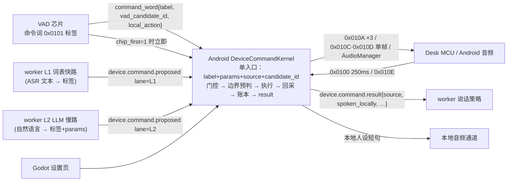

# CC → codex：语音设备控制「双源单核」联调合同 v3（音量 / 灯光 / 亮度 / 色温 / 虚像距离）

> ⚠️ 2026-09-05 增量：本 v3 已被 codex 评审修正，冲突处以 [`2026-09-05-语音设备控制合同v3.1增量-答复codex评审(给codex).md`](./2026-09-05-语音设备控制合同v3.1增量-答复codex评审(给codex).md) 为准（去重改按轮次、白名单外电机不启 fallback、`local_action=claimed`、每步 ≤1 帧、label4/6 更正、18 槽各 1 条）。


> 日期：2026-09-04（13:49 初稿，13:55 按 P0 实测更新 §0/§1/§3/§7/§8/§9/§11）　球权：cc 起草，等 codex 逐条回执
> 设备只写 003 / 0010 / 0002，不含 SN 全文、不含凭据、不含 ASR 原文。
> 证据等级：标「已验证」的来自原厂 v12 反编译、codex 2b 回执（2026-09-02）、worker `feat/rust-worker@ce06e87e4` 源码与 `hardware-protocol/RK3562-MCU-通讯协议.md`（V2.1 转写）；标「建议」的是本合同新提；标「待 codex 确认」的是我没有 Android 源码依据的地方。

## 0. 结论与范围

**目标一句话**：芯片精确命令词回到原厂那样「命中即本地执行」，worker 的语义理解只在芯片没有候选时补位，两条来源汇入 Android 同一个执行内核；双端合同升到 v3，向后兼容 v2。

**三个目标**

| 目标 | 定义 | 验收判据（建议阈值，003 一周窗，三证一致） |
|---|---|---|
| 有效性 | 真人说出目录内命令词 → 设备发生物理动作或正确的边界回话 | 成功率 ≥ 95%；边界回话零误报 |
| 稳定性 | 同一句话只触发一次 MCU 动作；电机每意图 ≤ 1 帧；无幻影动作 | 双执行 = 0；`mcu_tx_count` 与意图数一致；电机超时不重发 |
| 智能化 | 非目录短语（「画面拉远一点」「太亮了」）由 worker 语义映射到同一标签空间 | LLM 标记误触发率 ≤ 5%（观察期 7/11 不可执行是基线，必须显著下降）；suppress 比例可解释 |

**本合同不改的东西**：MCU 帧协议与帧型、电机 0 重试、灯光三连发、LiveKit 会话与 trace 模型、APK/PCK OTA、Godot 界面控制路径。

## 1. 架构：双源单核



规则只有三条：

1. **一个内核**：所有来源（芯片、worker L1、worker L2、Godot、1000 ms 兜底、Ready 前旧链）都走同一个 `DeviceCommandKernel`，同一套门控、边界、执行、回采、账本、result 编码。Ready 前旧链「不纳入候选 ID 协议」的例外（2b 回执 §3.2）在 v3 取消。
2. **芯片先执行**：`chip_first=1` 时芯片精确标签立即执行，不再等 worker；执行结果带 `source=vad_chip` 发给 worker，worker 压掉同候选或同标签族 3 s 窗内的自家提案，只负责说话。P0 实测（§8.0）表明在线且 worker 健康时现行「等 worker」只多 ~75 ms，所以芯片先执行的收益是**省掉 ASR 尾窗（实测芯片比 ASR final 早 0.3–1.0 s）与断网可用**，不是省 1 s；同时芯片有误触发（5 例中 1 例），因此首轮只对可逆的灯光/音量标签开启，电机标签见 §7。
3. **语义只补位**：芯片无候选时 worker 才提案；L2 允许带 `params.count`（1–3 步）与 `params.value`（音量绝对值）；多步在内核内逐步执行，每步等 `0x010E`，任一步非成功即停。

## 2. 协议基线：内核对 MCU 必须遵守的执行规则（已验证）

帧格式：`5A | FrameType | Serial(2B BE) | Cmd(2B BE) | Len(2B BE) | Payload | CRC-8/J1850 | A5`；`0x01` No ACK、`0x02` Need ACK、`0x03` ACK OK、`0x04` ACK Error；每帧新序号；ACK 按「序号+命令号」匹配，命令回执按命令号匹配；半帧 200 ms 清空。

| 命令 | 载荷（协议 V2.1） | 内核执行规则 | 成功 / 失败判据 |
|---|---|---|---|
| `0x010A` 灯光 | Byte0 开关 0/1；Byte1 亮度 1/2/3；Byte2 色温 1 冷/2 常规/3 暖 | **永远发全量三元组**（另两个维度取 desired store）；Need ACK 帧型、**连发 3 帧不登记 ACK 等待**（固件 3.0.15 不回 ACK，实测）；每次下发登记 2.5 s 抑制窗 | 窗内 `0x0100` Byte1–3 与意图一致 → `succeeded/state_confirmed`；窗后仍不一致 → `succeeded/executed_unconfirmed`（不重发、不冒充精确档位） |
| `0x010C` 步进 | Byte0 `0x01` 上 / `0x02` 下；Byte1 距离 dm | 仅 Ultra（`0x0101` 型号 = 3）；步长 5 dm，钳到软范围 30..120；**单帧、期待 `0x010E`、20 s 窗、0 重试** | `0x010E` Byte0=`0x01` → `succeeded`，Byte1 更新缓存像距；Byte0=`0x00` → `failed/motor_rejected`；超时读实态：到位 → `succeeded/state_confirmed_after_result_timeout`，未到位 → `timeout/motor_result_timeout` |
| `0x010D` 目标值 | Byte0 目标像距 dm | 最远 = 120；最近 = 25（一次，机械最低点以 `0x0100` Byte13=`0xFF` 为权威）；同上单帧 0 重试 | 同上 |
| `0x0100` 状态 | Byte0 工作态 1/2/3 待机、4 工作；Byte5 像距 dm；Byte13 最低点 `0x00/0xFF/0xEE` | 250 ms 轮询；**边界预判唯一真值源**；`workState≠4` 时内核不执行 | — |
| `0x0120` MCU log | Byte0 级别；Byte1 模块；Byte2–4 data | `Error/APP` 且 data 为 `00 13 00` 或 `00 19 00`（已观察到的两种拒绝码）→ 本意图判 `rejected/mcu_error`，不重试 | — |
| 音量 | 不经 MCU | `AudioManager` `STREAM_MUSIC` + `STREAM_ASSISTANT` 同步；±5%，下限 5%，上限 100%；持久化并开机恢复 | 设置调用成功即 `succeeded` |

边界预判（发帧前，不发 UART 即回话）：

- 虚像/高度：缓存像距 ≥ 120 时「更远/最远」→ `rejected/boundary_reached`；≤ 30 且 Byte13=`0xFF` 时「更近/最近」→ `rejected/boundary_reached`；`raw≥120 ∧ Byte13=0xFF` 冲突态按 v217 口径 `image_distance_state=uncalibrated`、`image_distance_source=mcu_boundary_conflict`，允许一次显式远端移动清除冲突（待 codex 确认该口径未变）。
- 灯光：desired store 已等于目标 → `already_applied`；亮度/色温调节时 LED 关 → 补一组 `led=1` 三元组（原厂行为，保留）。
- Max（型号 2）：任何电机标签 → `rejected/unsupported_device_type`，不发 UART，但要出声解释（原厂静默，v3 不静默）。
- 型号未知（255，配置未收齐）：电机标签 → `rejected/device_type_unknown`，不发 UART（原厂在此直接发帧，v3 收紧）。

## 3. Android ↔ Worker 合同 v3（字段终值）

包封套沿用 v2：`version/type/trace_id/ts_ms/src/seq/lane/idempotency_key/payload`。

### 3.1 能力声明（Android → Worker，随 `wake`）

```json
{"type":"wake","payload":{"device_command_contract_version":3,"chip_first":true}}
```

- `=3`：支持本合同全部字段；`=2`：worker 按 2b 行为；缺失或 `<2`：observe-only。
- `chip_first` 布尔随能力声明一起发，worker 据此决定是否对芯片候选提案。

### 3.2 硬件候选（Android → Worker，`command_word`，v2 形态不变，新增一字段）

```json
{"type":"command_word","payload":{"label":33,"observed_before_input_ready":false,"vad_candidate_id":"vad:<trace_id>:1","local_action":"executed"}}
```

`local_action` ∈ `executed`（chip_first 已本地执行，worker 禁止对该候选提案）/ `deferred`（等 worker，1000 ms 兜底，即 v2 行为）/ `ignored`（Android 不执行也不希望 worker 提案）。`ignored` 时附 `ignore_reason` ∈ `work_state` / `not_ready` / `offline` / `device_type` / `duplicate` / `label_not_chip_first`。老 APK 无此字段 = `deferred`。

**新增硬性要求（P0 结论）**：只要 active trace 存在，芯片每一次 `0x0101` 识别都必须发一条 `command_word`，包括被门控忽略的；否则 worker 无法度量芯片召回率与误触发率，`chip_first` 永远没有翻默认值的依据。2b 时「不发空候选包」的约束只针对无真实识别的 turn，不与本条冲突。worker 侧对应记 `chip_asr_mismatch`（芯片标签与 3 s 内 ASR 词表命中标签不一致）。

### 3.3 提案（Worker → Android，`device.command.proposed`，新增 `params` 与 `source`）

```json
{"type":"device.command.proposed","lane":"L2","idempotency_key":"voice:<room>:<label>:<seq>",
 "payload":{"semantic_label":33,"action":"virtual_image_farther_step","canonical_phrase":"…","normalized_text":"…",
            "match_type":"llm","vad_candidate_id":null,"source":"worker_l2","params":{"count":2}}}
```

- `params.count`：1–3，仅步进类标签（4/6/12/13/25/26/27/28/33/34/37/38）；缺省 1；越界 → `rejected/params_invalid`。
- `params.value`：0–100，仅音量绝对值标签；其他标签忽略。
- `params.target_deci_units`（新，P0 结论）：25–120，虚像绝对目标，用于「画面调到 5 米」这类 LLM 才能理解的绝对值请求；Android 走 `0x010D` 单帧，规则同 §2；Max/未知型号拒绝；缺省不带。对应新增动作名 `virtual_image_target`，`semantic_label` 复用 35（最远）语义族，由 `params` 区分。
- `source` ∈ `worker_l1` / `worker_l2`；lane 语义不变。

### 3.4 结果（Android → Worker，`device.command.result`，新增字段全部可空以兼容）

```json
{"type":"device.command.result","lane":"L0","idempotency_key":"chip:<trace_id>:1",
 "payload":{"semantic_label":33,"action":"virtual_image_farther_step","status":"succeeded","reason":"state_confirmed",
            "source":"vad_chip","vad_candidate_id":"vad:<trace_id>:1",
            "spoken_locally":true,"spoken_clip_key":"device_reply.applied_relative",
            "execution_ms":1840,"mcu_tx_count":1,"steps_done":1,"boundary_basis":"raw",
            "observed_state":{"ipd_deci_units":75,"image_distance_deci_units":75,"image_distance_state":"valid","lowest_point_state":0}}}
```

- `lane`：`L0` = 芯片本地执行（新）；`L1`/`L2` 原样回写提案 lane。worker 现在把缺失 lane 当 `L1`，`L0` 由 cc 侧新增解析。
- `idempotency_key`：`L0` 用 `chip:<trace_id>:<candidate_seq>`；`L1`/`L2` 原样回写提案 key。
- `source` ∈ `vad_chip` / `worker_l1` / `worker_l2` / `fallback`（1000 ms 兜底）/ `ui`。
- `spoken_locally`：本地音频通道**已开始播放**才为 true；`spoken_clip_key` 给出播放的槽位。
- `execution_ms`：从内核收到意图到 result 发出；`mcu_tx_count`：本意图实际写出的 MCU 帧数（边界回话与音量为 0）；`steps_done`：多步完成数。
- `boundary_basis` ∈ `raw` / `lowest_point` / `conflict` / `none`。
- `status` 枚举不变：`accepted / succeeded / already_applied / rejected / failed / timeout`。

### 3.5 `reason` 枚举（现有保留，新增标「新」）

| status | reason | 含义 |
|---|---|---|
| succeeded | `state_confirmed` / `executed_unconfirmed` / `state_confirmed_after_result_timeout` | 回采一致 / 窗后未一致 / 电机超时后实态到位 |
| already_applied | `already_applied` / `vad_fallback_already_applied` / **`vad_chip_already_applied`（新）** / **`duplicate_candidate`（新）** | 目标已是当前态 / 兜底已做 / 芯片已做 / 同标签族 3 s 窗重复 |
| rejected | `boundary_reached` / `unsupported_device_type` / `candidate_conflict` / `processor_ignored`（现有，8-21 至 9-01 日志出现 4 次，请 codex 说明触发条件并映射到下列新 reason 之一） / **`device_type_unknown`（新）** / **`device_not_active`（新，workState≠4，仅对 worker 提案回）** / **`params_invalid`（新）** / **`mcu_error`（新）** | — |
| failed | `motor_rejected` / `uart_write_failed` | `0x010E` 失败 / 串口写异常 |
| timeout | `motor_result_timeout` | 20 s 无 `0x010E` 且实态未到位 |

### 3.6 说话策略（谁开口）

| 来源 | 结果 | Android 本地播 | worker |
|---|---|---|---|
| `vad_chip`（L0） | succeeded / already_applied / boundary | 播对应短句，`spoken_locally=true` | 静默；仅当 `spoken_locally=false` 才按 worker 话术表补说 |
| `vad_chip`（L0） | failed / timeout / unsupported / device_type_unknown | 播失败或不支持短句 | 静默；同上兜底 |
| `worker_l1`（L1） | 任意 | 不播 | 按现行 `device_reply` 表说 |
| `worker_l2`（L2） | succeeded 且回复仍在播 | 不播 | 静默（现行 `success_reply_silent`）；其余状态追加纠正句 |
| `fallback` | 任意 | 同 L0 规则 | 同 L0 规则 |

话术表两端共用一份（见 §5），Android 本地音频的文本必须与 worker 表逐字一致，否则人设漂移。

### 3.7 去重账本（Android，所有来源）

- 主键 `(trace_id, vad_candidate_id)`；候选由 VAD START/END 段落产生，`candidate_seq` 每 trace 单调递增（v2 终值不变）。
- 同候选第二次到达（任何来源）→ `already_applied` + 对应 `*_already_applied` reason，附原 result 的 `observed_state`。
- 无候选 ID 的提案：同 trace 内同标签族 3000 ms 窗 → `already_applied/duplicate_candidate`；窗外照常。标签族 = 灯光开关 / 亮度 / 色温 / 电机 / 音量。
- 账本内存、按 trace 隔离、上限 64、trace 切换与 runtime stop 全清（v2 终值不变）。
- **L1 提案不再豁免账本**（v2 说「L1 不进入 L2 候选 ledger」）；worker 侧 first-wins 3 s 窗保留作为第二道。

## 4. 内核门序与执行（Android）

1. 合同门：无 active trace 且在线 → 芯片来源照常本地执行（离线闭环）；worker 提案必须有 active trace。
2. 工作态门：`0x0100` Byte0 ≠ 4 → 芯片来源静默忽略并记日志（`local_action=ignored`）；worker 提案回 `rejected/device_not_active`。
3. 型号门：Max / 未知型号见 §2。
4. 参数校验：`count`、`value` 范围。
5. 账本查重（§3.7）。
6. 边界预判（§2），命中即回 result，`mcu_tx_count=0`。
7. 执行（§2 各命令规则）；多步：逐步、每步等 `0x010E`、下一步前重新做边界预判、任一步非成功即停并回 `steps_done`。
8. 回采与终态；写 result；写遥测（§6）；本地播报（§5）。

超时数字：电机 20 s 结果窗、灯光 2.5 s 抑制窗、账本窗 3 s、多步总窗 = 20 s × count。

## 5. 本地人设短句（本地音频清单增补）

新增 `device_reply.*` 槽位，文本与 worker `device_reply/boundary_reply` 表逐字一致，音色用 小可 当前 TTS 音色（与本地音频 D1 线一致），随本地音频修订下发，SHA 校验、原子切换、回滚沿用现有合同：

| 槽位 | 文本 | 触发 |
|---|---|---|
| `device_reply.applied_relative` | 好，调了一点 | 步进类 succeeded |
| `device_reply.applied_absolute` | 好的，已经调好了 | 目标类 succeeded |
| `device_reply.applied_unconfirmed` | 好的，已为你调整 | `executed_unconfirmed` |
| `device_reply.already` | 现在已经是这个状态了 | already_applied 全部 reason |
| `device_reply.boundary.virtual_image_far` / `_near` | 已经到最远了 / 已经到最近了 | 虚像边界 |
| `device_reply.boundary.brightness_max` / `_min` | 已经是最亮了 / 已经是最暗了 | 亮度边界 |
| `device_reply.boundary.color_temperature_warm` / `_cold` | 已经是最暖了 / 已经是最冷了 | 色温边界 |
| `device_reply.boundary.volume_max` / `_min` | 已经是最大声了 / 已经是最小声了 | 音量边界 |
| `device_reply.boundary.height_max` / `_min` | 已经到最高了 / 已经到最低了 | 高度边界 |
| `device_reply.boundary.generic` | 已经调到头了 | 方向未知 |
| `device_reply.not_now` | 现在暂时不能这样调 | 非边界 rejected |
| `device_reply.failed` | 刚刚没有调成功，再试一次吧 | failed / timeout |
| `device_reply.unsupported_motor` | 这台设备不能调画面距离 | Max 电机（**新句，待川哥定稿**） |

播放走现有本地音频通道，播报期间媒体流压低；槽位缺失或播放未开始 → `spoken_locally=false`，由 worker 补说。原厂「指挥官」mp3 目录不复用。

## 6. 遥测事件 `device_command`（建议，沿用设备遥测 schema 1 封套）

字段：`source / label / action / lane / status / reason / execution_ms / mcu_tx_count / steps_done / boundary_basis / spoken_locally / candidate_seq / trace_id`。不含任何文本。每次内核执行一条，含边界回话与 already_applied。用途：三证对撞（worker 日志 ↔ Android result ↔ 遥测）与一周窗统计。

## 7. 开关与灰度

| 键 | 位置 | 缺省 | 说明 |
|---|---|---|---|
| `p003_device_command_chip_first` | Android `Settings.Global` | 0 | 1 = 芯片命中即执行；0 = v2 行为（1000 ms 兜底） |
| `p003_device_command_chip_first_labels` | Android `Settings.Global` | `light_volume` | 芯片先执行的标签集：`light_volume` = 2–24、37–38、42–45、60–79（误触发可逆）；`all` = 再含 25–36 电机。电机标签进入 `all` 的前提：芯片样本 ≥ 50 条且芯片误触发 ≤ 2%（建议阈值，按 §8.0 口径统计） |
| `P003_DEVICE_INTENT_EXECUTE` + canary SN hashes | worker env | 现值 | 不变；L2 真实执行仍只在 003 |
| `P003_DEVICE_INTENT_L2_BATCH`（新，建议） | worker env | 第一批 9 标签 | 第二批（33/34、2/3、最值、44/45、25/26）只在 chip_first 与内核合并验收后加入 |

灰度：003 唯一首轮机；0010 observe-only 对照；0002 是 Hall1 问题机不作对照。

## 8. 阶段与分工

### 8.0 P0 实测基线（已完成，2026-09-04；64.90 worker journal 2026-08-21 14:11 ～ 09-04 13:25，脚本 `apps/server/scripts/device-cmd-journal-stats.py`）

样本：设备命令提案 48（003 33 / 0010 14 / 0002 1），结果 52，芯片候选 `command_word` 5，ASR 与芯片撞窗 3，LLM 标记 24。

| 指标 | 实测 | 含义 |
|---|---|---|
| 芯片候选转发量 | v187 之前（≤ 9-01）**0 条**，`control 旁路事件` 只有 `kind=vad`；v187 起（9-02 至 9-04）**5 条**，同期 ASR/LLM 起源的设备命令轮 16 条 | 芯片路径在生产里几乎没被走过，v2 的「等 worker 1000 ms」实际只覆盖 5/21 轮 |
| 芯片 ↔ ASR 一致 | 5 例：一致 3、芯片独有 1（ASR 词表未命中「把灯调到最亮」，芯片补上了）、**不一致 1**（芯片报 5「调到最亮」，ASR 为 35「画面调到最远」，音近误触发，恰好 already_applied 无害） | 芯片有误触发；n=5 不能估率，这是 §3.2 要求「每次识别都发包」的原因 |
| 芯片比 ASR final 早多少 | 4 例可比：985 / 527 / 320 / 420 ms | 芯片先执行能省的就是这段 ASR 尾窗 |
| worker 发布 → Android 首个 result | 芯片起源 p50 76 ms（n=5）；词表起源 p50 202 ms（n=36）；音量 p50 115 ms（n=5）；LLM p50 822 ms（n=2） | 在线时「等 worker」的代价只有几十毫秒，1000 ms 是兜底上限不是常态 |
| worker 发布 → 终态 | 词表起源 p50 689 ms、p90 9.6 s、max 20.1 s（电机等 `0x010E`） | 电机终态由 MCU 决定，与合同无关 |
| 终态分布（词表起源 36） | succeeded 22、boundary 5、**motor_result_timeout 5**、processor_ignored 3、already 1 | 电机超时 14%，全部落在 003 虚像标签（今天 v217 冲突态归一化针对的就是它） |
| 用户实际说法（提案标签 Top） | 3 关灯 14、35 虚像最远 10（含「画面调到最远/最高」）、2 开灯 3、22 暖光 2、42 最大音量 2、音量百分比 5 | 「画面…」是产品口径，**不在芯片词表里**（芯片只有「虚像调到最远」），芯片天然覆盖不到 |
| LLM 慢路 | 标记 13、执行 2（均 succeeded）、压制 1；一例「画面调到 5 米」被映射为 35「最远」 | 绝对值请求需要 `params.target_deci_units`，且 prompt 要禁止把具体数值映射成最值（cc 侧） |

P0 结论：① 现行链路的问题不是延迟而是**芯片路径覆盖率**与**误触发不可度量**；② `chip_first` 首轮只开可逆标签（§7）；③ 芯片词表与产品口径不一致是硬件/VAD 固件议题（§11 第 8 问）；④ 词表起源命令的 Android 执行本身很快，单内核合并不应让它变慢（N14 锚）。

**已落地（cc，2026-09-04 14:15 上产）**：server 设备感知协议规则 7/8 加固——具体数值/百分比/档位/距离（米/分米/厘米）一律不出标记、绝不当成"最"，并禁止空标记 `[[DEV:]]`；单测 `scripts/device-intent-protocol.test.ts` 5/5，真 LLM E2E `scripts/device-intent-prompt-e2e.ts` 8/8（含「画面调到5米」「画面调到十米」「亮度调到二档」不出标记，「画面调到最远」→35）。回滚锚 `_backup/20260904-141306-pre-intent-numeric/`。同时发现 worker 剥离器对空标记 `[[DEV:]]` 是放行的（会被 TTS 念出），已另开修复任务，不在本合同范围。

| 阶段 | cc（worker / server） | codex（Android） | 出口判据 |
|---|---|---|---|
| P0 测量（已完成） | 见 §8.0；脚本入仓可按窗口重跑 | — | 基线成文 ✅ |
| P1 合同 v3 与单内核（`chip_first=0`） | worker 解析 `L0`/`source`/`spoken_locally`/`local_action`，`params` 编码，L0 result 进 first-wins 去重 | 单内核合并三条执行路径；result 新字段；账本覆盖全部来源；`command_word.local_action` | M2 快路回归与 2b M0–M10 全部不变；三证对撞零差异 |
| P2 芯片先执行（003） | 观察日志、对撞脚本升级 | `chip_first=1` 仅 003 | 矩阵 N1–N14 通过；双执行 = 0；耗时较 P0 下降（数字以测量为准） |
| P3 本地短句 | 话术表冻结、提供文本清单 | 清单槽位、播放、`spoken_locally` | N15 通过；人设一致 |
| P4 语义扩面 | L2 第二批 + `params`；prompt 反例 | 多步执行、`params` 校验 | N6/N7 通过；误触发率达标 |

## 9. 验收矩阵（三证一致：worker 日志 + Android result + 真机物理/听感）

| # | 场景 | 期望 |
|---|---|---|
| N0 | 真人唤醒后 `wake` | `device_command_contract_version=3`，`chip_first` 与设置一致 |
| N1 | 说「打开灯光」（目录内） | `command_word.local_action=executed`；result `lane=L0 source=vad_chip mcu_tx_count=3`；本地短句；worker 零提案、零播报 |
| N2 | 远端时说「虚像远一点」 | `rejected/boundary_reached`，`mcu_tx_count=0`，`boundary_basis=raw`，本地播「已经到最远了」 |
| N3 | 同一句话芯片与 ASR 双捕获 | 只有一次 MCU 动作；worker 日志出现 `chip_owned` 类压制；Android 账本无第二次执行 |
| N4 | 同一句话芯片命中 + LLM 同标签标记 | L2 被 `fast_path_hit` 或 `vad_chip_already_applied` 压制，无第二次动作 |
| N5 | 说「把画面拉远一点」（非目录短语） | 芯片无候选；worker L1 或 L2 提案；`source=worker_*`；设备动作一次；worker 播报 |
| N6 | L2 `count=2` | 两次 `0x010E`，`steps_done=2`，`mcu_tx_count=2` |
| N7 | L2 `count=3` 但第二步到边界 | `steps_done=1`，`reason=boundary_reached`，不再发第三帧 |
| N8 | 0010（Max）说「虚像远一点」 | `rejected/unsupported_device_type`，UART TX=0，出声解释 |
| N9 | 合盖（workState≠4）说「打开灯光」 | 芯片来源 `local_action=ignored`，无动作；worker 提案回 `device_not_active` |
| N10 | 电机结果超时注入 | 20 s 后 `timeout/motor_result_timeout`，UART TX 仍为 1 帧，播失败短句 |
| N11 | 灯光回采不一致注入 | `succeeded/executed_unconfirmed`，无重发 |
| N12 | trace 切换后重放旧候选 ID | `rejected/candidate_conflict`，不影响新会话 |
| N13 | 断网无 room 说「关闭灯光」 | 芯片走同一内核执行；遥测事件离线排队后上报 |
| N14 | `chip_first=0` 回滚 | 行为与 v2 逐项一致（M2 锚） |
| N15 | 本地短句缺槽位 | `spoken_locally=false`，worker 补说同一文本 |
| N16 | L2 `params.target_deci_units=50`（「画面调到 5 米」） | 一帧 `0x010D=50`，`0x010E` 成功后 `observed_state.ipd_deci_units=50`；Max 回 `unsupported_device_type` |
| N17 | 芯片误报（芯片标签与 3 s 内 ASR 词表标签不一致） | Android 发出的 `command_word` 与 result 可对撞；worker 记 `chip_asr_mismatch`；电机标签在 `light_volume` 模式下必须 `local_action=ignored/label_not_chip_first` 无动作 |
| N18 | 合盖或未 ready 时芯片识别 | 仍收到 `command_word local_action=ignored ignore_reason=work_state|not_ready`，Android 零 UART TX |

## 10. 回滚

- Android：`p003_device_command_chip_first=0` → 立刻回 v2 行为；APK 回滚锚 = 上一 exact 版本；禁 `pm clear`。
- worker：`P003_DEVICE_INTENT_EXECUTE=0` 回 observe-only；L0 解析向后兼容，无需回滚二进制。
- 本地短句：本地音频修订回退到上一 revision。

## 11. 待 codex 回答

1. 单内核落地方式：smali 钩住原厂 `VadVoiceControlProcessor` 的执行入口复用其门控与执行，还是在 `classes3/4.dex` 内重写并让旧处理器退役？两种都可，但必须只剩一条执行路径。
2. Ready 前旧链纳入账本的代价：2b 时说「高侵入 Smali terminal 回调」，v3 是否可接受？若不可，请给出 Ready 前路径的替代去重方案。
3. `command_word.local_action` 的发送时机：是在内核决定后发（可能比识别晚几十毫秒），还是识别即发 `deferred` 再补一条？我倾向前者，一次一包。
4. 本地音频清单 `device_reply.*` 槽位的字段名与 slot 语境约束（现有合同要求保留语境），请给终值。
5. 遥测 `device_command` 事件的封套与白名单，请按 schema 1 给终值。
6. 冲突态（`raw≥120 ∧ Byte13=0xFF`）下「允许一次显式远端移动」的口径在 v217 是否仍成立。
7. `chip_first=1` 时 1000 ms 兜底定时器是否整体停用，还是保留给 `deferred` 分支。
8. 芯片词表：CI1306 命令词表能否随 VAD 固件 OTA 更新，把「画面调到最远/最近/远一点/近一点」「把灯调到最亮」等产品口径加进去？若能，请给词表格式与 OTA 入口，cc 提供产品短语清单（与 worker 254 别名表同源）；若不能，芯片路径覆盖率就有上限，合同按此定 `chip_first` 的预期。
9. `processor_ignored` 的触发条件（8-21 至 9-01 出现 4 次）是什么，v3 应映射为哪个 reason。

署名：cc（Claude）| 2026-09-04 13:55 CST
