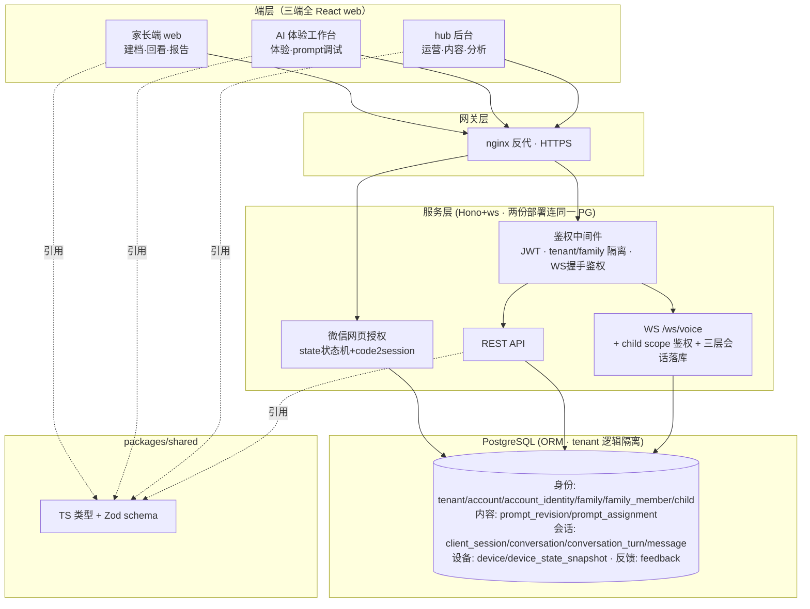
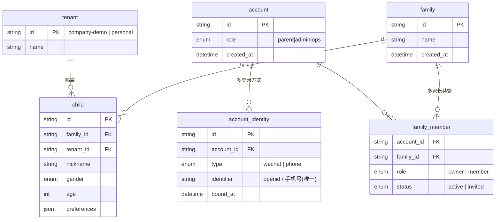
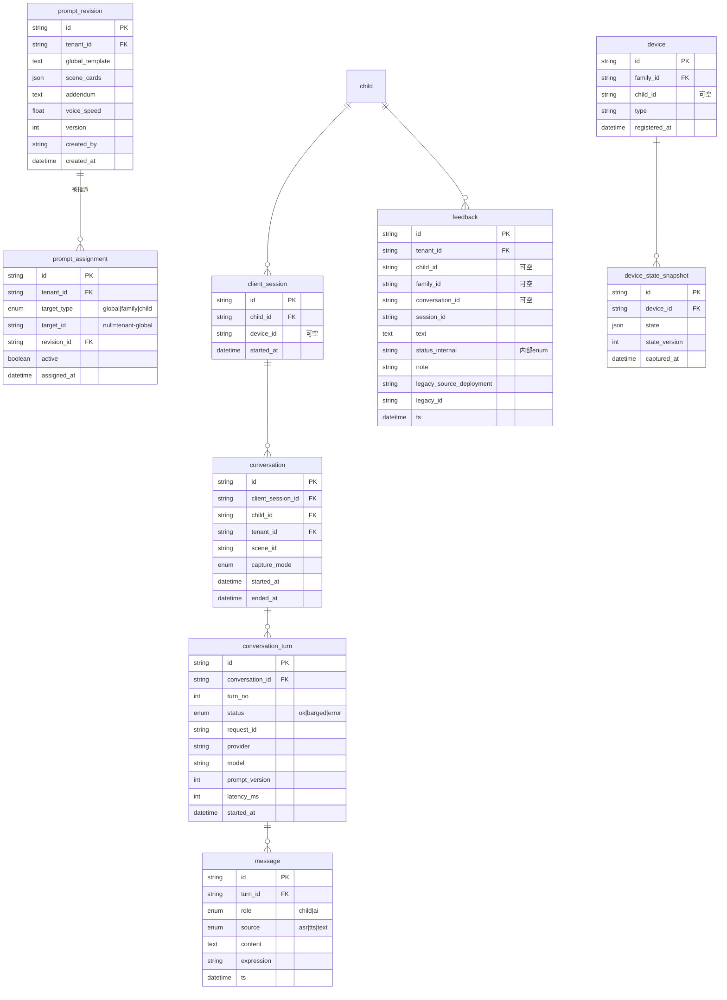

# P003 KidsHub 三端互通架构设计方案 · v1.2

| 项 | 内容 |
|---|---|
| 版本 | v1.2（codex 5.5 对抗评审采纳后定稿，可进 Phase 0） |
| 日期 | 2026-06-15 |
| 作者 | cc（Claude），对抗评审 codex（OpenAI gpt-5.5 xhigh） |
| 回滚点 | git tag `p003-pre-3end-arch-20260615` → HEAD `9dc5343c3` |
| 决策依据 | 川哥拍板：① 目标架构+分阶段 ② 微信登录为身份中心（家长端 web 承载、登录参考小程序） ③ 四类数据全打通 ④ 儿童隐私原型阶段不约束 |
| 现状证据 | 三路并行盘点 + ssh 核实部署 + codex 源码级反证（均已验证 2026-06-15） |

> **v1.2 相对 v1.1 的变更**（采纳 codex 18 条评审，详见[附录 A](#附录-a-codex-评审采纳记录)）：① 加 `tenant` 站点隔离（解决两站 PG 污染）② prompt 拆 `revision`+`assignment`（去多态外键）③ 加 `account_identity`+`family_member`（多身份/多家长）④ 会话拆 `client_session`/`conversation`/`conversation_turn` 三层（修 session 语义错位）⑤ OAuth+WS 鉴权状态机 ⑥ 迁移归属策略 + 枚举映射 ⑦ device_state 落库。**原则：目标架构按 codex 采纳设计「对」，Phase 0 实现层做「最小」，原型不臃肿。**

---

## 1. 背景 · 目标 · 本次决策

### 1.1 三端定义

| 端 | 角色 | 使用者 | 当前形态 |
|---|---|---|---|
| **家长端 web 页面**（移动端优先，可微信内打开） | 主入口 · 建档 · 回看 | 家长 | 🔴 零代码 |
| **AI 原型体验工作台（web）** | 体验 · prompt 调试 | 产品/运营/体验家长 + 孩子 | 🟢 完整实现 |
| **KidsHub hub 后台** | 运营 · 内容管理 · 数据分析 | 内部运营 | 🟡 静态空壳（单 HTML） |

### 1.2 目标（O1）

让三端**围绕同一份数据**互联互通：家长建档 → 孩子体验 → 历史回看 → 运营闭环，数据一次产生、三端共享、两站互通不串味。

### 1.3 本次决策（O2 约束）

1. **路线**：先设计「对的」目标架构，再切分阶段落地（Phase 0 地基对、实现最小）。
2. **账号**：微信登录（openid）为身份中心；家长端用 web 承载，登录参考小程序网页授权（`code` 换 token 同构）。
3. **数据范围**：孩子档案 + prompt&场景配置 + 对话历史&体验记录 + 反馈，四类全打通。
4. **隐私**：原型阶段不做合规约束（审计/加密产品化前补），仅保留数据隔离基本盘。
5. **两站**（v1.2 新定）：公司站(gemini)/个人站(deepseek) **物理同库 + `tenant` 逻辑隔离**——互通但 prompt/数据不跨站污染。

### 1.4 设计原则

- **地基先行、一次定对**：账号/数据模型/契约错了会固化，Phase 0 必须设计对（已过 codex 对抗评审）。
- **设计对 ≠ 实现重**：目标架构含完整表结构，Phase 0 只实现原型必需字段/逻辑，复杂项建表预留、后置实现。
- **可演进不锁死**：ORM 抽象引擎可后切；三端统一 React web，`packages/shared` 复用拉满。
- **零回归**：每阶段独立交付、验收、上线。

---

## 2. 现状盘点

### 2.1 四大地基缺口（已验证）

| # | 缺口 | 证据 |
|---|---|---|
| 1 | 数据层几乎为零 | 唯一持久化 = SQLite `feedback.db`，仅存吐槽文本（`feedback-store.ts`） |
| 2 | 身份体系几乎为零 | admin=单账号 env 口令+内存 token（`routes/auth.ts`）；WS 端匿名、nickname 客户端自报 |
| 3 | 前端数据锁在 localStorage | 孩子档案/prompt/8 场景卡/引导进度全本地（`kidshub-store.ts`，含版本 key/dirty/采样避重耦合） |
| 4 | 无共享契约 | `packages/` 声明未建；`session.meta` wire 结构与 server 类型已有不一致（codex 实证） |
| 5 | 对话完全无状态 | 每轮 LLM 只发 systemPrompt+当轮文本（`pipeline.ts:48-51`） |

### 2.2 可复用资产

WS 语音链路成熟（turn 标识防护+bargein）/ provider 双路（gemini·deepseek）/ feedback 闭环雏形 / 场景卡+prompt 模板体系 / TS+pnpm workspace 统一栈。

### 2.3 部署现实（已 ssh 核实 2026-06-15 · 修正盘点推测）

```
阿里云 HK 8.218.26.17 · 进程管理 = pm2（非 systemd）
├── pm2 chenchuan-site                                  个人站 Next.js
├── pm2 p003-voice → /opt/p003/server/            :3001  公司站, gemini
└── pm2 kidshub-voice → /opt/kidshub-personal/server/ :3002  个人站, deepseek
```

公司站与个人站是**两份完全独立部署**（独立代码/独立 .env/独立 feedback.db/独立 provider）。修正盘点两处推测：~~systemd~~→pm2、~~同份代码~~→两份独立目录。→ v1.2 用 `tenant` 维度让两站接同一 PG 但逻辑隔离。

---

## 3. 目标架构总览

### 3.1 分层架构图



### 3.2 三端定位

| 端 | 是数据的 | 核心职责 |
|---|---|---|
| 家长端 web | 生产者(建档)+消费者(回看) | 网页授权登录、建/管孩子档案、选 child、回看历史/报告、吐槽通知 |
| web 工作台 | 消费者(读档案/prompt)+生产者(对话) | 凭 child scope 拉档案+prompt 注入、跑体验、三层会话落库、prompt 调试 |
| hub 后台 | 生产者(管 prompt)+分析者 | 编辑 prompt_revision 下发、缓存失效推送、反馈闭环、tenant 内数据分析 |

### 3.3 核心数据流

1. **建档**：家长手机打开 web → 网页授权（state 校验）拿 openid → `account`+`account_identity` → 建/加入 `family`(`family_member`) → 录 `child`（绑定 tenant）。
2. **体验**：选定 `child` → server 凭 token 内 child scope 拉档案+`prompt_assignment` 当前 revision → 注入 system prompt。
3. **沉淀**：`client_session` 开 → 选 child+scene 显式建 `conversation` → 每轮 `conversation_turn`（含 provider/model/prompt_version/status）→ `message`（child/ai）。
4. **回看**：家长按 child 查 conversation/message + 体验报告。
5. **运营**：hub 编辑 `prompt_revision` → `prompt_assignment` 切版本（tenant/family/child 维度）→ 缓存失效推送 → 下次体验生效。

---

## 4. 账号 · 身份 · 鉴权（微信登录为中心）

### 4.1 身份模型（codex 修正：account_identity + family_member 解耦）



- **身份解耦**：`account` 只是身份载体；登录方式（微信 openid / 手机号）是 `account_identity` 行 → 支持「先手机号建档、后绑微信合并到同一 account」（codex 建议·解决合并冲突）。
- **多家长**：`family_member` 多对多 → 爸爸微信 + 妈妈手机号共管同一 family/child（不再 1:1 自相矛盾）。
- **tenant 隔离**：`child` 等业务表带 `tenant_id`，两站物理同库、逻辑隔离。
- **原型简化**：Phase 0 `account_identity` 先只走单一登录方式（表预留 merge）；`tenant` 先 2 个固定值。

### 4.2 家长端登录链路（web 网页授权 + OAuth 安全状态机）

```
家长手机打开家长端 web
 ├─[微信内] 微信网页授权 OAuth2(snsapi_userinfo)
 │   1. server 生成 state(TTL+一次性) 存服务端, 校验 redirect_uri allowlist
 │   2. redirect 微信 → 回调带 code+state
 │   3. server 校验 state(一次性消费, 防 CSRF) + code 单次换取(防重放)
 │   4. code2session → openid → upsert account_identity → account
 └─[普通浏览器/起步] 手机号验证码登录 → account_identity(type=phone)
   ↓
 找/建 family(family_member) → 签发短 access JWT{accountId,familyId,tenantId,role,childScope?}
   + refresh token(HttpOnly cookie)
```

> **codex 修正**：v1.1 只有 `code→token`，缺 state/redirect allowlist/code 防重放 → CSRF 可把攻击者 openid 绑到受害者、旧 code 重放。v1.2 补全 OAuth 安全状态机。

### 4.3 三端鉴权 + 越权防护

| 端 | 登录 | Token | 数据可见范围 |
|---|---|---|---|
| 家长端 web | 网页授权/手机号 | JWT(parent) | 仅自己 family（强制 join `child.family_id=ctx.familyId`） |
| web 工作台 | 微信扫码/口令升级 JWT | JWT(parent/admin) | parent=自家；admin=tenant 内 |
| hub 后台 | operator 账密 | JWT(admin/ops) | 按 role + tenant |

- **越权防护**（codex）：所有 child 资源查询**强制 join family_id**（不靠业务代码"记得过滤"）+ 集成测试覆盖；可选 PG Row-Level Security。
- **WS 握手鉴权**（codex）：`/ws/voice` 在 **upgrade 阶段**校验 token（cookie/query），未认证拒绝建连、不计限额；token 过期回 `AUTH_EXPIRED`，前端**停止静默重连死循环**（呼应已修的跨重连缺陷）。
- ⚪ 儿童隐私（原型不约束）：审计/加密/合规产品化前补。

### 4.4 多孩子 / 多设备（codex 修正）

JWT 有 family ≠ 锁定 child。**每次体验必须显式选 child 或设备绑 child**，WS token 携带 `authorized child scope` → 防"两娃共用平板，弟弟对话落姐姐档案"。

---

## 5. 数据层设计

### 5.1 技术选型

| 维度 | 选型 | 理由 |
|---|---|---|
| 数据库 | **PostgreSQL** | 多端并发、核心资产事务、tenant 隔离 |
| ORM | **Prisma**（待 VPS dry-run 验证） | 类型安全+migration；**codex 提醒**：现栈是 tsx ESM + `node:sqlite` 实验开关，Phase 0 必须先在 VPS dry-run 跑通 `generate/migrate`，并评估 **Drizzle/Kysely** 作为对 ESM/tsx 更轻的替代 |
| 部署数据 | 两站共享同一 PG + `tenant_id` 隔离 | 互通不串味（解决两站合一决策点） |

### 5.2 数据模型（14 表，分 5 层）

§4.1 已给身份层 6 表（tenant/account/account_identity/family/family_member/child）。业务层 8 表：



**关键设计点（codex 采纳）**：
- **prompt 拆 revision/assignment**：`revision` 不可变版本快照、`assignment` 指派谁用哪版（target_type+target_id，去掉多态 owner_id）→ 支持版本回滚、tenant/family/child 三级覆盖、可审计。
- **会话三层**：`client_session`（页面/客户端）→ `conversation`（一次"选 child+scene"业务对话，显式 start/end，**断线重连可恢复**）→ `conversation_turn`（每轮，记 provider/model/prompt_version/status/latency，**barge/error 可追**）→ `message`。修复 v1.1 "切 3 张卡全落同一对话"的语义错位。
- **device_state 落库**：`device_state_snapshot`（state+state_version），prompt/turn 引用 state_version → 解决"小可说明天孵化海马但真实设备无此状态"的空洞（现为 `variables.ts:36` mock + `sample.ts:30` 前端随机采样）。
- **provider 落数据**：turn 记 provider/model/prompt_version → 同一 child 在 gemini/deepseek 的历史差异可解释。

> **原型简化**：Phase 0 `conversation_turn` 先记核心列（status/provider/prompt_version）；`device_state_snapshot` 先承接现 mock；`prompt_assignment` 先只 global/child 两级。

### 5.3 现有数据迁移（codex 修正：不自动认领 + 枚举映射）

- **两份** `feedback.db`（`/opt/p003` + `/opt/kidshub-personal`）→ PG `feedback`。
- **归属策略**：旧数据只有 nickname/gender/age，**无法可靠归属真实孩子**（两个都叫"朵朵"会错配）→ 统一导入 `unassigned`/`legacy_guest`，保留 `legacy_source_deployment`(标来源站)+`legacy_id`，**不自动认领**，后续人工/规则补。
- **枚举映射**：现有 feedback 状态是**中文四态**（`feedback-store.ts:6`），方案内部用 enum + display label 映射表；迁移脚本显式映射 + 回归验证，防 hub 旧筛选全错。
- session_id/turn_id 跨两库可能撞键 → 迁移加 `tenant_id` 前缀去重。

---

## 6. 共享契约包 `packages/shared`

```
packages/shared/src/{ws-protocol, rest-dto, domain, schema}.ts  →  @p003/shared
```
三端 + server 共引。**优先级提升**（codex 实证）：`session.meta` 的 wire 结构与 server 类型**已有不一致**，先建契约包是防协议漂移的刚需，非锦上添花。

---

## 7. 后端服务演进（apps/server）

| 模块 | 改造 |
|---|---|
| REST 扩展 | `/api/auth/wechat`(state 状态机)、`/api/auth/phone`、`/api/children`、`/api/prompt-config`(返回 version/etag)、`/api/conversations`、`/api/feedback`(扩展) |
| 鉴权中间件 | JWT 校验→注入 `ctx{accountId,familyId,tenantId,role,childScope}`；child 查询强制 join family |
| WS 鉴权 | upgrade 阶段校验 token；未认证拒绝；childId 由 token 解析（**不信客户端自报**） |
| 对话落库 | `asr.final`/`llm.done` 写三层会话表；**异步 sink 带失败计数+重试队列+告警**（codex：核心资产不能静默丢） |
| 观测性 | 结构化日志含 `tenantId/familyId/childId/conversationId/requestId`（Phase 0 即加，多端排障刚需） |

---

## 8. 三端改造要点

- **8.1 家长端 web（新建 `apps/parent`）**：React+Vite 移动端优先、可微信内打开、可选 PWA；网页授权/手机号登录、建档、**显式选 child**、回看、报告。不用 Taro/小程序。
- **8.2 web 工作台**：localStorage→后端 API（`kidshub-store.ts`），保留本地作离线缓存+乐观更新；**缓存一致性策略**（见 §9 Phase 1）；`device_state` mock→server 下发。
- **8.3 hub 后台**：单 HTML→React 工程（复用 web 栈+`@p003/shared`）；prompt_revision 编辑器+assignment 下发+**缓存失效推送**；feedback 看板平移+关联 child。

---

## 9. 分阶段落地路径

| 阶段 | 目标 | Phase 内"设计对、实现最小" | 验收 |
|---|---|---|---|
| **Phase 0 · 地基** | 数据层+账号+契约对 | 建全 14 表 schema（设计对）；鉴权状态机(OAuth state+WS 握手)；`@p003/shared`；迁移(归属 unassigned+枚举映射)；观测日志字段；**Prisma/Drizzle VPS dry-run**。简化：单登录方式/2 tenant/turn 核心列/device mock 承接 | admin 走 JWT；两份 feedback 迁移无损且 hub 筛选正确；越权集成测试过；VPS 迁移跑通 |
| **Phase 1 · web 接入** | web 数据上后端 | 档案/prompt 草稿迁 API；三层会话落库+异步重试；**缓存一致性**(ETag/version+冲突回滚+refetch on focus/reconnect) | 换设备数据同步；切卡=独立 conversation；hub 改 prompt→web 强校验生效 |
| **Phase 2 · 家长端 web** | 家长入口 MVP | `apps/parent`：手机号登录(预留微信)+建档+选 child+回看 | 家长建档→web 读同一 child；两娃不串档 |
| **Phase 3 · hub 工程化** | 运营闭环 | hub React 化+revision/assignment 编辑+缓存失效推送+tenant 内分析 | hub 切 prompt 版本→三端生效；反馈关联 child |

**关键路径**：Phase 0→1 串行；Phase 2、3 在 1 后可并行。

---

## 10. 决策记录 · 风险

### 10.1 决策记录

| 决策 | 选择 | 理由 |
|---|---|---|
| 数据库 | PostgreSQL + Prisma（待 VPS dry-run，备选 Drizzle/Kysely） | 多端并发+tenant 隔离；codex 提醒验证 ESM/tsx 兼容 |
| 两站数据 | 物理同库 + `tenant_id` 逻辑隔离 | 互通不串味（回答两站合一决策点） |
| 家长端载体 | web 页面（React 移动端） | 三端统一栈、免小程序主体 |
| 家长端登录 | 网页授权(手机号起步) + account_identity 解耦 | 参考小程序同构；支持多登录方式合并 |
| prompt 存储 | revision + assignment 拆表 | 版本回滚+多级覆盖+审计，去多态外键 |
| 会话建模 | client_session/conversation/turn 三层 | 修 session 语义错位、支持重连恢复 |
| 单体 vs 微服务 | 单体扩展 | 早期量级足够 |

### 10.2 风险与对策

| 风险 | 等级 | 对策 |
|---|---|---|
| Prisma 与 tsx ESM+node:sqlite 栈兼容/VPS 迁移踩坑 | 🟡 | Phase 0 先 VPS dry-run；迁移手动执行；备选 Drizzle/Kysely |
| 迁移历史 feedback 错误归属 | 🟡 | unassigned 不自动认领 + legacy 来源标记 |
| Phase 1 缓存一致性被低估（离线改 vs hub 全局改冲突） | 🟡 | 先定 ETag/version+冲突回滚策略再动工 |
| 对话落库静默丢核心资产 | 🟡 | 异步 sink 失败计数+重试+告警，debug/admin 可见 |
| 儿童隐私合规 | ⚪ 本期不做 | 产品化前补 |

### 10.3 待川哥确认（1 项）

- **tenant 命名/边界**：暂定 `company-demo`(公司 gemini 站) + `personal`(个人 deepseek 站)。两者物理同库逻辑隔离、global prompt 各自独立。确认这个划分即可进 Phase 0。

---

## 附录 A · codex 评审采纳记录

codex 5.5（xhigh）对 v1.1 做源码级对抗评审，18 条意见 **cc 验收全部采纳**（0 驳回，每条均有源码/逻辑佐证）。原始评审存于会话任务输出。

**必须改（10）→ 全进 v1.2 目标架构**：tenant 隔离 / prompt 去多态外键拆 revision+assignment / family_member 多家长 / session 三层语义 / WS 握手鉴权 / 越权强制 join / OAuth state 状态机 / 迁移不自动认领 / 枚举映射 / Phase1 缓存重估。

**建议（7）→ 进 v1.2，部分 Phase 0 部分后置**：conversation_turn 表 / device_state 落库 / provider 落数据 / account_identity 合并 / Prisma 部署验证 / prompt 缓存失效 / 多孩子多设备显式选 child。

**可选（3）→ 采纳**：scene_cards JSONB 起步但预留 scene_id/version / 异步落库失败可见 / 观测性日志进 Phase 0。

> 评审增量价值：把方案从"能跑的草图"推到"地基不固化错误的可落地设计"，避免 Phase 0 固化多态外键、session 语义错位、两站污染、OAuth/WS 安全洞等硬伤。

---

> **下一步**：川哥确认 §10.3 的 tenant 划分 → 进 **Phase 0 地基**（建 schema + 鉴权状态机 + 契约包 + 迁移 + VPS dry-run）。

署名：cc（Claude）｜2026-06-15
