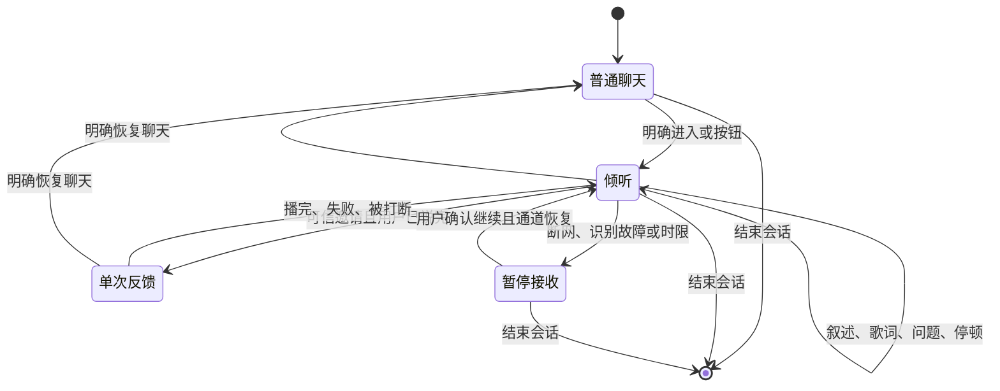

# 小可倾听模式：产品定义与当前 Worker 实施设计

版本：方案 v1；日期：2026-10-29；状态：**设计建议，尚未实现或部署，待川哥确认实施范围**。

依据：用户提供的《倾听模式设计调研.md》、当前已部署修复源码、官方资料核查及两路只读评审。本轮只归档与设计，不改变线上开关、搜索窗口或语音行为。

## 1. 推荐决策

**保留 Rust Worker＋LiveKit＋现有 STT/Brain/TTS，在其上增加“持久倾听模式、明确反馈许可、有界故事上下文、端云状态同步”。首版默认无任何声音附和，先把故事和唱歌期间不抢话做可靠。**

| 路线 | 收益 | 代价与适用范围 | 建议 |
|---|---|---|---|
| 现有 Worker 增加模式和输出控制 | 复用设备合同、搜索、人格、音色与回滚链；可按SN灰度 | 要覆盖投机、异步播报和端侧本地声音 | **选此路线** |
| 迁移 Pipecat 并接 Smart Turn/TEN | 获得相应框架的组件组合方式 | 需重做现有ordered、取消、设备指令、搜索与字幕合同；不能自动解决谁有发言权 | 本需求不迁框架 |
| 改为全双工语音模型 | 有机会更自然地理解音频并互动 | 语音模型、部署成本、中文儿童场景、记忆与工具安全均需重新验证 | 独立研究，不作为首版依赖 |

选择为本次工程建议，尚非用户对新功能实施的批准。“不抢话”优先级高于主动表现热情；人格只能改变被邀请后怎么回答，不能自行提高开口权限。

## 2. 产品定义与使用方式

倾听模式是用户掌握发言权的会话方式：小可持续接收讲述，保留本次上下文；停顿、疑问句、人物对白都不默认启动完整回答，用户邀请时才反馈。

提供两个场景入口，底层共用状态机：

- **讲故事／分享**：虚构故事、日常经历、思考出声。允许高确定性的直接语音邀请和按钮反馈。
- **听我唱歌**：优先保障完整表达，静默到底；首版以按钮请求反馈或退出，避免歌词命令误触发。语音恢复留到可靠唤醒与歌声/讲话区分经真机验证后开放。

| 用户行为 | 建议行为 |
|---|---|
| 点击“听我讲故事”／“听我唱歌” | 切入模式，屏幕显示“正在倾听”；默认只视觉确认，不插一声“好呀” |
| 普通聊天中直接说“小可，先听我讲个故事” | 确认是当前用户的完整直接指令后进入；若紧接故事，继续收音，不插确认音 |
| 叙述中停顿2秒、10秒或更久 | 保持倾听；停顿不是回答许可 |
| 叙述里出现“你觉得呢”“然后呢”“怎么会这样” | 继续听；可能是人物对白、自问或歌词 |
| 说“小可，请说说你对刚才故事的看法”或点击“听听小可” | 在邀请结束且用户没有继续开口时，给一次短反馈，随后自动回到倾听 |
| 只说“讲完了” | 标记一个故事段结束，保留上下文，显示可反馈入口；不把它同时定义为退出或提问 |
| 说“小可，退出倾听，正常聊天”或点击“恢复聊天” | 回普通聊天；不补播此前被搁置的自动回复 |
| 点击结束会话 | 可靠关闭会话，清理任务和会话上下文；不依赖语音识别成功 |

“讲完了”“你觉得呢”“恢复聊天”分别是段落结束、可能的反馈请求、模式退出，不能在三处复用同一含糊语义。首版高精度优先，宁可漏掉含糊请求，让用户点按钮，也不在人物台词里抢话。

**反馈风格建议**：通常1–2句、40–80个汉字的软目标，另设音频时长上限；先回应用户实际分享的一个细节或明确情绪，不固定每次追问，不自动给建议/打分。想听详细评论时可继续明确请求。反馈失败或用户再次说话，结束这次许可并恢复倾听，不自动重播。

唱歌首版只能讨论可靠识别到的内容和感谢分享。现链路把转写文本给LLM，**不能据此判断唱得准、节奏稳、音色好，也不能保证歌词识别完整**。需要专业唱歌评价时另接音频理解能力并独立评估。

## 3. 当前代码盘点：能复用什么、缺什么

上线基线以[10月29日发布回执](P003_STYLE_FILLER_ARK_RELEASE_20261029.md)为准，非仓库main。Brain代码`c1cc0359`；普通Worker为R18＋`8a343694`，候选为R26＋`c2ef3ca9`。下列行号为阅读时快照，开发前重新定位函数。

| 当前模块 | 源码证据 | 对倾听模式的影响 |
|---|---|---|
| 持续识别 | 普通Worker `pipeline.rs:1227–1257`，ordered首句后转持续RTC | 可复用；首句默认7秒期限不能被当成无限长故事上传 |
| 原Listening状态 | `pipeline.rs:256` 的 `AgentState::{Listening,Thinking,Speaking}` | 仅表示当前没有播音，必须另建持久产品模式 |
| 提前生成 | `start_speculation`、`on_ordered_final_held`，普通约1756/1793行 | 只拦普通Reply太晚；静默期也会偷偷请求Brain，必须源头禁止 |
| 分段与路由 | `on_tick_inner`、`turn_gate.poll_commit`，普通约3005行 | commit只代表片段完成；倾听段要在设备/搜索/普通回答之前另路处理 |
| 多个出声源 | `start_turn`约3577、`spawn_playout`约3618行 | Say、Reply、BackgroundSay/Clip、设备结果和错误提示都需同一许可门 |
| 旧帧竞态 | `playout.rs::capture_with_retry`约320–342、441行 | 捕获重试可能在clear_buffer后回填；需在每次捕获/重试核代次或可取消等待 |
| 附和处理 | `backchannel.rs` | 当前是用户附和时让小可继续讲，不是AI边听边附和；不可混用 |
| 搜索异步 | `search_tasks.rs::poll`、`suppress_auto_replay`；候选search_recovery | 结果可在无用户输入时自动播；poll(false)仍可能提交到期补充查询，需同时阻决策与输出 |
| Brain上下文 | `routes/custom-llm.ts:83–90`只保留user/assistant消息 | Worker新增system消息会被过滤，不能靠它注入故事摘要 |
| 记忆/人格 | `custom-llm.ts::persistTurn`约239–262、`memory-extractor.ts` | 完整问答后才落库/抽取；静默转写不会自然记住；强塞普通历史又可能污染画像 |
| 端侧控制 | `control.rs`暂无倾听协议；`job.rs:231`有真实participant来源 | 新按钮/状态需合同；仅检查JSON内src=android不够 |

当前STT有有限队列、失败关闭路径。`job.rs`的5秒是主循环卡死看门狗，不是“用户沉默5秒”的规则。端侧当前APK的空闲退出、本地音频和唤醒行为仍需定向核查；不沿用历史日志猜当前行为。

## 4. 状态机与优先级

用独立 `ConversationMode` 管产品状态，保留原 `AgentState` 管播放瞬态。每次切换递增 `mode_epoch`，异步任务回包必须与当前epoch和session匹配。

Worker是epoch权威，客户端只能提出切换请求，不能指定服务端代次。另设 `listening_session_id` 标记一段连续倾听及其多次短反馈；输出epoch变化不清故事缓冲。摘要绑定该倾听ID、段号及revision快照，不以播放epoch代替内容版本。

`暂停接收`只显示真实不可用状态，不伪装成“仍在听”；默认不突然恢复普通聊天或播报旧内容。重连后端云重新握手，以新session为准，用户确认再继续；首版不承诺断网跨会话完整续接。

建议处理顺序：实际参与者/会话校验 → 显式控制事件 → 与当前模式相关的语音控制及回声确认 → 倾听内容收集 → 只有获得许可的反馈/操作 → 普通聊天路由。物理急停和可信结束始终有效；故事引用的“再见/停止/关灯/帮我查”不能在模式判断前执行。

ASR可能丢标点或把引语切成独立句，“整句精确匹配”也不等于真实指令。故事语音控制采用“小可＋明确模式/反馈意图＋无继续发声”的组合，并关联最近上下文；不确定继续静默。唱歌首版关闭内容触发控制，按钮是确定性通道。这是首版取舍，不声称语音规则能百分之百区分转述。

## 5. Worker实施逻辑

### A. 决策源头门

在Orchestrator新增模式与版本化策略，按session生效。倾听期间：

- 保持音频接收、STT和字幕发布；普通final进入 `ListeningBuffer`，不假造assistant回答，不发普通`UserTurnCommitted/Thinking`事件误导客户端。
- 关闭普通回复、投机LLM、对应TTS预热和filler；原四档概率只是普通模式策略，倾听模式无条件覆盖为静默。
- 禁止由故事文本发起搜索、设备控制、语音切档、改名和其他业务副作用。明确的结束/反馈控制单独处理；普通设备语控首版要求先恢复聊天，实体安全控制保持。
- 候选的搜索控制补识别取消并丢弃旧epoch结果；二遍ASR修改同一片段时更新revision，不能重复追加故事。
- 不把更长静音阈值当静默保证。原端点可继续帮助分段，反馈邀请才需要“用户已说完”的确认。

### B. 全输出门与竞态清理

给输出标注用途，例如普通回答、filler、进入提示、一次反馈、搜索结果、设备回执。`start_turn`先检查模式许可；进入倾听时：

1. 递增epoch，阻止新输出与自动决策。
2. 取消spec、当前turn、TTS预热、paused/false_deadline恢复、deferred_say；不能只调可能提前return的`hard_abort_current`。
3. 清媒体发送队列；旧捕获回调/重试/PlayedOut按epoch失效。每个待发送音频块均需检查许可。
4. 与端侧完成清播放队列/停本地提示的确认后更新可见状态。进入过程中若用户已开口，不补语音确认。

进入采用两阶段：`enter.received`只确认请求收到并已关闭新输出；取消/排空在途capture、清Worker队列且收到端侧本地停播确认后，才发`enter.completed`。STT始终继续，不等待ACK；客户端丢ACK可按request_id查询当前状态，端侧未确认则保持静默并显示进入中/失败，不恢复自动聊天。验收“进入完成后无旧帧新发送”以completed为锚；从请求/语音意图接受到最后实际尾音另行计时。

一次反馈许可绑定session、epoch、request_id，生命周期为`reserved → active(turn_id) → spent/cancelled`。先进入反馈状态、递增epoch，再签许可；首次创建反馈轮只消费一次reserved，后续每帧校验同一active许可，不逐帧重复消费。重复按钮回原状态，不新增反馈；迟到final只能更新匹配片段，不能补发许可；用户再次发声立即cancelled并递增输出代次。播完、失败和取消均回倾听，不在下一次停顿偷偷继续。最后是否真的播完按现有播放进度结算，不能拿LLM结束代替。

“进入那一毫秒绝无尾音”不能保证，已有RTC缓存需要清理。首版验收要量化按钮→端侧静音和语音意图接受→停止输出的尾音，而不是声称零延迟。

### C. 后台搜索与设备回执

- 已经明确授权、在运行的只读搜索可继续后台计算，保原TTL/额度/取消规则；倾听时结果ready只更新状态，不播音、不字幕冒充已说、不计delivered。
- 进入时清除尚未确认的pending_topic自动补查及自动重放；仅给poll传false不够。
- 反馈按钮默认评论本次故事，不隐式播放搜索。要听搜索结果，需明确请求，按已有权限及TTL重新检查；可作为一次有独立用途的许可，之后仍回倾听。
- 给进入时已有的任务/结果及随后完成的同批任务持久到任务生命周期的`requires_explicit_play`标记；覆盖Ready/Claimed及待播speech，不因恢复普通模式或重新poll(safe=true)清除。退出倾听不自动播出任何此前积压结果，只有新明确请求通过TTL检查才授予播放许可；过期淘汰，取消则取消。设备真实结果可静默更新状态，不能被丢掉或改写成操作失败。

## 6. 上下文、记忆与成长

新增本次会话专用缓冲，不复用“每段＝一次问答”的结构。每段含session/segment_id/revision/seq、来源（故事/分享/歌词/控制）、时间、转写状态；原文只用于当前已授权语音处理，不写普通遥测。

**建议首版预算，属于待测默认值：**每会话原文最多12,000汉字；约6,000汉字或累计3分钟新内容触发一次异步压缩，最低新内容量门防止空跑；摘要约800–1,200字，反馈带摘要＋最近约4,000字＋用户当前明确问题。每会话至多一个摘要任务，合并重复触发，不等待它才能继续收音。摘要仅用于会话，不自动写长期画像。

摘要覆盖段号范围必须连续，保留未压缩尾部；成功后才能释放对应原文。失败保原文到上限，超限按确定规则裁最旧内容并记录缺口，反馈时不假装记得完整故事。按字符/字节与模型token双层限额验收，重连或新session不把旧摘要误挂新身份。

摘要使用独立内部用途`listening_summary`及受控队列，绕过普通对话落库、工具调用、onboarding、语音切档、人格成长和长期记忆抽取。请求冻结每段revision与既有摘要版本；返回时覆盖范围仍完全匹配才能替换并释放原文，二遍ASR已修订则弃旧结果或重算。摘要调用单独计量，不算普通完整对话调用，也不在“零普通LLM”指标里隐去其成本。

Brain新增经过服务凭据和服务器会话绑定校验的 `listening_context`（拟议字段），不能仅依赖客户端body或被过滤的system消息。用既有主服务的真实账号归属，不因候选库副本差异串号。字段有版本、来源、长度、epoch与段号上限，内容是用户资料而非系统指令。

反馈请求携带 `purpose=listening_feedback`，从入口到onboarding、voice-style、落库、extractScheduler、trait更新逐一隔离：

- 仍可读取当前人格与已知偏好，使反馈有小可风格。
- 不把故事角色当家庭成员、不把歌词第一人称当孩子事实、不因虚构冲突改情绪或价值观。
- 首版不自动长期记忆/人格加分。后续明确“这是我的经历，请记住”时，走事实来源、证据与已有记忆安全规则；一段故事不按STT切片次数重复计成长。
- 摘要与模式审计独立；统计只记reason/时长/段数/字数/代次/是否放行，不记故事原文、歌词、凭据。
- 核现有EOT快照、打断遥测和错误日志出口，倾听片段默认不新增原始录音落盘，不因调试打开长时间采集。具体保留/删除口径与已有账号规则一致。

## 7. 端云合同与后台

**这是Worker为主、Brain配合、Android必须做少量改动的功能。** 云端可先做隔离验证，产品级“不打断”不能只靠Worker宣称完成。

拟议控制：`listening.enter / feedback / exit / state`，含协议版本、request_id/seq、session/trace、mode_epoch、场景和结果枚举。服务端使用LiveKit实际participant身份与签发会话能力校验，拒绝伪造src、旧session、重复消费和乱序回包。进入ACK代表哪些清理已完成需写清，客户端不得发送后立刻显示成功。

Android最小改动：

- 增加“听我讲故事”“听我唱歌”“听听小可”“恢复聊天/结束”入口，显示正在倾听/反馈中/连接中断。
- 模式内停本地招呼、承接、闲置催问和自动告别；持续RTC收音，不等待小可说完才恢复麦克风；防长停顿触发旧自动退出。
- ordered首句与持续RTC切换需确认接续和首词无丢失；不把整个故事放进7秒首包。
- 本地命令识别也需区分故事/歌词，防硬件在Worker判断前已执行；物理按钮、安全保护和主动结束不被屏蔽。
- 重连重新协商模式，失联提示和明确按钮恢复；旧客户端缺能力时不开放首版倾听入口，不用半功能灰度冒充产品可用。

后台拟新增“倾听模式”独立卡片，不塞进衔接概率一个滑块：总闸、SN范围、协议最低能力、场景、反馈方式、一次反馈长度、会话上限、匿名计数。建议初始默认关闭、单机白名单，空名单关闭；配置由会话签发快照传递。后台紧急关闸需同时撤销活跃许可，不能只影响下一次会话。

**活跃撤权选择**：两池都向主Brain的内部只读策略接口获取短租约，以主服务为唯一权威；Worker进程级后台每5秒刷新、单次1秒预算，不在音频循环等待。租约最长15秒（本机单调时钟限时，拒旧version），关闸/移出SN后下次成功刷新立即撤权；刷新失败不延长租约，最迟到期进入静默暂停。初始验收目标为变更后≤16秒停止新发送，另核设备尾音；这是待实现参数。撤权取消active许可、保普通非倾听房原行为，不让当前倾听房自动变聊天。端侧显示功能暂停，用户结束后可建普通新会话；代码回滚前必须清空对应活跃房，不能让旧二进制接管未完成的倾听。搜索自身到期优先，不被新租约延长。

建议首版单次30分钟上限、真实静默120秒显示无声继续按钮提示；这些是待容量/体验验证的产品默认，不是现有线上值。到限先视觉提示并进入“暂停接收”，不突然发声或切回普通聊天；继续需用户动作。传输断流/ASR错误与用户安静分开诊断，保留现有watchdog。

## 8. 改动清单

| 层 | 预计文件/模块 | 内容 |
|---|---|---|
| Rust新增 | `listening_mode.rs`、`listening_buffer.rs` | 状态/许可/代次/有界上下文；纯状态测试 |
| Rust现有 | `pipeline.rs`、`playout.rs`、`turn.rs` | 决策门、全输出门、逐帧取消、反馈恢复、字幕语义 |
| Rust合同 | `control.rs`、`job.rs`、`ordered_pcm.rs` | 实际参与者授权、幂等状态同步、首句到RTC接续 |
| Rust异步 | `llm.rs`、`search_tasks.rs`及候选search_recovery | 无静默投机；可信context传递；后台只计算不自动出声 |
| Brain | 新listening policy/context模块，`routes/device-session.ts`、`routes/custom-llm.ts`、`prompts.ts` | 会话策略、反馈专用请求、人设复用、长度和来源限制 |
| Brain记忆 | `memory-extractor.ts`、extractScheduler调用点与onboarding/style/growth入口 | 旁路与去重；首版不自动长期抽取，后续受控记忆 |
| 后台 | `routes/admin-data.ts`、`apps/web/public/admin/index.html` | 开关/范围/参数/状态与统计，不展示原始故事全文 |
| Android | 由端侧同事核当前APK源码后定文件 | 模式UI、持续收音、本地音频/指令/超时控制、重连合同 |

新增文件和协议名均为设计，不表示当前已存在。现有衔接音风格配置与本地音频个性化下载仍保留，倾听时在消费端暂停，不重生成或删除资产。

## 9. 调研核查与技术取舍

核查日期2026-10-29。以下官方说明是能力依据，不能代替小可中文儿童真机验收。

| 参考 | 核实及取舍 |
|---|---|
| [Smart Turn](https://github.com/pipecat-ai/smart-turn) | 音频原生端点模型，支持中文和CPU；可独立作为后续端点实验，不必迁Pipecat。它解决片段是否结束，不替用户授予发言权。 |
| [TEN Turn Detection](https://github.com/TEN-framework/ten-turn-detection) | Qwen2.5-7B、中英及三态属实，输入为ASR文本；wait指明确要求AI别说。不是唱歌音频理解器，也不能假定为现有小服务器可直接运行的轻量模型。 |
| [pipecat-backchannel](https://github.com/maisterr/pipecat-backchannel) | 作者说明目前仅停顿触发、英文素材/规则，另跑一套VAD/端点推理。首版不用；中文低音量也仍会打断沉浸。 |
| [Say Pi Agent Mode](https://www.saypi.ai/agents) | 可借鉴Auto/Agent/Manual的产品选择；Beta语义判断不是零误触承诺，不能直接推广为儿童中文唱歌已验证。 |
| [PersonaPlex研究](https://research.nvidia.com/labs/adlr/personaplex/)／[模型卡](https://huggingface.co/nvidia/personaplex-7b-v1) | 全双工7B方向有价值，模型卡为英语、官方测试用A100；不作为当前中文Cascade小改动。 |
| [ElevenReader案例](https://elevenlabs.io/blog/how-elevenreader-used-elevenagents) | 核心是围绕正在读的书问答，不等于“听用户唱歌”；案例自动恢复旁白的工具行为不可当本项目现成功能。 |
| [GPT-Live发布](https://openai.com/index/introducing-gpt-live/)／[官方提示指南](https://developers.openai.com/api/docs/guides/live-prompting) | GPT-Live名称和全双工能力有官方依据；指南仍明确精确停说需要应用层控制，不能仅靠prompt强制静默。 |
| [LiveKit手动轮次](https://docs.livekit.io/agents/logic/turns/#manual-turn-control) | 可借鉴自动端点与手动响应分离的原则；文档Python/Node接口不当成本项目Rust现成API。 |

不采纳报告“每次反馈必追问”“所有故事周期写长期画像”“首版先迁框架”三点；也不把2–5秒静音当通用最佳阈值。请求反馈分类器放到P1，只看候选邀请，超时/不确定继续静默，不每段都调用完整对话模型。

## 10. 验收与发布

验收必须同时看“没有出声”和“没有偷偷生成/执行”，以及用户邀请后仍能正常反馈。以下是**拟定通过门，不是已有测试结果**。

| 验收组 | 场景与通过门 |
|---|---|
| 静默语义 | 固定中文故事、生活分享、疑问/转述/歌词/停顿/控制词负例集；进入后普通LLM/投机调用=0、filler=0、未经许可AI音频=0、设备/搜索误执行=0；摘要请求单列次数/费用 |
| 邀请与状态 | 按钮、明确邀请、跨ASR分段、重复乱序；一次仅一答，完成/失败/打断均回倾听；新session拒旧指令 |
| 多出口竞态 | 进入时正在播/排PCM/重试capture/假打断恢复/搜索ready/设备回执/错误提示；enter.completed后无旧代次新发送或未经许可新输出；请求→尾音另计，ACK丢失/重复不误开口 |
| 端到端静音 | 建议按钮本地停播P95≤200ms、Worker接受进入→设备尾音P95≤500ms作为初始目标；按网络与缓存分层计时，超门先修不换口径 |
| 内容记得住 | 10/20/30分钟讲述与摘要前后关键事实对账；去重、修订、摘要失败/超限、上下文缺口提示；虚构角色和歌词不改画像 |
| 歌唱 | 真机清唱及伴奏、歌词含“小可/再见/你觉得呢”、唱后按钮反馈；全程无误触，无虚构音准/节奏评价 |
| 基础回归 | 模式关闭时两池普通聊天/衔接0–100/搜索取消换查/设备指令/退出/字幕保持；正常聊天新增路径不请求新服务 |
| 性能 | 固定同版本同网络成对采样，普通聊天正文首声增量中位≤100ms、P90≤300ms、无新增缺正文；至少20有效对并保留慢例/失败；反馈延迟单列 |
| 故障与容量 | 网络断开、ASR连续失败、队列溢出、摘要超时、撤权、会话到限；真实状态提示、有限资源、无偷偷回普通模式；长连接占用与CPU/RSS有界 |
| 真机验收 | 服务端音频/字幕/指标＋客户端实际播放/状态＋持有人实听；合成RTC不替代Android本地音频和自动退出验收 |

建议固定内容集不少于60条，另做至少3次10分钟真人故事/分享、3首歌、一次30分钟持续会话；数字是首轮验收样本计划，不证明总体零误触。测试前冻结版本、配置、样本和计时锚，不边调边混统计。

## 11. 分阶段与分支

**P0：可控倾听。** 模式/明确许可、全出口门、持续STT与有界摘要、端侧状态与本地禁播、短反馈、单机灰度和回滚；不引入新端点模型，不发backchannel，不自动长期画像。预计主要工作量在多出口竞态与Android联调，而不是prompt。

**P1：更自然的邀请理解。** 在P0真实误触/漏触样本上，比较规则＋小分类器、TEN或现有端点升级；只有独立误触率/漏触率/延迟收益达标才引入。故事可评估极低频非语音表情，声音附和仍默认关，唱歌保持关。

**P2：成长与音频理解。** 用户确认的经历记忆、跨会话续接、可靠音乐理解；再比较全双工模型。长期记忆与歌唱评分分别立项，不借倾听上线自动扩收数据。

批准后采用专用分支＋独立工作树：

- Brain：从此次已发布修复线创建 `codex/p003-listening-brain-<date>`。
- Worker主实现：从普通R18＋style/ark修复线创建 `codex/p003-listening-worker-<date>`；避免从main或旧源码基线开始。
- 需要和现有搜索灰度共存时，在**执行当天重新核实的候选运行基线**上建独立integration工作树，移植最小倾听补丁；当前参考为R26＋style/ark。不可拿候选整包覆盖普通池，不切换原搜索开发会话工作树。
- Android使用端侧自己的专用分支和能力声明。Codeg登记两端工作树及本方案入口，历史保留为快照引用。

发布顺序：冻结各池运行源/SHA/env/配置/能力及回滚 → 离线与Linux构建 → 隔离RTC/端侧合同 → 单台授权SN新会话 → 真机验收 → 再按用户批准扩量。当前搜索一周窗口不自动变成倾听授权，不改其设备范围和截止。

回滚分两层：紧急关倾听闸/撤活跃许可，端侧退出该模式并清队列，明确新会话回普通聊天；若需代码回滚，各池恢复自己的已冻结产物。保新业务数据/搜索结果原TTL/人格配置，不整库或整env回灌。回滚后再次确认搜索、衔接概率和设备控制没被旧源码覆盖。

## 12. 预期收益与成本

- **用户感受**：能够完整讲一段或唱一首，不被“好呀、我在听”及正文插入打断；是否让小可开口由用户掌握。
- **反馈质量**：用连贯故事摘要与近段回应，减少只接住最后一句；读现有人格，避免每次固定附和和追问。
- **调用成本**：普通叙述不逐段调用完整LLM/TTS，只支付持续STT、少量摘要和明确反馈；不承诺节省百分比，需实测。长时间占用RTC/ASR/Worker名额可能增加连接和STT成本。
- **工程稳定性**：保留现有语音栈，把开口权限集中管理，搜索、设备回执与未来主动提醒也有清晰边界。
- **成长可信度**：真实分享与虚构/歌词分开，避免小可“成长”建立在误记忆上。

首版不需要因TEN/全双工而先更换服务器。上线前按预计同时倾听人数做容量测试，分别看ASR成本、长会话槽位、摘要吞吐和CPU；确有瓶颈再分离摘要Worker或扩容会话池。

关联：[已上线修复回执](P003_STYLE_FILLER_ARK_RELEASE_20261029.md) · [复盘与记忆](P003_STYLE_ARK_RETROSPECTIVE_MEMORY_20261029.md)。

署名：codex（OpenAI）| 2026-10-29（北京时间）
