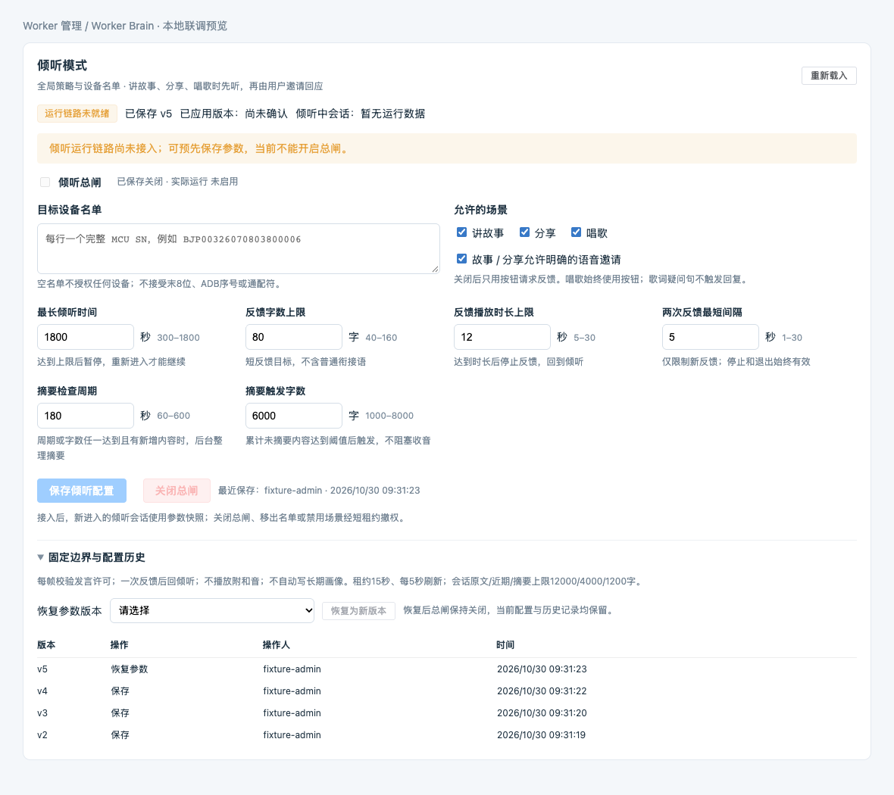

# Worker Brain 倾听模式配置

2026-10-30，用户要求在 Worker 管理后台的 Worker Brain 板块直接显示和调整倾听参数，减少调试时改代码。本批已在倾听 Brain 开发分支实现配置卡、真实配置接口、持久化、审计与版本恢复。**尚未部署线上，运行授权和音频链路仍待接入；保存配置不代表设备已应用。**

## 页面与可调项

入口：Worker 管理 → Worker Brain → 顶部「倾听模式」。这是全局策略加设备名单，与左侧当前选中设备无关，仅管理员可读写。

| 参数 | 默认 | 可调范围/行为 |
|---|---|---|
| 倾听总闸 | 关闭 | 当前运行未就绪时界面禁用开启，接口也返回409；其余参数可预存 |
| 设备名单 | 空 | 每行完整MCU SN，最多1000台；校验日历日期/非零流水；重复、末8位、ADB序号和通配符拒绝；空名单不授权 |
| 场景 | 讲故事、分享、唱歌 | 至少选择一项 |
| 故事/分享语音邀请 | 开 | 关闭后只用按钮；唱歌始终按钮控制 |
| 最长倾听时间 | 1800秒 | 300–1800秒 |
| 反馈字数上限 | 80字 | 40–160个Unicode字符 |
| 反馈播放时长上限 | 12秒 | 5–30秒 |
| 两次反馈最短间隔 | 5秒 | 1–30秒；不影响停止和退出 |
| 摘要检查周期 | 180秒 | 60–600秒 |
| 摘要触发字数 | 6000字 | 1000–8000字；有新增内容且时间或字数任一达到时触发 |

字段范围与标签由服务端同一注册表提供，前端仅预检，后端严格类型/未知字段/上下限校验。首版不开放自由脚本、正则、提示词或凭据输入。上述默认值是本批实现选择，尚未经过真人体验调优。

固定约束只读：15秒租约/5秒刷新；每帧发言许可；一次反馈后回倾听；无附和音；不自动写长期画像；12000/4000/1200原文/近期/摘要上限。不得通过配置绕过。

## 显示与生效口径

- 分开显示已保存修订、已应用修订、实际运行状态、倾听中会话数。没有运行取证时应用修订/会话数/确认时间为null，页面显示“尚未确认/暂无运行数据”。
- 当前`runtime.status=not_integrated`，`ready=false`、`effective_enabled=false`。没有环境变量或UI选项可以把未接线伪装成就绪。
- **后续接线要求**：参数在下一次进入倾听时取可信快照；总闸关闭、设备移出名单、场景禁用通过主Brain短租约撤权。后台撤权停止新输出≤16秒仍是待测目标。
- 所有参数必须被实际消费并验证：改变会话上限/反馈字数/播放时限/冷却/摘要阈值须有对应行为测试；不能只把配置存入库或metadata便宣布生效。
- 后续页面运行状态必须来自部署能力、租约、Worker应用确认及当前APK能力证据；禁止仅凭总闸显示上线。

## 存储、接口和回滚

复用`CONFIG_DB_PATH`指定的config.db，在独立SQLite连接新增`listening_settings`和`listening_settings_audit`两表；原device_config/runtime_flag及其他业务数据不改。初始化延迟到首次访问倾听管理接口。写入使用BEGIN IMMEDIATE；配置与审计同事务，任一步失败一起回滚。读取配置和历史使用同一读事务快照。

`schema_version=1`是结构版本，`revision`是保存修订号。投影到已有授权策略时使用`listeningPolicyFromConfig()`，其`version=config.revision`，后续grant.policyVersion须同源，不能混用schema_version。

| API | 契约 |
|---|---|
| GET `/api/admin/worker-voice/listening` | 配置、修改人/时间、最近20条审计、字段元数据、固定约束、独立运行状态 |
| PUT 同路径 | `{expected_revision, settings:{enabled,allowlist,scenes,tuning}}`；旧修订409；非法字段400；超过64KiB 413；存储异常503 |
| POST `/disable` | `{}`；事务内读最新值，只关闭总闸，不拿旧浏览器草稿覆盖其他人的调参 |
| POST `/restore` | `{expected_revision,revision}`；目标须存在（v1为默认）；保存成更高修订，强制关闭总闸，保留历史 |

操作人从真实管理员token取得；匿名401、editor/guest读写均403。配置损坏返回503并拒绝覆盖，不静默回落后覆盖损坏现场。调用方遇503应重新读取确认，避免把已提交但响应失败误解成必未保存。

页面防止旧请求回填：请求序号＋登录代次＋token；退出/身份失效清空面板；未保存草稿不被自动刷新覆盖；显式重新载入需要确认；409/503保留草稿并显示错误。修复了在Brain页登录过期后重登不会触发导航watch的问题，登录成功会按当前页面补加载。

回滚代码从本批提交revert，原基点`5426e78e`；旧服务器忽略新增两表，不删表、不整库回灌。恢复参数走上述restore接口，版本只升不降。当前未部署，所以本批不需要生产回滚或服务重启。

## 验证与范围

- `scripts/listening-admin.test.ts`：真实Hono鉴权/SQLite接口，38项检查；包括非法输入、开启409、修订冲突、恢复、关闭、存储损坏503与请求体上限。
- `scripts/listening-config-store.test.ts`：12项检查；两独立进程抢同修订仅一次成功、审计插入故障全事务回滚、重开持久化、关闭保最新调参、恢复强制关闸、原表数据保持。
- `scripts/listening-admin-ui.cjs`：Playwright真实Chromium＋实际页面卡片/函数＋真实临时Hono/SQLite。覆盖保存回读、脏草稿刷新、冲突、503、历史恢复、旧登录响应、实际重登录函数；全页面内联JS语法也检查。它不是线上整个管理站的端到端测试。
- 新pure policy/grant 10组、原device-session45项与filler policy回归；apps/server全量`tsc --noEmit`。
- 本地预览截图来自合成测试账号和临时数据库，不代表线上开闸。

运行：在apps/server目录，使用既有Node/tsx依赖；浏览器测试传入已安装工具的`P003_PLAYWRIGHT_MODULE`和`P003_CHROME_BIN`，可选`P003_LISTENING_SCREENSHOT`。fixture不加载.env，退出后删除本次临时数据库，不接生产服务。

署名：codex（OpenAI）| 2026-10-30

本批功能代码提交：`22505d8b5fc0bbdb41e2b78577f35ac3769d9024`；冻结标签`rollback/p003-listening-admin-20261030`→`5426e78e`。以下为临时库/合成账号的真实浏览器截图：

