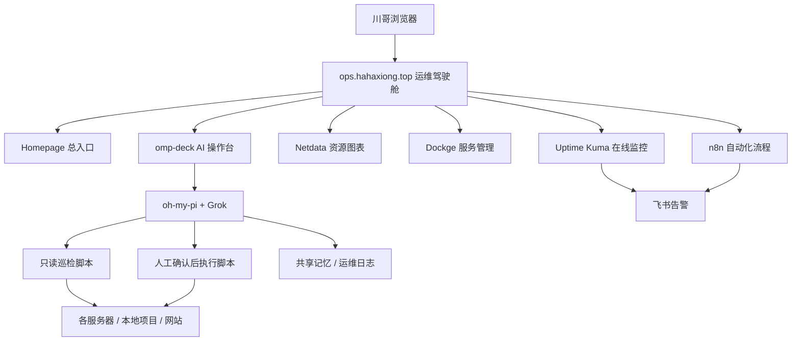

# AI Ops Cockpit — AI 运维驾驶舱

> 状态：v1 方案已确认，准备在 RackNerd VPS 上实施。

## 一句话目标

给川哥一个可视化运维入口：打开网页就能看服务器/项目状态，问 AI 做只读巡检，必要操作先确认再执行，全程有日志、证据、验收结果。

## 背景

川哥不写代码，也不希望日常依赖纯命令行运维。RackNerd VPS `racknerd` 已完成 root 免密 SSH 接入，可作为轻量控制面。第一版目标是“先跑起来再迭代”：稳定、可见、可验收，不追求一开始就完全自治。

## 总体架构

## 模块分工

| 模块 | 作用 | 川哥怎么用 |
|---|---|---|
| Homepage | 总入口看板 | 打开一个网页，看所有服务卡片 |
| Uptime Kuma | 在线、证书、API、端口监控 | 用红绿灯判断服务是否正常 |
| Netdata | CPU、内存、磁盘、网络实时图表 | 看服务器是不是负载高 |
| Dockge | Docker 服务可视化管理 | 点按钮启停服务、看日志 |
| omp-deck | oh-my-pi 网页操作台 | 给 AI 发任务、看执行记录 |
| oh-my-pi + Grok | 运维 AI 助手 | 问“帮我检查所有服务器” |
| n8n | 可视化自动化流程 | 做每日巡检、异常推送飞书 |
| 飞书机器人 | 告警和日报出口 | 手机上收异常和日报 |

## 闭环设计

| 场景 | 闭环流程 | 验收标准 |
|---|---|---|
| 日常巡检 | 定时触发 → AI 汇总 → 飞书日报 | 每天固定时间收到摘要 |
| 网站异常 | Uptime Kuma 检测失败 → 飞书告警 → AI 给排查建议 | 能看到失败 URL、时间、原因 |
| 服务器异常 | Netdata 指标异常 → 看板变红 → AI 拉取证据 | CPU、内存、磁盘有图表证据 |
| 项目状态 | AI 检查 mycc、个人站、服务进程 → 输出状态表 | 每个项目有“正常/异常/待确认” |
| 人工操作 | 川哥点确认 → AI 执行 → 输出前后对比 | 操作前后都有日志和验证结果 |

## 安全原则

- 默认只读：第一版 AI 只能巡检、分析、汇总。
- 高危动作二次确认：重启、删除、升级、改配置必须先给方案。
- 所有服务优先 Docker 化，方便备份、迁移、回滚。
- 看板必须加登录保护，不能裸奔公网。
- 密码和 API Key 不写入看板、不写入记忆，只放服务器 secret 文件或系统安全位置。
- 每次 AI 操作都写日志：谁触发、做了什么、结果是什么。

## 第一版验收清单

| 验收项 | 通过标准 |
|---|---|
| 总入口 | 能打开 `ops.hahaxiong.top`，看到所有模块卡片 |
| 在线监控 | 至少监控 3 个目标：RackNerd、本机关键服务、个人站 |
| 资源监控 | 能看到 RackNerd 的 CPU、内存、磁盘、网络图表 |
| 服务管理 | 能在 Dockge 看到所有容器状态和日志 |
| AI 助手 | 能在网页里问“检查当前服务器状态”并得到表格结果 |
| 飞书通知 | 手动触发一次巡检，飞书收到摘要 |
| 异常测试 | 停掉一个测试服务，看板变红并发出通知 |
| 日志留痕 | 每次巡检/操作都有记录可查 |

## 实施路线

1. Phase 1：基础驾驶舱  
   部署 Docker、Caddy、Homepage、Uptime Kuma、Netdata、Dockge，先把可视化跑起来。
2. Phase 2：AI 操作台  
   部署 oh-my-pi、omp-deck，接 Grok，配置只读巡检能力。
3. Phase 3：通知闭环  
   接飞书机器人，做“手动巡检”和“每日巡检日报”。
4. Phase 4：可确认操作  
   加“重启服务、拉日志、检查磁盘、检查证书”等按钮，全部需要确认。
5. Phase 5：多服务器扩展  
   接入 Mini、NAS、阿里云、个人站等其他机器，统一进看板。

## v1 交付物

- `ops.hahaxiong.top` 可访问的总入口。
- RackNerd 控制面上的监控、资源、容器、AI 操作台。
- 只读巡检 routine。
- 飞书手动/定时巡检摘要。
- 操作日志和验收记录。

## 当前运维接入信息

- RackNerd SSH 别名：`racknerd`
- 主机：`root@23.226.135.149:22`
- 主机名：`racknerd-54aa08d`
- 系统：Ubuntu 24.04
- 登录方式：本机 `~/.ssh/id_ed25519` 公钥免密
- 密码策略：密码不入文档、不入记忆

## 实施记录

### 2026-07-07 Phase 1 基础驾驶舱

已在 RackNerd VPS 完成基础栈部署：

- Docker Engine：`29.6.1`
- Docker Compose：`v5.3.0`
- 部署目录：`/opt/ai-ops-cockpit`
- Compose 文件：`/opt/ai-ops-cockpit/compose.yaml`
- 入口：`http://23.226.135.149/`
- Basic Auth 用户：`chuan`
- Basic Auth 密码：仅保存在远端 `/root/ai-ops-cockpit-secrets.txt`，不入文档、不入记忆
- 防火墙：UFW 已启用，仅放行 `22/tcp`、`80/tcp`、`443/tcp`

已启动容器：

| 容器 | 作用 | 路径 |
|---|---|---|
| `ops-caddy` | 统一入口与 Basic Auth | `/` |
| `ops-homepage` | 运维总入口 | `/` |
| `ops-uptime-kuma` | 在线监控 | `/kuma/` |
| `ops-netdata` | 资源图表 | `/netdata/` |
| `ops-dockge` | Docker 服务管理 | `/dockge/` |

公网验收结果：

| 验收项 | 结果 |
|---|---|
| 未登录访问 `/` | `401`，Basic Auth 生效 |
| 登录访问 `/` | `200 text/html` |
| 登录访问 `/kuma/` | `302`，进入 Uptime Kuma 初始化流程 |
| 登录访问 `/netdata/` | `200 text/html` |
| 登录访问 `/dockge/` | `200 text/html` |
| Netdata 容器健康 | `healthy` |
| 磁盘余量 | `/` 约 `25G` 可用 |
| 运行内存 | 5 个容器合计约 `770MiB` |

当前限制：

- `ops.hahaxiong.top` 尚未配置 DNS，当前先用 `http://23.226.135.149/` 验收。
- Uptime Kuma 和 Dockge 还需要首次 Web 初始化账号。
- oh-my-pi、omp-deck、n8n、飞书通知属于后续 Phase。

### 2026-07-07 域名与基础监控闭环

川哥已在 Cloudflare 配置 `ops.hahaxiong.top` 橙云代理；源站已完成域名入口适配。

域名入口：

- 正式入口：`https://ops.hahaxiong.top/`
- Cloudflare 橙云：已生效，DNS 返回 Cloudflare A/AAAA
- 源站 HTTPS：Caddy 已自动签发 `ops.hahaxiong.top` Let’s Encrypt 证书
- 访问保护：未登录访问 `https://ops.hahaxiong.top/` 返回 `401`
- 登录后页面验收：`/`、`/kuma/`、`/dashboard`、`/netdata/`、`/dockge/` 均返回 `200`

管理账号：

| 服务 | 用户 | 密码位置 |
|---|---|---|
| 外层 Basic Auth | `chuan` | `/root/ai-ops-cockpit-secrets.txt` 的 `ops` |
| Uptime Kuma | `chuan` | `/root/ai-ops-cockpit-secrets.txt` 的 `uptime_kuma_setup_password` |
| Dockge | `chuan` | `/root/ai-ops-cockpit-secrets.txt` 的 `dockge_setup_password` |

Uptime Kuma 已配置 3 个基础监控项：

| 监控项 | 类型 | 当前状态 |
|---|---|---|
| AI 运维驾驶舱 HTTPS | HTTP `https://ops.hahaxiong.top/`，接受 `401` | UP |
| 陈川个人站 HTTPS | HTTP `https://my.chenchuan.cc/` | UP |
| RackNerd SSH 22 | TCP `23.226.135.149:22` | UP |

最新验收：

| 检查 | 结果 |
|---|---|
| `https://ops.hahaxiong.top/` 未登录 | `401` |
| `https://ops.hahaxiong.top/` 登录后 | `200 text/html` |
| `/kuma/` | `200 text/html` |
| `/dashboard` | `200 text/html` |
| `/netdata/` | `200 text/html` |
| `/dockge/` | `200 text/html` |
| Kuma 监控 3 项 | 全部 `UP` |

下一步：

- 接入飞书通知。
- 部署 oh-my-pi / omp-deck，形成 AI 运维助手入口。
- 接入 n8n，做每日巡检日报和手动巡检按钮。

### 2026-07-07 Homepage 默认模板修复

川哥截图显示首页仍是 Homepage 默认模板，并且顶部出现多个 `API Error`。根因是 Caddy 为兼容 Uptime Kuma，把 `/api/*` 和 `/assets/*` 也转发给了 Uptime Kuma，导致 Homepage 自己的 `/api/services`、`/api/bookmarks` 等接口被抢路由，前端无法读取自定义配置。

修复：

- 移除 Kuma 对全局 `/api/*`、`/assets/*`、`/socket.io/*` 的匹配。
- Kuma 仅保留 `/kuma*`、`/dashboard*`、`/setup*`、`/status*`、`/manage-status-page*`、`/maintenance*` 等必要页面路由。
- Homepage 的 `/api/services`、`/api/bookmarks` 恢复由 Homepage 容器处理。
- 个人站卡片从错误的 `https://chenchuan.site/` 改为 `https://my.chenchuan.cc/`。

验收：

| 检查 | 结果 |
|---|---|
| `https://ops.hahaxiong.top/api/services` | `200 application/json` |
| `https://ops.hahaxiong.top/api/bookmarks` | `200 application/json` |
| 服务组 | `运维入口`、`主机状态` |
| 服务卡片 | `Uptime Kuma 在线监控`、`Netdata 资源图表`、`Dockge 服务管理`、`AI 操作台`、`RackNerd VPS`、`个人站`、`mycc 本机` |
| 默认模板字符串 | API 中已不存在 `My First Group` / `API Error` |

### 2026-07-07 Uptime Kuma 空白页修复与 BRO-PDCA 补验

川哥截图反馈 `/dashboard` 打开后一片空白。前一次验收只验证了 HTTP `200`，没有做真实浏览器加载验证，违反 BRO-PDCA 中“自己先验收、证据闭环”的要求。

根因：

- Uptime Kuma 是根路径 SPA，`/dashboard` 页面引用根路径资源：`/assets/*.js`、`/assets/*.css`、`/manifest.json`、`/icon.svg`、`/socket.io/*`、`/api/entry-page`。
- 为修复 Homepage 默认模板时，我把 `/api/*`、`/assets/*` 从 Kuma 路由移除，导致 Kuma 的 JS/CSS 资源被 Homepage 接管并返回 `404 text/html`。
- 浏览器看到 HTML 主页面 `200`，但 JS/CSS 加载失败，所以页面空白。

修复：

- 保持 Homepage 的 `/api/services`、`/api/bookmarks` 由 Homepage 处理。
- 将 Kuma 必需资源显式路由给 `ops-uptime-kuma`：`/assets/*`、`/socket.io/*`、`/upload/*`、`/manifest.json`、`/icon.svg`、`/api/entry-page*`、`/api/status-page/*`。
- 保留 Kuma 页面路由：`/kuma*`、`/dashboard*`、`/setup*`、`/status*`、`/manage-status-page*`、`/maintenance*`。

验收证据：

| 检查 | 结果 |
|---|---|
| Homepage `/api/services` | `200 application/json` |
| Homepage `/api/bookmarks` | `200 application/json` |
| Kuma `/dashboard` | `200 text/html` |
| Kuma `/assets/index-*.js` | `200 application/javascript` |
| Kuma `/assets/index-*.css` | `200 text/css` |
| Kuma `/manifest.json` | `200 application/json` |
| Kuma `/icon.svg` | `200 image/svg+xml` |
| Playwright 真浏览器登录 `/dashboard` | 页面非空，标题 `Uptime Kuma`，三项监控可见 |
| Playwright 控制台错误 | 无 |
| Playwright 失败请求 | 无 |

Playwright 输出摘要：`bodyLength=377`，可见 `AI 运维驾驶舱 HTTPS`、`RackNerd SSH 22`、`陈川个人站 HTTPS`，Quick Stats 显示 `Up 3 / Down 0`。

后续规则：

- 前端页面验收不能只看 HTTP 状态码，必须至少做一次真实浏览器加载验证。
- SPA 子路径/反代改动必须检查 HTML 引用的 JS/CSS/API/WebSocket 资源是否全部命中正确后端。
- 涉及用户可见页面时，验收证据需包含页面文本、截图或 Playwright snapshot。

### 2026-07-07 飞书告警通道与最终验收

川哥提供飞书机器人 Webhook 后，已在 Uptime Kuma 中接入“飞书运维告警”，并绑定到 3 个生产监控项。

当前生产监控：

| 监控项 | 告警通道 | 当前状态 |
|---|---|---|
| AI 运维驾驶舱 HTTPS | 飞书运维告警 | UP |
| 陈川个人站 HTTPS | 飞书运维告警 | UP |
| RackNerd SSH 22 | 飞书运维告警 | UP |

本次处理：

- Uptime Kuma 已创建飞书通知配置 `飞书运维告警`，Webhook 不入文档、不入 git、不入记忆。
- 已发送飞书通道测试消息，Uptime Kuma provider 返回 `Sent Successfully.`。
- 已用临时容器 `ops-alert-test` 做 Down/Up 闭环测试，Kuma 记录到 `Up → Down → Up` 心跳变化。
- 测试监控与临时容器已清理，最终页面只保留 3 个生产监控项。
- Homepage `RackNerd VPS` 卡片移除了外链 `ubuntu.png` 图标，避免浏览器出现非核心第三方图标失败请求。

BRO-PDCA 验收证据：

| 检查 | 结果 |
|---|---|
| 远端容器 | `ops-caddy`、`ops-homepage`、`ops-uptime-kuma`、`ops-netdata`、`ops-dockge` 全部运行 |
| 生产监控数量 | 3 个，均绑定 `飞书运维告警` |
| 最近心跳 | 3 个生产监控均为 `UP` |
| 临时测试项 | `飞书告警闭环测试` 已删除 |
| Playwright 首页验收 | 首页 `200`，可见 Uptime Kuma / Netdata / Dockge / RackNerd VPS，无 `API Error` |
| Playwright Kuma 验收 | `/dashboard` `200`，标题 `Uptime Kuma`，可见 3 个生产监控，Quick Stats `Up 3 / Down 0` |
| 浏览器控制台 | 无错误 |
| 应用失败请求 | 无失败请求 |

本地验收截图：

- `/Users/rayman.chen/mycc/output/playwright/ai-ops-homepage-final.png`
- `/Users/rayman.chen/mycc/output/playwright/kuma-dashboard-final.png`
- `/Users/rayman.chen/mycc/output/playwright/ai-ops-final-verify.json`

下一步：

- 接入 n8n，做“手动巡检按钮”和每日巡检日报。
- 接入 oh-my-pi / omp-deck / Grok，形成 AI 运维助手入口。
- 扩展监控目标：本机关键项目、NAS、Mini、Studio、更多个人站服务。

### 2026-07-07 n8n 接入、Dockge 白屏修复、Netdata 真实性核验

本轮按川哥要求并行处理 3 件事：接入 n8n、修复 Dockge 白屏、确认 Netdata 数据是否为当前真实数据。

n8n 接入：

- 已新增容器 `ops-n8n`，入口：`https://ops.hahaxiong.top/n8n/`。
- 已在 Homepage 增加 `n8n 自动化巡检` 卡片。
- 已完成 n8n owner 初始化，当前页面进入登录态；账号信息不入文档、不入 git、不入记忆，密码仍只在远端 `/root/ai-ops-cockpit-secrets.txt`。
- 已在 Uptime Kuma 增加监控 `n8n 自动化巡检 HTTPS`，并绑定 `飞书运维告警`。

Dockge 白屏根因与修复：

- 根因 1：Dockge 和 Uptime Kuma 都是根路径 SPA，Dockge `/dockge/` 页面会默认加载根路径 `/assets/*`，被 Caddy 转给 Kuma，导致 JS MIME 错误和白屏。
- 根因 2：修复资源后，Dockge Socket.IO 仍默认连根路径 `/socket.io/`，继续和 Kuma 冲突。
- 根因 3：Socket 修好后，Dockge Vue Router 仍按 `/` 作为前端 base，访问 `/dockge/` 无匹配路由，页面仍空。
- 修复：Dockge 前端资源继续由 `/dockge/` 入口访问；Socket.IO 改为 `/dockge/socket.io`，Caddy 对该路径 strip `/dockge` 后转发给 Dockge；Dockge 前端 Router base 改为 `/dockge/`。

Netdata 真实性结论：

- `https://ops.hahaxiong.top/netdata/` 显示的是 RackNerd 当前真实宿主机数据，不是静态样例数据。
- 证据：Netdata 页面显示 Ubuntu、Kernel `6.8.0-134-generic`、1 核、约 `1.92 GB` RAM、约 `40 GB` Disk、KVM；与宿主 `hostname`、`uname -r`、`free -m`、`df -h /` 匹配。
- Netdata 容器通过 host `/proc`、`/sys`、`/` 只读挂载采集宿主数据；浏览器和 Netdata API 均有实时数值变化。

BRO-PDCA 验收证据：

| 检查 | 结果 |
|---|---|
| 远端容器 | `ops-caddy`、`ops-homepage`、`ops-uptime-kuma`、`ops-netdata`、`ops-dockge`、`ops-n8n` 全部运行 |
| Homepage | `200`，可见 `n8n 自动化巡检`，无 `API Error` |
| Dockge | `200`，页面非空，显示 `Dockge / Username / Password / Login`，控制台错误 0，失败请求 0 |
| Netdata | `200`，页面非空，显示 RackNerd 当前系统信息，控制台错误 0，失败请求 0 |
| n8n | `200`，owner 已初始化，显示 `Sign in / Email / Password` |
| Uptime Kuma | 4 个监控：AI 运维驾驶舱、个人站、RackNerd SSH、n8n；均绑定飞书告警 |
| 最新心跳 | 4 个监控均为 `UP`，n8n 返回 `401 - Unauthorized` 并按预期计为 UP |

本地验收文件：

- `/Users/rayman.chen/mycc/output/playwright/ai-ops-final-phase2.json`
- `/Users/rayman.chen/mycc/output/playwright/final--.png`
- `/Users/rayman.chen/mycc/output/playwright/final--dockge-.png`
- `/Users/rayman.chen/mycc/output/playwright/final--netdata-.png`
- `/Users/rayman.chen/mycc/output/playwright/final--n8n-.png`

下一步：

- 在 n8n 内做第一个“手动巡检按钮”：读取 Kuma 状态、Netdata 摘要、Docker 容器状态，并发飞书摘要。
- 再做每日定时巡检日报。

### 2026-07-07 n8n 手动巡检按钮闭环

已完成第一版“手动巡检按钮”：通过 n8n Webhook 触发只读巡检，汇总 Kuma、Netdata、Docker 容器状态，并发送飞书摘要。

入口：

- 手动触发：`https://ops.hahaxiong.top/n8n/webhook/ai-ops-inspect`
- 访问保护：仍在外层 Caddy Basic Auth 后面。
- n8n 工作流：`AI Ops 手动巡检到飞书`
- 内部只读采集服务：`ops-inspector`

实现结构：

- `ops-inspector` 只读读取：Docker socket、Uptime Kuma SQLite、Netdata API。
- n8n Webhook 调用 `http://ops-inspector:8080/send-feishu`。
- 飞书 Webhook 只保存在远端 `.env`，不写入文档、不写入 git、不写入长期记忆。
- n8n 不直接持有飞书 Webhook，避免表达式读取 env 被禁和 secret 扩散。

BRO-PDCA 验收证据：

| 检查 | 结果 |
|---|---|
| `ops-inspector /health` | `200 {"ok": true}` |
| `ops-inspector /summary` | 返回 Kuma、容器、Netdata 摘要 |
| `ops-inspector /send-feishu` | 飞书返回 `StatusCode: 0` / `msg: success` |
| n8n Webhook | `GET /n8n/webhook/ai-ops-inspect` 返回 `200` |
| n8n 执行记录 | execution `2`，workflow `AI Ops 手动巡检到飞书`，状态 `success` |
| 飞书结果 | 已发送“AI 运维驾驶舱手动巡检”摘要 |

当前巡检摘要包含：

- 总结论：正常 / 需要关注。
- 主机：Kernel、Load、内存概况。
- Kuma：4 个监控项状态。
- Docker：`ops-*` 容器运行状态。

已知限制：

- `ops-inspector` 当前 hostname 显示容器 ID，但 Kernel、内存、Kuma、Docker 状态均来自宿主/生产服务；后续可把显示名固定为 `racknerd-54aa08d`。
- 当前是手动按钮，下一步再加 n8n 定时节点做每日巡检日报。
