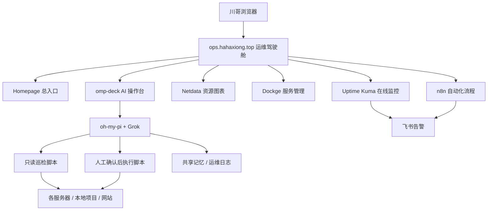

# AI Ops Cockpit — AI 运维驾驶舱

> 状态：v1 方案已确认，准备在 RackNerd VPS 上实施。

## 一句话目标

给川哥一个可视化运维入口：打开网页就能看服务器/项目状态，问 AI 做只读巡检，必要操作先确认再执行，全程有日志、证据、验收结果。

## 背景

川哥不写代码，也不希望日常依赖纯命令行运维。RackNerd VPS `racknerd` 已完成 root 免密 SSH 接入，可作为轻量控制面。第一版目标是“先跑起来再迭代”：稳定、可见、可验收，不追求一开始就完全自治。

## 总体架构

## 模块分工

| 模块 | 作用 | 川哥怎么用 |
|---|---|---|
| Homepage | 总入口看板 | 打开一个网页，看所有服务卡片 |
| Uptime Kuma | 在线、证书、API、端口监控 | 用红绿灯判断服务是否正常 |
| Netdata | CPU、内存、磁盘、网络实时图表 | 看服务器是不是负载高 |
| Dockge | Docker 服务可视化管理 | 点按钮启停服务、看日志 |
| omp-deck | oh-my-pi 网页操作台 | 给 AI 发任务、看执行记录 |
| oh-my-pi + Grok | 运维 AI 助手 | 问“帮我检查所有服务器” |
| n8n | 可视化自动化流程 | 做每日巡检、异常推送飞书 |
| 飞书机器人 | 告警和日报出口 | 手机上收异常和日报 |

## 闭环设计

| 场景 | 闭环流程 | 验收标准 |
|---|---|---|
| 日常巡检 | 定时触发 → AI 汇总 → 飞书日报 | 每天固定时间收到摘要 |
| 网站异常 | Uptime Kuma 检测失败 → 飞书告警 → AI 给排查建议 | 能看到失败 URL、时间、原因 |
| 服务器异常 | Netdata 指标异常 → 看板变红 → AI 拉取证据 | CPU、内存、磁盘有图表证据 |
| 项目状态 | AI 检查 mycc、个人站、服务进程 → 输出状态表 | 每个项目有“正常/异常/待确认” |
| 人工操作 | 川哥点确认 → AI 执行 → 输出前后对比 | 操作前后都有日志和验证结果 |

## 安全原则

- 默认只读：第一版 AI 只能巡检、分析、汇总。
- 高危动作二次确认：重启、删除、升级、改配置必须先给方案。
- 所有服务优先 Docker 化，方便备份、迁移、回滚。
- 看板必须加登录保护，不能裸奔公网。
- 密码和 API Key 不写入看板、不写入记忆，只放服务器 secret 文件或系统安全位置。
- 每次 AI 操作都写日志：谁触发、做了什么、结果是什么。

## 第一版验收清单

| 验收项 | 通过标准 |
|---|---|
| 总入口 | 能打开 `ops.hahaxiong.top`，看到所有模块卡片 |
| 在线监控 | 至少监控 3 个目标：RackNerd、本机关键服务、个人站 |
| 资源监控 | 能看到 RackNerd 的 CPU、内存、磁盘、网络图表 |
| 服务管理 | 能在 Dockge 看到所有容器状态和日志 |
| AI 助手 | 能在网页里问“检查当前服务器状态”并得到表格结果 |
| 飞书通知 | 手动触发一次巡检，飞书收到摘要 |
| 异常测试 | 停掉一个测试服务，看板变红并发出通知 |
| 日志留痕 | 每次巡检/操作都有记录可查 |

## 实施路线

1. Phase 1：基础驾驶舱  
   部署 Docker、Caddy、Homepage、Uptime Kuma、Netdata、Dockge，先把可视化跑起来。
2. Phase 2：AI 操作台  
   部署 oh-my-pi、omp-deck，接 Grok，配置只读巡检能力。
3. Phase 3：通知闭环  
   接飞书机器人，做“手动巡检”和“每日巡检日报”。
4. Phase 4：可确认操作  
   加“重启服务、拉日志、检查磁盘、检查证书”等按钮，全部需要确认。
5. Phase 5：多服务器扩展  
   接入 Mini、NAS、阿里云、个人站等其他机器，统一进看板。

## v1 交付物

- `ops.hahaxiong.top` 可访问的总入口。
- RackNerd 控制面上的监控、资源、容器、AI 操作台。
- 只读巡检 routine。
- 飞书手动/定时巡检摘要。
- 操作日志和验收记录。

## 当前运维接入信息

- RackNerd SSH 别名：`racknerd`
- 主机：`root@23.226.135.149:22`
- 主机名：`racknerd-54aa08d`
- 系统：Ubuntu 24.04
- 登录方式：本机 `~/.ssh/id_ed25519` 公钥免密
- 密码策略：密码不入文档、不入记忆
