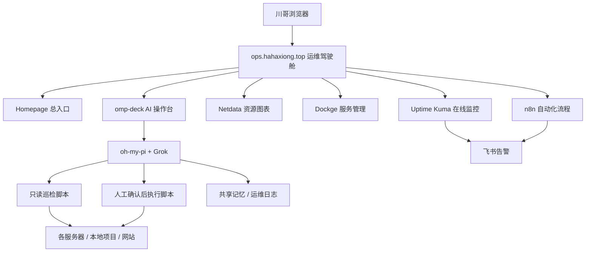

# AI Ops Cockpit — AI 运维驾驶舱

> 状态：v1 方案已确认，准备在 RackNerd VPS 上实施。

## 一句话目标

给川哥一个可视化运维入口：打开网页就能看服务器/项目状态，问 AI 做只读巡检，必要操作先确认再执行，全程有日志、证据、验收结果。

## 背景

川哥不写代码，也不希望日常依赖纯命令行运维。RackNerd VPS `racknerd` 已完成 root 免密 SSH 接入，可作为轻量控制面。第一版目标是“先跑起来再迭代”：稳定、可见、可验收，不追求一开始就完全自治。

## 总体架构

## 模块分工

| 模块 | 作用 | 川哥怎么用 |
|---|---|---|
| Homepage | 总入口看板 | 打开一个网页，看所有服务卡片 |
| Uptime Kuma | 在线、证书、API、端口监控 | 用红绿灯判断服务是否正常 |
| Netdata | CPU、内存、磁盘、网络实时图表 | 看服务器是不是负载高 |
| Dockge | Docker 服务可视化管理 | 点按钮启停服务、看日志 |
| omp-deck | oh-my-pi 网页操作台 | 给 AI 发任务、看执行记录 |
| oh-my-pi + Grok | 运维 AI 助手 | 问“帮我检查所有服务器” |
| n8n | 可视化自动化流程 | 做每日巡检、异常推送飞书 |
| 飞书机器人 | 告警和日报出口 | 手机上收异常和日报 |

## 闭环设计

| 场景 | 闭环流程 | 验收标准 |
|---|---|---|
| 日常巡检 | 定时触发 → AI 汇总 → 飞书日报 | 每天固定时间收到摘要 |
| 网站异常 | Uptime Kuma 检测失败 → 飞书告警 → AI 给排查建议 | 能看到失败 URL、时间、原因 |
| 服务器异常 | Netdata 指标异常 → 看板变红 → AI 拉取证据 | CPU、内存、磁盘有图表证据 |
| 项目状态 | AI 检查 mycc、个人站、服务进程 → 输出状态表 | 每个项目有“正常/异常/待确认” |
| 人工操作 | 川哥点确认 → AI 执行 → 输出前后对比 | 操作前后都有日志和验证结果 |

## 安全原则

- 默认只读：第一版 AI 只能巡检、分析、汇总。
- 高危动作二次确认：重启、删除、升级、改配置必须先给方案。
- 所有服务优先 Docker 化，方便备份、迁移、回滚。
- 看板必须加登录保护，不能裸奔公网。
- 密码和 API Key 不写入看板、不写入记忆，只放服务器 secret 文件或系统安全位置。
- 每次 AI 操作都写日志：谁触发、做了什么、结果是什么。

## 第一版验收清单

| 验收项 | 通过标准 |
|---|---|
| 总入口 | 能打开 `ops.hahaxiong.top`，看到所有模块卡片 |
| 在线监控 | 至少监控 3 个目标：RackNerd、本机关键服务、个人站 |
| 资源监控 | 能看到 RackNerd 的 CPU、内存、磁盘、网络图表 |
| 服务管理 | 能在 Dockge 看到所有容器状态和日志 |
| AI 助手 | 能在网页里问“检查当前服务器状态”并得到表格结果 |
| 飞书通知 | 手动触发一次巡检，飞书收到摘要 |
| 异常测试 | 停掉一个测试服务，看板变红并发出通知 |
| 日志留痕 | 每次巡检/操作都有记录可查 |

## 实施路线

1. Phase 1：基础驾驶舱  
   部署 Docker、Caddy、Homepage、Uptime Kuma、Netdata、Dockge，先把可视化跑起来。
2. Phase 2：AI 操作台  
   部署 oh-my-pi、omp-deck，接 Grok，配置只读巡检能力。
3. Phase 3：通知闭环  
   接飞书机器人，做“手动巡检”和“每日巡检日报”。
4. Phase 4：可确认操作  
   加“重启服务、拉日志、检查磁盘、检查证书”等按钮，全部需要确认。
5. Phase 5：多服务器扩展  
   接入 Mini、NAS、阿里云、个人站等其他机器，统一进看板。

## v1 交付物

- `ops.hahaxiong.top` 可访问的总入口。
- RackNerd 控制面上的监控、资源、容器、AI 操作台。
- 只读巡检 routine。
- 飞书手动/定时巡检摘要。
- 操作日志和验收记录。

## 当前运维接入信息

- RackNerd SSH 别名：`racknerd`
- 主机：`root@23.226.135.149:22`
- 主机名：`racknerd-54aa08d`
- 系统：Ubuntu 24.04
- 登录方式：本机 `~/.ssh/id_ed25519` 公钥免密
- 密码策略：密码不入文档、不入记忆

## 实施记录

### 2026-07-07 Phase 1 基础驾驶舱

已在 RackNerd VPS 完成基础栈部署：

- Docker Engine：`29.6.1`
- Docker Compose：`v5.3.0`
- 部署目录：`/opt/ai-ops-cockpit`
- Compose 文件：`/opt/ai-ops-cockpit/compose.yaml`
- 入口：`http://23.226.135.149/`
- Basic Auth 用户：`chuan`
- Basic Auth 密码：仅保存在远端 `/root/ai-ops-cockpit-secrets.txt`，不入文档、不入记忆
- 防火墙：UFW 已启用，仅放行 `22/tcp`、`80/tcp`、`443/tcp`

已启动容器：

| 容器 | 作用 | 路径 |
|---|---|---|
| `ops-caddy` | 统一入口与 Basic Auth | `/` |
| `ops-homepage` | 运维总入口 | `/` |
| `ops-uptime-kuma` | 在线监控 | `/kuma/` |
| `ops-netdata` | 资源图表 | `/netdata/` |
| `ops-dockge` | Docker 服务管理 | `/dockge/` |

公网验收结果：

| 验收项 | 结果 |
|---|---|
| 未登录访问 `/` | `401`，Basic Auth 生效 |
| 登录访问 `/` | `200 text/html` |
| 登录访问 `/kuma/` | `302`，进入 Uptime Kuma 初始化流程 |
| 登录访问 `/netdata/` | `200 text/html` |
| 登录访问 `/dockge/` | `200 text/html` |
| Netdata 容器健康 | `healthy` |
| 磁盘余量 | `/` 约 `25G` 可用 |
| 运行内存 | 5 个容器合计约 `770MiB` |

当前限制：

- `ops.hahaxiong.top` 尚未配置 DNS，当前先用 `http://23.226.135.149/` 验收。
- Uptime Kuma 和 Dockge 还需要首次 Web 初始化账号。
- oh-my-pi、omp-deck、n8n、飞书通知属于后续 Phase。

### 2026-07-07 域名与基础监控闭环

川哥已在 Cloudflare 配置 `ops.hahaxiong.top` 橙云代理；源站已完成域名入口适配。

域名入口：

- 正式入口：`https://ops.hahaxiong.top/`
- Cloudflare 橙云：已生效，DNS 返回 Cloudflare A/AAAA
- 源站 HTTPS：Caddy 已自动签发 `ops.hahaxiong.top` Let’s Encrypt 证书
- 访问保护：未登录访问 `https://ops.hahaxiong.top/` 返回 `401`
- 登录后页面验收：`/`、`/kuma/`、`/dashboard`、`/netdata/`、`/dockge/` 均返回 `200`

管理账号：

| 服务 | 用户 | 密码位置 |
|---|---|---|
| 外层 Basic Auth | `chuan` | `/root/ai-ops-cockpit-secrets.txt` 的 `ops` |
| Uptime Kuma | `chuan` | `/root/ai-ops-cockpit-secrets.txt` 的 `uptime_kuma_setup_password` |
| Dockge | `chuan` | `/root/ai-ops-cockpit-secrets.txt` 的 `dockge_setup_password` |

Uptime Kuma 已配置 3 个基础监控项：

| 监控项 | 类型 | 当前状态 |
|---|---|---|
| AI 运维驾驶舱 HTTPS | HTTP `https://ops.hahaxiong.top/`，接受 `401` | UP |
| 陈川个人站 HTTPS | HTTP `https://my.chenchuan.cc/` | UP |
| RackNerd SSH 22 | TCP `23.226.135.149:22` | UP |

最新验收：

| 检查 | 结果 |
|---|---|
| `https://ops.hahaxiong.top/` 未登录 | `401` |
| `https://ops.hahaxiong.top/` 登录后 | `200 text/html` |
| `/kuma/` | `200 text/html` |
| `/dashboard` | `200 text/html` |
| `/netdata/` | `200 text/html` |
| `/dockge/` | `200 text/html` |
| Kuma 监控 3 项 | 全部 `UP` |

下一步：

- 接入飞书通知。
- 部署 oh-my-pi / omp-deck，形成 AI 运维助手入口。
- 接入 n8n，做每日巡检日报和手动巡检按钮。

### 2026-07-07 Homepage 默认模板修复

川哥截图显示首页仍是 Homepage 默认模板，并且顶部出现多个 `API Error`。根因是 Caddy 为兼容 Uptime Kuma，把 `/api/*` 和 `/assets/*` 也转发给了 Uptime Kuma，导致 Homepage 自己的 `/api/services`、`/api/bookmarks` 等接口被抢路由，前端无法读取自定义配置。

修复：

- 移除 Kuma 对全局 `/api/*`、`/assets/*`、`/socket.io/*` 的匹配。
- Kuma 仅保留 `/kuma*`、`/dashboard*`、`/setup*`、`/status*`、`/manage-status-page*`、`/maintenance*` 等必要页面路由。
- Homepage 的 `/api/services`、`/api/bookmarks` 恢复由 Homepage 容器处理。
- 个人站卡片从错误的 `https://chenchuan.site/` 改为 `https://my.chenchuan.cc/`。

验收：

| 检查 | 结果 |
|---|---|
| `https://ops.hahaxiong.top/api/services` | `200 application/json` |
| `https://ops.hahaxiong.top/api/bookmarks` | `200 application/json` |
| 服务组 | `运维入口`、`主机状态` |
| 服务卡片 | `Uptime Kuma 在线监控`、`Netdata 资源图表`、`Dockge 服务管理`、`AI 操作台`、`RackNerd VPS`、`个人站`、`mycc 本机` |
| 默认模板字符串 | API 中已不存在 `My First Group` / `API Error` |
