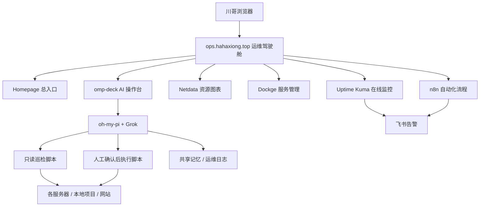

# AI Ops Cockpit — AI 运维驾驶舱

> 状态：v1 方案已确认，准备在 RackNerd VPS 上实施。

## 一句话目标

给川哥一个可视化运维入口：打开网页就能看服务器/项目状态，问 AI 做只读巡检，必要操作先确认再执行，全程有日志、证据、验收结果。

## 背景

川哥不写代码，也不希望日常依赖纯命令行运维。RackNerd VPS `racknerd` 已完成 root 免密 SSH 接入，可作为轻量控制面。第一版目标是“先跑起来再迭代”：稳定、可见、可验收，不追求一开始就完全自治。

## 总体架构



## 模块分工

| 模块 | 作用 | 川哥怎么用 |
|---|---|---|
| Homepage | 总入口看板 | 打开一个网页，看所有服务卡片 |
| Uptime Kuma | 在线、证书、API、端口监控 | 用红绿灯判断服务是否正常 |
| Netdata | CPU、内存、磁盘、网络实时图表 | 看服务器是不是负载高 |
| Dockge | Docker 服务可视化管理 | 点按钮启停服务、看日志 |
| omp-deck | oh-my-pi 网页操作台 | 给 AI 发任务、看执行记录 |
| oh-my-pi + Grok | 运维 AI 助手 | 问“帮我检查所有服务器” |
| n8n | 可视化自动化流程 | 做每日巡检、异常推送飞书 |
| 飞书机器人 | 告警和日报出口 | 手机上收异常和日报 |

## 闭环设计

| 场景 | 闭环流程 | 验收标准 |
|---|---|---|
| 日常巡检 | 定时触发 → AI 汇总 → 飞书日报 | 每天固定时间收到摘要 |
| 网站异常 | Uptime Kuma 检测失败 → 飞书告警 → AI 给排查建议 | 能看到失败 URL、时间、原因 |
| 服务器异常 | Netdata 指标异常 → 看板变红 → AI 拉取证据 | CPU、内存、磁盘有图表证据 |
| 项目状态 | AI 检查 mycc、个人站、服务进程 → 输出状态表 | 每个项目有“正常/异常/待确认” |
| 人工操作 | 川哥点确认 → AI 执行 → 输出前后对比 | 操作前后都有日志和验证结果 |

## 安全原则

- 默认只读：第一版 AI 只能巡检、分析、汇总。
- 高危动作二次确认：重启、删除、升级、改配置必须先给方案。
- 所有服务优先 Docker 化，方便备份、迁移、回滚。
- 看板必须加登录保护，不能裸奔公网。
- 密码和 API Key 不写入看板、不写入记忆，只放服务器 secret 文件或系统安全位置。
- 每次 AI 操作都写日志：谁触发、做了什么、结果是什么。

## 第一版验收清单

| 验收项 | 通过标准 |
|---|---|
| 总入口 | 能打开 `ops.hahaxiong.top`，看到所有模块卡片 |
| 在线监控 | 至少监控 3 个目标：RackNerd、本机关键服务、个人站 |
| 资源监控 | 能看到 RackNerd 的 CPU、内存、磁盘、网络图表 |
| 服务管理 | 能在 Dockge 看到所有容器状态和日志 |
| AI 助手 | 能在网页里问“检查当前服务器状态”并得到表格结果 |
| 飞书通知 | 手动触发一次巡检，飞书收到摘要 |
| 异常测试 | 停掉一个测试服务，看板变红并发出通知 |
| 日志留痕 | 每次巡检/操作都有记录可查 |

## 实施路线

1. Phase 1：基础驾驶舱  
   部署 Docker、Caddy、Homepage、Uptime Kuma、Netdata、Dockge，先把可视化跑起来。
2. Phase 2：AI 操作台  
   部署 oh-my-pi、omp-deck，接 Grok，配置只读巡检能力。
3. Phase 3：通知闭环  
   接飞书机器人，做“手动巡检”和“每日巡检日报”。
4. Phase 4：可确认操作  
   加“重启服务、拉日志、检查磁盘、检查证书”等按钮，全部需要确认。
5. Phase 5：多服务器扩展  
   接入 Mini、NAS、阿里云、个人站等其他机器，统一进看板。

## v1 交付物

- `ops.hahaxiong.top` 可访问的总入口。
- RackNerd 控制面上的监控、资源、容器、AI 操作台。
- 只读巡检 routine。
- 飞书手动/定时巡检摘要。
- 操作日志和验收记录。

## 当前运维接入信息

- RackNerd SSH 别名：`racknerd`
- 主机：`root@23.226.135.149:22`
- 主机名：`racknerd-54aa08d`
- 系统：Ubuntu 24.04
- 登录方式：本机 `~/.ssh/id_ed25519` 公钥免密
- 密码策略：密码不入文档、不入记忆

## 实施记录

### 2026-07-07 Phase 1 基础驾驶舱

已在 RackNerd VPS 完成基础栈部署：

- Docker Engine：`29.6.1`
- Docker Compose：`v5.3.0`
- 部署目录：`/opt/ai-ops-cockpit`
- Compose 文件：`/opt/ai-ops-cockpit/compose.yaml`
- 入口：`http://23.226.135.149/`
- Basic Auth 用户：`chuan`
- Basic Auth 密码：仅保存在远端 `/root/ai-ops-cockpit-secrets.txt`，不入文档、不入记忆
- 防火墙：UFW 已启用，仅放行 `22/tcp`、`80/tcp`、`443/tcp`

已启动容器：

| 容器 | 作用 | 路径 |
|---|---|---|
| `ops-caddy` | 统一入口与 Basic Auth | `/` |
| `ops-homepage` | 运维总入口 | `/` |
| `ops-uptime-kuma` | 在线监控 | `/kuma/` |
| `ops-netdata` | 资源图表 | `/netdata/` |
| `ops-dockge` | Docker 服务管理 | `/dockge/` |

公网验收结果：

| 验收项 | 结果 |
|---|---|
| 未登录访问 `/` | `401`，Basic Auth 生效 |
| 登录访问 `/` | `200 text/html` |
| 登录访问 `/kuma/` | `302`，进入 Uptime Kuma 初始化流程 |
| 登录访问 `/netdata/` | `200 text/html` |
| 登录访问 `/dockge/` | `200 text/html` |
| Netdata 容器健康 | `healthy` |
| 磁盘余量 | `/` 约 `25G` 可用 |
| 运行内存 | 5 个容器合计约 `770MiB` |

当前限制：

- `ops.hahaxiong.top` 尚未配置 DNS，当前先用 `http://23.226.135.149/` 验收。
- Uptime Kuma 和 Dockge 还需要首次 Web 初始化账号。
- oh-my-pi、omp-deck、n8n、飞书通知属于后续 Phase。

### 2026-07-07 域名与基础监控闭环

川哥已在 Cloudflare 配置 `ops.hahaxiong.top` 橙云代理；源站已完成域名入口适配。

域名入口：

- 正式入口：`https://ops.hahaxiong.top/`
- Cloudflare 橙云：已生效，DNS 返回 Cloudflare A/AAAA
- 源站 HTTPS：Caddy 已自动签发 `ops.hahaxiong.top` Let’s Encrypt 证书
- 访问保护：未登录访问 `https://ops.hahaxiong.top/` 返回 `401`
- 登录后页面验收：`/`、`/kuma/`、`/dashboard`、`/netdata/`、`/dockge/` 均返回 `200`

管理账号：

| 服务 | 用户 | 密码位置 |
|---|---|---|
| 外层 Basic Auth | `chuan` | `/root/ai-ops-cockpit-secrets.txt` 的 `ops` |
| Uptime Kuma | `chuan` | `/root/ai-ops-cockpit-secrets.txt` 的 `uptime_kuma_setup_password` |
| Dockge | `chuan` | `/root/ai-ops-cockpit-secrets.txt` 的 `dockge_setup_password` |

Uptime Kuma 已配置 3 个基础监控项：

| 监控项 | 类型 | 当前状态 |
|---|---|---|
| AI 运维驾驶舱 HTTPS | HTTP `https://ops.hahaxiong.top/`，接受 `401` | UP |
| 陈川个人站 HTTPS | HTTP `https://my.chenchuan.cc/` | UP |
| RackNerd SSH 22 | TCP `23.226.135.149:22` | UP |

最新验收：

| 检查 | 结果 |
|---|---|
| `https://ops.hahaxiong.top/` 未登录 | `401` |
| `https://ops.hahaxiong.top/` 登录后 | `200 text/html` |
| `/kuma/` | `200 text/html` |
| `/dashboard` | `200 text/html` |
| `/netdata/` | `200 text/html` |
| `/dockge/` | `200 text/html` |
| Kuma 监控 3 项 | 全部 `UP` |

下一步：

- 接入飞书通知。
- 部署 oh-my-pi / omp-deck，形成 AI 运维助手入口。
- 接入 n8n，做每日巡检日报和手动巡检按钮。

### 2026-07-07 Homepage 默认模板修复

川哥截图显示首页仍是 Homepage 默认模板，并且顶部出现多个 `API Error`。根因是 Caddy 为兼容 Uptime Kuma，把 `/api/*` 和 `/assets/*` 也转发给了 Uptime Kuma，导致 Homepage 自己的 `/api/services`、`/api/bookmarks` 等接口被抢路由，前端无法读取自定义配置。

修复：

- 移除 Kuma 对全局 `/api/*`、`/assets/*`、`/socket.io/*` 的匹配。
- Kuma 仅保留 `/kuma*`、`/dashboard*`、`/setup*`、`/status*`、`/manage-status-page*`、`/maintenance*` 等必要页面路由。
- Homepage 的 `/api/services`、`/api/bookmarks` 恢复由 Homepage 容器处理。
- 个人站卡片从错误的 `https://chenchuan.site/` 改为 `https://my.chenchuan.cc/`。

验收：

| 检查 | 结果 |
|---|---|
| `https://ops.hahaxiong.top/api/services` | `200 application/json` |
| `https://ops.hahaxiong.top/api/bookmarks` | `200 application/json` |
| 服务组 | `运维入口`、`主机状态` |
| 服务卡片 | `Uptime Kuma 在线监控`、`Netdata 资源图表`、`Dockge 服务管理`、`AI 操作台`、`RackNerd VPS`、`个人站`、`mycc 本机` |
| 默认模板字符串 | API 中已不存在 `My First Group` / `API Error` |

### 2026-07-07 Uptime Kuma 空白页修复与 BRO-PDCA 补验

川哥截图反馈 `/dashboard` 打开后一片空白。前一次验收只验证了 HTTP `200`，没有做真实浏览器加载验证，违反 BRO-PDCA 中“自己先验收、证据闭环”的要求。

根因：

- Uptime Kuma 是根路径 SPA，`/dashboard` 页面引用根路径资源：`/assets/*.js`、`/assets/*.css`、`/manifest.json`、`/icon.svg`、`/socket.io/*`、`/api/entry-page`。
- 为修复 Homepage 默认模板时，我把 `/api/*`、`/assets/*` 从 Kuma 路由移除，导致 Kuma 的 JS/CSS 资源被 Homepage 接管并返回 `404 text/html`。
- 浏览器看到 HTML 主页面 `200`，但 JS/CSS 加载失败，所以页面空白。

修复：

- 保持 Homepage 的 `/api/services`、`/api/bookmarks` 由 Homepage 处理。
- 将 Kuma 必需资源显式路由给 `ops-uptime-kuma`：`/assets/*`、`/socket.io/*`、`/upload/*`、`/manifest.json`、`/icon.svg`、`/api/entry-page*`、`/api/status-page/*`。
- 保留 Kuma 页面路由：`/kuma*`、`/dashboard*`、`/setup*`、`/status*`、`/manage-status-page*`、`/maintenance*`。

验收证据：

| 检查 | 结果 |
|---|---|
| Homepage `/api/services` | `200 application/json` |
| Homepage `/api/bookmarks` | `200 application/json` |
| Kuma `/dashboard` | `200 text/html` |
| Kuma `/assets/index-*.js` | `200 application/javascript` |
| Kuma `/assets/index-*.css` | `200 text/css` |
| Kuma `/manifest.json` | `200 application/json` |
| Kuma `/icon.svg` | `200 image/svg+xml` |
| Playwright 真浏览器登录 `/dashboard` | 页面非空，标题 `Uptime Kuma`，三项监控可见 |
| Playwright 控制台错误 | 无 |
| Playwright 失败请求 | 无 |

Playwright 输出摘要：`bodyLength=377`，可见 `AI 运维驾驶舱 HTTPS`、`RackNerd SSH 22`、`陈川个人站 HTTPS`，Quick Stats 显示 `Up 3 / Down 0`。

后续规则：

- 前端页面验收不能只看 HTTP 状态码，必须至少做一次真实浏览器加载验证。
- SPA 子路径/反代改动必须检查 HTML 引用的 JS/CSS/API/WebSocket 资源是否全部命中正确后端。
- 涉及用户可见页面时，验收证据需包含页面文本、截图或 Playwright snapshot。

### 2026-07-07 飞书告警通道与最终验收

川哥提供飞书机器人 Webhook 后，已在 Uptime Kuma 中接入“飞书运维告警”，并绑定到 3 个生产监控项。

当前生产监控：

| 监控项 | 告警通道 | 当前状态 |
|---|---|---|
| AI 运维驾驶舱 HTTPS | 飞书运维告警 | UP |
| 陈川个人站 HTTPS | 飞书运维告警 | UP |
| RackNerd SSH 22 | 飞书运维告警 | UP |

本次处理：

- Uptime Kuma 已创建飞书通知配置 `飞书运维告警`，Webhook 不入文档、不入 git、不入记忆。
- 已发送飞书通道测试消息，Uptime Kuma provider 返回 `Sent Successfully.`。
- 已用临时容器 `ops-alert-test` 做 Down/Up 闭环测试，Kuma 记录到 `Up → Down → Up` 心跳变化。
- 测试监控与临时容器已清理，最终页面只保留 3 个生产监控项。
- Homepage `RackNerd VPS` 卡片移除了外链 `ubuntu.png` 图标，避免浏览器出现非核心第三方图标失败请求。

BRO-PDCA 验收证据：

| 检查 | 结果 |
|---|---|
| 远端容器 | `ops-caddy`、`ops-homepage`、`ops-uptime-kuma`、`ops-netdata`、`ops-dockge` 全部运行 |
| 生产监控数量 | 3 个，均绑定 `飞书运维告警` |
| 最近心跳 | 3 个生产监控均为 `UP` |
| 临时测试项 | `飞书告警闭环测试` 已删除 |
| Playwright 首页验收 | 首页 `200`，可见 Uptime Kuma / Netdata / Dockge / RackNerd VPS，无 `API Error` |
| Playwright Kuma 验收 | `/dashboard` `200`，标题 `Uptime Kuma`，可见 3 个生产监控，Quick Stats `Up 3 / Down 0` |
| 浏览器控制台 | 无错误 |
| 应用失败请求 | 无失败请求 |

本地验收截图：

- `/Users/rayman.chen/mycc/output/playwright/ai-ops-homepage-final.png`
- `/Users/rayman.chen/mycc/output/playwright/kuma-dashboard-final.png`
- `/Users/rayman.chen/mycc/output/playwright/ai-ops-final-verify.json`

下一步：

- 接入 n8n，做“手动巡检按钮”和每日巡检日报。
- 接入 oh-my-pi / omp-deck / Grok，形成 AI 运维助手入口。
- 扩展监控目标：本机关键项目、NAS、Mini、Studio、更多个人站服务。

### 2026-07-07 n8n 接入、Dockge 白屏修复、Netdata 真实性核验

本轮按川哥要求并行处理 3 件事：接入 n8n、修复 Dockge 白屏、确认 Netdata 数据是否为当前真实数据。

n8n 接入：

- 已新增容器 `ops-n8n`，入口：`https://ops.hahaxiong.top/n8n/`。
- 已在 Homepage 增加 `n8n 自动化巡检` 卡片。
- 已完成 n8n owner 初始化，当前页面进入登录态；账号信息不入文档、不入 git、不入记忆，密码仍只在远端 `/root/ai-ops-cockpit-secrets.txt`。
- 已在 Uptime Kuma 增加监控 `n8n 自动化巡检 HTTPS`，并绑定 `飞书运维告警`。

Dockge 白屏根因与修复：

- 根因 1：Dockge 和 Uptime Kuma 都是根路径 SPA，Dockge `/dockge/` 页面会默认加载根路径 `/assets/*`，被 Caddy 转给 Kuma，导致 JS MIME 错误和白屏。
- 根因 2：修复资源后，Dockge Socket.IO 仍默认连根路径 `/socket.io/`，继续和 Kuma 冲突。
- 根因 3：Socket 修好后，Dockge Vue Router 仍按 `/` 作为前端 base，访问 `/dockge/` 无匹配路由，页面仍空。
- 修复：Dockge 前端资源继续由 `/dockge/` 入口访问；Socket.IO 改为 `/dockge/socket.io`，Caddy 对该路径 strip `/dockge` 后转发给 Dockge；Dockge 前端 Router base 改为 `/dockge/`。

Netdata 真实性结论：

- `https://ops.hahaxiong.top/netdata/` 显示的是 RackNerd 当前真实宿主机数据，不是静态样例数据。
- 证据：Netdata 页面显示 Ubuntu、Kernel `6.8.0-134-generic`、1 核、约 `1.92 GB` RAM、约 `40 GB` Disk、KVM；与宿主 `hostname`、`uname -r`、`free -m`、`df -h /` 匹配。
- Netdata 容器通过 host `/proc`、`/sys`、`/` 只读挂载采集宿主数据；浏览器和 Netdata API 均有实时数值变化。

BRO-PDCA 验收证据：

| 检查 | 结果 |
|---|---|
| 远端容器 | `ops-caddy`、`ops-homepage`、`ops-uptime-kuma`、`ops-netdata`、`ops-dockge`、`ops-n8n` 全部运行 |
| Homepage | `200`，可见 `n8n 自动化巡检`，无 `API Error` |
| Dockge | `200`，页面非空，显示 `Dockge / Username / Password / Login`，控制台错误 0，失败请求 0 |
| Netdata | `200`，页面非空，显示 RackNerd 当前系统信息，控制台错误 0，失败请求 0 |
| n8n | `200`，owner 已初始化，显示 `Sign in / Email / Password` |
| Uptime Kuma | 4 个监控：AI 运维驾驶舱、个人站、RackNerd SSH、n8n；均绑定飞书告警 |
| 最新心跳 | 4 个监控均为 `UP`，n8n 返回 `401 - Unauthorized` 并按预期计为 UP |

本地验收文件：

- `/Users/rayman.chen/mycc/output/playwright/ai-ops-final-phase2.json`
- `/Users/rayman.chen/mycc/output/playwright/final--.png`
- `/Users/rayman.chen/mycc/output/playwright/final--dockge-.png`
- `/Users/rayman.chen/mycc/output/playwright/final--netdata-.png`
- `/Users/rayman.chen/mycc/output/playwright/final--n8n-.png`

下一步：

- 在 n8n 内做第一个“手动巡检按钮”：读取 Kuma 状态、Netdata 摘要、Docker 容器状态，并发飞书摘要。
- 再做每日定时巡检日报。

### 2026-07-07 n8n 手动巡检按钮闭环

已完成第一版“手动巡检按钮”：通过 n8n Webhook 触发只读巡检，汇总 Kuma、Netdata、Docker 容器状态，并发送飞书摘要。

入口：

- 手动触发：`https://ops.hahaxiong.top/n8n/webhook/ai-ops-inspect`
- 访问保护：仍在外层 Caddy Basic Auth 后面。
- n8n 工作流：`AI Ops 手动巡检到飞书`
- 内部只读采集服务：`ops-inspector`

实现结构：

- `ops-inspector` 只读读取：Docker socket、Uptime Kuma SQLite、Netdata API。
- n8n Webhook 调用 `http://ops-inspector:8080/send-feishu`。
- 飞书 Webhook 只保存在远端 `.env`，不写入文档、不写入 git、不写入长期记忆。
- n8n 不直接持有飞书 Webhook，避免表达式读取 env 被禁和 secret 扩散。

BRO-PDCA 验收证据：

| 检查 | 结果 |
|---|---|
| `ops-inspector /health` | `200 {"ok": true}` |
| `ops-inspector /summary` | 返回 Kuma、容器、Netdata 摘要 |
| `ops-inspector /send-feishu` | 飞书返回 `StatusCode: 0` / `msg: success` |
| n8n Webhook | `GET /n8n/webhook/ai-ops-inspect` 返回 `200` |
| n8n 执行记录 | execution `2`，workflow `AI Ops 手动巡检到飞书`，状态 `success` |
| 飞书结果 | 已发送“AI 运维驾驶舱手动巡检”摘要 |

当前巡检摘要包含：

- 总结论：正常 / 需要关注。
- 主机：Kernel、Load、内存概况。
- Kuma：4 个监控项状态。
- Docker：`ops-*` 容器运行状态。

已知限制：

- `ops-inspector` 当前 hostname 显示容器 ID，但 Kernel、内存、Kuma、Docker 状态均来自宿主/生产服务；后续可把显示名固定为 `racknerd-54aa08d`。
- 当前是手动按钮，下一步再加 n8n 定时节点做每日巡检日报。

### 2026-07-07 统一登录与 MyJavis 备份监控

已完成两项运维体验改造：

1. Uptime Kuma 新增 Push 类型监控 `MyJavis 备份异地拉取`。
2. `ops.hahaxiong.top` 改为外层 Caddy Basic Auth 统一登录，核心子页面不再二次弹登录。

MyJavis 备份监控：

| 项 | 配置 |
|---|---|
| 类型 | Push |
| 名称 | `MyJavis 备份异地拉取` |
| Heartbeat Interval | `129600` 秒 |
| Retries | `0` |
| 通知 | `飞书运维告警` |
| Push URL | 不写入 git / 文档 / 首页，只在对话中交付 |

验收结果：

| 步骤 | 结果 |
|---|---|
| 手动 push | Kuma 返回 `{"ok":true}`，监控变 `UP` |
| 临时改 `60s` 等待超时 | 监控变 `DOWN`，飞书收到故障告警 |
| 恢复 `129600s` 再 push | 监控恢复 `UP`，飞书收到恢复通知 |

统一登录改造：

| 页面 | 结果 |
|---|---|
| `/` | 外层未登录 `401`，登录后显示 AI 运维驾驶舱 |
| `/dashboard` | 登录外层后直接进入 Uptime Kuma Dashboard |
| `/dockge/` | 登录外层后直接进入 Dockge |
| `/n8n/` | 登录外层后直接进入 n8n |
| `/netdata/` | 登录外层后直接进入 Netdata |
| `/api/push/*` | 为 Kuma Push 心跳单独放行，不要求外层 Basic Auth |

实现说明：

- Caddy 继续作为统一入口，外层 Basic Auth 保护除 `/api/push/*` 之外的页面。
- Uptime Kuma 设置 `disableAuth=true`，依赖外层 Caddy 鉴权。
- Dockge 设置 `disableAuth=true`，依赖外层 Caddy 鉴权。
- n8n 关闭内层 Basic Auth，保留 `N8N_USER_MANAGEMENT_DISABLED=true`，依赖外层 Caddy 鉴权。
- Netdata 原本无内层登录，继续依赖外层 Caddy 鉴权。

BRO-PDCA 验收证据：

| 检查 | 结果 |
|---|---|
| 容器状态 | `ops-caddy`、`ops-homepage`、`ops-uptime-kuma`、`ops-netdata`、`ops-dockge`、`ops-n8n`、`ops-inspector` 均运行 |
| 外层保护 | 未登录访问首页返回 `401` |
| Push 放行 | 假 token 返回 `404`，说明请求已到 Kuma，而不是被 Basic Auth 拦截 |
| 浏览器验收 | Homepage、Kuma、Dockge、n8n、Netdata 均可打开 |
| 登录体验 | Kuma/Dockge/n8n 页面不再出现二次登录页 |

本地验收文件：

- `/Users/rayman.chen/mycc/output/playwright/auth-unify-home.png`
- `/Users/rayman.chen/mycc/output/playwright/auth-unify-kuma.png`
- `/Users/rayman.chen/mycc/output/playwright/auth-unify-dockge.png`
- `/Users/rayman.chen/mycc/output/playwright/auth-unify-n8n.png`
- `/Users/rayman.chen/mycc/output/playwright/auth-unify-netdata.png`

### 2026-07-07 统一登录二次优化：消除子页反复授权

现象：从 Homepage 进入 n8n 时，浏览器会反复出现外层授权/登录相关提示；Kuma、Dockge、Netdata 也需要确认是否受同类问题影响。

根因拆分：

1. 只用 Caddy `basic_auth` 时，浏览器会对不同子资源/API 请求反复处理 Basic Auth challenge，体验上像“子页面不断弹授权”。
2. n8n 最新镜像中 `N8N_USER_MANAGEMENT_DISABLED=true` 不能绕过已经初始化 owner 的产品内登录；`/n8n/rest/login` 返回 `401` 是 n8n 自身登录状态，不是 Caddy 外层挑战。
3. n8n 的 `n8n-auth` cookie 会绑定每个浏览器的 `browser-id`，静态复用一个 cookie 会被 n8n 拒绝，仍回到 Sign in。

修复方式：

- 新增内部服务 `ops-auth`：首次通过外层 Basic Auth 后下发 `ops_auth` 会话 cookie，后续页面/API 请求凭 cookie 放行，不再重复弹 Basic Auth。
- Caddy 继续保护除 `/api/push/*` 之外的全部页面；`/api/push/*` 仍保持 Kuma Push 心跳免登录。
- 对 `/n8n/rest/login` 单独反代到 `ops-auth`，由 `ops-auth` 使用当前浏览器的 `browser-id` 动态向 n8n 登录，再把 n8n 返回的 `n8n-auth` cookie 透传给浏览器。
- Kuma、Dockge 继续使用 `disableAuth=true`，依赖外层 Caddy/`ops_auth` 统一会话。

BRO-PDCA 验收结果：

| 页面 | 验收结果 |
|---|---|
| Homepage | 首次授权后进入驾驶舱 |
| n8n | 直接进入 `/n8n/home/workflows`，页面标题 `Workflows - n8n`，可见 `Overview`、`Workflows`、`Credentials`、`Executions` |
| Uptime Kuma | 直接进入 Dashboard，无外层 401 请求 |
| Dockge | 直接进入 Dockge，无外层 401 请求 |
| Netdata | 直接进入 Netdata，无外层 401 请求 |
| Push 心跳 | `/api/push/not-real-token` 仍返回 `404`，说明仍到达 Kuma 且未被授权层拦截 |

本地验收文件：

- `/Users/rayman.chen/mycc/output/playwright/sso-final-n8n.png`
- `/Users/rayman.chen/mycc/output/playwright/sso-final-kuma-snapshot.txt`
- `/Users/rayman.chen/mycc/output/playwright/sso-final-dockge-snapshot.txt`
- `/Users/rayman.chen/mycc/output/playwright/sso-final-netdata-snapshot.txt`

维护注意：

- `ops_auth` 是外层会话 cookie；对应 secret 在远端 `.env`，不写 git。
- n8n 登录密码只在远端 secret/.env 中，`ops-auth` 动态换取每个浏览器自己的 `n8n-auth`。
- n8n 的 `n8n-auth` 默认约 7 天有效；如果之后 n8n 改登录 API 或 cookie 机制，优先检查 `/n8n/rest/login`、`browser-id`、`auth.service.js` 的 browserId 校验逻辑。

### 2026-07-07 只读 AI 运维助手 v0

基于“AI 能力提前，但执行闭环后置”的原则，已先完成只读 AI 运维助手 v0：把真实运维状态结构化给 Grok / OMP 分析，但不让 AI 执行任何重启、删除、升级、改配置动作。

入口：

- 可视化页：`https://ops.hahaxiong.top/ai/`
- JSON 上下文：`https://ops.hahaxiong.top/ai/context`
- 可复制 Prompt：`https://ops.hahaxiong.top/ai/prompt`

实现：

- 复用 `ops-inspector`，新增 `/ai/`、`/ai/context`、`/ai/prompt`。
- `/ai/context` 聚合 Kuma 监控、Docker 容器、Netdata 主机摘要。
- `/ai/prompt` 把上下文包装成“只读 AI 运维助手”提示词，可复制给 Grok / OMP。
- Caddy 新增 `/ai*` 路由到 `ops-inspector`。
- Homepage 把原 `AI 操作台` 卡片升级为 `AI 运维助手 v0`。

安全边界：

- v0 只读，不执行命令。
- Prompt 内显式要求：不重启、不删除、不升级、不改配置。
- 高危动作只能输出建议和风险说明，必须等待川哥确认。
- 远端未接入模型 API key，不在服务器上保存 Grok / OMP 凭据。

BRO-PDCA 验收：

| 检查 | 结果 |
|---|---|
| `/ai/` | `200 text/html`，可见 `AI 运维助手 v0`、`总状态`、`复制提示词` |
| `/ai/context` | `200 application/json`，包含 `read_only_ai_ops_assistant_v0`、Kuma、容器、主机摘要 |
| `/ai/prompt` | `200 text/plain`，可复制给 Grok / OMP |
| Homepage | 可见 `AI 运维助手 v0` 卡片 |
| 浏览器验收 | `/ai/` 页面非空，可见 `正常`、`racknerd-54aa08d`、`Grok`、`OMP`、`Kuma 监控`、`容器` |
| Grok 验收 | 本机 Grok 使用 `/ai/prompt` 成功输出只读运维分析，指出当前正常、需关注重启稳定性、内存、磁盘数据缺失等 |

限制补齐：

- 已补磁盘采集：`/ai/context` 的 `diskGB` 包含 `/`、`/app`、`/kuma` 使用率，以及 Docker image 占用摘要。
- 已补站内只读问答：`/ai/ask?q=...` 支持异常、备份、磁盘、内存、容器等规则化问答；页面提供“站内只读问答 v0”。
- 已补 Grok/OMP 使用入口：页面提供推荐命令，建议把 Prompt 保存到 `/tmp` 后从 `/tmp` 运行，减少 Grok 扫描 `mycc` 大仓和 MCP 配置噪音。
- 已修 favicon 404：Caddy 对 `/favicon.ico` 返回 `204`，减少浏览器控制台噪音。

后续 TODO：

| 优先级 | 事项 | 说明 |
|---|---|---|
| P0 | 观察只读助手稳定性 | 确认 `ops-inspector` 重建后 24h 内不异常重启 |
| P1 | 接 OMP/Grok 站内聊天 | 已完成：页面内“一键问 OMP/Grok”经本机 Bridge 调 OMP，只读返回分析 |
| P1 | 优化健康检查 | 把驾驶舱/n8n 监控从 `401` 视为 UP 改成明确健康端点 |
| P2 | AI 总览卡片 | 首页直接显示“正常/异常、备份、磁盘、容器”的摘要 |
| P2 | 清理 Grok MCP 噪音 | 修复本机 Grok 无 transport 的 MCP 配置，减少 CLI 启动警告 |
| P3 | 人工审批执行 | 只在稳定后考虑“建议 → 确认 → 执行 → 验收”的半自动运维 |

#### OMP / Grok 登录态验证

结论：OMP 调用 Grok 不需要额外手动登录；本机已有 `xai-oauth` 登录态，并由 `com.omp.xai-token-refresh` 定时刷新同步 OMP 与 Grok token。

验证结果：

| 检查 | 结果 |
|---|---|
| `omp models` | 可见 `xai-oauth` provider，包含 `grok-4.3`、`grok-build` 等模型 |
| `grok models` | 显示已登录 `grok.com`，可用 `grok-composer-2.5-fast`、`grok-build` |
| token 保鲜 | `com.omp.xai-token-refresh` last exit code `0`，日志显示刷新成功 |
| OMP 烟测 | `omp --model xai-oauth/grok-4.3 -p ...` 成功返回中文回答 |
| 运维 Prompt | OMP + `xai-oauth/grok-4.3` 成功分析 `/ai/prompt`，判断当前正常并指出内存、个人站延迟、MyJavis 备份心跳为观察项 |

推荐命令：

```bash
curl -u chuan:你的外层密码 https://ops.hahaxiong.top/ai/prompt -o /tmp/ai-ops-prompt.txt
cd /tmp && omp --model xai-oauth/grok-4.3 -p "$(cat /tmp/ai-ops-prompt.txt)"
```

注意：不要使用模糊模型名 `--model grok-4.3`，它可能落到 `xai` provider 并提示缺 API key；应使用完整模型名 `xai-oauth/grok-4.3`。

### 2026-07-07 P0 稳定性补齐

本轮目标：先把“看得见、测得准、每天能主动报”的 P0 闭环补齐，再继续做更复杂的 AI 运维能力。

完成项：

- 健康端点：新增 `https://ops.hahaxiong.top/ops-health/ai` 与 `https://ops.hahaxiong.top/ops-health/n8n`，两者免登录返回 `200` JSON。
- Kuma 优化：`AI 运维驾驶舱 HTTPS` 和 `n8n 自动化巡检 HTTPS` 已从认证页监控切到 `/ops-health/*`，状态码规则恢复为 `200-299`，不再依赖 `401` 判活。
- Bridge 自检：`/ai/` 页面新增“本机 OMP Bridge 自检”卡片，自动请求 `http://127.0.0.1:18777/health`，在线时显示模型 `xai-oauth/grok-4.3`。
- 飞书日报：n8n 新增并激活 `AI Ops 每日巡检日报到飞书`，每天 `08:30 Asia/Shanghai` 调用 `ops-inspector:/send-daily-feishu`。

文件快照：

- Caddy 快照：`2-Projects/ai-ops-cockpit/caddy/Caddyfile`
- n8n 日报工作流：`2-Projects/ai-ops-cockpit/n8n/workflows/aiops-daily-feishu-0830.json`
- 远端服务源码：`2-Projects/ai-ops-cockpit/ops-inspector/server.py`

BRO-PDCA 验收：

| 检查 | 结果 |
|---|---|
| `/ops-health/ai` | 公网免登录 `200`，返回 `ok=true`、`downCount=0`、`unhealthyCount=0` |
| `/ops-health/n8n` | 公网免登录 `200`，内部探测 n8n `/healthz` 返回 `status=ok` |
| Kuma 监控目标 | `AI 运维驾驶舱 HTTPS` -> `/ops-health/ai`，`n8n 自动化巡检 HTTPS` -> `/ops-health/n8n` |
| Bridge 自检页面 | Playwright 可见 `Bridge 在线，可一键问 OMP/Grok`，请求 `127.0.0.1:18777/health => 200` |
| 浏览器控制台 | `/ai/` 页面最终验收 `Errors: 0, Warnings: 0` |
| 飞书日报发送 | 手动触发 `/send-daily-feishu` 返回飞书 `StatusCode:0` / `msg:success` |
| n8n 激活 | 日报工作流 `active=1` 且 n8n 日志显示 `Activated workflow "AI Ops 每日巡检日报到飞书"` |

踩坑记录：

- Caddy 的外层授权白名单要同时排除 `@needsAuth` 和 `@setAuthCookie`，否则 `/ops-health/*` 仍会返回 `401`，Kuma 无法用纯 `200-299` 判活。
- 直接改 Kuma SQLite 前必须先备份；本次备份在远端 `/opt/ai-ops-cockpit/backups/kuma-before-health-py-20260707082645.db`。
- n8n 单机模式下 `import:workflow --activeState=fromJson` 不可用；需要先导入，再发布 `publish:workflow`，并重启 n8n 才会加载定时触发器。
- Python f-string 内输出 JS 字符串时仍需注意 `\\n`，否则浏览器会报 `Invalid or unexpected token`。

### 2026-07-07 P1 可视化与告警体验

本轮目标：把 P1 的“首页总览、n8n 可视化验收、告警降噪、备份状态卡”并行补齐，让日常运维尽量少进命令行。

完成项：

- AI Ops 总览页：新增 `https://ops.hahaxiong.top/ops-dashboard/`，展示总状态、备份状态、磁盘最高使用率、容器异常数、Kuma DOWN 数、最后日报时间。
- 总览 JSON：新增 `https://ops.hahaxiong.top/ops-dashboard.json`，供后续 Homepage widget 或其他 agent 读取。
- 备份状态卡：`/ai/` 与 `/ops-dashboard/` 都展示 `MyJavis 备份异地拉取` 最近心跳、36h 窗口和剩余告警时间。
- 告警降噪：`/send-feishu` 增加 issue signature 去重；相同 DOWN/异常容器组合只发一次，重复触发返回 `status=deduped`；日报 `/send-daily-feishu` 保持强制发送。
- n8n 可视化验收：n8n 页面可见 `AI Ops 每日巡检日报到飞书` 工作流，并可从 `Executions` 查看执行记录入口。
- Homepage 配置：`homepage/config/services.yaml` 已加入 `AI Ops 总览` 卡片配置；远端 API `/api/services` 已返回该卡片。

BRO-PDCA 验收：

| 检查 | 结果 |
|---|---|
| `/ops-dashboard/` | Playwright 可见 `AI Ops 总览`、`正常`、`备份状态`、`磁盘最高使用率`、`最后日报` |
| `/ops-dashboard.json` | 返回 `ok=true`、`backup.remainingHours`、`lastDaily.sentAt`、`metrics` |
| 备份卡 | 显示 `UP，最近心跳 2026-07-07 04:37:06.365，约剩 23.7 小时进入告警窗口` |
| 告警降噪 | 连续调用 `/send-feishu` 第一次发飞书成功，第二次返回 `status=deduped` |
| 日报状态 | 调用 `/send-daily-feishu` 后 `lastDaily.sentAt=2026-07-07 16:52:50 CST` |
| n8n 页面 | Playwright 可见 `AI Ops 每日巡检日报到飞书`，控制台 `Errors: 0` |
| Homepage API | `/api/services` 返回 `AI Ops 总览` -> `/ops-dashboard/` |

收尾修复：

- Homepage `/api/services` 已返回 `AI Ops 总览` 但首页仍显示旧卡片，根因是 Homepage 容器内 `.next/server/pages/en.html` 静态 SSR 缓存未刷新。
- 已清理容器内旧静态 HTML 并重启 Homepage；Playwright 复验首页可见 `AI Ops 总览`，点击后进入 `/ops-dashboard/`。

文件快照：

- 远端服务源码：`2-Projects/ai-ops-cockpit/ops-inspector/server.py`
- Homepage 配置：`2-Projects/ai-ops-cockpit/homepage/config/services.yaml`
- Homepage 注入脚本尝试：`2-Projects/ai-ops-cockpit/homepage/config/custom.js`

#### 站内一键问 OMP / Grok

目标：川哥在 `https://ops.hahaxiong.top/ai/` 页面点击按钮，就能把当前页面里的只读运维 Prompt 发给本机 OMP/Grok，不再手工复制命令。

实现边界：

- 远端 `ops-inspector` 只负责渲染页面和真实只读上下文，不保存 Grok / OMP 凭据。
- 本机 Bridge：`/Users/rayman.chen/mycc/2-Projects/ai-ops-cockpit/local-omp-bridge/server.py`。
- 本机 LaunchAgent：`/Users/rayman.chen/Library/LaunchAgents/com.ai-ops.omp-bridge.plist`。
- 健康检查：`http://127.0.0.1:18777/health`，期望返回 `mode=prompt-from-page`、`model=xai-oauth/grok-4.3`。
- 页面按钮 POST 到 `http://127.0.0.1:18777/ask`，请求体由页面携带当前 `prompt` 和 `question`。

BRO-PDCA 验收：

| 检查 | 结果 |
|---|---|
| Bridge health | `200 {"ok": true, "model": "xai-oauth/grok-4.3", "mode": "prompt-from-page"}` |
| 远端容器 | `ops-inspector` 重建后运行，`/ai/` 不再 500 |
| 浏览器页面 | Playwright 打开 `/ai/`，可见 `正常`、`一键问 OMP / Grok`、`问 OMP/Grok` |
| 控制台 | 最终验收 console `Errors: 0, Warnings: 0` |
| 网络请求 | 点击按钮后 `POST http://127.0.0.1:18777/ask => 200 OK` |
| 模型输出 | 页面内出现 Grok 分析：总判断正常，关注内存 free RAM、MyJavis 备份时效、401 认证响应是否预期 |

踩坑记录：

- `ops-inspector` 是 build 镜像服务，改 `/opt/ai-ops-cockpit/ops-inspector/server.py` 后必须 `docker compose up -d --build ops-inspector`，只 `restart` 不会带入新代码。
- Python f-string 里内嵌 JS 对象字面量时，`{method:'POST'}` 会被当成 Python 表达式，导致 `/ai/` 500：`NameError: name 'method' is not defined`；JS 代码中的花括号必须双写或放到更安全的脚本块里。
- Python f-string 里写 JS 字符串换行时，`\n` 会在最终 HTML 里变成真实换行，触发浏览器 `Invalid or unexpected token`；需要输出字面量 `\\n`。
- 本机 LaunchAgent 调 OMP/Grok 必须带代理环境变量；否则 CLI 在 LaunchAgent 环境里可能超时。已在 plist 写入 `HTTP_PROXY`、`HTTPS_PROXY`、`ALL_PROXY` 及小写版本。
- 真实验收不能只看 HTTP `200`；这次用 Playwright 验证了页面文本、控制台、网络请求和按钮返回内容。

维护命令：

```bash
curl -sS http://127.0.0.1:18777/health
launchctl kickstart -k gui/$(id -u)/com.ai-ops.omp-bridge
tail -120 /tmp/ai-ops-omp-bridge.log
ssh racknerd 'cd /opt/ai-ops-cockpit && docker compose up -d --build ops-inspector'
```
