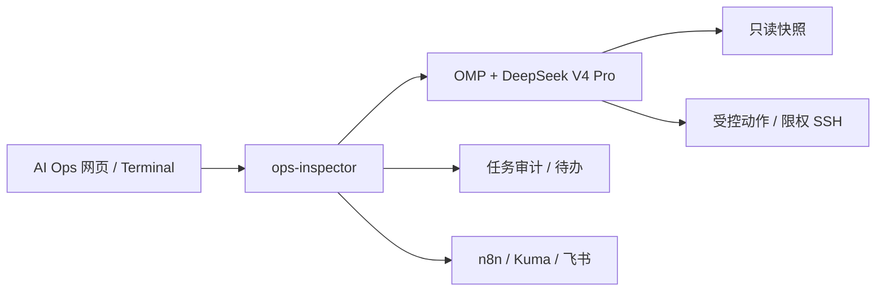
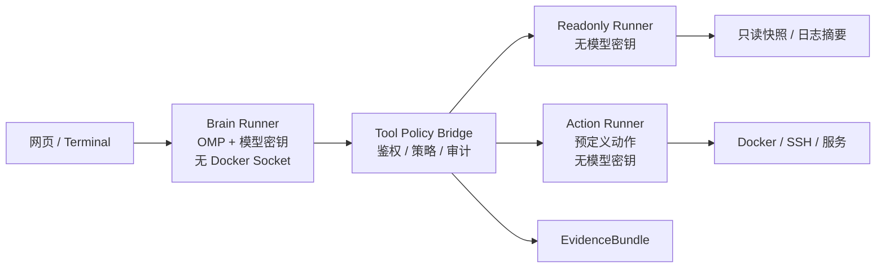

# Pi 源码借鉴方案：在不迁移引擎的前提下增强 AI Ops

> 决策日期：2026-08-01
> 适用项目：`2-Projects/ai-ops-cockpit`
> 当前生产引擎：OMP + 火山方舟 `deepseek-v4-pro`

## 1. 决策结论

AI Ops 继续使用 OMP 作为生产主引擎，不直接迁移到 Pi Agent。

Pi 的核心价值是提供一组值得吸收的架构模式：执行隔离、项目 Trust、工具调用策略门、权威状态快照、会话树、结构化压缩和供应链加固。这些模式应按 AI Ops 的现有边界重新实现，而不是直接依赖 Pi 的实验性 server 包。

源码审阅基线：

- Pi：`earendil-works/pi`，审阅 HEAD `4488ad55c18f07ae89a489096c90de8667b3adfb`。
- OMP：`can1357/oh-my-pi`，审阅 HEAD `80627462b4e91f46795ba87f3678174bd3c0b907`。
- 两者均为 MIT；如复制具体实现而非只借鉴设计，必须保留对应许可证和署名。

## P0 落地状态（2026-08-01）

本方案的 Brain / Hands 分离、`readonly_safe` 和 Tool Policy Gate 已部署到 RackNerd 生产环境，不再只是设计稿：

- `ops-brain` 与 `ops-terminal` 均为无 Docker Socket、无生产 SSH、无真实项目挂载的 Brain 沙箱。
- `ops-tool-runner` 独占只读快照，执行 `read`、`grep`、`find`、`ls`；路径逃逸、敏感路径、软链接、未知项目/workflow 和写工具全部拒绝。
- `ops-inspector` 继续作为受控 Hands，生产动作仍必须走既有结构化动作、确认词和审计链路。
- 后台 Brain 与网页 Terminal 使用独立 OMP agent 目录；Terminal 的最小配置固定关闭首次 Provider Setup Wizard，打开后直接进入 `readonly_safe`。
- 本地单元测试、Python/Shell/最终页面 JavaScript 静态检查、完整线上回归、真实 DeepSeek 只读任务和真实浏览器七页面检查均通过。
- 生产回滚锚点为 `/opt/ai-ops-cockpit/backups/brain-hands-20260801-055028`；终端首次启动修复回滚点为 `/opt/ai-ops-cockpit/backups/terminal-setup-fix-20260801-141913`。

仍未实施的内容保持原优先级：OMP 更新供应链 48 小时冷静期与 integrity/依赖快照属于下一项 P0 收口；权威 Snapshot/revision/reconnect/abort、会话树与结构化压缩属于 P1；Project Trust Registry 和生产离线模式属于 P2。

## 2. 当前 AI Ops 基线

当前闭环：



已有保护：

- 网页任务默认 `--no-tools`。
- 真实项目使用文件级 allowlist。
- 生产维护通过独立限权 SSH 动作。
- Harness 注入 BRO-PDCA、默认只读、动作确认和验收要求。
- OMP 更新采用 candidate/current/fallback，必须通过真实推理和 `OK vibe regression` 才切换。
- 模型密钥只通过 Docker secret 挂载。

当前主要结构风险：`ops-terminal` 同时持有模型密钥、完整 OMP、Docker Socket 和运维工作区。网页无工具模式能降低日常风险，但完整终端模式仍把“大脑、凭据和高权限手脚”放在同一信任边界。

## 3. P0：优先借鉴

### 3.1 Brain / Hands 分离

目标架构：



边界：

- Brain Runner 只访问模型服务、任务上下文和 Tool Bridge。
- Brain Runner 不挂载 Docker Socket，不直接持有生产 SSH 私钥。
- Readonly Runner 只读挂载 allowlist 快照，不持有模型密钥。
- Action Runner 只接受结构化动作，例如 `inspect`、`restart-service`、`refresh`、`rollback-last-good`。
- Tool Bridge 校验 taskId、workflow、project、permission、确认票据和参数 schema。
- 任意 shell、任意 Docker API 和任意 SSH 命令保持禁止。

验收：

1. Brain 容器内不存在 Docker Socket和生产 SSH 私钥。
2. Tool Runner 内不存在方舟密钥、Webhook、Kuma Push URL。
3. 未授权动作返回结构化拒绝并进入审计。
4. 现有网页任务、Terminal、n8n、Kuma 和飞书回归全部通过。

### 3.2 `readonly_safe` 工具档

现状的 `--no-tools` 安全但能力不足。新增安全只读档：

| Workflow | 允许 | 禁止 |
|---|---|---|
| `readonly_safe` | `read`、`grep`、`find`、`ls`，仅允许只读快照根 | bash、write、edit、Docker、SSH |
| `diagnose` | `readonly_safe` + 预定义健康检查、日志摘要、限权 `inspect` | 任意命令、任意路径、修改服务 |
| `action_confirmed` | 已批准的结构化动作 | 未绑定确认票据的动作、参数外命令 |

实现要求：

- 真实路径必须经过 `realpath`，阻止 `..`、软链接和绑定挂载逃逸。
- 工具参数和结果限制最大长度，日志只保留脱敏摘要。
- 非交互定时任务遇到未知项目或未知工具时 fail closed。
- 网页默认仍保持 `readonly_safe`，不因模型请求自动升级权限。

### 3.3 Tool Policy Gate

借鉴 Pi 的 `permission-gate`、`protected-paths`、`dirty-repo-guard`，按 OMP Extension / Tool Bridge API 重写，不假定可以直接复制运行。

硬拦规则：

- `rm -rf`、`sudo`、`chmod/chown 777`、`curl | sh`。
- `.env`、secret、私钥、认证数据库、Webhook、Push URL。
- `/etc`、`/root`、Docker Socket、未登记工作区。
- 未确认的 restart、deploy、rollback、delete、commit、push。
- 非 allowlist 文件写入和跨项目写入。

审计输出只包含：taskId、项目、workflow、工具名、参数摘要、策略判定、确认票据、耗时和验收结果，不保留 secret 或上游错误正文。

### 3.4 OMP 更新供应链冷静期

在现有 candidate/current/fallback 基础上增加：

- 稳定版本发布满 48 小时后才进入候选验证。
- 保存 npm integrity、包版本、依赖清单和候选目录 SHA-256。
- 依赖版本和模型目录使用固定快照。
- 日常 Agent 运行禁止访问 npm/GitHub，只有 updater 在维护窗口临时放行。
- 保留当前版、上一稳定版和镜像 fallback，清理更旧候选，控制 `/opt/omp-runtime` 增长。

## 4. P1：网页与长任务体验

### 4.1 权威快照和 revision

借鉴 Pi server/client 的状态模型，但不直接使用其实验 API。

任务快照：

```json
{
  "taskId": "...",
  "revision": 12,
  "status": "verifying",
  "progress": 80,
  "updatedAt": "...",
  "canAbort": true
}
```

状态机：

```text
queued → starting → reasoning → executing → verifying
       → completed | failed | waiting_confirmation | aborted
```

规则：

- Snapshot 是权威状态，Progress Event 只作展示。
- 浏览器只接受 revision 更大的快照，忽略迟到事件。
- 刷新页面后按 taskId 重新 attach，不创建重复任务。
- reconnect 使用指数退避并展示最后一次权威状态。
- abort 是独立受审计动作，不能只在前端隐藏任务。

### 4.2 会话树与分支

为任务增加：

- `parentTaskId`
- `conversationId`
- `branchId`
- `decisionId`
- `evidenceBundleId`

标准闭环：

```text
发现异常
→ 只读巡检
→ 生成方案
→ 用户确认
→ 执行动作
→ 验收
→ 恢复通知
```

“继续追问”创建子节点；“换方案”创建分支；“执行”只能引用已批准方案；“转待办”只保存脱敏摘要和任务引用。

### 4.3 BRO-PDCA 结构化压缩

长任务压缩格式固定为：

```markdown
## O1 目标
## O2 约束
## 当前状态
## 已完成
## 进行中
## 阻塞
## 关键决策
## 风险与回滚点
## 已读取资产
## 已修改资产
## 验收证据
## 下一步
```

压缩后仍保留原始本地审计文件引用；飞书、待办和共享记忆只接收脱敏摘要。

## 5. P2：多项目治理

### 5.1 Project Trust Registry

示例：

```json
{
  "chenchuan-site": {
    "trusted": true,
    "scope": "readonly",
    "allowedActions": ["inspect", "refresh-radar"],
    "approvedBy": "chuan",
    "approvedAt": "..."
  }
}
```

规则：

- 新项目默认 `untrusted`。
- 未信任项目不加载项目级配置、Skill 或扩展。
- 信任、读取、修改、部署为四个独立权限，不互相蕴含。
- 非交互任务遇到未知项目默认拒绝。
- Trust 变化必须有审批记录和可回滚版本。

### 5.2 生产离线模式

- Agent 日常仅允许访问方舟 API 和 Tool Bridge。
- npm、GitHub、任意下载站默认不可达。
- updater 在维护窗口获取临时出站权限。
- 模型目录和规则采用本地固定快照。
- 第三方扩展必须固定版本或 commit，并经过源码审查。

## 6. 实施顺序

| 阶段 | 内容 | 预期收益 | 进入条件 |
|---|---|---|---|
| P0-A | Brain / Hands 分离设计与最小 PoC | 去除模型密钥与 Docker 高权限共存 | 不改变生产入口 |
| P0-B | `readonly_safe` + Tool Policy Gate | AI 能自己核验证据且不能写入 | 只读回归通过 |
| P0-C | 更新冷静期和完整性记录 | 降低供应链与首发回归风险 | updater dry-run 通过 |
| P1-A | Snapshot/revision/reconnect/abort | 消除网页无反应和状态倒退 | 兼容旧任务 API |
| P1-B | 会话树与结构化压缩 | 支持跨页面、跨天连续运维 | 隐私审查通过 |
| P2 | Trust Registry + 离线模式 | 安全扩展更多真实项目 | P0/P1 稳定运行 |

## 7. 不做事项

- 不直接替换 OMP。
- 不在生产依赖 Pi 的实验性 server/client/protocol。
- 不因为有 Project Trust 就认为获得了系统隔离。
- 不把原始 Docker Socket、任意 SSH 或模型密钥交给 Tool Runner。
- 不自动升级权限，不自动部署，不自动 commit/push。
- 不把 secret、原始任务正文、OAuth URL、Webhook 或内部错误正文写入 Git、记忆或通知。

## 8. 总体验收

1. 原有 `/vibe/` 发送任务、`/vibe/tasks`、`/vibe/todos`、`/vibe/assets`、`/terminal/` 全部可用。
2. 网页只读任务能使用安全只读工具，越权写入测试被代码层拒绝。
3. Brain 容器不能访问 Docker Socket或生产 SSH 私钥。
4. Tool Runner 不能读取方舟密钥。
5. 页面刷新和断网重连不会重复创建任务或丢失终态。
6. 并发任务按项目和动作锁正确串并行。
7. 候选 OMP 版本只有在冷静期、完整性、真实推理和全量回归全部通过后才切换。
8. 全量远端验收仍返回 `OK vibe regression`。
