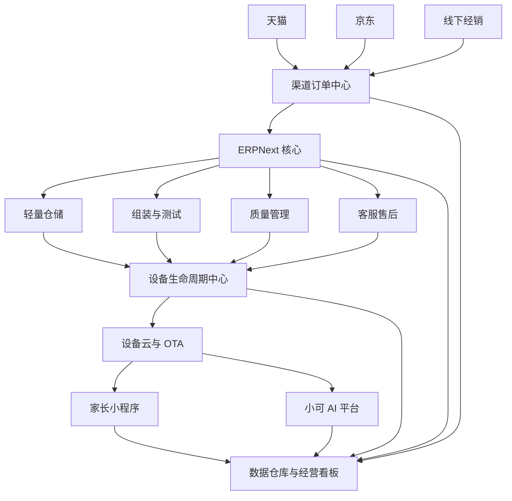

# 爱视可智能 ERP 架构 V0.1

## 1. 目标

建立爱视可读写台产品线的统一业务真相系统，使公司可以围绕一个设备 SN 查询产品、采购、生产、质量、销售、激活和售后全过程。

第一阶段不追求替代所有外围系统，而是先解决四个问题：

1. 货是什么：SKU、BOM和版本统一；
2. 货怎么造：采购、组装、烧录、测试和入库可追溯；
3. 货卖给谁：天猫、京东和经销商订单统一；
4. 货后来怎样：激活、故障、退换货和维修可追溯。

## 2. 核心架构

## 3. 系统职责

| 系统 | 负责 | 不负责 |
|---|---|---|
| ERPNext | 商品、BOM、采购、库存、生产、销售、财务、基础质量 | 海量设备日志、儿童原始对话 |
| 渠道订单中心 | 渠道订单转换、SKU映射、库存同步、发货和退款回传 | 会计总账、生产工艺 |
| 轻量WMS | 库位、扫码、拣货、出入库、SN复核 | 采购定价、财务结算 |
| 轻量MES/QMS | 工单、工序、烧录、校准、测试、不合格和返工 | 用户运营、平台订单 |
| 设备生命周期中心 | SN、硬件版本、固件、测试摘要、激活、维修履历 | 视光原始数据、原始语音 |
| 客服售后 | 客服工单、远程诊断、RMA、维修、翻新 | 产品BOM审批 |
| 敏感数据域 | 视光原始数据、授权记录、访问审计 | 普通ERP查询和批量导出 |
| AI平台 | Agent、模型、Prompt、安全策略、评测 | 直接修改采购和生产单据 |

## 4. 核心业务主链

## 5. SKU策略

实体硬件SKU由工程批准的属性组合生成。颜色、硬件配置等影响库存和BOM的属性生成实体SKU；促销套餐和赠品使用销售组合，不重复建立整机BOM。

销售可以：

- 选择已批准颜色；
- 选择已批准硬件配置；
- 选择已批准套餐和配件；
- 选择对应渠道价格表。

销售不可以：

- 创建未经工程批准的硬件组合；
- 修改BOM或固件兼容范围；
- 销售没有质检模板的实体SKU；
- 将不兼容配件加入套餐。

## 6. 生产与测试路线

标准路线为：

1. 备料齐套；
2. 主体组装；
3. 线束和电子连接；
4. 生成并写入SN、MAC和设备证书；
5. 固件烧录；
6. 光学和传感器校准；
7. 整机功能测试；
8. 小可AI功能测试；
9. 老化测试；
10. OQC；
11. 包装复核；
12. 成品入库。

关键部件按序列号追踪，普通物料按批次追踪，避免现场扫码负担过大。

## 7. 渠道策略

所有渠道先转换为统一内部订单，再进入ERP。

渠道订单中心必须提供：

- 天猫和京东外部SKU到内部SKU映射；
- 订单幂等和重复检查；
- 可售库存同步；
- 取消、退款、退货状态同步；
- 发货和物流单号回传；
- 平台结算单导入；
- 经销商价格表、授信和订单入口。

## 8. 数据与隐私边界

- 视光原始数据进入独立敏感数据域，ERP只保存引用ID和必要摘要；
- 儿童档案使用独立家庭ID和孩子ID，ERP不保存完整档案；
- 原始语音只允许短时处理，不进入ERP和长期日志；
- 允许保存脱敏后的场景、意图、情绪和安全标签；
- 所有敏感数据查看、导出和修改必须记录审计；
- 生产测试数据与用户敏感数据严格分域。

## 9. 阶段规划

### P0：业务底座

- 商品、属性、SKU和套餐；
- BOM和版本；
- 供应商、采购和IQC；
- 库存、生产工单和工序；
- 烧录、测试、OQC和SN；
- 渠道订单导入；
- 出库、发货和基础售后；
- 基础成本核算。

### P1：渠道与生命周期

- 天猫和京东API连接器；
- 经销商订单与价格体系；
- 扫码WMS；
- 激活与设备云关联；
- 客服工单、RMA、维修和翻新；
- 平台结算和渠道利润。

### P2：智能经营

- 销量预测；
- 缺料和交期预警；
- 供应商风险评分；
- 智能排产建议；
- 生产异常和批次质量识别；
- 客服诊断建议；
- 退货原因聚类；
- 经营日报和行动建议。

## 10. P0验收门槛

P0必须用一台模拟设备完成：SKU创建、BOM绑定、采购收货、工单组装、烧录、全部测试、成品入库、渠道订单、SN分配、发货、激活和售后工单全过程。

任何一步只靠手工修改数据库或绕过状态机，都不算通过。
