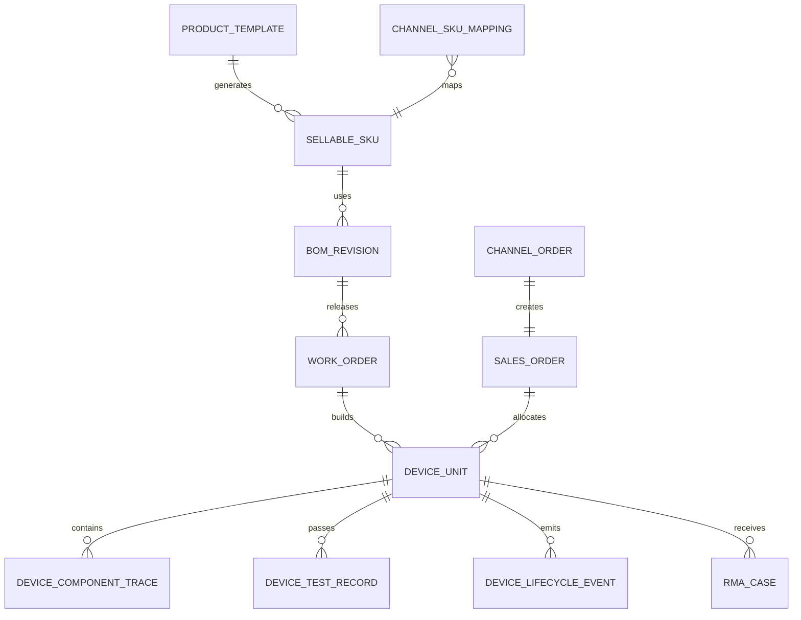

# 爱视可 ERP 数据模型 V0.1

## 1. 建模原则

1. ERPNext标准对象优先复用；
2. 爱视可差异化能力通过独立自定义对象补充；
3. SN是设备全生命周期主键；
4. 产品版本、BOM版本、固件版本和Agent版本独立管理；
5. 原始设备日志、视光数据和原始语音不进入ERP主库；
6. 所有外部系统使用不可变业务ID关联，不依赖名称匹配。

## 2. ERPNext标准对象映射

| 爱视可业务对象 | ERPNext对象 | 用途 |
|---|---|---|
| 产品模板 | Item Template | K1产品族 |
| SKU属性 | Item Attribute | 颜色、硬件配置、区域版本 |
| 实体SKU | Item Variant | 可生产、可库存、可销售硬件 |
| 套餐 | Product Bundle | 设备、附件和赠品组合 |
| 物料 | Item | 主板、屏幕、模组、包装和辅料 |
| BOM | BOM | SKU物料和工艺版本 |
| 工序 | Operation | 组装、烧录、测试、包装 |
| 工位 | Workstation | 组装、测试、老化和包装工位 |
| 生产计划 | Production Plan | 产能和物料计划 |
| 工单 | Work Order | 生产执行单元 |
| 工序卡 | Job Card | 人员工位、时间和数量记录 |
| 来料/过程/成品检验 | Quality Inspection | IQC、过程检验、OQC |
| 设备序列号 | Serial No | ERP库存序列化主键 |
| 采购订单 | Purchase Order | 供应商采购 |
| 采购收货 | Purchase Receipt | 到货和IQC入口 |
| 库存移动 | Stock Entry | 领料、完工和仓库移动 |
| 销售订单 | Sales Order | 统一内部销售订单 |
| 发货单 | Delivery Note | SN出库与物流履约 |
| 客户 | Customer | 平台客户、经销商、必要的家庭客户摘要 |
| 供应商 | Supplier | 物料和委外供应商 |

## 3. 自定义对象

### 3.1 Sales Configuration Rule

控制销售可选择的属性组合。

| 字段 | 类型 | 说明 |
|---|---|---|
| rule_id | ID | 不可变规则ID |
| template_item | Link | 产品模板 |
| attributes | JSON/Child Table | 批准的属性组合 |
| valid_from | Date | 生效日期 |
| valid_to | Date | 失效日期 |
| status | Enum | Draft/Approved/Disabled |
| approved_by | User | 工程或产品审批人 |

### 3.2 Channel SKU Mapping

| 字段 | 类型 | 说明 |
|---|---|---|
| channel | Enum | TMALL/JD/DEALER |
| external_sku | Data | 渠道SKU |
| internal_sku | Link Item | 内部实体SKU或套餐 |
| store_or_dealer | Data | 店铺或经销商范围 |
| active | Check | 是否有效 |

唯一约束：`channel + external_sku + store_or_dealer`。

### 3.3 Device Unit

Serial No的爱视可业务扩展。

| 字段 | 类型 | 说明 |
|---|---|---|
| serial_no | Link Serial No | 设备SN |
| sku | Link Item | 实体SKU |
| bom_revision | Link BOM | 实际生产BOM |
| work_order | Link Work Order | 生产工单 |
| production_batch | Data | 生产批次 |
| generation_date | Date | 显式生产日期，避免服务器时区影响 SN |
| firmware_version | Data | 出厂固件 |
| agent_version | Data | 出厂Agent版本 |
| lifecycle_state | Enum | 生命周期状态 |
| current_customer_ref | Data | 脱敏客户引用 |
| activation_ref | Data | 设备云激活引用 |

### 3.4 Device Component Trace

| 字段 | 类型 | 说明 |
|---|---|---|
| device_serial | Link Device Unit | 整机SN |
| component_item | Link Item | 关键部件 |
| component_serial | Data | 部件序列号，可空 |
| component_batch | Data | 部件批次，可空 |
| supplier | Link Supplier | 供应商 |
| installed_at | Datetime | 装配时间 |

### 3.5 Device Test Record

| 字段 | 类型 | 说明 |
|---|---|---|
| device_serial | Link Device Unit | 设备SN |
| test_type | Enum | OPTICAL/SENSOR/FUNCTION/AI/AGING/OQC |
| test_template_version | Data | 测试规范版本 |
| result | Enum | PASS/FAIL |
| raw_data_ref | Data | MES/QMS原始数据引用 |
| operator | User | 操作人员 |
| workstation | Link Workstation | 工位 |
| tested_at | Datetime | 测试时间 |

### 3.6 Device Lifecycle Event

追加写事件表，不覆盖历史。

| 字段 | 类型 | 说明 |
|---|---|---|
| device_serial | Link Device Unit | 设备SN |
| event_type | Enum | 状态事件 |
| occurred_at | Datetime | 发生时间 |
| source_system | Data | ERP/MES/WMS/IOT/CRM |
| source_record_id | Data | 来源记录ID |
| metadata | JSON | 脱敏扩展信息 |

### 3.7 Channel Order

| 字段 | 类型 | 说明 |
|---|---|---|
| channel | Enum | TMALL/JD/DEALER |
| external_order_id | Data | 渠道订单号 |
| internal_sales_order | Link Sales Order | ERP订单 |
| order_status | Enum | 标准化状态 |
| settlement_status | Enum | 结算状态 |
| raw_payload_ref | Data | 脱敏原始报文引用 |

唯一约束：`channel + external_order_id`。

### 3.8 RMA Case

| 字段 | 类型 | 说明 |
|---|---|---|
| rma_id | ID | 售后编号 |
| device_serial | Link Device Unit | 设备SN |
| case_type | Enum | RETURN/EXCHANGE/REPAIR/REFURBISH |
| issue_category | Data | 问题分类 |
| diagnosis | Text | 脱敏诊断结果 |
| resolution | Text | 处理结果 |
| status | Enum | 状态 |
| replacement_serial | Link Device Unit | 换机SN，可空 |

### 3.9 Privacy Data Reference

ERP只保存敏感数据引用，不保存内容。

| 字段 | 类型 | 说明 |
|---|---|---|
| subject_ref | Data | 脱敏家庭或孩子ID |
| data_type | Enum | OPTOMETRY/CHILD_PROFILE/CONSENT |
| vault_record_id | Data | 敏感数据域记录ID |
| consent_record_id | Data | 授权记录ID |
| retention_until | Date | 保存期限 |
| status | Enum | ACTIVE/REVOKED/DELETED |

### 3.10 Serial Number Rule

| 字段 | 类型 | 说明 |
|---|---|---|
| rule_code | ID | 稳定规则编号 |
| pattern | Data | 支持 PREFIX/DATE/SKU/BATCH/SEQ/SUFFIX 占位符 |
| date_format | Enum | NONE/YYMM/YYMMDD/YYYYMMDD |
| sequence_digits | Int | 流水号位数，4–10 |
| reset_policy | Enum | NEVER/DAILY/MONTHLY/BATCH |
| current_scope_key | Data | 当前序号作用域 |
| next_sequence | Int | 下一个可用流水号 |
| barcode_format | Enum | CODE128/CODE39 |

### 3.11 Serial Number Generation Batch

| 字段 | 类型 | 说明 |
|---|---|---|
| serial_rule | Link Serial Number Rule | 使用的生成规则 |
| sku_configuration | Link Sellable SKU | 目标 SKU |
| production_batch | Data | 生产批次 |
| requested_quantity | Int | 请求生成数量 |
| sequence_start/end | Int | 占用流水号范围 |
| generated_count | Int | 实际生成数量 |
| generated_by/at | User/Datetime | 操作审计 |

## 4. 关键关系



## 5. 设备状态机

```text
CREATED
  -> ASSEMBLED
  -> FLASHED
  -> QC_PASSED
  -> STOCKED
  -> ALLOCATED
  -> SHIPPED
  -> ACTIVATED
  -> RMA_OPEN
  -> REPAIRING / RETURNED / REFURBISHED / SCRAPPED
```

强制规则：

- 未组装不能烧录；
- 未烧录不能进行出厂测试；
- 强制测试未全部通过不能入库；
- 不在库存不能分配销售订单；
- 未分配SN不能发货；
- 未发货不能激活；
- 进入RMA后必须冻结正常销售库存；
- 翻新设备必须重新完成测试并建立新的销售状态。

## 6. 第一阶段API边界

| API | 调用方 | 作用 |
|---|---|---|
| POST /sales-configurations/resolve | OMS/销售端 | 校验属性并返回内部SKU |
| POST /channel-orders | 渠道连接器 | 幂等创建渠道订单 |
| POST /devices | MES | 创建SN设备档案 |
| POST /devices/{sn}/tests | MES/QMS | 写入测试结果 |
| POST /devices/{sn}/stock | WMS | 质检通过后入库 |
| POST /orders/{id}/allocate | OMS/WMS | 分配库存设备SN |
| POST /orders/{id}/ship | WMS | 发货并绑定物流 |
| POST /devices/{sn}/activate | 设备云 | 写入脱敏激活引用 |
| POST /rma-cases | 客服系统 | 建立售后RMA |
| GET /devices/{sn}/trace | 内部后台 | 查询完整设备履历 |

## 7. 数据约束

- 所有外部订单写入必须幂等；
- SN全局唯一且创建后不可修改；
- 渠道SKU必须先映射，禁止名称猜测；
- 生命周期事件只追加、不更新和删除；
- 测试失败记录不得覆盖，复测写新记录；
- 敏感数据字段不得出现在通用导出和普通日志；
- 所有人工状态修正必须保存原因、操作人和前后状态。
