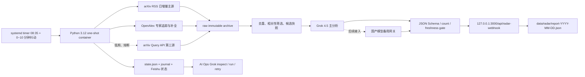

# Theory Radar Korea Migration Plan

> 状态：Phase 0-2 已完成；韩国节点已于 2026-07-14 进入 `PUBLISH=false` 的 3 天影子运行，个人站和 Mini 生产任务均未切换。

## 结论

迁移到韩国服务器，但不原样复制 Mini 脚本。采用“独立容器任务 + 多源采集 + Grok 主分析 + 发布门禁 + systemd timer + AI Ops 限权维护”，先影子运行 3 天，再切换主发布。

arXiv Query API 不再承担每日主链路。韩国节点的 429 不通过轮换 IP、免费代理或 CDN 绕过，而是通过 RSS 日增量、OpenAlex 补全、Query API 集中限流与熔断来长期解决。即使 Query API 持续 429，每日日报仍可正常生成。

## 当前链路


当前功能只有“抓取、筛选、AI 中文分析、推送个人站”。`daily-radar-push.sh` 明确独立于 multica 飞书流，不包含 Wiki、Bitable 或飞书发送。

已确认的故障点：

- Mini 主分析网关因余额不足返回 403；Gemini 备用接口返回 503。迁机器不能解决模型额度与备用通道问题。
- Mini Homebrew Python 3.14 的 `pyexpat` 已损坏；launchd 恰好使用系统 Python 3.9，交互执行与定时执行环境不一致。
- 脚本最终 `echo` 会掩盖分析失败，launchd 记录为 exit 0。
- 韩国系统 Python 是 3.6.8，不能直接运行现有脚本。
- 韩国 IP 直连 arXiv Query API 实测 HTTP 429；arXiv 分类 RSS 和 OpenAlex 实测 HTTP 200。
- Mini 代理访问 arXiv Query API 也出现超时，因此把请求转回 Mini 或固定代理不是长期方案。

## 目标架构



## 设计要点

### arXiv 429 长期治理

#### 第一层：RSS 承担每日增量

- 每日只抓取 `cs.CL`、`cs.AI`、`cs.LG`、`cs.NE`、`q-bio.NC`、`stat.ML` 六个官方分类 RSS，每类一次请求。
- 调度使用 `RandomizedDelaySec=600`，避免每天固定秒级流量；请求之间加入轻量间隔。
- 保存 `ETag`、`Last-Modified`，服务端支持时使用条件请求；无新内容则复用缓存，不重复下载。
- 每份响应原样保存到 `/var/lib/theory-radar/raw/YYYY-MM-DD/rss/`，按 arXiv ID 去重后再进入筛选。
- RSS 某类临时失败时读取最近成功快照，并由 OpenAlex 补齐当天增量；不能因单一分类失败中断整份日报。

#### 第二层：OpenAlex 承担专家追踪、补全和对账

- 为专家维护稳定的 OpenAlex Author ID、ORCID 映射，不再依赖姓名模糊搜索。
- 使用免费 API key，按日期窗口批量查询；设置 `per_page=100`、最小字段 `select` 和 OR 批量过滤，减少请求量。
- 读取服务端 rate-limit headers，接近额度时停止非必要补全；429/5xx 使用带抖动的指数退避。
- 每日把 RSS 与 OpenAlex 的 arXiv ID 做并集；OpenAlex 记录只在具备 DOI、arXiv ID 或可验证落地页时进入候选。
- 每周执行一次 `--reconcile`，补齐因周末、网络中断或 RSS 窗口遗漏的历史记录。

#### 第三层：Query API 降级为低频补充

- 所有 Query API 请求必须经过单一 request broker，禁止脚本各自直连和并发请求。
- 将原来的“7 类目 + 6 专家共 13 次串行请求”合并为少量宽查询；常规日报默认不调用。
- 请求间隔至少 3 秒，设置明确 `User-Agent` 和联系邮箱，遵守 `Retry-After`；失败采用指数退避。
- 首次 429 即开启熔断，默认冷却 6 小时；冷却期间直接跳过 Query API，不阻塞 RSS + OpenAlex 主链路。
- 设置每日请求预算和 24 小时响应缓存。连续成功后半开探测，确认恢复才关闭熔断。
- 只允许用于健康探测、少量缺项补查和周度对账，不用于全量抓取。

#### 明确不采用

- 不使用代理池、轮换出口 IP、Cloudflare Worker 或 CDN 来规避 429。这只能改变出口，无法降低请求量，也会增加合规、封禁和数据完整性风险。
- 如未来确有跨区网络故障，只允许一个稳定、可审计的固定出口中继，并与韩国任务共享同一全局请求预算；它解决网络可达性，不用于绕过限流。

#### 数据完整性

- `source_state.json` 记录 `rss_ok`、`openalex_ok`、`arxiv_query_circuit`、`last_success_at`、`new_ids`、`backfill_ids` 和各源延迟。
- 原始响应、候选集和最终报告分层保存；分析重试只读取候选快照，不重复访问上游。
- 支持 `--date YYYY-MM-DD` 和 `--reconcile` 幂等补跑，历史缺口可以重建且不会制造重复日报。
- Query API 强制 429 时，只要 RSS/OpenAlex 新鲜度和论文数量通过门禁，仍允许发布，并在状态中标记 Query API 降级。

### Grok 主分析网关

- 主分析切换为 xAI Grok，默认模型 `grok-4.5`；模型名和 base URL 全部环境变量化，不写死在业务代码。
- 当前影子运行使用川哥现有 CPA Direct OpenAI-compatible 网关 `https://api-direct.hahaxiong.top/v1` 调用 `grok-4.5`，已完成真实 strict JSON Schema smoke test。后续可无代码切换到官方 xAI API。
- 每日日报不依赖 RackNerd 上 AI Ops 的 OMP OAuth 会话。AI Ops Grok 只作为维护、诊断和受控补跑的控制面。
- 独立凭据放 `/etc/theory-radar.env`，权限 `600`，不复用个人站 `.env.local`，不进入 Git、日志、状态文件或通知。
- 使用 strict JSON Schema 约束输出，模型只接收已筛选论文的标题和摘要，不开启联网工具；服务端再次校验字段、篇数、arXiv ID 和长度。
- 单次批量分析最多 8 篇，摘要按字符预算裁剪，避免逐篇调用造成成本和失败面放大。
- Grok 遇到 403、429、5xx 或超时，最多重试 3 次并指数退避；仍失败则保留候选快照、返回非零、告警且不覆盖 last-good。

推荐配置：

```dotenv
ANALYSIS_PRIMARY_PROVIDER=xai
ANALYSIS_PRIMARY_BASE_URL=https://api-direct.hahaxiong.top/v1
ANALYSIS_PRIMARY_MODEL=grok-4.5
XAI_API_KEY=<secret pointer only>

# 先保留接口，收到川哥提供的国产模型网关后再启用。
ANALYSIS_FALLBACK_ENABLED=false
ANALYSIS_FALLBACK_BASE_URL=
ANALYSIS_FALLBACK_MODEL=
ANALYSIS_FALLBACK_API_KEY=
```

国产模型备用网关后续按统一 `Analyzer` 接口接入：同一输入 schema、同一输出 schema、独立超时和熔断。启用前必须完成真实结构化输出 smoke test 和主路故障演练。在备用通道未提供前，系统遵循“Grok 失败不发布”，不使用未经分析的模板冒充深度内容。

### 发布与幂等

- 发布走 `http://127.0.0.1:3000/api/radar-webhook`，绕过 Cloudflare、公网 DNS 和跨机网络，但继续复用 webhook 鉴权与 schema 校验。
- 以日期 + arXiv ID 幂等；同日报告只有候选通过门禁后才原子替换。
- 门禁：至少 4 篇、ID 唯一、字段齐全、日期为当天、JSON 可解析、来源新鲜；失败不得覆盖 last-good。
- 状态写入 `/var/lib/theory-radar/state.json`：阶段、抓取数、精选数、source、provider、发布时间、错误类型、连续失败次数，不写 prompt、摘要正文或 secret。

### 调度与资源

- `/opt/theory-radar` 使用 Docker/Podman 固定 Python 3.12，不依赖服务器 Python 3.6。
- `systemd` oneshot + timer，配 `flock` 防重入；失败返回非零，由 systemd 和 AI Ops 捕获。
- 韩国机 2C/1.8GiB，任务只做网络 I/O 和文本处理，容器限制建议 CPU 0.5、内存 384MiB，不运行本地模型。

### 通知与 AI Ops

- 飞书若需要同步，必须复用已经通过门禁的同一份 report JSON，不再单独抓取和分析一遍。
- AI Ops 独立接入 `theory-radar`：只读 `inspect`，受控 `run-now`、`retry-analysis`、`reconcile`；禁止任意 shell、改代码和自动部署。
- 每日检查报告日期、论文数、数据源状态、provider、任务退出码和个人站文件是否落盘；异常开待办，恢复自动关闭。

## 实施阶段

1. Phase 0（已完成）：把 Mini 三个脚本收敛到正式项目，建立 source/analyzer、schema、退出码、状态文件、测试和 Python 3.12 容器。
2. Phase 1（已完成）：接入 RSS + OpenAlex + Query circuit breaker，并完成 Query API 强制 429 演练；验证日报不受阻。
3. Phase 2（已完成）：接入 Grok 4.5，完成 strict JSON Schema、真实 API smoke test、限额和故障演练。
4. Phase 3（进行中）：韩国影子运行 3 天，`PUBLISH=false`；对比 Mini 的抓取数、入选论文和分析结构。
5. Phase 4：韩国主发布，Mini 保持 launchd disabled 但不删除，观察 7 天。
6. Phase 5：接 AI Ops、飞书状态通知和补跑入口；收到国产模型网关后接入备用 Analyzer 并演练切换。

## 验收

- 连续 3 天定时执行成功，systemd exit 0；故障演练能返回非零并产生状态告警。
- 强制 arXiv Query API 返回 429 时，RSS + OpenAlex 仍能生成当天候选和报告，且熔断状态可见。
- 每天至少 4 篇有效分析，arXiv ID 无重复，报告日期和最新论文时间正确。
- Grok 输出 100% 通过 JSON Schema；无效字段、错 ID 或篇数不足会被拒绝发布。
- 本地 loopback 发布成功，个人站历史连续且公网可见。
- Grok 主路失败时不覆盖 last-good；国产备用网关接入后，再验收主路故障时自动切换成功。
- AI Ops 能看到状态并执行限权动作，任意 shell 被拒绝。

## 回滚

- 切换前保留 Mini launchd plist 和脚本 7 天。
- 韩国发布异常：立即 disable systemd timer，重新 enable Mini launchd；站点已有报告和 last-good 不删除。
- 代码、容器镜像、env 指针、systemd unit 和最近 7 个 raw/report 快照均保留版本化备份。

当前首个生产侧备份：`aliyun-kr:/var/backups/theory-radar/pre-migration-20260714-104704/`。影子阶段回滚只需停止并 disable 两个 timer，个人站无需重启。

## 2026-07-14 影子部署记录

- 部署目录：`aliyun-kr:/opt/theory-radar`；状态目录：`/var/lib/theory-radar`；secret：`/etc/theory-radar.env`（`root:root 600`）。
- 容器：Python 3.12、非 root、只读根文件系统、0.5 CPU、384 MiB 内存；首次实测峰值约 19 MiB。
- 调度：每日 `08:35 + 0~10 分钟`；周日 `09:30 + 0~20 分钟` 对账。当前 `PUBLISH=false`。
- 首轮采集：六个 RSS 分类全部成功，共 497 条；OpenAlex 专家源 3 条；去重候选 350 条，精选 8 条。
- 首轮 Grok：`grok-4.5` 成功输出 8 篇并通过 schema/ID/数量门禁，报告只落 `/var/lib/theory-radar/reports/`，未写个人站。
- 已排除 RSS 的 `replace` / `replace-cross` 旧论文，保留 `new` / `cross`；修复 Grok 返回顺序变化时按 arXiv ID 安全重排。
- 强制 429 演练：首次打开 6 小时熔断，第二次直接 skip，RSS + OpenAlex 和个人站均不受影响。
- 运行期间个人站首页和 `/radar` 持续 HTTP 200，PM2 重启次数保持 3，未重启或重新构建个人站。

## 实施前仅需补齐

- Grok 生产凭据：优先 xAI API key；如使用现有 OpenAI-compatible Grok 网关，则提供 base URL、model 和 key 的 secret 存放位置。
- 国产模型备用网关暂不阻塞 Phase 0-4；收到参数后再启用 Phase 5 的 fallback。

## 依据

- [arXiv API User's Manual](https://info.arxiv.org/help/api/user-manual.html)
- [arXiv RSS Feeds](https://info.arxiv.org/help/rss.html)
- [OpenAlex authentication and rate limits](https://developers.openalex.org/api-reference/authentication)
- [xAI Structured Outputs](https://docs.x.ai/developers/model-capabilities/text/structured-outputs)
- [xAI Grok 4.5](https://docs.x.ai/developers/models/grok-4.5)
