# Company AI Ontology

公司级 AI Ontology 基座实施项目。P0-A 至 P0-F、V3 P0-S Foundation Pack、Goal 4 P0-EPI、Goal 5 P0-DEC 和 Goal 6 P1-DOMAIN 只读领域骨架已在公司 QNAP 部署并完成当前层级生产验收；现有 H 平台员工私人 Bot 保持不变，真实 ERP/社媒写回继续关闭。

## 项目宏观架构

这套系统不是单一问答机器人，而是以公司 Ontology 为语义与权限核心、以 Company Agent Core 为统一 AI 中枢、以公司 QNAP 为主硬件底座的经营操作系统。绿色节点表示当前层级已经搭建并有工程或生产证据；灰色虚线节点表示架构已预留，但仍需独立审批、真实 UAT 或生产验收。

```mermaid
flowchart TB
  subgraph ACCESS["人员与统一入口"]
    direction LR
    EMPLOYEE["公司员工 / 管理者"]:::done
    COMPANY_BOT["公司级飞书 App / Bot<br/>全员统一入口"]:::done
    H_CONSOLE["H 控制面<br/>架构白盒 · 运行看板 · 模拟审批中心"]:::done
    PRIVATE_BOTS["员工私人 Bot + 现有 H 平台<br/>App / 订阅 / 记忆保持独立"]:::boundary
  end

  subgraph INPUTS["公司知识、经营事实与外部情报"]
    direction LR
    FEISHU_KB["飞书知识<br/>文档 · 表格 · 多维表 · 知识库"]:::done
    ERP["爱视可 ERP<br/>订单 · 质量 · 库存 · 交付"]:::done
    SOCIAL["社交媒体监控<br/>市场信号 · 话题 · 趋势"]:::done
    PESTIM["PEST + Industry + Market<br/>公开外部情报来源"]:::done
  end

  subgraph QNAP["公司 QNAP Foundation｜PRNas / TS-X65"]
    direction TB

    subgraph BRAIN["Company Brain｜核心 AI 与工作协议"]
      direction LR
      HLITE["QNAP H-Lite<br/>飞书订阅 · Bot Bridge · Outbox · ACK"]:::done
      AGENT_CORE["Company Agent Core<br/>身份 · 路由 · 会话 · Context Compiler · WorkCase"]:::core
      H_ROUTE["H 引擎路由适配<br/>HMAC · 预算 · 熔断 · 用量读回"]:::done
      WORK_PROTOCOL["公司大脑工作协议<br/>认识闭环 → 实践闭环 → 演化闭环"]:::done
    end

    subgraph GOVERNANCE["Ontology、权限与治理"]
      direction LR
      IDENTITY["Identity / Principal / Purpose<br/>人员 · 部门 · 群聊 · 会话权限"]:::done
      RETRIEVAL["Permissioned Retrieval<br/>先鉴权 → 授权集内召回 → Evidence Package"]:::done
      ONTOLOGY["Company Ontology Kernel<br/>目标 · P2 · Task · Product · Operations · Market"]:::core
      REGISTRY["Ontology Compiler & Registry<br/>Schema · Version · Hash · Drift · Reconciliation"]:::done
      ACTION["Mandatory Action Gateway<br/>Intent · Dry-run · 人审 · 执行 · 读回 · 回滚"]:::done
    end

    subgraph CONNECTORS["连接器与战略情报流水线"]
      direction LR
      KNOWLEDGE_CONNECTOR["Knowledge Connector<br/>飞书发现 · ACL · 分块 · 同步审计"]:::done
      DOMAIN_CONNECTOR["Domain Connector<br/>ERP / Market 只读映射 · 双时间 · 重放"]:::done
      SOURCE_REGISTRY["Source Registry<br/>许可 · 保存范围 · 频率 · 撤销 · Fail-closed"]:::done
      COLLECTOR["Intelligence Collector<br/>准入 · 采集 · 消毒 · 去重 · Last-good"]:::done
      SI_PIPELINE["Strategic Intelligence<br/>Raw → Evidence → Signal → Impact → ReportRun"]:::done
    end

    subgraph DATA["数据、运行与恢复底座"]
      direction LR
      POSTGRES["Postgres 17 + pgvector<br/>结构化事实真源 · RLS · 幂等 · 审计"]:::done
      QDRANT["Qdrant<br/>可重建向量召回派生层"]:::done
      REDIS["Redis<br/>队列 · 缓存 · 限流"]:::done
      OBSERVE["健康 · 指标 · 审计 · 备份<br/>Prometheus · WAL · PITR · 回滚证据"]:::done
    end
  end

  subgraph AI_EXECUTION["H 引擎执行面"]
    direction LR
    H_WORKER["当前 Route A 远程 H Worker<br/>Grok Build · CPA · grok-4.5"]:::done
    H_LOCAL_POOL["后续 QNAP / Mini / Studio Worker Pool<br/>Route B · 分池 · 故障接管"]:::gated
  end

  subgraph OUTPUTS["经营输出与后续闭环"]
    direction LR
    ANSWER["权限化公司问答<br/>证据 · 未知项 · 置信等级"]:::done
    REPORTS["战略情报报告草稿<br/>日 / 周 / 月 / 季 / 半年 / 年"]:::done
    DECISION_P2["正式 Decision / P2<br/>实名 DRI 审批后生效"]:::gated
    EMPLOYEE_TASKS["员工任务下发、跟进与成果提交<br/>真实 Canary 后启用"]:::gated
    WRITEBACK["ERP / 社媒受控写回<br/>独立 Goal 与授权后启用"]:::gated
  end

  EMPLOYEE --> COMPANY_BOT --> HLITE --> AGENT_CORE
  EMPLOYEE --> H_CONSOLE
  PRIVATE_BOTS -. "仅复用 H 平台代码与行为契约" .-> HLITE
  H_CONSOLE --> AGENT_CORE
  H_CONSOLE --> REGISTRY

  FEISHU_KB --> KNOWLEDGE_CONNECTOR --> RETRIEVAL
  ERP --> DOMAIN_CONNECTOR
  SOCIAL --> DOMAIN_CONNECTOR
  DOMAIN_CONNECTOR --> RETRIEVAL
  PESTIM --> SOURCE_REGISTRY --> COLLECTOR --> SI_PIPELINE

  IDENTITY --> RETRIEVAL --> AGENT_CORE
  ONTOLOGY --> AGENT_CORE
  REGISTRY --> ONTOLOGY
  AGENT_CORE --> H_ROUTE --> H_WORKER
  H_ROUTE -. "后续扩容与冗余" .-> H_LOCAL_POOL
  AGENT_CORE --> WORK_PROTOCOL
  SI_PIPELINE --> AGENT_CORE

  KNOWLEDGE_CONNECTOR --> POSTGRES
  DOMAIN_CONNECTOR --> POSTGRES
  SI_PIPELINE --> POSTGRES
  ONTOLOGY --> POSTGRES
  RETRIEVAL --> QDRANT
  AGENT_CORE --> REDIS
  POSTGRES --> OBSERVE
  QDRANT --> OBSERVE
  REDIS --> OBSERVE

  AGENT_CORE --> ANSWER
  SI_PIPELINE --> REPORTS
  WORK_PROTOCOL -. "Decision Proposal" .-> DECISION_P2
  DECISION_P2 -. "Task Proposal + DRI 批准" .-> ACTION
  ACTION -. "Delivery Outbox" .-> EMPLOYEE_TASKS
  ACTION -. "受控业务动作" .-> WRITEBACK
  EMPLOYEE_TASKS -. "飞书送达 / ACK / 成果" .-> HLITE
  WRITEBACK -. "Outcome / Verification / Learning" .-> WORK_PROTOCOL

  classDef done fill:#e8f7ee,stroke:#1f883d,color:#0b3d1d,stroke-width:1.5px;
  classDef core fill:#dff7e8,stroke:#116329,color:#062d16,stroke-width:2.5px;
  classDef gated fill:#f6f8fa,stroke:#8c959f,color:#57606a,stroke-width:1.2px,stroke-dasharray:6 4;
  classDef boundary fill:#ffffff,stroke:#57606a,color:#24292f,stroke-width:1.2px;
```



宏观运行逻辑：

```text
外部世界与公司事实 → 权限化 Evidence → Ontology 语义与因果关系 → Company Agent Core 分析
→ 回答 / 报告 / Decision Proposal → DRI 与 Action Gateway → 执行结果 → Verification / Learning
```

- **认识闭环**：Observation → Evidence → Claim → Hypothesis → Decision。
- **实践闭环**：Decision → Action → Outcome → Verification。
- **演化闭环**：Learning → Ontology Change Proposal → Review → Deploy → Reconciliation。
- **当前 Demo 边界**：权限化问答、内部情报采集样例、报告草稿和模拟审批可体验；正式 P2、员工任务下发和 ERP/社媒写回仍保持关闭。

## 资产身份门禁

- 本项目中的 `QNAP` 只指公司局域网生产 NAS：SSH 别名 `prnas` / `prnas-pub`、型号 `TS-X65`、当前地址 `192.168.61.18`。
- 家庭 QNAP 不属于本项目，不得复用本项目的部署目录、Compose、端口、卷、凭据、备份、恢复或运维结论。
- 任何 QNAP 读取、部署、重启、备份或恢复操作前，必须重新核对“用途=公司、主机别名、型号、当前地址、项目根目录”五元组；任一项不一致立即停止，禁止根据“QNAP”三个字猜目标。
- 地址、版本、容量和服务状态都是时间快照，执行生产操作前仍需读取共享记忆并做在线核验。

## 当前状态

> **接手入口（2026-08-13）**：当前阶段按“架构骨架 + 可体验 Demo”收口，不以实名终审、七日 Shadow 或业务写回作为本阶段完工条件。接手人先阅读 `docs/p1-si-demo-v1-handoff-2026-08-13.md`，完成其中 5～10 分钟体验验收；生产化事项另开 Goal。

- 生产架构基线：V2.2，QNAP 承载 H-Lite、Company Agent Core、Ontology 控制面和数据面。
- 目标架构：V3 认知—实践骨架，采用“三个闭环、两个世界、一个编译器”和“骨架完整、血肉渐进”；P0-S 稳定骨架已生产上线，认识论、决策与领域血肉仍按阶段增量建设。
- 当前生产基线：`Goal 6-A / P1-DOMAIN` 已完成工程与川哥体验验收；公司 QNAP active Schema `3.3.0`、Registry `in_sync`、Company Brain Operating Model v1 `active`，Domain Connector `2026-08-10.1`。Goal 7 当前获批候选已完成 A～E：Agent Core `2026-08-12.3`、Knowledge Connector `2026-08-11.1`、H-Lite `2026-08-12.1`；Foundation `13/13 running / unhealthy=0 / restart=0`，Route A 正常、Route B 关闭。该工程发布仍不等于川哥 Owner Acceptance、P1-SI-H 七日 Shadow 或 Goal Completion 完成。
- P1-SI-B～G 工程骨架当前完整基线为 Contracts `61/61`、Collector `9/9`、Strategic Intelligence `142/142`；修复旧 Runtime 回滚恢复兼容性后，当前唯一不可变候选为 Workflow `31663036837` Attempt `1` / Artifact `9166921089`，绑定 Ontology Commit `4a158d1d17141da905e9206dd54013cdac987039` 与 H-Lite Commit `baa00bf07089a3caf5fe6318aac28cb73bd5ae13`，Manifest `1.6.0` 与 9 项 `SHA256SUMS` 已验签，并完成公司 QNAP A～E 全链工程证据。Artifact `9166253151` 的 A～D 仅保留历史审计：其首次 E 失败后已自动恢复候选，因回滚控制代码改变不得继续复用。
- 公司 QNAP 当前只安装内部工程 Runtime Artifact `9108034290` / Commit `0342fcd39`，并完成一次 accepted Collector：3 个公开来源共 60 条、Hash-only、正文 0、重复 0、五类业务副作用 0，且 `countsTowardProductionShadow=false`。生产 `strategic_intelligence` Schema、表、容器、网络和发布端口仍为 0。
- 当前硬门禁：来源分配 `8/8`、最终决定 `0/8`；P003 个人 DRI `30/36`、必要角色位 `90/150`、全角色覆盖 `12/36`、最终决定 `0/36`；四角色真实成员 UAT `0/4`；Artifact `9166921089` 的 A～E 已完成，当前 Goal 7 下一门禁仅是川哥独立 Owner Acceptance。D 阶段真实 H Worker 双源读回为 `cpa-openai-compatible / grok-4.5 / route-a`，HTTP 与 ledger 一致；Authority Canary `7/7`，撤权收敛 `0.015 秒`，拒绝路径正文读取和越权 Evidence 均为 `0`。E 阶段已在 `34.709 秒` 内完成候选→旧版→候选真实切换，旧版与恢复候选均验证通过，012 保留，五类业务副作用均为 `0`。
- 审批操作面已调整为 H 控制面的公司 Ontology「审批中心」；飞书多维表格降级为原型、历史导入和应急导出。当前 `v1.62.0` 候选提供 8 个来源与 36 条 P003 关系的 `engineering_simulation` 草稿、推荐填充和重置，模拟完成不改变上述 `0/8`、`0/36` 真实门禁，也不能放行 Collector、010/011、七日 Shadow、P003 激活或写回。
- 当前门禁快照见 `deploy/qnap/strategic-intelligence/evidence/p1-si-current-gate-snapshot-2026-08-13.json`，解释与历史发布链见 `docs/p1-si-bh-gate-audit-2026-08-12.md` 和 `deploy/qnap/strategic-intelligence/README.md`。
- 本目录包含可复用的 QNAP 部署配置；生产密码只在 QNAP 本地生成并保存，不进入 Git。

## 部署边界

- 热数据：`/share/CACHEDEV1_DATA/ai-ontology`。
- WAL、基础备份和快照：`/share/CACHEDEV2_DATA/ai-ontology-backup`。
- 唯一对局域网开放的基础端口：`192.168.61.18:19080`，仅提供健康检查。
- Postgres、Qdrant、Redis、Prometheus 不发布宿主机端口。
- 平台容器总内存硬上限控制在约 3.9GB，为 QTS 和既有容器预留资源。

## 目录

- `deploy/qnap/docker-compose.yml`：QNAP Foundation 栈。
- `deploy/qnap/initdb/`：Ontology 最小真源、RLS、审计、幂等和 Outbox 初始化。
- `deploy/qnap/config/`：Caddy、Prometheus 配置。
- `deploy/qnap/scripts/`：远端初始化、验证、备份与恢复演练脚本。
- `deploy/qnap/images.lock`：生产镜像内容摘要。
- `deploy/qnap/strategic-intelligence/`：P1-SI-F 资源受限 Shadow Compose、调度、部署门禁、备份、Freeze、回滚、七日连续性/版本一致性校验和 Owner Acceptance 证据链。
- `deploy/mini/`：Mini → aliyun-hk 的回环反向 SSH 状态通道。
- `deploy/qnap/ACCEPTANCE.md`：本次生产验收证据和剩余门禁。
- `docs/feishu-knowledge-acl-audit-2026-08-08.md`：产品研究部知识库只读 ACL 审计、两个正式导入 P0 和 Canary 门禁。
- `docs/knowledge-acl-canary-2026-08-08.md`：Knowledge Connector `2026-08-08.3` 生产部署、真实撤权、越权负测、回滚和清理证据。
- `docs/lessons-learned-2026-08-08.md`：公司 Bot、通讯录同步、权限和 QNAP 部署的经验教训。
- `docs/h-engine-credential-cutover.md`：从临时 H 平台 OAuth 切换到公司独立凭据的正式流程。
- `docs/architecture-v3-cognitive-practice-skeleton.md`：认识论、实践论、双层本体、Ontology Compiler 和大骨架优先实施方案。
- `docs/company-brain-work-logic-modeling-plan-2026-08-09.md`：公司大脑工作阶段、状态机、显式对象、Evidence Package v2、可视化和 Goal 4 实施计划。
- `docs/company-brain-work-protocol-acceptance-2026-08-09.md`：Goal 4 生产发布、正负 fixture、回滚恢复、重启回放和 H 控制面验收证据。
- `docs/decision-practice-loop-acceptance-2026-08-09.md`：Goal 5 决策、P2、任务、行动、三层结果、Learning、失败尝试退役和 H 控制面验收证据。
- `docs/goal6-operating-domain-acceptance-2026-08-09.md`：Goal 6 Operating Model、P1-DOMAIN、只读演示链、负向验证和生产验收。
- `docs/goal6-completion-audit-2026-08-09.md`：按 Goal 原始要求逐项核对“已证明/部分证明/待证明”，防止把代码、测试或容器健康误报为完整完成。
- `docs/task6-r-release-provenance-guard-2026-08-10.md`：H 控制面 Source Commit、目标文件哈希、运行时对账和发布回滚门禁。
- `docs/p1-si-f-qnap-shadow-readiness-acceptance-2026-08-10.md`：战略情报 Shadow 部署准备、资源限制、授权门禁、Linux/amd64 镜像与 PostgreSQL Runtime 证据。
- `docs/p1-si-f-deployment-readiness-inspector-acceptance-2026-08-11.md`：统一只读七项部署门禁检查器、32/32 工程验证、当前阻断原因与生产零副作用证据。
- `docs/p1-si-bh-completion-audit-2026-08-11.md`：P1-SI-B～H 逐项完成证据、负向测试覆盖和仍未关闭的人审/部署门禁。
- `docs/p1-si-internal-engineering-shadow-2026-08-11.md`：内部工程验证与正式生产 Shadow 双模式、审核降负担、后补门禁和独立 readiness。
- `docs/p1-si-internal-engineering-deployment-handoff-2026-08-11.md`：内部模式部署影响、预计时长、回滚边界和独立授权交接单。
- `docs/p1-si-reviewer-role-access-uat-2026-08-11.md`：四名职能角色真实登录权限验收步骤、五份原始 Evidence、编译验收和 Runtime Manifest 门禁。
- `docs/p1-si-reviewer-assignment-readiness-2026-08-11.md`：飞书实名审核分配、结构化 Principal 修复、真实 CSV 往返和当前人工门禁。
- `docs/p1-si-g-p003-review-candidate-acceptance-2026-08-10.md`：真实 4644 条矩阵到 P003 36 条审核候选的来源、Hash、负向门禁和 DRI 待办。
- `docs/p1-si-human-review-workflow-acceptance-2026-08-10.md`：来源合规与 P003 DRI 的飞书 CSV 回填、强类型 JSON、final 校验、编译和实名数据边界。
- `docs/p1-si-feishu-review-workbench-acceptance-2026-08-10.md`：P1-SI-B/G 真实飞书人工审核工作台、筛选视图和 CSV 往返验收。
- `docs/p1-si-dri-selection-handoff-2026-08-10.md`：实名 DRI 候选的隐私隔离交接、待拍板角色和 P003 部署门禁补强。
- `docs/goal7-p1-prod-readiness-plan-2026-08-10.md`：Goal 7 部门 / 群聊 Principal、用途与撤权语义，以及 H 引擎冗余、熔断、预算和真实模型读回实施计划。
- `docs/goal7-foundation-release-runbook-2026-08-11.md`：Goal 7 三组件连续性发布、迁移、验收和安全恢复运行手册。
- `docs/goal7-foundation-deployment-authorization-card-2026-08-12.md`：五项独立授权卡；当前固定 Artifact `9164960593`，A 已完成，B～E 必须在前序 Evidence 完成后分别授权且不得继承。
- `docs/pestim-strategic-intelligence-architecture-2026-08-10.md`：PESTIM 持续情报、多周期经营报告、Horizon/个人站雷达复用边界和公司 QNAP Shadow 方案。
- `docs/p1-si-a-pestim-ontology-definition-acceptance-2026-08-10.md`：PESTIM 候选 Schema `3.4.0`、纯增量兼容性、禁止自动 P2/写回和生产不变验收证据。
- `docs/p1-si-b-source-registry-acceptance-2026-08-10.md`：Source Registry `3.5.0` 候选、首批来源目录、fail-closed 判定和本地工程验收证据。
- `docs/p1-si-c-company-radar-package-acceptance-2026-08-10.md`：公司独立 Collector、JSON Schema、oneshot/last-good、固定镜像配方和无个人运行时依赖验收。
- `docs/p1-si-d-strategic-intelligence-data-foundation-acceptance-2026-08-10.md`：Postgres 唯一真源、Raw/Observation/Signal 双时间、Replay、ACL fail-closed 和候选迁移验收。
- `docs/p1-si-e-multi-period-reporting-acceptance-2026-08-10.md`：多周期窗口、非递归输入、ReportRun 谱系、Alert 和飞书/H 只读投影验收。
- `packages/ontology-contracts/`：Git 管理的 V3 Definition、Compiler、兼容性、Event Envelope、Data/Logic/Action、Operating Model 和 Capability Governance 契约。
- `services/ontology-registry/`：独立 Registry、部署审批、版本激活、历史版本再激活和 Git/运行时对账服务。
- `services/agent-core/`：Company Agent Core 内部 API、Postgres 幂等审计和 H 引擎独立 Runtime 门禁。
- `services/knowledge-connector/`：飞书知识发现、ACL 映射、正文分块和同步审计。
- `services/domain-connector/`：ERP M3 与社媒归一化结果的只读同步、双时间、幂等、重放、Dead Letter 和脱敏状态服务。

## 上线门禁

- 不迁移、不切换任何员工私人 Bot 的飞书 App 或事件订阅。
- 公司级飞书 App/Bot 已接入，H-Lite 当前为 `active` 且真实飞书长连接健康；已验收 `p2p:post`、`p2p:text`、`group:text` 三类真实消息，3 次处理全部完成、0 次失败，SQLite 去重记录为 3 条，容器 `restart_count=0`。
- 飞书通讯录数据范围已生效：4 个授权范围、83 个可见部门、414 名可见人员已只读同步到 Ontology Principal；重复同步结果为新增 0、更新 414，未写入邮箱、手机号或聊天内容。
- Agent Core `2026-08-12.3` 是当前生产版本，绑定 Goal 7 Source Commit `4a158d1d17141da905e9206dd54013cdac987039`；系统角色解释、权限化知识查询、三组件发布、Authority Canary、Worker 双源读回和真实回滚恢复均已完成工程验证。Goal 7 仍待川哥独立 Owner Acceptance；Worker 仍临时使用个人 CPA 凭据，Route B 固定关闭，公司专用 CPA 凭据仍待替换。
- Knowledge Connector `2026-08-08.3` 已部署到公司 QNAP；Connector 与 Agent Core 回归均为 14/14，生产只读 Canary 已覆盖直接授权、空间继承、无空间继承、ACL 失败、正文可读但 ACL 失败、员工真实撤权、跨部门和链接直猜负测。撤权后 37.757 秒内 Evidence 归零，临时文档删除后 ACL/Chunk 均归零，回滚 `2026-08-08.2 → 2026-08-08.3` 演练通过。产品研究部整库导入仍未批准，`department/openchat` P1 映射完成前继续禁止批量索引。
- Ontology Registry 当前 Schema `3.3.0`、状态 `in_sync`，生产 active 版本唯一且 Git/运行时一致；Definition Source Commit 与 Runtime Release Commit 继续分开记录。
- Goal 4 已完成 ERP/社媒 fixture 的正证、反证、过期、无 ACL 和不存在 Principal 五类生产验证；无证据路径在策略层失败关闭，不调用 H 引擎，不泄露标题、URL、人员或正文。
- Goal 5 已跑通一名真实 DRI、一个受控 P2、一个 Task、一个 Action、一个 Verification 和一个 Learning Proposal；技术执行、业务结果、经营目标三层结果均为 `true`。失败演练保留审计并退役，不算正式 P2。
- H 控制面 `v1.56.2` 已上线 WorkCase、Evidence Map、Answer Basis、Decision Lineage、Goal 6 领域白盒、实时运行真值和能力治理灰色节点；真实浏览器 `92/92` 检查通过，34 条连线光晕全部位于彩线下层，控制台错误、失败请求、节点重叠、错接、穿卡连线和横向溢出均为 0。川哥已于 `2026-08-10` 明确确认验收通过。
- 本阶段不开放数据库端口到员工网段。
- 10 人真实员工 Canary 和 24 小时容量数据未完成前，不进入 50 人正式首批。

## 下一阶段

1. `Task 6-R / Release Provenance Guard` 已完成；未来所有 H 发布继续执行 Source Commit、完整运行时 Manifest、文件哈希和真实浏览器门禁。
2. Goal 7 `P1-PROD-READINESS`：P1-AUTHORITY/P1-RUNTIME 已加入 H-Lite 回复状态机、恢复重投、H-Lite/Agent Core drain、恢复型 H-Lite 先切换和候选→旧版→候选的完整回滚恢复证据。正常发布与正常容器停止可以排空请求并保持员工回复；宿主断电、`SIGKILL` 和半程 WorkCase 的阶段恢复明确留给 Goal 8 lease/fencing。012 已存在，B 阶段只做只读证据对账且 SQL replay 为 `0`。Artifact `9166921089` 的 Manifest `1.6.0`、9 项 Hash 和 A～E 工程证据已全部完成；下一步仅由川哥独立执行 Evidence-bound Owner Acceptance。公司专用 CPA 与 Route B 继续后补，本 Goal 不执行整库导入。
3. PESTIM `internal_engineering_shadow` Runtime 已更新到 Commit `0342fcd39` / Artifact `9108034290`，并完成 1 次真实内部 Collector：3 来源、60 条、Hash-only、正文 0、重复 0、业务副作用 0，Foundation 13/13 且 restart 0。该 Evidence 不计入正式 Shadow；当前先继续系统审批中心与 Goal 7 工程，8 来源最终决定、36 条 P003 审核和四角色实名 UAT 延后到系统整体测试阶段。第 2～3 天内部排错仍需新的运行授权。
4. Goal 3 的 10 名真实员工 Canary 在 Goal 7 后执行，仍是 20/50 人放量前的强制门禁。
5. Goal 8 建立 24 小时容量观测、H-Lite lease/fencing 和 Worker 分池，再规划 20/50 人扩容。
6. 产品研究部整库导入、Capability Governance 激活、A2A、真 3D、PESTIM 自动 P2、ERP/社媒写回、ERP M4 和 MediaCrawler 风控恢复继续拆为独立 Goal，必须重新授权。
