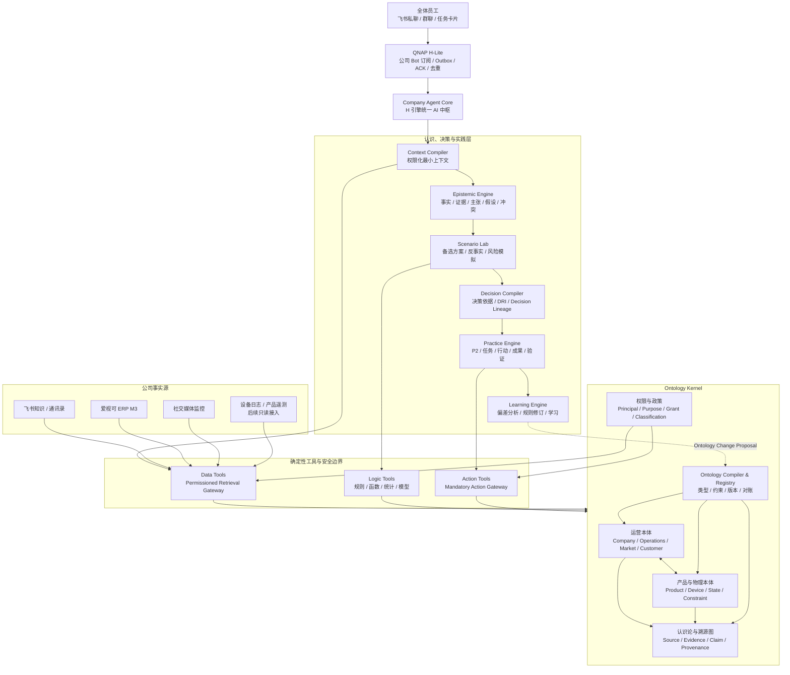

# 公司 AI Ontology V3 认知—实践骨架方案

更新时间：2026-08-08（Asia/Shanghai）

## 1. 结论

V2.2 继续作为当前生产部署基线，不推翻 QNAP、H-Lite、Company Agent Core、H 引擎、Postgres、Permissioned Retrieval Gateway 和 Mandatory Action Gateway。

V3 采用“骨架完整、血肉渐进”的建设方式：现在一次性搭好长期稳定的元模型、命名空间、权限、版本、事件和扩展契约；具体业务对象、属性、关系、规则和 Connector 只围绕真实决策闭环逐步增加。

这与“大而全本体”不同：

- 大骨架：先固定系统边界、对象基类、关系契约、证据模型、决策模型、行动模型、版本治理和安全路径。
- 大而全本体：试图一次性穷举公司全部对象、字段、关系、数据源和流程。
- 推荐建设前者，禁止建设后者。

V3 的目标不是增加一个更大的知识库，而是把公司 AI 基座升级为：

```text
观察事实 → 形成认识 → 比较方案 → 作出决策 → 组织实践 → 验证结果 → 修正认识
```

## 2. 核心架构原则

### 2.1 三个闭环

1. 认识闭环：`Observation → Evidence → Claim → Hypothesis → Decision`。
2. 实践闭环：`Decision → Action Intent → Approval → Action → Outcome → Verification`。
3. 演化闭环：`Learning → Change Proposal → Review → Deploy → Reconciliation`。

### 2.2 两个世界

1. 运营世界：目标、P2、人员、任务、决策、成果、ERP 履约事实、市场信号。
2. 产品与物理世界：产品、SKU、BOM、固件、SN、设备状态、环境、诊断、物理约束和安全边界。

### 2.3 一个编译器

新增 Ontology Compiler & Registry，统一负责：

- 类型、继承、引用和命名空间检查。
- Function、Action、Policy 和 Constraint 签名检查。
- SHACL 风格对象约束和数据质量门禁。
- 权限路径和 Mandatory Action Gateway 不可绕过检查。
- 向后兼容性、迁移计划和历史版本重放。
- Git 定义、运行时 Registry 和数据库对象的对账。
- 内容寻址版本、commit、hash、policy 和 prompt 版本锚定。

## 3. V3 总体架构



## 4. 一次性搭好的“大骨架”

### 4.1 稳定命名空间

首版固定以下命名空间，后续只允许在命名空间内增量扩展：

| 命名空间 | 职责 |
|---|---|
| `system.ontology` | 类型、关系、函数、动作、约束、版本、变更提案 |
| `core.identity` | Person、Department、Role、Principal、Delegation |
| `core.policy` | Purpose、Classification、Grant、PolicyDecision |
| `core.epistemic` | Observation、Evidence、Claim、Hypothesis、Contradiction |
| `core.decision` | DecisionCase、Alternative、Scenario、Decision、Approval |
| `core.work` | Goal、P2、Task、Artifact、Verification、Learning |
| `core.action` | ActionIntent、DryRun、Execution、Readback、Rollback |
| `domain.company` | 公司、组织、经营目标和指标 |
| `domain.product` | 产品线、SKU、BOM、固件、功能和成本 |
| `domain.operations` | SN、质检、库存、订单、物流、激活和设备追溯 |
| `domain.market` | 内容、评论、趋势、痛点、竞品和 Opportunity |
| `domain.customer` | 用户、场景、反馈、售后和转化线索 |
| `domain.device` | 设备状态、环境、诊断、遥测和安全约束 |

### 4.2 通用对象基类

所有对象至少统一以下字段，避免后续跨域重构：

```text
object_id
object_type
schema_version
security_domain
classification
lifecycle_status
valid_from / valid_to
recorded_at
source_system
source_reference
created_by / updated_by
ontology_version
provenance_id
```

其中：

- `valid_from/valid_to` 表示业务事实何时成立。
- `recorded_at` 表示系统何时知道该事实。
- 两套时间不能合并，避免历史事实被当前数据覆盖。

### 4.3 通用关系基类

所有 Link 统一包含：

```text
link_id
link_type
from_object_id
to_object_id
validity_window
confidence
provenance_id
ontology_version
```

关系不能只存两个外键；必须能够说明有效期、来源和可信程度。

### 4.4 统一事件信封

飞书消息、任务状态、ERP 变更、社媒 Signal 和 Action 结果统一进入 append-only Event Envelope：

```text
event_id
event_type
occurred_at
received_at
producer
principal
purpose
correlation_id
causation_id
idempotency_key
payload_schema_version
ontology_version
classification
```

Connector 只能发布事件和标准化事实，不能直接绕过 Ontology Service 修改跨域业务对象。

### 4.5 固定三类 Agent 工具契约

1. Data Tools：只返回权限过滤后的 Object/Evidence Package。
2. Logic Tools：调用确定性规则、统计、函数和模型，不直接修改业务系统。
3. Action Tools：只允许提交 Action Intent，业务写回必须经过 Mandatory Action Gateway。

H 引擎不持有公司数据库直连权限，不持有长期 ERP、飞书、Git 或社媒写凭据。

## 5. 认识论层骨架

### 5.1 核心对象

| 对象 | 含义 |
|---|---|
| Observation | 对外部或内部状态的原始观察 |
| Source | 数据、文档、人员、系统或传感器来源 |
| Evidence | 支撑或反驳某一主张的证据 |
| Claim | 基于证据提出的可验证陈述 |
| Hypothesis | 尚未被充分验证的因果解释 |
| Assumption | 当前决策依赖但尚未证实的前提 |
| Unknown | 已明确知道缺失的信息 |
| Contradiction | 与当前主张冲突的证据或结论 |
| Confidence | 证据强度和判断置信度，不等同于事实概率 |
| ValidityWindow | 结论成立的时间、场景和权限范围 |
| Provenance | 事实如何产生、转换、批准和派生 |

### 5.2 事实类型必须分开

禁止把下列内容都写成同一种 `fact`：

- 源系统原始事实。
- 规则推导事实。
- 模型预测。
- 员工人工判断。
- 假设。
- 未知项。
- 冲突证据。

Company Agent 回答必须能够同时返回结论、证据来源、时间有效性、权限范围、反证、未知项和建议验证动作。

## 6. 实践论层骨架

每个真实 P2 固定形成 Decision Lineage：

```text
Goal
→ Observation / Evidence
→ Claim / Hypothesis
→ DecisionCase / Alternatives
→ DRI Decision
→ P2 / Tasks
→ Employee Artifact
→ Action / Readback
→ Observed Outcome
→ Verification
→ Learning
→ Policy or Ontology Change Proposal
```

实践结果分三层：

1. Execution Success：技术调用成功。
2. Operational Success：业务流程进入预期状态。
3. Goal Success：最初经营目标真实改善。

任何 Connector 的 HTTP 200、数据库更新或飞书消息 ACK 都不能直接等同于 Goal Success。

## 7. 双层运营—物理本体

### 7.1 运营本体

继续承载目标、任务、人员、订单、库存、市场信号和经营决策。

### 7.2 产品与物理本体

先搭对象与关系骨架，P0/P1 只读接入：

```text
ProductModel
SKU
BOM
FirmwareVersion
DeviceUnit
SerialNumber
Component
CalibrationProfile
SensorSnapshot
DeviceState
EnvironmentContext
DiagnosticEvent
SafetyConstraint
MaintenanceAction
StateEstimate
```

不在当前阶段建设设备自动控制，不让 H 引擎或 Company Agent 直接下发硬件控制指令。

## 8. 数据与存储边界

### 8.1 Postgres 逻辑 Schema

先建立稳定 Schema 边界，不要求一次填满全部业务表：

| Schema | 内容 |
|---|---|
| `ontology_registry` | 类型、Link、Function、Action、Constraint、版本 |
| `ontology_runtime` | 对象、关系、对象快照和通用索引 |
| `epistemic` | Source、Observation、Evidence、Claim、Hypothesis |
| `decision` | DecisionCase、Alternative、Scenario、Approval、Lineage |
| `work` | Goal、P2、Task、Artifact、Verification、Learning |
| `integration` | Connector checkpoint、source mapping、dead letter |
| `security` | Principal、Grant、Purpose、Classification、PolicyDecision |
| `action` | ActionIntent、DryRun、Execution、Readback、Rollback |
| `audit` | append-only event、访问审计、版本和变更记录 |

### 8.2 派生层

- Qdrant：可重建语义召回，不承担权限和事实判断。
- Redis：队列、租约、缓存和限流，不承担任务状态真源。
- Object Storage：原始证据、导出包、模型输出和不可变附件。
- RDF/JSON-LD：未来跨域交换接口，不取代当前 Postgres 真源。

## 9. Ontology Compiler 最小流水线

```text
Git Definition
→ Parse
→ Type/Reference Check
→ Constraint Check
→ Policy/Action Path Check
→ Compatibility Check
→ Migration Plan
→ Review Proposal
→ Registry Deploy
→ Runtime Reconciliation
→ Smoke Test
```

首版必须具备：

1. 类型与引用检查。
2. 版本内容哈希。
3. 兼容性分级：compatible / migration-required / rejected。
4. Git 与运行时 Registry diff。
5. Agent 只能生成 Proposal，DRI 或 Ontology Owner 批准后才能部署。
6. 每次回答、Decision、Task、Action 和 Verification 写入 Ontology 版本。

## 10. 建设顺序

### P0-S：骨架先行

状态：✅ 已于 2026-08-08 上线 QNAP。当前生产 Registry Schema `3.0.0`，受治理元素 71 个，Git/运行时 Hash `0e1690bbced6` 一致；认识论与决策对象只完成稳定类型骨架，尚未批量导入业务数据。

1. 建立命名空间、对象基类、关系基类和 Event Envelope。
2. 建立 Postgres 逻辑 Schema 和跨域 ID 规则。
3. 建立 Ontology Definition、Compiler、Registry 和 reconciliation skeleton。
4. 建立 Data/Logic/Action 三类工具契约。
5. 建立 Policy、Purpose、Classification 和版本锚点。
6. 只创建骨架和少量样例，不批量导入全部公司数据。

### P0-EPI：认识论最小闭环

1. Source、Observation、Evidence、Claim、Hypothesis、Contradiction。
2. 改造 Permissioned Evidence Package。
3. Company Agent 输出证据、反证、未知项和有效期。
4. 用一条社媒 Signal 和一条 ERP 事实完成正反证闭环。

### P0-DEC：决策与实践闭环

1. DecisionCase、Alternative、Scenario、Decision Lineage。
2. Task Proposal 必须引用已批准 Decision。
3. Action 增加 Expected Outcome、Observed Outcome 和 Verification。
4. 用一个真实部门、一名 DRI 和一条真实 P2 完成验收。

### P1-DOMAIN：领域逐步生长

1. ERP M3 只读对象映射。
2. 社媒归一化 Signal 与不可信输入隔离。
3. 产品/SKU/BOM/固件/SN 骨架。
4. 设备日志与诊断状态后续只读接入。
5. 每个新增领域必须绑定 Competency Questions 和真实决策闭环。

### P1-SCALE：50 到 300 人扩展

1. QNAP 保持控制面、数据面和首批短任务池。
2. 长任务、批处理、向量化和 Scenario 计算扩展到无状态 Worker Cell。
3. 150 人增加部门配额和 Admission Control。
4. 300 人按 public/product/erp/management 安全域分 Cell。

## 11. 当前明确不做

- 不一次性穷举公司全部业务对象。
- 不把所有飞书文档内容自动当作公司事实。
- 不把 RAG 删除；文档与向量召回作为 OAG 的 Evidence Retrieval 工具。
- 不让 Agent 直接修改生产 Ontology。
- 不把 ERP 设备记录当成完整物理状态模型。
- 不把 Action 技术成功当成经营目标成功。
- 不迁移员工私人 Bot，不读取私人 Bot 历史会话。
- 不开发爱视可 ERP M4，不恢复 MediaCrawler 风控任务。
- 不把 Qdrant、Redis 或 H 引擎本地会话作为业务真源。

## 12. 验收指标

1. 任一对象、关系、Decision、Task 和 Action 可追溯到 Ontology 版本与来源。
2. 悬空引用、类型错误和绕过 Action Gateway 的 Action 无法部署。
3. 有权员工得到 Evidence，无权员工为零且无标题、摘要、正文泄漏。
4. Company Agent 能明确区分事实、推导、预测、判断、假设和未知。
5. 一条真实 P2 能完整回放 Decision Lineage。
6. Action 同时记录技术执行、业务结果和目标验证三类状态。
7. QNAP 重启后 Registry、对象、任务、Decision、Evidence 和审计均可恢复。
8. 新领域通过 Change Proposal 接入，不修改既有核心契约。

## 13. 研究依据

- 微信文章：《Ontology as Code：像代码一样管理本体》。
- 微信文章：《Palantir 本体论④：OAG 替代 RAG》。
- 微信文章：《Palantir Foundry：5 步把数据变对象》。
- 微信文章：《一文读懂 Ontology 背后的四大技术：RDF、OWL、SPARQL、SHACL》。
- 微信文章：《为什么工业不能照搬 Palantir Ontology——从决策本体到物理本体》。
- Palantir 官方：Ontology、Action Types、Functions、Agent Studio、Data Connection、Pipeline Builder、Ontology branching。
- W3C：PROV-O、OWL 2、SHACL。
- NIST：AI Risk Management Framework。
