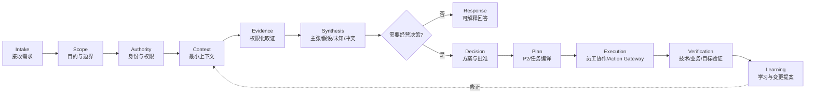
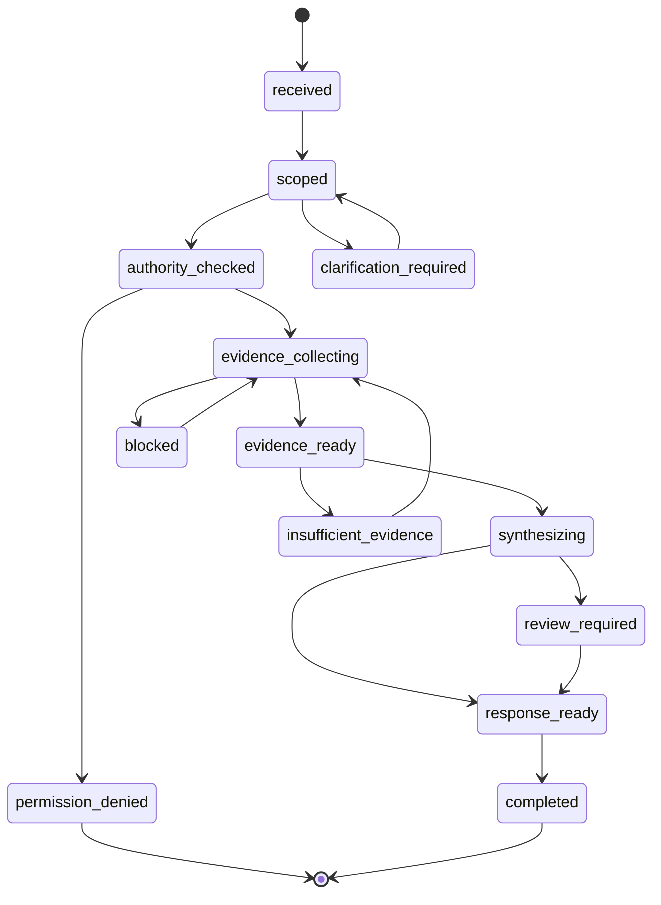

# 公司大脑工作逻辑显式建模与 Goal 4 实施计划

日期：2026-08-09（Asia/Shanghai）

> 实施状态：Goal 4 已按本计划完成，Goal 5 也已激活 Decision 至 Learning。当前生产基线为 Schema `3.2.0`、Work / Practice Protocol `1.1.0 / active`；详见 `decision-practice-loop-acceptance-2026-08-09.md`。

## 1. 结论

下一阶段推荐直接启动 **Goal 4：P0-EPI 认识论最小闭环 + Company Brain Work Protocol v1.0**。

10 名真实员工 Canary 暂缓，不删除，也不降低其生产门禁地位。它调整到公司大脑工作协议、P0-EPI 和 P0-DEC 大框架稳定之后执行，避免用真实员工验证一套马上会改变的回答与任务逻辑。

Goal 4 采用“**全链路显式建模、当前只激活认识闭环**”的方式：

- 一次性定义公司大脑从接收问题到学习回写的完整工作阶段、状态、输入输出和安全门禁。
- 本轮真正实现并上线 `接收 → 定界 → 权限 → 取证 → 认识合成 → 可解释回答`。
- 决策、任务、行动、验证、学习阶段只建立兼容契约和灰色状态，不在 Goal 4 冒充已运行。
- 不保存模型隐藏思维链；只保存可审计的证据引用、判断摘要、假设、未知、冲突、规则结果和批准记录。

## 2. 为什么先做 Goal 4

当前 V3 已有 Source、Observation、Evidence、Claim、Hypothesis、DecisionCase、Verification 等对象骨架，但仍缺少统一回答以下问题的运行模型：

1. 公司大脑收到一项需求后，当前处于哪个阶段。
2. 为什么选择问答、分析、决策支持、任务编排或受控行动模式。
3. 使用了哪些有权限证据，哪些信息因权限、时效或缺失没有使用。
4. 当前结论属于源事实、推导、预测、人工判断、假设还是未知。
5. 哪个条件不满足时必须停止、澄清、转人工或等待批准。
6. 一个回答如何继续变成 Decision、P2、Task、Action、Verification 和 Learning。
7. 管理者如何在可视化页面回放整个过程，而不是只看到容器绿色或一段最终文本。

如果先做 10 人真实 Canary，只能验证现有对话通道和权限隔离，随后 P0-EPI/P0-DEC 改变回答结构、状态机和任务入口时还要重新验收。因此先稳定工作协议，再做真实员工 Canary，返工更少、证据更强。

## 3. Company Brain Work Protocol v1.0

### 3.1 六种工作模式

| 模式 | 适用请求 | Goal 4 状态 |
|---|---|---|
| `answer_query` | 查询已有事实、制度、项目状态 | 激活 |
| `situation_analysis` | 汇总事实、识别趋势、风险和未知 | 激活 |
| `decision_support` | 比较方案并形成 Decision Proposal | 只建契约，Goal 5 激活 |
| `p2_orchestration` | 把批准的 Decision 编译为 P2/任务 | 只建契约，Goal 5 激活 |
| `governed_action` | 通过 Action Gateway 执行受控写回 | 沿用既有 Action Gateway，Goal 5 接线 |
| `learning_review` | 对结果偏差形成 Learning/Change Proposal | 只建契约，Goal 5 后激活 |

模式不是由提示词随意选择。系统必须结合请求目的、当前 Principal、权限范围、期望产物、风险等级和是否涉及业务写回生成可审计的 Mode Decision。

### 3.2 统一工作阶段



Goal 4 激活 A–H；I–M 进入 Registry 契约和可视化灰色节点，Goal 5 再激活。

### 3.3 工作实例状态机



所有状态变化必须写入 append-only Event Envelope。`completed` 仅表示本次工作实例完成，不等于任务完成、行动成功或经营目标成功。

## 4. 显式对象模型

### 4.1 Goal 4 新增对象

在既有 13 个命名空间内增量扩展，不新增平行命名空间：

| 对象 | 命名空间 | 用途 |
|---|---|---|
| `WorkCase` | `core.work` | 一次公司大脑工作实例的外层信封 |
| `WorkStage` | `core.work` | 每个阶段的输入、输出、状态和阻断原因 |
| `Assumption` | `core.epistemic` | 当前判断依赖但尚未证实的前提 |
| `Unknown` | `core.epistemic` | 已知缺失且会影响结论的信息 |
| `EpistemicAssessment` | `core.epistemic` | 对证据完整性、冲突、时效和置信依据的确定性评估 |

`ValidityWindow` 保持为统一值对象，不单独制造生命周期复杂的业务实体。Provenance 继续使用既有对象与字段，不建立第二套溯源真源。

### 4.2 核心关系

```text
WorkCase HAS_STAGE WorkStage
WorkCase USES_EVIDENCE Evidence
WorkCase PRODUCES_CLAIM Claim
Claim DEPENDS_ON Assumption
WorkCase HAS_UNKNOWN Unknown
Evidence SUPPORTS Claim
Evidence CONTRADICTS Claim
Evidence TESTS Hypothesis
EpistemicAssessment ASSESSES WorkCase
```

后续 Goal 5 再连接：

```text
WorkCase ESCALATES_TO DecisionCase
Decision PRODUCES P2
P2 COMPILES_TO Task
Task VERIFIED_BY Verification
Verification PRODUCES Learning
```

### 4.3 WorkCase 最小字段

```text
case_id
tenant_id
principal_id
purpose
work_mode
request_summary
requested_outcome
status
risk_level
security_domain
policy_snapshot_id
ontology_version
conversation_reference
started_at / completed_at
```

`request_summary` 是脱敏后的业务请求摘要，不默认保存员工私人对话全文。

### 4.4 WorkStage 最小字段

```text
stage_id
case_id
stage_type
status
input_references
output_references
policy_decision_id
block_reason_code
started_at / ended_at
ontology_version
```

阶段对象只记录可审计产物与引用，不记录模型内部隐藏思维链。

## 5. Permissioned Evidence Package v2

Goal 4 将当前 Evidence Package 升级为稳定契约：

```text
package_id
case_id
principal_snapshot
purpose
policy_decision_reference
ontology_version
generated_at
valid_until
retrieval_coverage
facts[]
supporting_evidence[]
contradicting_evidence[]
assumptions[]
unknowns[]
freshness_summary
truncation_summary
excluded_reason_counts
```

每条事实必须包含：

- `epistemic_type`：source_fact / derived_fact / prediction / human_judgment / assumption / unknown。
- 来源、业务有效时间、系统记录时间和 Provenance。
- Classification、权限快照和 Ontology 版本。
- 置信等级及其依据，不把模型自信度伪装为事实概率。

无权限资源只允许进入聚合后的排除原因计数，不得泄露标题、摘要、URL、人员或正文片段。

## 6. Company Agent 回答契约

Goal 4 后，正式回答统一包含机器可读结构和员工可读表达：

| 字段 | 含义 |
|---|---|
| `conclusion` | 当前可支持的结论 |
| `fact_basis` | 主要源事实与证据引用 |
| `derived_summary` | 可审计的推导摘要，不是隐藏思维链 |
| `assumptions` | 当前依赖的未证实前提 |
| `contradictions` | 反证或冲突 |
| `unknowns` | 缺失信息及其影响 |
| `confidence_level` | high / medium / low / insufficient |
| `validity_window` | 结论适用的时间和场景 |
| `recommended_next_action` | 建议验证、补充信息或后续动作 |
| `approval_required` | 是否需要 DRI/管理员批准 |
| `evidence_references` | 可按当前员工权限打开的证据引用 |

回答必须允许明确返回“证据不足”“无权限判断”“存在冲突，暂不建议决策”，不能为了保持流畅而补全未知事实。

## 7. 存储与运行架构

### 7.1 Postgres 真源

建议新增以下运行表，全部带 Tenant RLS、双时间、Ontology 版本和 append-only 审计：

```text
work.brain_cases
work.brain_case_stages
work.brain_case_events
epistemic.assumptions
epistemic.unknowns
epistemic.assessments
```

既有 Evidence、Knowledge Chunk、Ontology Entity 和任务表继续使用，不复制数据。工作实例只保存引用和投影。

### 7.2 Agent Core 流水线

```text
Feishu/H-Lite Request
→ WorkCase 创建
→ Purpose/Mode/风险定界
→ Principal 与 Policy Decision
→ Context Compiler
→ Permissioned Retrieval
→ Evidence Package v2
→ Epistemic Assessment
→ H 引擎结构化生成
→ Response Validator
→ 飞书回答 + WorkCase 完成
```

H 引擎只能读取当前 WorkCase 的最小 Evidence Package，不获得数据库直连权，也不能直接写业务系统。

### 7.3 可视化投影

H 控制面增加“公司大脑工作台”，只展示脱敏投影：

1. WorkCase 阶段时间线：当前在哪一步、耗时、阻断原因。
2. Evidence Map：支持证据、反证、未知和时效状态。
3. Answer Basis：结论属于事实、推导、预测、判断还是假设。
4. Decision Lineage：Goal 4 中保持灰色，Goal 5 激活。
5. Verification/Learning：Goal 4 中保持灰色，后续按结果逐步点亮。

普通员工未来只能查看自己的 WorkCase 和有权限证据；管理视图也不能绕过文档 ACL 展示正文。

## 8. Goal 4 实施分解

### Phase A：契约与版本

1. Foundation Definition 以向后兼容方式升级到建议版本 `3.1.0`。
2. 新增 WorkCase、WorkStage、Assumption、Unknown、EpistemicAssessment 及关系。
3. 增加“不保存隐藏思维链”“回答必须声明认识状态”“Evidence 必须带权限快照”的 Policy/Constraint。
4. Compiler 增加状态引用、枚举、关系和必填字段校验。

### Phase B：数据库与 API

1. 建立 additive migration、RLS、角色最小权限和稳定 View。
2. 增加 WorkCase 创建、阶段推进、Evidence Package、回答解释和回放 API。
3. 所有阶段变化写 Event Envelope 和审计，不允许覆盖历史轨迹。

### Phase C：Agent Core 认识闭环

1. 增加 Purpose/Mode/风险定界器。
2. 生成 Evidence Package v2。
3. 执行确定性证据完整度、时效和冲突评估。
4. H 引擎使用结构化输出契约。
5. Response Validator 拒绝无来源事实、未声明假设和越权证据引用。

### Phase D：样例与可视化

1. 使用明确标记为 fixture 的一条 ERP 事实和一条社媒 Signal。
2. 构造支持、反证、过期、未知和无权限五类场景。
3. H 控制面显示工作阶段、证据地图和认识状态。
4. 不接入 10 名真实员工，不导入产品研究部整库。

### Phase E：QNAP shadow 与生产切换

1. 先备份、Compiler dry-run、Registry Proposal 和兼容性检查。
2. 数据库只执行 additive migration。
3. Agent Core 以 `shadow` 记录 WorkCase，不改变现有员工回复。
4. 通过正负测试后切换为 `active`。
5. 重启、回滚、历史回放和 Git/Registry reconciliation 全部通过后标绿。

## 9. Goal 4 验收标准

1. Registry 只有一个 active 版本，Git/运行时 Hash 一致，升级被判定为 compatible。
2. WorkCase 每次请求只有一个当前状态，所有历史阶段事件可回放。
3. Source Fact、Derived Fact、Prediction、Human Judgment、Assumption、Unknown 和 Contradiction 不得混存为普通事实。
4. 有权 Principal 获得 Evidence，无权 Principal 为 0，且无标题、摘要、URL 和正文泄露。
5. 过期证据、冲突证据和证据不足能够降低认识状态，不能生成确定性结论。
6. 数据库、日志、Prompt 临时文件和管理页面均不保存或展示隐藏思维链。
7. ERP fixture 与社媒 fixture 能形成支持、反证、假设和验证建议。
8. QNAP 重启后 WorkCase、Stage、Evidence 引用和审计仍可回放。
9. Dashboard 能明确显示 Goal 4 已激活阶段和 Goal 5 灰色阶段。
10. 未触发产品研究部整库导入、真实 ERP/社媒写回或 10 人真实员工 Canary。

## 10. Goal 顺序重排

```text
Goal 4：P0-EPI + Company Brain Work Protocol v1.0
→ Goal 5：P0-DEC + Decision/Task/Verification 实践闭环
→ Goal 3：10 名真实员工 Canary
→ 24 小时容量观测
→ 20/50 人放量
```

公司专用 CPA 凭据、`department/openchat` 主体映射可以作为独立基础设施任务并行推进，但不能改变上述业务验收顺序。

## 11. 建议启动 Goal 文本

> 实施公司 AI Ontology Goal 4：在 V2.2 生产基线和 V3 P0-S Foundation Pack 上，完成 P0-EPI 认识论最小闭环与 Company Brain Work Protocol v1.0。一次性固化公司大脑从 Intake、Scope、Authority、Context、Evidence、Synthesis 到 Decision、Plan、Execution、Verification、Learning 的完整阶段和状态契约，但本轮只激活至可解释回答；新增 WorkCase、WorkStage、Assumption、Unknown、EpistemicAssessment，升级 Permissioned Evidence Package v2 和 Company Agent 回答契约，明确区分源事实、推导、预测、人工判断、假设、未知和冲突；禁止保存隐藏思维链。完成兼容性编译、数据库迁移、RLS、Agent Core、结构化 H 引擎输出、管理可视化、fixture 正负测试、QNAP shadow/active 切换、重启回放和回滚验收。不得导入产品研究部整库，不得启用真实 ERP/社媒写回，不执行 10 名真实员工 Canary。

## 12. 实施结果（2026-08-09）

Goal 4 已按上述范围完成生产部署，状态为 `active`：

1. Ontology Schema `3.1.0`、Hash `117074b5e6b0`，46 Object、24 Link、5 Function、2 Action、5 Policy、8 Constraint。
2. Agent Core `2026-08-09.1` 已启用 Work Protocol `1.0.0`；当前 active 阶段为 Intake、Scope、Authority、Context、Evidence、Synthesis、Response。
3. ERP/社媒 fixture 的 fresh、conflict、stale、no-ACL、missing-principal 五类场景均通过；过期、冲突和证据不足禁止确定性结论。
4. 无 ACL 路径在策略层直接返回 `insufficient_evidence`，不存在 Principal 返回 `permission_denied`，两类路径均不调用 H 引擎且 Evidence 为 0。
5. QNAP 完整自检、旧版 `3.0.0`/Agent Core `2026-08-08.4` 回滚、新版恢复、WorkCase 重启回放、日志敏感值扫描和 `restart_count=0` 通过。
6. H 控制面 `v1.52.0` 已显示 WorkCase、Evidence Map、Answer Basis；真实浏览器 8/8 组件就绪、控制台错误 0、无横向溢出，Goal 5 五个阶段保持灰色。
7. 产品研究部整库、真实 ERP/社媒写回和 10 名真实员工 Canary 均未触发。

详细证据见 `company-brain-work-protocol-acceptance-2026-08-09.md`。下一主线转为 Goal 5 P0-DEC。
