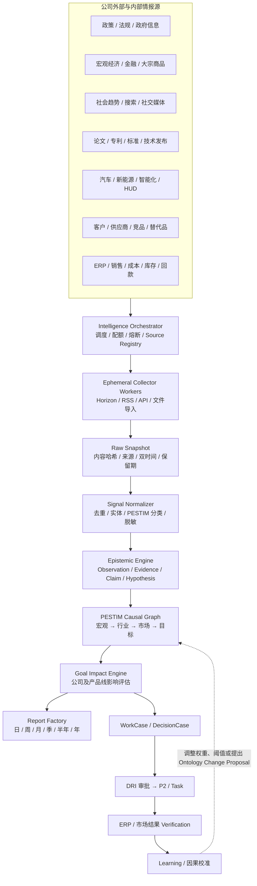

# PESTIM 战略情报与经营建议系统方案

更新时间：2026-08-10（Asia/Shanghai）

## 1. 结论

PEST + Industry + Market 是公司级重要外部情报，不应只作为一次性分析文档或静态知识库导入。推荐在现有 AI Ontology 中建设独立的 `P1-STRATEGIC-INTELLIGENCE` 能力，将它定位为：

> 持续采集外部世界变化，形成有证据的 PESTIM 判断，映射公司及产品线目标，按多时间尺度输出经营建议，并通过 Decision/P2/Task/Verification/Learning 闭环验证和校准传导关系。

个人站“AI 前沿资讯雷达”的方法和部分代码可以复用，但不能把个人站或其生产数据链原样移植到公司 QNAP。正确做法是：

1. 复用 Horizon 的多源采集、去重、评分、过滤、富化、阶段产物和 last-good 发布门禁；
2. 复用 Theory Radar 的 oneshot、影子运行、严格 JSON、熔断、资源上限和单一生产者原则；
3. 不复用个人站 Next.js 展示层、公开 Webhook、个人报告目录、个人账号、个人 Token 或个人站生产发布关系；
4. 在公司 QNAP 上建立独立的 Intelligence Orchestrator 与临时 oneshot Worker，输出进入 Ontology Evidence/Claim/Impact Assessment，而不是直接写个人站 JSON；
5. 第一阶段只读生成报告和 Decision Proposal，不自动创建正式 P2，不触发 ERP/社媒写回。

## 2. 已读取的 PESTIM 资料

- 飞书知识库：`PESTIM关联关系和传导链条总结`
- 多维表 `目标管理0320`：27 个公司战略与经营目标模块；每个目标拆成 O1 目标、O1 目的、O2 原则、O2 原因，共 108 个目标要素。
- 多维表 `数字表0320`：43 个 PESTIM 二级维度 × 108 个目标要素，共 4644 个矩阵单元。
- 多维表 `传导链条0320`：4644 条传导记录，与矩阵编号一一对应，无缺失或重复编号。

43 个维度包括：

| 一级维度 | 二级维度数量 |
|---|---:|
| Political | 14 |
| Economic | 10 |
| Social | 4 |
| Tech | 6 |
| Industry | 4 |
| Market | 5 |

## 3. 因果层级

PESTIM 在分类上有六类，但在经营因果上不是六个完全平行的盒子。

```text
PEST 宏观外生变量
→ Industry 行业状态与技术/利润池变化
→ Market 客户、供应商、竞品、替代品和进入者力量变化
→ 公司战略、经营目标和产品线
```

同时保留直接路径：

```text
Political → 合规 / IPO / 海外准入
Economic → 融资 / 现金流 / 总需求
Social → 用户需求 / 人才 / 组织文化
Tech → 研发 / 专利 / 技术路线
```

因此 Ontology 中必须采用有向因果图，而不是只有 43 × 108 的平面表格。

## 4. 当前矩阵的定位与质量门禁

现有矩阵的结构覆盖非常完整，适合用作：

- 外部因素覆盖检查表；
- 目标影响候选目录；
- 人工评审的初始因果假设；
- 后续情报分类和报告选题的骨架。

但不能直接作为生产因果事实：

- 4644 条记录只有 290 种不同传导逻辑；
- 1161 条“原则”全部引用“灵魂优先原则”；
- 1161 条“原因”全部引用“规避风险”；
- 903 条“目的”仍使用通用的“O1目的”称呼；
- “制造和工艺”的真实原则是产能匹配、精益制造和集团化布局，但候选传导描述仍可能引用“灵魂优先原则”。

因此 4644 条记录导入时必须统一标记：

```text
epistemic_type = hypothesis
origin = generated_matrix
status = generated_draft
confidence = unverified
activation = inactive
```

只有经过实际证据、DRI 评审和经营结果验证的关系才能进入 active causal graph。

## 5. 战略情报运行架构



## 6. 多周期报告体系

多周期报告必须从结构化 Signal、Evidence、Impact Assessment 和经营指标重新计算，不能只递归总结下一级报告正文。

| 周期 | 观察窗口 | 核心问题 | 输出与决策边界 |
|---|---|---|---|
| 日报 | 24 小时 | 今天发生了什么 | Top 信号、受影响目标、监控/补证据/紧急预警 |
| 周报 | 7 天 | 哪些信号持续增强或消失 | 信号聚类、连续性、产品线影响、本周建议 |
| 月报 | 30 天 | 外部变化是否影响经营结果 | 与订单、毛利、成本、库存、回款联动；Decision Proposal |
| 季报 | 90 天 | 战略假设和产品组合是否需调整 | 场景、竞争格局、预算和资源建议；管理层评审 |
| 半年报 | 180 天 | 战略执行与因果模型是否需校准 | 能力缺口、组织/产品线表现、传导关系重估 |
| 年报 | 365 天 | 下一年度目标与资源如何配置 | 年度战略、产品组合、预算、年度 P2 方向 |

重大监管、客户、供应商、竞品和替代技术事件走独立 `Strategic Intelligence Alert`，不等待日报，但仍只创建 WorkCase/Decision Proposal。

## 7. 公司级与产品线级双投影

### 7.1 公司经营视图

- IPO、融资与现金流；
- 组织治理与人才；
- 产能、供应链、重大客户；
- 公司整体战略风险和机会。

### 7.2 产品线视图

每条产品线建立 `ProductLine Intelligence Profile`：

```text
product_line_id
related_pestim_dimensions
regions
customers
suppliers
competitors
substitutes
strategic_goals
operating_metrics
risk_thresholds
opportunity_thresholds
dri
```

推荐首个试点选择 HUD：当前 PESTIM 文档的 Industry/Market 逻辑最完整，同时 ERP 可提供订单、成本、库存和回款验证证据。

## 8. Ontology 最小扩展

当前已有 `MarketSignal`、`Trend`、`Opportunity`、`Observation`、`Evidence`、`Claim`、`Hypothesis`、`Scenario`、`DecisionCase`、`Goal/P2/Task`，无需另建第二套认识论和实践论。

建议增加：

| 对象 | 作用 |
|---|---|
| `domain.environment.ExternalFactorDefinition` | 43 个 PESTIM 稳定维度 |
| `domain.strategy.GoalFacet` | 108 个目标、目的、原则和原因要素 |
| `domain.environment.ImpactHypothesis` | 4644 条候选传导关系 |
| `domain.environment.ImpactAssessment` | 某时点对公司或产品线的影响判断 |
| `domain.intelligence.StrategicIntelligenceReport` | 结构化多周期报告 |
| `system.run.ReportRun` | 数据范围、模型、Prompt、输入哈希、成本和执行结果 |

报告先生成结构化 JSON，再渲染到飞书文档、飞书消息卡片和 H 控制面。报告正文是投影，不是真源。

## 9. 个人站雷达复用评估

### 9.1 个人站实际组成

个人站 `/radar` 不是单一项目，而是展示层聚合：

1. `aihot + yuweiwan`：实时资讯流；
2. `Theory Radar`：arXiv RSS + OpenAlex + Grok 4.5 深度分析；
3. `GitHub Radar`：开源项目风向标；
4. `Horizon`：跨源每日 AI 精选。

Next.js 页面负责读取各自 JSON 目录和展示，不承担公司级证据、权限、决策和任务语义。

### 9.2 Horizon 的可复用性

Horizon 上游采用 MIT License，支持 RSS、GitHub、Hacker News、Reddit、Twitter、Sitemap、GDELT、Jina、AI 排序和 MCP Server。个人站当前固定在已验证 Commit，并保存 `raw/scored/filtered/enriched` 阶段产物。

适合复用：

- 多源配置和采集适配器；
- URL/内容哈希去重；
- 规则过滤、AI 评分和摘要富化；
- 阶段产物和运行状态；
- 影子运行、last-good、条数/日期/URL 门禁；
- 失败不覆盖正式结果。

不适合直接复用：

- AI-only 的默认信源和分类；
- 个人站 Webhook、报告目录和公开页面；
- 个人模型账号和 API Key；
- 依赖浏览器登录或反自动化绕过的采集器；
- 把 AI 摘要直接当成 Evidence 或 Claim。

### 9.3 QNAP 适配结论

适合在公司 QNAP 上建设独立公司实例，但应采用“轻常驻 + 临时 Worker”，而不是常驻完整个人站：

```text
长期运行：
- intelligence-orchestrator：128–256 MiB

按任务临时启动：
- horizon-worker：上限 512 MiB
- theory/patent/rss worker：上限 384–512 MiB

复用既有：
- Postgres / Qdrant / Redis
- Agent Core / H 引擎
- H-Lite / Delivery Outbox
```

个人站 Theory Radar 已验证 `0.5 CPU / 384 MiB`，Horizon 已验证 `CPUQuota=60% / MemoryMax=512M`。这些是其他生产节点的配置，不是公司 QNAP 容量结论；正式部署前仍需在 QNAP 做 7 天 shadow 资源观测，并重新核对总内存门禁。

## 10. 公司版安全与治理边界

1. 公司实例使用独立配置、账号、Key、数据库表、状态目录和报告目录；不得读取个人站目录或调用个人站 Webhook。
2. Secret 只保存于公司 QNAP 本地 `0600` 环境文件或后续公司 Secret Store，不进 Git、Ontology、报告、日志或截图。
3. 外部内容均视为不可信输入，先消毒、限制长度、去脚本化，再进入 Evidence Pipeline。
4. 每个来源记录许可、使用范围、抓取频率、保存期限和合规负责人；内部决策使用不等于可以对外再分发。
5. 原始快照 append-only，带内容哈希、source time、ingest time、collector version 和 source license；设置热/冷/删除保留策略。
6. 高层报告只能展示调用者有权访问的内部经营数据；无权限资源不得泄露标题、摘要、URL 或存在性。
7. Intelligence Worker 无 ERP、飞书、Git 或业务系统写权限；正式动作仍走 Mandatory Action Gateway。

## 11. 报告与运行可复现性

每个 ReportRun 至少记录：

```text
report_type
period_start / period_end
evidence_cutoff_at
source_snapshot_ids
ontology_version
causal_graph_version
input_hash
model_id
prompt_version
tokens_in / tokens_out
cost
duration_ms
status / error_code
```

同一输入哈希不得重复调用模型；换模型、Prompt、Ontology 或因果图后必须能解释报告差异。

## 12. 推荐实施顺序

### Phase A：定义与 Staging

1. 固化 PESTIM、GoalFacet、ImpactHypothesis、ImpactAssessment、Report/Run 契约。
2. 从飞书只读导入 43 个维度、27 个目标、108 个 GoalFacet 和 4644 个 draft Hypothesis。
3. 建立版本、双时间、来源和语义质量审计；不激活因果关系，不生成任务。

### Phase B：QNAP 雷达 Shadow

1. 从个人站代码抽取 Horizon Adapter/Runner 模式，建立公司独立镜像和固定上游 Commit。
2. 先接 RSS、官方站、GitHub、论文/专利和允许的公开 API；浏览器型采集器默认关闭。
3. QNAP 连续 7 天 `PUBLISH=false`，验证资源、来源成功率、去重、成本、时效和敏感信息。
4. 输出结构化 Daily Report，但只在管理控制台可见，不发全员 Bot。

### Phase C：HUD 产品线试点

1. 选择 20–50 条高价值传导路径，经产品、销售、采购、财务和研发 DRI 评审后激活。
2. 跑通日报、周报和月报；加入 ERP 只读结果验证。
3. 建立重大事件 Alert 和 Decision Proposal，不自动创建正式 P2。

### Phase D：管理节奏与闭环

1. 月报进入经营会，季度/半年/年度报告进入管理层战略评审。
2. DRI 批准后才允许 Decision → P2 → Task。
3. Verification/Learning 根据经营结果调整因果强度、阈值或提出 Ontology Change Proposal。

## 13. 与现有 Goal 的关系

- Goal 7 `P1-PROD-READINESS` 仍是下一工程 Goal，不被本方案替代。
- PESTIM Schema、源清单和报告契约可以只读并行规划。
- QNAP Shadow 部署属于独立生产变更，需要单独完成容量、备份、回滚和当次部署授权。
- Goal 3 十人真实员工 Canary 继续使用受控 P2，不由 PESTIM 自动生成任务。
- PESTIM → Decision Proposal 可在 Goal 7 和 HUD Shadow 验收后启用；正式 P2 自动化需另行决策。

## 14. 当前后续 TODO

1. `P1-SI-A`：完成 PESTIM Ontology Definition 和兼容性方案，不改生产 Schema。
2. `P1-SI-B`：建立公司 Source Registry、许可/频率/保留期清单和第一批白名单信源。
3. `P1-SI-C`：从 Horizon/Theory Radar 抽取公司版 collector contract、JSON Schema 和镜像方案。
4. `P1-SI-D`：设计 Raw Snapshot、Signal、Impact Assessment、ReportRun 数据表与保留策略。
5. `P1-SI-E`：定义日报、周报、月报机器契约、飞书模板和 H 控制面投影。
6. `P1-SI-F`：制定公司 QNAP 7 天 Shadow 的资源、成本、失败率、来源覆盖和回滚验收包。
7. `P1-SI-G`：选择 HUD 首批 20–50 条传导链及对应 DRI，不激活其余 4594+ 条候选关系。
8. `P1-SI-H`：在 Goal 7 完成后申请 QNAP Shadow 部署授权。
