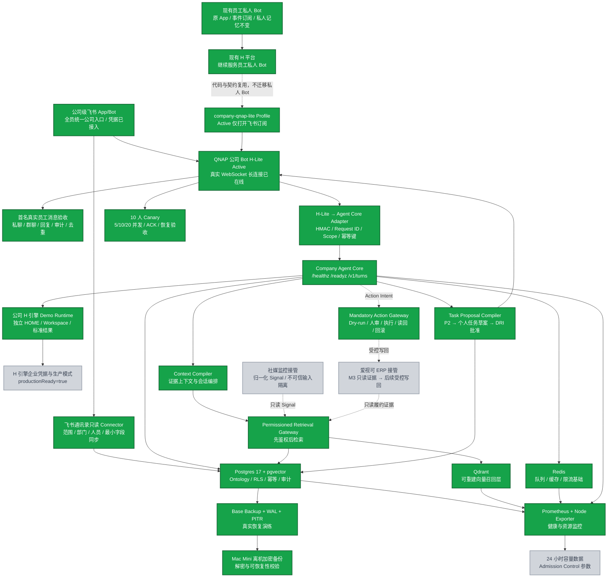

# 公司 AI Ontology 技术架构开发进展

更新时间：2026-08-08（Asia/Shanghai）

- 绿色：已完成代码、测试或生产 shadow 验证。
- 灰色：未完成，或仍在上线门禁之后。
- 架构统一使用“H 引擎”描述 AI 执行层；底层模型实现和版本只属于部署细节。
- 现有 H 平台员工私人 Bot 完全保持不变；另行新建一个公司级飞书 App/Bot 作为 Ontology 全员入口。

## 本轮完成

1. H 平台新增 `company-qnap-lite` 同源 shadow profile，并已在 QNAP 健康运行。
2. 新增 H-Lite → Company Agent Core 内部签名 Adapter。
3. QNAP 部署 Company Agent Core 最小服务，不发布宿主机端口。
4. 接入现有 Postgres RLS、幂等键与 append-only 审计。
5. 完成 H-Lite → Agent Core → H 引擎演示 Runtime → Postgres/SQLite 的真实 shadow 闭环。
6. 演示模式强制返回 `simulation=true`、`productionReady=false`，不冒充生产就绪。
7. 明确现有员工私人 Bot 不迁移、不切换事件订阅；公司 Bot 使用独立飞书 App。
8. 公司 App 凭据已通过非 Git 的 600 权限环境文件写入 QNAP，租户 Token 和 WebSocket 长连接验证通过。
9. H-Lite 已从 shadow 切到 active；Agent Core 仍返回 `demo_ready`，真实回复必须带“演示模式”。
10. 首名真实员工链路已通过：SQLite 读回 `p2p:post`、`p2p:text`、`group:text`，3 次处理全部 `completed`，无 `feishu_turn_failed`，去重记录 3 条，H-Lite 健康且 `restart_count=0`。
11. 通讯录数据范围已生效并上线只读同步：4 个授权范围展开为 83 个可见部门，414 名可见人员进入 Ontology Principal；重复同步新增 0、更新 414，数据库敏感属性行数为 0。

## P0 A-F 已完成

1. P0-A：H 引擎演示 Runtime、Mac Mini Xray、超时和并发准入完成。
2. P0-B：QNAP H-Lite shadow、SQLite 持久事件和 Agent Core Adapter 完成。
3. P0-C：权限检索、越权负测和员工个人数据可见接口完成。
4. P0-D：十人 P2、ACK、成果和 DRI 验收闭环完成。
5. P0-E：Mandatory Action Gateway、读回、回滚和不可绕过验证完成。
6. P0-F：5/10/20 并发、重投、容器恢复、PITR 和离机加密备份完成。

## 待用户确认的生产门禁

1. H 引擎企业凭据与生产模式验收。
2. 飞书公司知识库只读 Connector 和 ACL → Evidence Package 验收。
3. 扩到 10 名真实员工，完成并发会话、群内多人 @ 隔离、失败重投和回复送达验收。
4. 真实试点部门、DRI 和 P2；24 小时容量观测完成后再决定 20/50 人放量。
