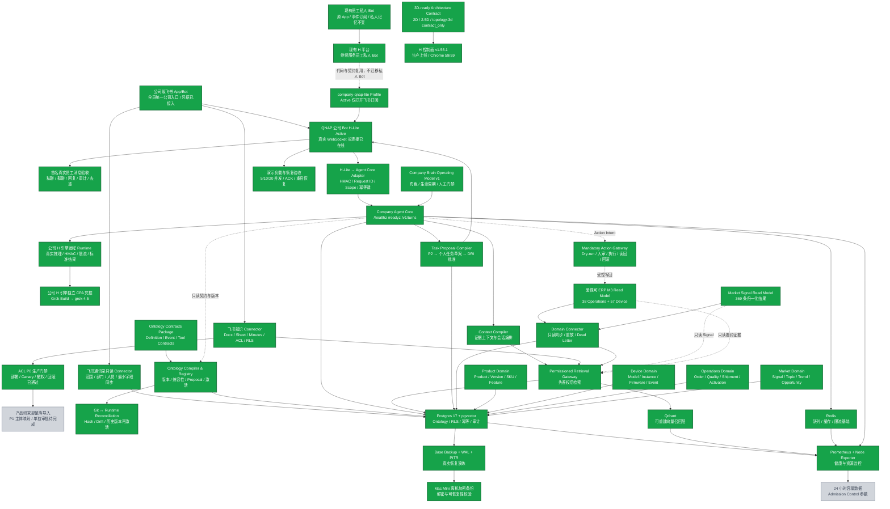

# 公司 AI Ontology 技术架构开发进展

更新时间：2026-08-09（Asia/Shanghai）

- 绿色：该节点标注的当前层级已经完成真实验收。
- 灰色：只完成代码/协议，或仍在生产授权、浏览器验收及业务门禁之后。
- 架构统一使用“H 引擎”描述 AI 执行层；底层模型实现和版本只属于部署细节。
- 现有 H 平台员工私人 Bot 完全保持不变；另行新建一个公司级飞书 App/Bot 作为 Ontology 全员入口。

## 本轮完成

1. H 平台新增 `company-qnap-lite` 同源 shadow profile，并已在 QNAP 健康运行。
2. 新增 H-Lite → Company Agent Core 内部签名 Adapter。
3. QNAP 部署 Company Agent Core 最小服务，不发布宿主机端口。
4. 接入现有 Postgres RLS、幂等键与 append-only 审计。
5. 完成 H-Lite → Agent Core → 远程 H Worker → Postgres/SQLite 的真实推理闭环。
6. 公司 H Worker 已切到独立 `cpa-api-key`，Grok Build 通过 CPA OpenAI 兼容入口真实调用 `grok-4.5`，不再复用员工私人 Bot OAuth。
7. 明确现有员工私人 Bot 不迁移、不切换事件订阅；公司 Bot 使用独立飞书 App。
8. 公司 App 凭据已通过非 Git 的 600 权限环境文件写入 QNAP，租户 Token 和 WebSocket 长连接验证通过。
9. H-Lite 已从 shadow 切到 active；Agent Core `2026-08-08.4` 返回 `ready`、`productionReady=true`、`mode=remote`，并透传 H Worker provider/model 元数据。
10. 首名真实员工链路已通过：SQLite 读回 `p2p:post`、`p2p:text`、`group:text`，3 次处理全部 `completed`，无 `feishu_turn_failed`，去重记录 3 条，H-Lite 健康且 `restart_count=0`。
11. 通讯录数据范围已生效并上线只读同步：4 个授权范围展开为 83 个可见部门，414 名可见人员进入 Ontology Principal；重复同步新增 0、更新 414，数据库敏感属性行数为 0。
12. 飞书知识 Connector `2026-08-08.3` 已生产上线；Base64 配置、四张知识表、RLS、ACL fail-closed 和同步审计通过。
13. 生产权限链路已通过合成证据正负测试：授权员工 Evidence 与 H 回复命中，无权限员工 Evidence 为 0，测试数据已删除。
14. 产品研究部知识库只读 ACL 审计完成，未触发导入；发现两个整库导入 P0，正式索引保持灰色并被硬阻断。
15. Knowledge Connector `2026-08-08.3` 已完成 Connector 14/14、Agent Core 14/14、真实 P0 ACL Canary、员工撤权、跨部门与链接直猜负测；撤权员工 Evidence 在 37.757 秒内归零。
16. V3 P0-S Contracts Package 已完成 13 个命名空间、41 个 Object Types、17 个 Link Types、3 个 Functions、2 个 Action Types、3 个 Policies 和 5 个 Constraints。
17. 独立 Ontology Registry `2026-08-08.1` 已在 QNAP 上线；生产 active 版本唯一，Schema `3.0.0`、71 个元素、Hash `0e1690bbced6`，Git/运行时状态为 `in_sync`。
18. PostgreSQL 17 隔离验收覆盖迁移重复执行、7 个逻辑 Schema、7 个稳定 View、RLS、最小权限、双审计和历史版本再激活；生产重启与重复部署后版本/元素/审计数量保持不变。
19. 公网管理看板已升级到 H 控制面 `v1.49.1`，Ontology Registry 独立标绿；真实 Chrome 验收为 7/7 运行组件就绪、控制台错误 0、失败请求 0、桌面和 390px 横向溢出 0。
20. Knowledge Connector 旧镜像回滚和恢复演练通过；临时飞书文档与 4 条 Canary Resource 已清理，最终知识表为 Resource 1、ACL 0、Chunk 0。
21. Goal 6 Schema `3.3.0` 已生产激活，Registry Hash 为 `41689393289d`，Definition 与 Runtime 保持 `in_sync`。
22. Company Brain Operating Model v1 已固化 12 个角色、关键生命周期、三层结果和 Learning 人工门禁。
23. Domain Connector `2026-08-09.3` 已只读接入 ERP M3 与社媒归一化结果；ERP 95 条、Market 369 条，敏感字段命中 0。
24. Replay、Live Cursor 保护、Active/Deleted/Expired/Revoked、Dead Letter、上游失败恢复和 Action Gateway 禁读负测已通过。
25. 跨域只读演示链已形成 11 节点/9 关系，不向员工下发、不写回 ERP/社媒、不产生 ActionIntent 或 Delivery Outbox。
26. 3D-ready Contract 已统一 Node、Edge、Layer、Focus、Selection、Camera、Filter、Trace 和 ViewMode；`topology-3d` 继续灰色。
27. H 控制面 `v1.55.1` 已生产上线；服务 active、`NRestarts=0`、错误日志 0，真实 Chrome `59/59`，节点重叠、错接、穿卡连线、焦点偏差、控制台错误、失败请求和横向溢出均为 0。

## P0 A-F 已完成

1. P0-A：H 引擎演示 Runtime、Mac Mini Xray、超时和并发准入完成。
2. P0-B：QNAP H-Lite shadow、SQLite 持久事件和 Agent Core Adapter 完成。
3. P0-C：权限检索、越权负测和员工个人数据可见接口完成。
4. P0-D：十人 P2、ACK、成果和 DRI 验收闭环完成。
5. P0-E：Mandatory Action Gateway、读回、回滚和不可绕过验证完成。
6. P0-F：5/10/20 并发、重投、容器恢复、PITR 和离机加密备份完成。

## 待用户确认的生产门禁

1. 为公司 H 引擎建立独立 CPA Key/账号与同厂冗余，替换当前个人 CPA 单账号依赖。
2. 补齐 `department/openchat` 映射和 `chat/group` 会话授权语义；产品研究部整库导入继续单独审批。
3. 扩到 10 名真实员工，完成并发会话、群内多人 @ 隔离、失败重投和回复送达验收。
4. 真实试点部门、DRI 和 P2；24 小时容量观测完成后再决定 20/50 人放量。

## 公网可视化看板

- ✅ 公网入口：`https://ai.kidshub.cn/admin/company-ontology`。
- ✅ 认证边界：复用 H 控制面管理员 Cookie；未认证访问跳转 `/admin`。
- ✅ 状态通道：Mini LaunchAgent → aliyun-hk `127.0.0.1:19180` → QNAP `192.168.61.18:19080`。
- ✅ 脱敏边界：QNAP 仅开放固定健康路径，H 控制面按字段白名单聚合，不返回凭据、内部路径、文档 URL、员工 ID 或原始错误正文。
- ✅ 真实浏览器验收：HTTP 200、标题正确、运行正常、运行组件 7/7、里程碑绿色 5 项/灰色 5 项、控制台错误 0、失败请求 0、桌面与 390px 横向溢出 0。
