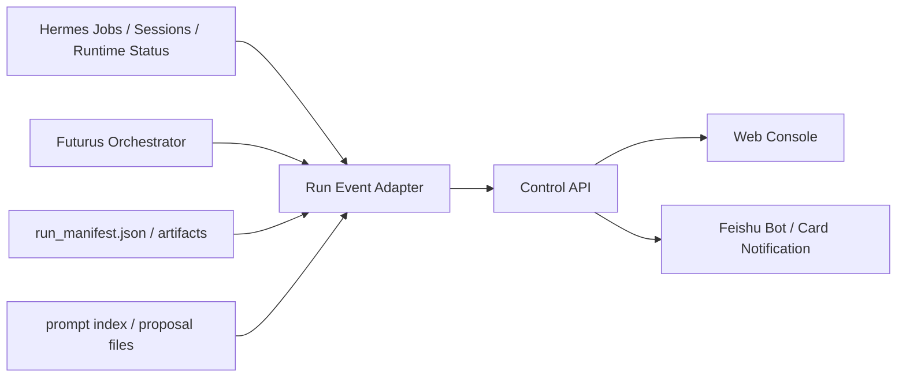

# Hermes 多智能体可视化控制台 v1 执行规划

> 项目：Futurus 战略情报系统  
> 基线方案：v2.5  
> 推荐路线：方案 B「运行控制台」  
> 文档日期：2026-04-14

## 1. 背景与结论

当前 Futurus 战略情报系统已经跑通主链路：

`context_pack -> collect -> curate -> analyze -> report -> deliver -> eval`

并且已有以下关键资产：
- `run_manifest.json`：记录单次运行的阶段结果、产物、成本、prompt 版本
- `prompts/{source,versions,current,index.json}`：支持 prompt 外部化、编译、激活与回滚
- `stageEval`：对报告质量打分，并生成 proposal
- Hermes 自带 jobs/session/runtime status 能力：可复用作业、状态、会话与 cron 基础设施

但系统目前仍缺少一个统一的可视化控制面，导致以下问题：
- 运行过程只能靠 shell、日志和文件目录观察，团队共享成本高
- 可以看到运行结果，但很难实时看到“跑到哪一步、卡在哪一步、为什么失败”
- prompt 版本、eval 分数、proposal 审批、重跑恢复等运维动作分散在不同目录和命令里
- 现阶段虽有局部子 Agent 概念，但对外并没有一个可观察、可追踪、可回放的“多智能体流转界面”

因此，第一阶段不建议直接做重型 DAG 编排器，而应优先落地一个**运行控制台**：

1. 先把“能看见、能诊断、能手动干预”做扎实
2. 底层事件模型按未来多智能体图谱兼容设计
3. 等真实并行子 Agent 与 handoff 关系变多后，再平滑演进到 DAG 编排器

[置信度: 高]

---

## 2. 目标与非目标

### 2.1 O1：本阶段目标

交付一个 Web 控制台，支持以下核心能力：
- 查看运行列表与单次 run 详情
- 实时查看阶段进展与流转状态
- 查看阶段耗时、日志、产物、成本、eval 分数
- 查看当前激活 prompt 版本及 proposal 状态
- 支持手动重跑、恢复、重新投递、prompt 激活、proposal 审批
- 为后续真正多智能体可视化编排预留统一事件层和对象模型

### 2.2 O2：约束

- 不重写 Hermes 调度核心，只做增量控制层
- 不做第一版拖拽 DAG 编辑器
- 不把 prompt 自动审批和自动激活放入第一版 UI
- 不改变现有日报主链路的业务语义
- 兼容阿里云裸机 + Hermes + lark-cli 当前部署方式
- 第一版优先服务内部运营与排障，不追求对全员开放

### 2.3 非目标

以下内容明确不在 v1 范围内：
- 图形化拖拽编排
- 节点级 prompt 在线编辑器
- 自动改写 orchestrator 逻辑
- 跨项目通用 Agent 平台化
- 移动端完整适配

---

## 3. 为什么选方案 B，而不是 A / C / D

### 3.1 相比方案 A「只读看板」

只读看板能解决“看得见”，但解决不了：
- prompt 激活
- proposal 审批
- 失败后恢复
- 重新投递
- 运行中干预

而 Futurus v2.5 已经进入 prompt 自进化与 stageEval 阶段，系统已经不是单纯观察对象，而是需要可控运营。因此 A 不够。

### 3.2 相比方案 C「DAG 编排器」

当前系统底层仍以阶段式 orchestrator 为主，真正的并行子 Agent 图谱关系还不够丰富。现在强上 DAG 会出现：
- 图比真相更复杂
- UI 先行，事件层滞后
- 开发量大但业务收益短期有限

因此 C 应作为后续演进方向，而不是第一落点。

### 3.3 相比方案 D「飞书内嵌控制台」

飞书适合做通知、审批、摘要，但不适合做：
- 长日志排障
- 多阶段时间线
- 运行状态流转
- 成本与版本回放

所以飞书应作为入口和提醒层，而不是主控制面。

### 3.4 方案 B 的价值

方案 B「运行控制台」同时满足：
- 观察
- 诊断
- 干预
- 留痕
- 为未来 DAG 化铺路

它是当前阶段投入产出比最高的选择。

---

## 4. 产品定位

### 4.1 一句话定义

Hermes 多智能体可视化控制台 v1，是 Futurus 战略情报系统的**运行控制面板**，用于查看任务进展和流转情况，并对关键运行动作进行人工干预与审计。

### 4.2 目标用户

- 一线运营者：查看日报是否正常生成，哪里失败，是否需要重跑
- AI 系统维护者：检查 prompt 版本、eval 趋势、proposal、成本熔断
- 管理者：了解今天跑了没、质量如何、是否有风险

### 4.3 使用频率

- 每日 1-3 次：检查自动 run
- 运行异常时：高频排障
- prompt 迭代时：集中使用 proposal / activate / 对比功能

---

## 5. 总体架构



### 5.1 架构原则

1. Hermes 继续负责执行与调度
2. Futurus orchestrator 继续负责业务流水线
3. 新增一层 `Run Event Adapter`，把分散的文件、日志、状态拼成统一对象模型
4. 控制台只消费统一 API，不直接耦合底层文件结构

### 5.2 核心新增组件

#### 组件 1：事件层 `events.jsonl`

为每次 run 增加统一事件流文件，例如：

```json
{"ts":"2026-04-15T06:00:02Z","run_id":"20260415-060002","type":"run_started"}
{"ts":"2026-04-15T06:00:10Z","run_id":"20260415-060002","type":"stage_started","stage":"collect"}
{"ts":"2026-04-15T06:04:31Z","run_id":"20260415-060002","type":"stage_completed","stage":"collect","duration_ms":261000}
{"ts":"2026-04-15T06:05:01Z","run_id":"20260415-060002","type":"stage_started","stage":"analyze"}
{"ts":"2026-04-15T06:14:42Z","run_id":"20260415-060002","type":"eval_scored","overall":3.8}
{"ts":"2026-04-15T06:14:48Z","run_id":"20260415-060002","type":"proposal_generated","agent":"report","path":"..."}
{"ts":"2026-04-15T06:15:02Z","run_id":"20260415-060002","type":"run_completed","status":"success"}
```

#### 组件 2：Control API

新增一个轻量 API 层，聚合：
- Hermes jobs / sessions / runtime status
- Futurus run manifests
- events.jsonl
- prompt index / proposal 元数据
- 成本与 eval 趋势

#### 组件 3：Web Console

一个前端控制台，聚焦于：
- 今日概览
- Run 详情
- Prompt 中心
- Eval / Proposal
- 成本监控
- 手动动作

---

## 6. 数据模型设计

### 6.1 统一运行对象 `Run`

```json
{
  "run_id": "20260415-060002",
  "job_id": "daily-intelligence",
  "status": "running|success|failed|partial",
  "started_at": "ISO8601",
  "completed_at": "ISO8601|null",
  "current_stage": "collect|curate|analyze|report|deliver|eval|null",
  "stages": [],
  "prompt_versions": {},
  "cost_summary": {},
  "eval_summary": {},
  "artifacts": {},
  "source_count": 0,
  "high_priority_count": 0,
  "error": null
}
```

### 6.2 阶段对象 `StageRun`

```json
{
  "stage": "analyze",
  "status": "pending|running|success|failed|skipped",
  "started_at": "ISO8601|null",
  "completed_at": "ISO8601|null",
  "duration_ms": 0,
  "model": "google/gemini-2.5-flash",
  "tokens_in": 0,
  "tokens_out": 0,
  "cost_usd": 0,
  "input_artifact": "path",
  "output_artifact": "path",
  "error": null
}
```

### 6.3 Prompt 激活对象 `PromptActivation`

```json
{
  "agent": "analyze|report",
  "doc_id": "...",
  "compiled_sha256": "...",
  "compiled_path": "...",
  "activated_at": "ISO8601",
  "activation_mode": "manual|auto"
}
```

### 6.4 Proposal 对象 `Proposal`

```json
{
  "proposal_id": "report_20260415-060002",
  "run_id": "20260415-060002",
  "agent": "report",
  "status": "draft|approved|rejected|applied",
  "source": "eval|manual_feedback",
  "created_at": "ISO8601",
  "path": "...diff.md",
  "reason_summary": "..."
}
```

### 6.5 反馈对象 `Feedback`

```json
{
  "feedback_id": "fb_...",
  "source": "feishu|manual",
  "source_message_id": "...",
  "applies_to_run_id": "20260415-060002",
  "severity": "low|medium|high",
  "category": "coverage|actionability|format|confidence|source_quality",
  "content": "...",
  "created_at": "ISO8601",
  "resolved_by_proposal": null
}
```

---

## 7. 页面规划

### 7.1 页面 1：今日总览 Dashboard

**目标**：3 秒内看懂今天系统是否健康。

**模块**：
- 今日最新 run 卡片
- 当前运行状态条
- 6 阶段进度条
- 今日成本 / token / 熔断状态
- 最新 eval 分数
- 最近 3 个 proposal
- 最近 3 条失败/告警

**为什么重要**：
这是运营视角入口，不进 shell 就能知道系统今天有没有按时完成。

### 7.2 页面 2：运行列表 Runs

**目标**：快速定位某次 run。

**字段**：
- run_id
- 日期时间
- 状态
- 当前或结束阶段
- 总耗时
- 高优信号数
- eval 分数
- 总成本
- prompt 版本摘要

**支持筛选**：
- 日期
- success/failed
- eval 低分
- 有 proposal
- 熔断触发

### 7.3 页面 3：运行详情 Run Detail

**目标**：完整回放一次运行。

**模块**：
- 顶部概览：状态、总耗时、成本、prompt 版本
- 阶段时间线：collect -> curate -> analyze -> report -> deliver -> eval
- 每阶段详情抽屉：日志、输入输出文件、模型、token、错误
- 产物区：curated.json / analysis.json / report.md / eval.json / proposal.diff.md
- Feishu 投递区：送达状态、投递目标、消息 ID

**这是 v1 的核心页面。**

### 7.4 页面 4：Prompt Center

**目标**：把 prompt 外部化和版本激活可视化。

**模块**：
- analyze/report 当前激活版本
- source / compiled / current 三层映射
- activate 历史
- 最近 proposal
- 手动 activate 按钮
- diff 查看器

### 7.5 页面 5：Eval & Proposal

**目标**：观察质量趋势，管理 prompt 迭代。

**模块**：
- eval 趋势图
- 各维度评分分布
- 最近低分 run
- proposal 列表
- 审批动作：approve / reject / apply
- 反馈与 proposal 的关联

### 7.6 页面 6：成本与稳定性

**目标**：把“便宜地稳定跑”变成可见指标。

**模块**：
- 日成本趋势
- 按阶段成本分桶
- 按模型成本分桶
- 熔断触发记录
- 重试次数
- 成功率 / 平均耗时 / P95

---

## 8. 交互动作设计

### 8.1 v1 必做动作

- `Run Now`：手动触发一次日跑
- `Resume`：从最近稳定阶段恢复
- `Re-deliver`：重新投递已有报告，不重跑全链路
- `Activate Prompt`：将已编译版本设为 current
- `Approve Proposal`
- `Reject Proposal`

### 8.2 v1.1 可加动作

- `Retry Stage`：仅重试失败阶段
- `Pause Job` / `Resume Job`
- `Re-eval`：只重跑 stageEval

### 8.3 幂等规则

所有动作必须带幂等保护：
- 同一 run 的 `Re-deliver` 重复点击，不得重复发多次消息
- 已 `approved` 的 proposal 不得重复 `apply`
- `Resume` 只能从 manifest 标记的最近稳定点恢复
- `Activate Prompt` 必须记录操作人和时间

---

## 9. 后端接口规划

### 9.1 读取接口

- `GET /api/futurus/runs`
- `GET /api/futurus/runs/:runId`
- `GET /api/futurus/runs/:runId/events`
- `GET /api/futurus/prompts`
- `GET /api/futurus/prompts/:agent/history`
- `GET /api/futurus/proposals`
- `GET /api/futurus/eval/trends`
- `GET /api/futurus/cost/summary`

### 9.2 动作接口

- `POST /api/futurus/runs/trigger`
- `POST /api/futurus/runs/:runId/resume`
- `POST /api/futurus/runs/:runId/redeliver`
- `POST /api/futurus/prompts/:agent/activate`
- `POST /api/futurus/proposals/:proposalId/approve`
- `POST /api/futurus/proposals/:proposalId/reject`

### 9.3 实时接口

建议优先用 SSE：
- `GET /api/futurus/stream`

原因：
- 实现简单
- 足够承载运行进展推送
- 前端接入成本低
- 比 WebSocket 更适合当前单向状态推送场景

[置信度: 中] 基于当前需求，SSE 足够；若未来需要多用户协同编辑或更复杂双向交互，再升级 WebSocket。

---

## 10. 前端信息架构建议

### 10.1 技术方向

建议做一个独立前端页面，挂在 Hermes API 或 mycc 现有前端能力之上。

### 10.2 组件树

```text
App
├── DashboardPage
│   ├── TodayRunCard
│   ├── StageProgressBar
│   ├── CostSummaryCard
│   ├── EvalSummaryCard
│   └── AlertList
├── RunsPage
│   ├── RunFilterBar
│   ├── RunTable
│   └── RunStatusBadge
├── RunDetailPage
│   ├── RunHeader
│   ├── TimelineView
│   ├── StageDetailPanel
│   ├── ArtifactPanel
│   └── DeliveryPanel
├── PromptCenterPage
│   ├── PromptVersionCard
│   ├── PromptDiffViewer
│   └── ActivateButton
├── EvalProposalPage
│   ├── EvalTrendChart
│   ├── ProposalTable
│   ├── ProposalDetailDrawer
│   └── ApprovalActionBar
└── OpsPage
    ├── ManualRunButton
    ├── ResumeButton
    ├── RedeliverButton
    └── CircuitBreakerStatus
```

### 10.3 UX 原则

- 状态优先：一眼能看出哪里卡住
- 回放友好：所有运行都能倒回去看
- 少即是多：先把关键信号和关键动作做对，不堆功能
- 与 v2.5 术语一致：不要另造名词

---

## 11. 实施拆解

### Phase 1：事件层与对象模型（2-3 天）

**目标**：先把 UI 的“数据骨架”打好。

任务：
- 给 orchestrator 增加 `events.jsonl`
- 统一 run / stage / prompt / proposal 数据结构
- 写一个聚合层读取 manifest + events + prompts + proposals
- 明确失败、恢复、重跑的语义

交付：
- 一次 run 的完整事件流可回放
- 控制台后端已有统一读取能力

### Phase 2：只读控制台（2-3 天）

**目标**：先让所有人看得见。

任务：
- Dashboard
- Runs 列表
- Run Detail
- Prompt Center（只读）
- Cost / Eval 基础视图

交付：
- 运营者能在网页上查看今日运行、历史记录、失败原因、产物和成本

### Phase 3：控制动作接入（2-3 天）

**目标**：从“看”升级到“控”。

任务：
- Trigger / Resume / Re-deliver
- Prompt Activate
- Proposal Approve / Reject
- 动作审计日志

交付：
- 关键运维动作在控制台完成，不依赖 shell

### Phase 4：飞书联动（1-2 天）

**目标**：形成“控制台主操作 + 飞书提醒/审批入口”的双层体验。

任务：
- 低分告警卡片
- proposal 待审批通知
- run 失败摘要通知
- 从飞书消息跳转到控制台详情页

交付：
- 飞书做入口，控制台做主工作面

---

## 12. 风险与缓解

| 风险 | 影响 | 缓解 |
|---|---|---|
| 只靠 manifest 无法实时展示 | UI 只能看结果，不能看过程 | 必须先补 `events.jsonl` |
| 动作接口幂等没处理好 | 重复发消息、重复激活 prompt | 每个动作加状态检查和操作锁 |
| UI 术语和 v2.5 不一致 | 团队理解成本上升 | 页面术语直接复用现有阶段名 |
| 先做太重的 DAG 视图 | 延误主线，收益低 | v1 明确不做拖拽编排 |
| 权限边界不清 | 非授权用户误操作 | v1 默认内部少数运维角色使用 |
| stageEval 结果波动 | proposal 频繁抖动 | UI 上先标 shadow / review / applied 状态，不自动激活 |

---

## 13. 验收标准

### 13.1 功能验收

- 能查看今日 run 与过去 7 天历史 run
- 能查看单次 run 的完整阶段时间线
- 能看到每阶段日志、耗时、产物、成本
- 能看到 analyze / report 当前 prompt 版本
- 能看到 eval 分数与 proposal 列表
- 能手动执行 `trigger / resume / redeliver / activate / approve / reject`

### 13.2 运维验收

- 发生失败时，运营者 3 分钟内能定位失败阶段
- 不进入 shell 也能完成一次 re-deliver
- prompt 激活留痕完整，可回溯到版本 SHA
- proposal 不会未经人工确认自动生效

### 13.3 架构验收

- 控制台不直接依赖底层文件布局细节
- 统一事件模型能兼容未来子 Agent 事件
- 后续若引入真正并行多智能体，可在不推翻 v1 的前提下扩展为图谱视图

---

## 14. 后续演进路线

### v1
- 运行控制台
- 线性阶段可视化
- 手动运维动作

### v1.5
- 子 Agent 事件可视化
- Retry Stage
- Eval 趋势与 prompt 影响关联

### v2
- DAG 视图
- handoff 可视化
- 节点级统计
- 依赖路径分析

### v3
- 可拖拽编排
- 节点参数化配置
- 多任务模板化复用

---

## 15. 结论

对于 Futurus 当前阶段，最正确的路径不是“直接做一个很炫的多智能体 DAG 平台”，而是先做一个扎实的**运行控制台**。

这条路线的核心价值在于：
- 它贴着 v2.5 现有架构生长
- 它能立刻提升可观察性、可诊断性、可运维性
- 它不会把系统带进过早平台化的坑里
- 它又为未来真正的多智能体图编排保留了统一事件层

一句话：

**先把系统变成“看得见、管得住、追得回”的控制台，再把它长成“拖得动、编得出、并得起”的 DAG 编排器。**
