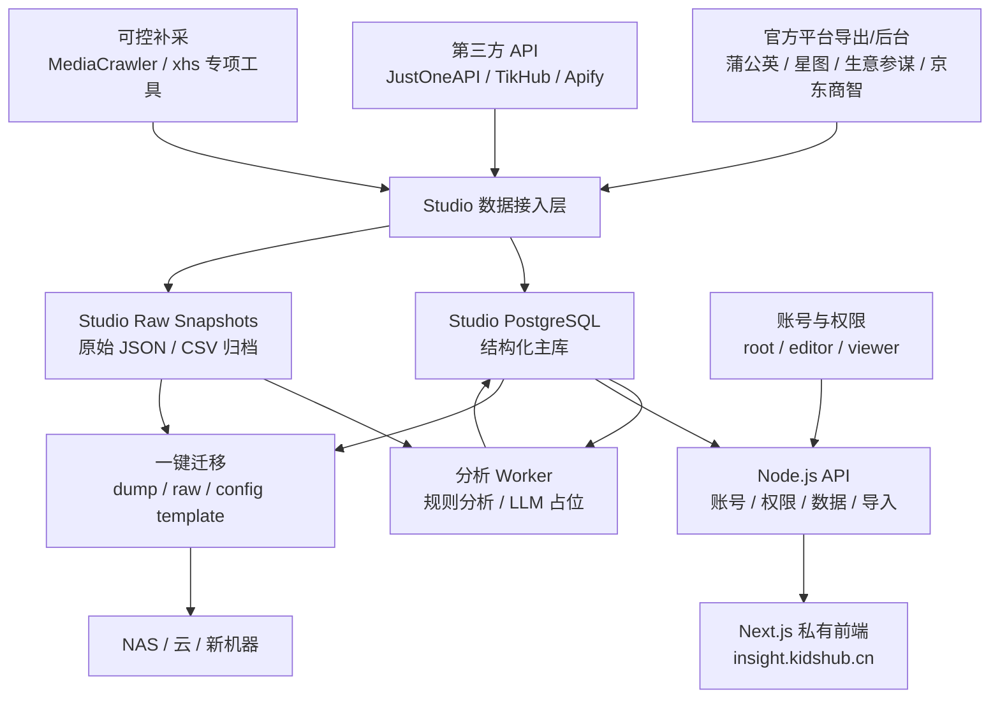

# 投流情报系统架构方案 v0.3

## 1. 目标

建设一个面向天猫/京东旗舰店投流前决策与投后复盘的内部系统，用于：

- 投流前筛选小红书/抖音达人
- 分析小红书/抖音内容效果
- 监控竞品淘宝/天猫/京东商品、销量、价格、评论
- 提炼用户痛点、卖点、差评原因和内容机会
- 形成达人评分、内容评分、竞品雷达和投放建议
- 支持内部账号分级访问、编辑和管理

本系统不替代天猫/京东官方归因后台，也不承诺识别所有“看完种草后自行搜索下单”的来源。系统定位是“投放前情报 + 投放后辅助分析”。

## 2. 已确认决策

| 项目 | 决策 |
|---|---|
| 前端域名 | `insight.kidshub.cn` |
| 第一阶段部署 | Studio 单机 MVP |
| Mini | 不使用 |
| dev198 | 不存数据、不放密钥、不参与业务系统 |
| 首批账号 | 只给川哥 root |
| 后续账号 | 川哥手动添加 editor/viewer |
| 品类/竞品 | 暂无，后台留输入口 |
| JustOneAPI Token | 暂无，搭建完成后申请/配置 |
| 蒲公英/星图/生意参谋/京东商智 | 暂无，保留 CSV/Excel 导入入口 |
| 报表导出权限 | 后台手动配置 |
| 迁移能力 | 必须支持一键迁移 |
| 飞书日报 | 需要，但最低优先级 |
| LLM 分析 | 后续再接入，第一版只预留接口 |

## 3. 总体架构



## 4. 机器分工

| 机器 | 职责 | 是否使用 | 说明 |
|---|---|---:|---|
| Studio | 主数据库、采集、分析、API、看板 | 是 | 统一部署，当前可用空间约 102GiB，够 MVP |
| Mini | 原计划数据中枢 | 否 | 暂不使用，避免引入额外运维链路 |
| dev198 | owner 高信任路径 | 否 | 不存投流业务数据、不放 API Token |
| NAS/云 | 备份归档 | 后续 | 用于 PostgreSQL、raw snapshot、上传文件备份 |

## 5. 技术选型建议

推荐主线：

- 前端：Next.js
- 主后端：Node.js / TypeScript
- ORM/迁移：Prisma
- 数据库：PostgreSQL
- 采集/分析 Worker：Python
- 任务调度：MVP 用 launchd/cron/PM2，后续再加队列
- 原始数据：本地文件归档
- 登录：邮箱密码 + RBAC
- 备份：PostgreSQL dump + raw snapshot + config template

## 6. Node.js 与 FastAPI 对比

| 维度 | Node.js / TypeScript | FastAPI / Python | 判断 |
|---|---|---|---|
| 和 Next.js 前端协同 | 强，类型与工程体系统一 | 中，需要维护前后端类型同步 | Node 优先 |
| 账号/RBAC/后台管理 | 成熟，适合 SaaS 后台 | 可做，但偏手写 | Node 优先 |
| 导入导出 | 足够好 | 很强 | 平手 |
| 数据分析/LLM | 中，需要 Python 辅助 | 强 | Python Worker 承担 |
| JustOneAPI Python SDK | 需 worker 调用 | 可直接调用 | 用 worker 解耦 |
| 数据库迁移 | Prisma 简洁 | Alembic 成熟 | Prisma 更适合当前 Web 产品 |
| 一键迁移 | Docker/脚本 + Prisma + pg dump 好做 | Docker/脚本 + Alembic + pg dump 好做 | 平手 |

结论：主后端选 Node.js/TypeScript，Python 只做采集与分析 worker。第一阶段核心是内部后台、权限、导入导出、看板和迁移能力，不是纯数据科学服务。

## 7. 数据源方案对比

| 数据源 | 覆盖 | 价值 | 风险/缺点 | 建议 |
|---|---|---|---|---|
| JustOneAPI | 淘宝/天猫、京东、小红书、抖音、评论、商品 | 接入快，覆盖面适合当前需求 | 付费 API，字段质量要实测 | MVP 主数据源候选 |
| TikHub | 抖音、小红书、TikTok 等社媒数据 | 抖音/社媒端点丰富 | 电商商品不是主力 | 与 JustOneAPI 对测 |
| Apify | 现成爬虫 Actor | 快速补数据，不用自建 | 按量付费，Actor 质量不一 | 临时补采备用 |
| MediaCrawler | 小红书/抖音/微博/B站等采集 | 开源、可控、中文生态强 | 风控和合规压力高，不宜商用主链路 | 内部验证/备份 |
| ReaJason/xhs | 小红书 Web 请求封装 | 小红书专项研究方便 | 单平台，维护成本高 | 小红书专项备选 |
| 蒲公英 | 小红书达人/投放官方数据 | 合规、贴近真实投放 | 数据导出/接口权限受限 | 必须预留导入 |
| 巨量星图 | 抖音达人/投放官方数据 | 合规、投放决策价值高 | 平台内数据，开放度有限 | 必须预留导入 |
| 生意参谋 | 天猫店铺经营/流量 | 官方经营真值 | 站外来源粒度有限 | 投后复盘核心入口 |
| 京东商智 | 京东店铺经营/流量 | 官方经营真值 | 站外来源粒度有限 | 投后复盘核心入口 |
| 阿里妈妈/万相台 | 天猫广告归因 | 官方广告效果 | 主要限阿里体系 | 投后归因入口 |
| 京准通/京东数坊 | 京东广告/人群回流 | 京东广告真值 | 权限和成本需确认 | 投后归因入口 |

## 8. 数据源接入策略

MVP 阶段：

1. JustOneAPI：预留 Token 配置，搭建后申请并实测。
2. 官方后台导出：预留蒲公英、星图、生意参谋、京东商智 CSV/Excel 上传入口。
3. 品类、品牌、竞品、关键词、达人、商品：后台留空表和输入口，等川哥后续填写。
4. TikHub/Apify：预留 provider 类型，第二阶段对测。
5. MediaCrawler/ReaJason-xhs：不做商业主链路，只预留内部验证入口。

## 9. 账号与权限模型

### 9.1 角色定义

| 角色 | 中文名 | 人员范围 | 定位 |
|---|---|---|---|
| `root` | 超级管理员 | 川哥、受控维护通道 | 系统所有权、配置、账号、密钥、数据源、部署维护 |
| `editor` | 可编辑者 | 后续运营/投放人员 | 管理业务数据、导入导出、维护达人/竞品/活动 |
| `viewer` | 可阅读者 | 后续只看报表的人 | 查看看板、筛选数据、下载允许范围内报表 |

### 9.2 第一版账号策略

- 只初始化川哥 root。
- 不开放注册。
- 后续由 root 在后台手动添加 editor/viewer。
- 导出权限由 root 在后台手动配置。
- 系统维护账号不建议作为普通网页登录账号，优先用本机受控脚本/CLI。

### 9.3 权限矩阵

| 功能 | root | editor | viewer |
|---|---:|---:|---:|
| 登录系统 | 是 | 是 | 是 |
| 查看看板 | 是 | 是 | 是 |
| 查看达人/内容/商品/评论 | 是 | 是 | 是 |
| 查看投放复盘 | 是 | 是 | 是 |
| 新增/编辑关键词 | 是 | 是 | 否 |
| 新增/编辑达人 | 是 | 是 | 否 |
| 新增/编辑竞品商品 | 是 | 是 | 否 |
| 新增/编辑投放活动 | 是 | 是 | 否 |
| 上传 CSV/Excel | 是 | 是 | 否 |
| 触发数据采集 | 是 | 是 | 否 |
| 重新运行分析任务 | 是 | 是 | 否 |
| 修改评分规则 | 是 | 否 | 否 |
| 管理账号 | 是 | 否 | 否 |
| 配置 API Token | 是 | 否 | 否 |
| 查看 API Token 明文 | 否，系统也不回显 | 否 | 否 |
| 删除数据 | 是 | 软删除，需审计 | 否 |
| 导出报表 | 是 | 后台开关 | 后台开关 |
| 查看系统日志 | 是 | 否 | 否 |
| 数据库备份/恢复 | 是 | 否 | 否 |

## 10. AI/LLM 分析预留

第一版不接 LLM，只保留接口、任务表和结果表。默认提供规则分析/空结果占位，后续可以一键补跑历史数据。

### 10.1 预留模块

| 模块 | 第一版状态 | 后续接入 |
|---|---|---|
| `analysis_jobs` | 创建任务、排队、状态流转 | 由 LLM worker 消费 |
| `analysis_results` | 保存空结果/规则结果 | 保存 LLM 输出 |
| `analysis_providers` | 配置占位 | OpenAI、Claude、Grok、Ollama、Studio MLX 等 |
| `analysis_prompts` | Prompt 模板占位 | 后台编辑和版本管理 |
| `analysis_runs` | 记录运行日志 | 记录模型、成本、耗时、失败原因 |
| `manual_tags` | 人工标签 | 用作 LLM 校准样本 |

### 10.2 第一版规则能力

- 评论关键词统计
- 高频词/品牌词/品类词统计
- 手动标签
- 手动备注
- 基础指标排行
- 简单规则评分占位

### 10.3 后续 LLM 能力

- 达人评分解释
- 评论情绪分析
- 用户痛点聚类
- 竞品卖点提炼
- 投放风险识别
- 内容选题建议
- 投后复盘总结
- 飞书日报自动生成

## 11. 核心数据表

| 表 | 用途 |
|---|---|
| `users` | 用户账号 |
| `sessions` | 登录 session |
| `audit_logs` | 审计日志 |
| `data_sources` | 数据源配置 |
| `api_secrets` | API 密钥引用，不存明文 |
| `api_runs` | 每次采集任务记录 |
| `raw_snapshots` | 原始 JSON/CSV 文件索引 |
| `import_jobs` | CSV/Excel 导入任务 |
| `watch_keywords` | 关键词池 |
| `brands` | 自有品牌与竞品品牌 |
| `categories` | 品类，第一版留空入口 |
| `products` | 淘宝/天猫/京东商品 |
| `product_metrics_daily` | 商品价格、销量、评价数、排名日快照 |
| `product_comments` | 商品评论 |
| `creators` | 达人基础信息 |
| `creator_metrics_daily` | 达人粉丝、互动率、报价、商业内容占比 |
| `contents` | 小红书笔记/抖音视频 |
| `content_metrics_daily` | 点赞、收藏、评论、转发日快照 |
| `content_comments` | 内容评论 |
| `analysis_providers` | AI/规则分析供应商配置 |
| `analysis_prompts` | Prompt 模板占位 |
| `analysis_jobs` | 分析任务 |
| `analysis_runs` | 分析运行记录 |
| `analysis_results` | 分析结果 |
| `manual_tags` | 人工标签 |
| `creator_scores` | 达人评分 |
| `campaigns` | 投放活动 |
| `campaign_reviews` | 投后复盘 |
| `export_policies` | 报表导出权限配置 |

## 12. 后台输入口

第一版需要提供以下后台入口，即使初始为空：

- 品类管理
- 品牌/竞品管理
- 关键词管理
- 达人管理
- 商品管理
- 数据源配置
- API Token 配置
- CSV/Excel 导入
- 账号管理
- 导出权限配置
- LLM Provider 占位配置
- Prompt 模板占位配置
- 迁移导出/恢复

## 13. 一键迁移机制

必须从第一版内置迁移脚本和迁移包结构。

### 13.1 导出内容

- PostgreSQL dump
- raw snapshots
- uploaded CSV/Excel
- generated reports
- app config template
- migration manifest
- 版本号、数据库迁移版本、文件校验和

### 13.2 不导出内容

- API Token 明文
- 登录 session token 明文
- 本机私钥
- 操作系统级密钥

### 13.3 命令设计

```text
pnpm ops:export
pnpm ops:restore <archive>
pnpm ops:healthcheck
pnpm ops:rotate-secrets
```

### 13.4 验收标准

- 新机器恢复后可登录。
- 数据表记录数一致。
- raw snapshot 文件数和校验和一致。
- API Token 显示为“需重新配置”。
- 前端、后端、数据库健康检查通过。

## 14. Studio 部署建议

目录建议：

```text
/Users/fu-121/kidshub-growth/
  app/                 # 项目代码
  data/
    raw/               # 原始 API/CSV 快照
    uploads/           # 后台导入文件
    exports/           # 导出报表
    reports/           # 每日/每周报告
  logs/                # 应用日志
  backups/             # 数据库备份和迁移包
  secrets/             # 本地密钥指针，不入 git
```

端口建议：

| 服务 | 端口 |
|---|---:|
| 后端 API | 3100 |
| 前端本地服务 | 3200 |
| PostgreSQL | 5432，仅本机 |
| Python Worker | 不暴露端口 |

避开现有端口：`8081`、`11434`、`11435`、`11436`、`8000`。

## 15. 安全要求

- API Token 不入 git。
- 数据库不保存 API Token 明文。
- 前端必须登录。
- 不开放注册。
- root/editor/viewer 权限严格区分。
- 后端每个写接口都校验角色。
- editor 删除只做软删除。
- 关键操作写审计日志。
- PostgreSQL 默认只监听本机。
- 原始订单/经营数据不公开。
- 如果引入爬虫，只抓公开页面，不抓隐私数据，不绕过强登录/风控。

## 16. Phase 计划

### Phase 1：Studio 单机 MVP

目标：先跑通内部后台闭环。

范围：

- Next.js 前端
- Node.js/TypeScript API
- PostgreSQL + Prisma
- root 登录
- RBAC 基础框架
- 账号管理入口
- 品类/品牌/竞品/关键词/达人/商品空入口
- JustOneAPI Token 配置入口
- 官方 CSV/Excel 导入入口
- raw snapshot 归档
- 基础看板
- 规则分析/LLM 占位
- 一键迁移脚本

验收：

- 川哥 root 可登录。
- 可新增品类/品牌/关键词/达人/商品。
- 可配置但不回显 API Token。
- 可上传 CSV/Excel。
- viewer/editor 角色模型存在，但默认无其他账号。
- LLM Provider 页面存在但默认未启用。
- 一键导出包可生成，恢复流程有脚本。

### Phase 2：数据源对测

- 接 JustOneAPI 真实 Token。
- 对测 TikHub/Apify。
- 导入蒲公英、星图、生意参谋、京东商智样本文件。
- 输出字段完整率、失败率、成本、延迟对比。

### Phase 3：投放复盘闭环

- campaign 模块
- 专属链接/券码/口令记录
- 官方后台数据导入
- 投前/投后时间窗对比
- 复盘报告

### Phase 4：LLM 与飞书日报

- 接入 LLM provider。
- 历史数据批量补分析。
- 飞书日报自动生成和推送。
- 采集失败告警。

## 17. 当前待评审问题

1. 主技术栈是否确认 Node.js/TypeScript + Python Worker。
2. Prisma/PostgreSQL 是否满足长期迁移与数据增长。
3. `insight.kidshub.cn` 的域名和反代方式是否需要现在设计。
4. Studio 单机部署是否需要从第一版就容器化。
5. 一键迁移包是否要同时支持迁到云服务器和迁到另一台 Mac。
6. API Token 本地密钥存储选文件、Keychain，还是后续接 Vault。
7. 报表导出权限开关粒度：全局、按角色、按用户，还是按报表。

