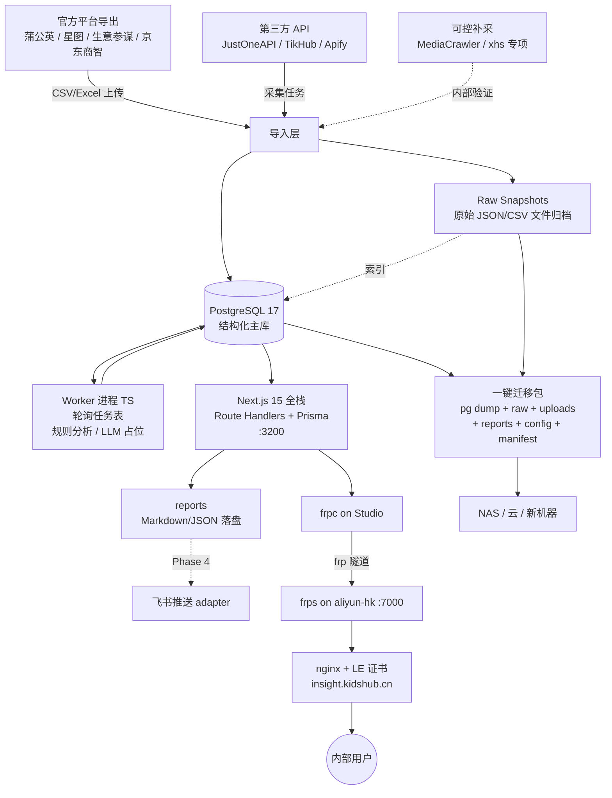

# 投流情报系统架构方案 v0.4

> 施工蓝图。相对 [v0.3](./architecture-v0.3.md) 的变更依据见 [cc 评审记录](./cc-review-v0.3.md)。
> **Phase 1 范围全量保留**（川哥 2026-08-05 拍板，不做裁剪）。
> 日期：2026-08-05

---

## 1. 目标

面向天猫/京东旗舰店投流前决策与投后复盘的内部系统：

- 投流前筛选小红书/抖音达人
- 分析小红书/抖音内容效果
- 监控竞品淘宝/天猫/京东商品、销量、价格、评论
- 提炼用户痛点、卖点、差评原因和内容机会
- 形成达人评分、内容评分、竞品雷达和投放建议
- 支持内部账号分级访问、编辑和管理

本系统不替代天猫/京东官方归因后台，也不承诺识别所有"看完种草后自行搜索下单"的来源。定位是**投放前情报 + 投放后辅助分析**。

---

## 2. 已确认决策

| 项目 | 决策 | 变更 |
|---|---|---|
| 前端域名 | `insight.kidshub.cn` | — |
| **域名落地方式** | **aliyun-hk (8.218.26.17) nginx 反代 → frp 隧道 → Studio** | 🆕 v0.4 拍板 |
| 第一阶段部署 | Studio 单机 MVP | — |
| Mini | 不使用 | — |
| dev198 | 不存数据、不放密钥、不参与业务系统 | — |
| 首批账号 | 只给川哥 root | — |
| 后续账号 | root 在后台手动添加 editor/viewer | — |
| 品类/竞品 | 暂无，后台留输入口 | — |
| JustOneAPI Token | 暂无，搭建完成后申请/配置 | — |
| 蒲公英/星图/生意参谋/京东商智 | 暂无，保留 CSV/Excel 导入入口 | — |
| 报表导出权限 | 后台手动配置（角色级） | 🆕 明确为角色级，不做 per-user ACL |
| 迁移能力 | 必须支持一键迁移 | — |
| 飞书日报 | 需要，最低优先级 | 🆕 MVP 建 `reports` 表 + 生成函数，Phase 4 只加推送 |
| LLM 分析 | 后续接入，第一版预留接口 | 🆕 provider 统一 OpenAI 兼容形状 |
| **主后端** | **Next.js 全栈单进程（Route Handlers）** | 🆕 取消独立 Node API 进程 |
| **Python Worker** | **第一版不引入** | 🆕 Phase 2 需要 JustOneAPI SDK 时再加 |
| **容器化** | **第一版不容器化**，产出 compose 文件仅作迁移目标 | 🆕 |
| **进程管理** | **launchd** | 🆕 与 Studio 现有服务一致 |
| **Studio QLoRA 夜训** | **已停用**（2026-08-05） | 🆕 见 §4.2 |

---

## 3. 总体架构



**与 v0.3 的架构差异**：删掉独立 Node API 进程与 Python Worker（合并为 Next.js 全栈 + 单个 TS worker）；新增域名反代链路。

---

## 4. 机器分工

| 机器 | 职责 | 使用 | 说明 |
|---|---|---:|---|
| **Studio** | 主数据库、采集、分析、Web 应用 | 是 | `192.168.61.177`，M2 Max 32GB，macOS 26.4.1，用户 `fu-121` |
| **aliyun-hk** | 域名反代入口 | 是 | `8.218.26.17`，nginx + frps，仅做流量转发不存数据 |
| Mini | 原计划数据中枢 | 否 | 不使用 |
| dev198 | owner 高信任路径 | 否 | 不存业务数据、不放 API Token |
| NAS (QNAP) | 备份归档 | 是 | `192.168.61.18`，PostgreSQL dump + raw + uploads 异机备份 |

### 4.1 Studio 实测基线（2026-08-05）

**工具链现状——全部需要安装**：

| 工具 | 状态 |
|---|---|
| git | ✅ 2.50.1 (Apple Git) |
| python3 | ⚠️ 仅系统自带 3.9.6 |
| node / npm / pnpm | ❌ 未安装 |
| psql / postgres | ❌ 未安装 |
| docker / brew / conda | ❌ 未安装 |

**磁盘**：avail 107GiB（`~/.ollama` 已占 77GB，raw snapshot 需定留存策略）

**端口占用（须避开）**：`8081`(kidsbench) · `11434/11435/11436`(Ollama) · `7880/7881`(LiveKit) · `5000/7000`(macOS ControlCenter) · `8000`(MLX，当前空闲但 `com.mlx.server.9b` 配了 `KeepAlive=true`)
**本项目端口**：`3200`(Next.js) · `5432`(PostgreSQL，仅监听 127.0.0.1) — 实测均空闲

**并存服务**：Ollama、LiveKit、kidsbench、mycc vision-daemon、voice-worker（均 launchd 管理）

### 4.2 QLoRA 夜训已停用

`com.lnmem.studio-nightly-train` 原调度为 **00:00 / 08:00 / 16:00 三个时段**，QLoRA 微调会抢占内存与 GPU。

2026-08-05 已执行 `launchctl bootout` + `launchctl disable`（持久化，重启后仍禁用），plist 文件保留在 `~/Library/LaunchAgents/`。

**回滚方式**：
```bash
launchctl enable gui/$(id -u)/com.lnmem.studio-nightly-train
launchctl bootstrap gui/$(id -u) ~/Library/LaunchAgents/com.lnmem.studio-nightly-train.plist
```

> ⚠️ 该任务属 lnmem 项目，停用后该项目的 nightly 训练不再自动执行。

---

## 5. 技术选型（定案）

| 层 | 选型 | 理由 |
|---|---|---|
| 应用 | **Next.js 15 App Router 全栈单进程**（Route Handlers 提供 API） | 内部系统、单机、单人开发、无外部 API 消费者。独立 API 进程只会多一个部署单元 + 前后端类型同步 + CORS。业务逻辑写在 `lib/services/` 层，日后要拆成独立服务成本很低 |
| 语言 | TypeScript | 全栈统一 |
| ORM/迁移 | Prisma | migration 文件即"一键迁移"所需的版本锚 |
| 数据库 | **PostgreSQL 17（Postgres.app）** | Studio 无 brew/docker，Postgres.app 是最省事路径，自带版本管理 |
| Worker | **单个 TS 长驻进程**轮询 DB 任务表 | 单机低频场景，Redis/BullMQ 是纯负担 |
| Python | **第一版不引入** | 无真实数据源时 worker 无活可干；引入需第二套依赖管理 + launchd + 跨语言契约。Phase 2 接 JustOneAPI SDK 时再加，DB 契约不变 |
| 认证 | **手写 session cookie**（httpOnly + SameSite=Lax）+ argon2 | 3 个内部账号上 NextAuth 属过度设计且升级坑多，手写约 150 行 |
| 文件解析 | SheetJS(xlsx) + papaparse + exceljs | TS 侧完全够用 |
| 进程管理 | **launchd** | 与 Studio 现有服务一致；PM2 有 env 快照压制 env-file 的坑 |
| 容器化 | **不用**，仅产出 `docker-compose.yml` 作为迁移目标格式 | Studio 无 docker；Docker Desktop 在 macOS 是 VM，叠在 Ollama(77GB) + LiveKit 之上是纯损耗；且 Docker Desktop 对企业使用需付费订阅（KidsHub 是公司业务） |
| 反代 | aliyun-hk nginx + frp | 见 §13 |

---

## 6. 数据源方案对比

| 数据源 | 覆盖 | 价值 | 风险/缺点 | 建议 |
|---|---|---|---|---|
| JustOneAPI | 淘宝/天猫、京东、小红书、抖音、评论、商品 | 接入快，覆盖面适合当前需求 | 付费 API，字段质量要实测 | MVP 主数据源候选 |
| TikHub | 抖音、小红书、TikTok 等社媒 | 抖音/社媒端点丰富 | 电商商品不是主力 | 与 JustOneAPI 对测 |
| Apify | 现成爬虫 Actor | 快速补数据 | 按量付费，Actor 质量不一 | 临时补采备用 |
| MediaCrawler | 小红书/抖音/微博/B站 | 开源、可控、中文生态强 | 风控和合规压力高 | 内部验证/备份，不做商用主链路 |
| ReaJason/xhs | 小红书 Web 请求封装 | 小红书专项研究方便 | 单平台，维护成本高 | 小红书专项备选 |
| 蒲公英 | 小红书达人/投放官方数据 | 合规、贴近真实投放 | 导出/接口权限受限 | 必须预留导入 |
| 巨量星图 | 抖音达人/投放官方数据 | 合规、投放决策价值高 | 平台内数据，开放度有限 | 必须预留导入 |
| 生意参谋 | 天猫店铺经营/流量 | 官方经营真值 | 站外来源粒度有限 | 投后复盘核心入口 |
| 京东商智 | 京东店铺经营/流量 | 官方经营真值 | 站外来源粒度有限 | 投后复盘核心入口 |
| 阿里妈妈/万相台 | 天猫广告归因 | 官方广告效果 | 限阿里体系 | 投后归因入口 |
| 京准通/京东数坊 | 京东广告/人群回流 | 京东广告真值 | 权限和成本需确认 | 投后归因入口 |

### 6.1 接入策略

1. JustOneAPI：预留 Token 配置，搭建后申请并实测
2. 官方后台导出：预留蒲公英、星图、生意参谋、京东商智 CSV/Excel 上传入口
3. 品类、品牌、竞品、关键词、达人、商品：后台留空表和输入口
4. TikHub/Apify：预留 provider 类型，第二阶段对测
5. MediaCrawler/ReaJason-xhs：不做商业主链路，只预留内部验证入口

---

## 7. 账号与权限模型

### 7.1 角色

| 角色 | 中文名 | 定位 |
|---|---|---|
| `root` | 超级管理员 | 系统所有权、配置、账号、密钥、数据源、部署维护 |
| `editor` | 可编辑者 | 管理业务数据、导入导出、维护达人/竞品/活动 |
| `viewer` | 可阅读者 | 查看看板、筛选数据、下载允许范围内报表 |

第一版只初始化川哥 root，不开放注册，后续由 root 手动添加。

### 7.2 权限矩阵

| 功能 | root | editor | viewer |
|---|---:|---:|---:|
| 登录系统 | 是 | 是 | 是 |
| 查看看板 / 达人 / 内容 / 商品 / 评论 / 复盘 | 是 | 是 | 是 |
| 新增编辑 关键词 / 达人 / 竞品商品 / 投放活动 | 是 | 是 | 否 |
| 上传 CSV/Excel | 是 | 是 | 否 |
| **触发数据采集** | 是 | **是（受配额约束）** 🆕 | 否 |
| 重新运行分析任务 | 是 | 是 | 否 |
| 修改评分规则 | 是 | 否 | 否 |
| 管理账号 | 是 | 否 | 否 |
| **吊销他人 session** 🆕 | 是 | 否 | 否 |
| 配置 API Token | 是 | 否 | 否 |
| 查看 API Token 明文 | **否，系统不回显** | 否 | 否 |
| 删除数据 | 是 | 软删除，需审计 | 否 |
| **恢复软删除数据** 🆕 | 是 | 否 | 否 |
| **硬删除** 🆕 | **仅 CLI 脚本，不开放 Web 入口** | 否 | 否 |
| 导出报表 | 是 | 后台开关（角色级） | 后台开关（角色级） |
| 查看系统日志 | 是 | 否 | 否 |
| 数据库备份/恢复 | 是 | 否 | 否 |

### 7.3 高风险写操作的额外约束（v0.4 新增）

| 操作 | 约束 |
|---|---|
| **触发数据采集** | JustOneAPI 按量计费。`app_settings` 配置日/月调用配额 + 单次任务上限；editor 超限需 root 批准；配额消耗记入 `api_runs` |
| **导出报表** | 每次导出写 `export_logs`（操作人 / 时间 / 范围 / 行数 / 文件哈希）。竞品数据与评论是核心资产，导出即外泄面 |
| **审计日志** | `audit_logs` 应用层 **append-only**，禁止 UPDATE/DELETE（含 root）。需要清理只能走 CLI 归档脚本 |
| **登录** | `login_attempts` 记录失败次数；同账号 5 次失败锁定 15 分钟；锁定事件写审计 |
| **改密码** | 触发该用户全部 session 失效 |

---

## 8. AI/LLM 分析预留

第一版不接 LLM，只保留接口、任务表和结果表，提供规则分析/空结果占位，后续可一键补跑历史数据。

### 8.1 预留模块

| 模块 | 第一版 | 后续 |
|---|---|---|
| `analysis_providers` | 配置占位 | OpenAI、Claude、Grok、Ollama、Studio MLX |
| `analysis_prompts` | Prompt 模板占位 | 后台编辑和版本管理 |
| `analysis_jobs` | 创建任务、排队、状态流转 | 由 LLM worker 消费 |
| `analysis_runs` | 运行日志 | 记录模型、成本、耗时、失败原因 |
| `analysis_results` | 空结果/规则结果 | LLM 输出 |
| `manual_tags` | 人工标签 | LLM 校准样本 |

### 8.2 Provider 接口约定（v0.4 新增）

**统一为 OpenAI 兼容 chat completions 一种形状**：Claude、Grok、Ollama(`/v1`)、MLX(`/v1`) 均有兼容端点，第一版只需一个 adapter。

`analysis_runs` 必须记录：`model_id` · `prompt_version` · `input_hash` · `tokens_in/out` · `cost` · `duration_ms` · `error`
`analysis_results` 必须记录 `input_hash` —— 同输入不重复调用，且结果可复现。

> ⚠️ Studio MLX 实测 `:8000` 未监听、`com.mlx.server.9b` 上次退出码为 1。列入 provider 清单属预留，不作为可用算力排期。

### 8.3 第一版规则能力

评论关键词统计 · 高频词/品牌词/品类词统计 · 手动标签 · 手动备注 · 基础指标排行 · 简单规则评分占位

### 8.4 后续 LLM 能力

达人评分解释 · 评论情绪分析 · 用户痛点聚类 · 竞品卖点提炼 · 投放风险识别 · 内容选题建议 · 投后复盘总结 · 飞书日报自动生成

---

## 9. 数据表设计

### 9.1 全局规范（v0.4 新增，所有表必须遵守）

| 规范 | 内容 |
|---|---|
| **时区** | 存储一律 UTC（`timestamptz`），聚合按 `Asia/Shanghai`。日快照的 `snapshot_date` 为东八区自然日 |
| **溯源字段** | 所有外部实体表必须有 `source` + `source_id` + `first_seen_at` + `last_seen_at` |
| **幂等键** | 所有 `*_metrics_daily` 必须有 `UNIQUE(entity_id, snapshot_date, source)`，写入走 upsert |
| **软删除** | 业务表用 `deleted_at` + `deleted_by`，查询默认过滤 |
| **数据质量** | 指标表带 `is_estimated`（第三方 API 的销量/粉丝数常为估算值，不可当真值进决策） |
| **审计** | 所有写操作经统一中间件记 `audit_logs` |

### 9.2 表清单（37 张）

**认证与系统（6）**

| 表 | 用途 | v0.4 新增 |
|---|---|:---:|
| `users` | 用户账号 | |
| `sessions` | 登录 session（支持吊销） | |
| `audit_logs` | 审计日志，append-only | |
| `login_attempts` | 登录失败限流 | 🆕 |
| `app_settings` | 系统配置（时区、配额、看板参数） | 🆕 |
| `export_logs` | 导出审计 | 🆕 |

**数据源与采集（4）**

| 表 | 用途 |
|---|---|
| `data_sources` | 数据源配置 |
| `api_secrets` | API 密钥引用（不存明文，见 §11） |
| `api_runs` | 每次采集任务记录（含配额消耗） |
| `raw_snapshots` | 原始 JSON/CSV 文件索引 |

**导入（2）**

| 表 | 用途 | v0.4 新增 |
|---|---|:---:|
| `import_jobs` | CSV/Excel 导入任务 | |
| `import_job_rows` | 行级导入结果与错误 | 🆕 |

**主数据（5）**

| 表 | 用途 |
|---|---|
| `categories` | 品类 |
| `brands` | 自有品牌与竞品品牌 |
| `watch_keywords` | 关键词池 |
| `creators` | 达人基础信息 |
| `products` | 淘宝/天猫/京东商品 |

**跨源映射（1）**

| 表 | 用途 | v0.4 新增 |
|---|---|:---:|
| `entity_aliases` | 跨平台实体映射 | 🆕 |

> `entity_aliases(entity_type, canonical_id, source, source_id, raw_name, confidence, merged_by, merged_at)`
> **没有这张表，竞品雷达做不出来** —— 同一达人在小红书/抖音是两个 ID，同一商品在天猫/京东是两个 SKU。第一版不建，后补要全表回填。

**内容与指标（5）**

| 表 | 用途 |
|---|---|
| `contents` | 小红书笔记/抖音视频 |
| `content_metrics_daily` | 点赞、收藏、评论、转发日快照 |
| `content_comments` | 内容评论 |
| `creator_metrics_daily` | 粉丝、互动率、报价、商业内容占比 |
| `product_metrics_daily` | 价格、销量、评价数、排名日快照 |

**商品评论（1）**：`product_comments`

**分析（6）**：`analysis_providers` · `analysis_prompts` · `analysis_jobs` · `analysis_runs` · `analysis_results` · `manual_tags`

**评分与投放（4）**

| 表 | 用途 | v0.4 新增 |
|---|---|:---:|
| `creator_scores` | 达人评分 | |
| `campaigns` | 投放活动 | |
| `campaign_creators` | 活动 ↔ 达人 多对多 | 🆕 |
| `campaign_contents` | 活动 ↔ 内容 多对多 | 🆕 |
| `campaign_reviews` | 投后复盘 | |

**报表与导出（2）**

| 表 | 用途 | v0.4 新增 |
|---|---|:---:|
| `reports` | 报告生成记录（Markdown/JSON 落盘索引） | 🆕 |
| `export_policies` | 报表导出权限配置（角色级） | |

### 9.3 评论表的隐私约束（合规硬要求）

`product_comments` / `content_comments` **只存内容与统计特征，不存用户昵称、头像、用户 ID**（或仅存哈希）。评论是他人 UGC，含个人信息，适用《个人信息保护法》。同时在 `app_settings` 配置保存期限并由清理脚本执行。

---

## 10. 后台入口（13 个，全量保留）

| # | 入口 | 说明 |
|---|---|---|
| 1 | 品类管理 | 初始为空 |
| 2 | 品牌/竞品管理 | 初始为空 |
| 3 | 关键词管理 | 初始为空 |
| 4 | 达人管理 | 含跨源别名合并 |
| 5 | 商品管理 | 含跨源别名合并 |
| 6 | 数据源配置 | provider 类型、启用状态、配额 |
| 7 | API Token 配置 | 不回显、写入即校验 |
| 8 | CSV/Excel 导入 | 上传 + 任务列表 + 行级错误 |
| 9 | 账号管理 | 建号、改角色、禁用、吊销 session |
| 10 | 导出权限配置 | 角色级开关 |
| 11 | LLM Provider 占位配置 | 默认未启用 |
| 12 | Prompt 模板占位配置 | 默认空 |
| 13 | 迁移导出/恢复 | 触发脚本 + 查看历史包 |

---

## 11. 密钥管理

### 11.1 存储方案（v0.4 定案）

- 明文存 `/Users/fu-121/kidshub-growth/secrets/secrets.env`，`chmod 600`，**不入 git**
- 应用启动读入内存
- DB `api_secrets` 只存：`secret_ref`(键名) + `last4` + `updated_at` + `status`
- **不用 Keychain** —— launchd 无 GUI session 时访问需 unlock，是经典踩坑点
- **不用 Vault** —— 单机场景属过度设计

### 11.2 三个强制动作（v0.4 新增）

1. **写入即活性校验**：保存 Token 时立刻打一次轻量真实 API 验证，失败则不落库并报错。否则存了错的要等采集失败才发现
2. **日志脱敏用白名单**：第三方 API 报错时**禁止**整个 response 对象丢日志（会泄 Token）。只提取白名单字段（status / code / message）
3. **不回显在 Prisma `select` 层实现**：不能靠序列化时 `delete`，一个 `findMany()` 返回整条 record 就漏了

---

## 12. 一键迁移

### 12.1 导出内容

PostgreSQL dump（`pg_dump -Fc`） · raw snapshots · uploaded CSV/Excel · generated reports · app config template · migration manifest（版本号、**PG 大版本**、Prisma migration 版本、文件校验和）

### 12.2 不导出

API Token 明文 · session token 明文 · 本机私钥 · 操作系统级密钥

### 12.3 命令

```
pnpm ops:setup              # 建目录 + 初始化
pnpm ops:seed-root          # 初始化 root（密码从 stdin，不入 history）
pnpm ops:export [--encrypt] [--since <date>]
pnpm ops:restore <archive> [--dry-run]
pnpm ops:healthcheck
pnpm ops:backup             # 定时备份到 NAS 192.168.61.18
pnpm ops:rotate-secrets
```

### 12.4 硬要求（v0.4 新增）

| 要求 | 说明 |
|---|---|
| **生产迁移只用 `prisma migrate deploy`** | `migrate dev` 检测到 drift 会**重置数据库**。脚本里禁止出现 `migrate dev` |
| **restore 前校验版本** | 校验 manifest 的 PG 大版本与目标机一致、Prisma migration 版本与代码一致，不一致则中止 |
| **迁移包加密** | `--encrypt` 用 age/openssl，密钥单独走。包内含全部竞品数据+评论，落 NAS/云 = 明文资产 |
| **异机恢复演练** | Phase 1 验收**必须真实执行一次异机恢复**，"脚本能跑"不算通过 |
| **备份异机** | `ops:backup` 落到 NAS `192.168.61.18`，只在 Studio 本地 = 没有备份 |

### 12.5 验收标准

- 新机器恢复后可登录
- 数据表记录数一致
- raw snapshot 文件数和校验和一致
- API Token 显示为"需重新配置"
- 前端、后端、数据库健康检查通过

---

## 13. 部署

### 13.1 Studio 目录

```text
/Users/fu-121/kidshub-growth/
  app/                 # 项目代码（git）
  data/
    raw/               # 原始 API/CSV 快照
    uploads/           # 后台导入文件
    exports/           # 导出报表
    reports/           # 每日/每周报告
  logs/                # 应用日志
  backups/             # 数据库备份和迁移包
  secrets/             # secrets.env (600)，不入 git
```

### 13.2 端口

| 服务 | 端口 | 绑定 |
|---|---:|---|
| Next.js（含 API） | 3200 | 127.0.0.1 + 192.168.61.177 |
| PostgreSQL | 5432 | **仅 127.0.0.1** |
| TS Worker | — | 不监听 |

避开：`8081` `11434` `11435` `11436` `7880` `7881` `5000` `7000` `8000`

### 13.3 launchd 单元

| Label | 用途 |
|---|---|
| `cn.kidshub.insight.web` | Next.js 应用，KeepAlive |
| `cn.kidshub.insight.worker` | TS worker，KeepAlive |
| `cn.kidshub.insight.frpc` | frp 客户端，KeepAlive |
| `cn.kidshub.insight.backup` | 每日备份到 NAS，StartCalendarInterval |

> ⚠️ 定时任务一律用 `StartCalendarInterval`，**禁用 `StartInterval`**（macOS 上会静默失联）

### 13.4 域名反代（五步）

```
浏览器 → https://insight.kidshub.cn (8.218.26.17)
  → nginx server block + LE 证书
  → proxy_pass 127.0.0.1:13200
  → frps :7000（已在跑，frps.toml 无需改）
  → [公网] frpc on Studio
  → 127.0.0.1:3200
```

1. **alidns 加 A 记录** `insight.kidshub.cn` → `8.218.26.17`
   ⚠️ `*.kidshub.cn` 存在**泛解析**（当前兜底到 `8.217.184.210`），必须加显式记录覆盖
2. **certbot 签证** insight.kidshub.cn
3. **nginx** 加 `sites-available/insight` + symlink
4. **Studio 装 frpc** + launchd 保活
5. frps 已占端口 `7000/7881/17443/18080/18091/18443/18890/19080/19443/22022/22119/22198`，新隧道用 **13200**

**两条硬要求**：

- frpc 的 remotePort **不可直接公网可达**（用 stcp，或 frps 侧只绑 `127.0.0.1`），否则可绕过 nginx 直击后端
- nginx 层加 IP 白名单或 basic auth，作为应用登录之外的第二道门

**操作纪律**：`/etc/nginx/sites-enabled/` 是通配 include 目录，**备份文件绝不能放在里面**（2026-08-05 实测踩过：备份被当配置加载，`duplicate upstream` 导致 `nginx -t` 变红）。备份放 `/root/`。改完必须 `nginx -t` → `reload` → **公网 E2E 验证全部 11 站**。

---

## 14. 安全要求

**访问控制**
- 前端必须登录，不开放注册
- root/editor/viewer 严格区分，后端每个写接口校验角色
- 登录失败限流 + 锁定；改密码吊销全部 session
- editor 删除只做软删除；硬删除仅 CLI

**密钥**
- 见 §11。Token 不入 git、不存明文、不回显、不进迁移包
- 日志脱敏用白名单，禁止 dump 第三方错误对象

**数据**
- PostgreSQL 仅监听 127.0.0.1
- 关键操作写审计日志，审计表 append-only
- 导出写 `export_logs`
- 原始订单/经营数据不公开

**合规**
- 评论表不存用户昵称/头像/ID（§9.3），定保存期限
- 引入爬虫只抓公开页面，不抓隐私数据，不绕过强登录/风控
- **本系统数据仅供内部决策参考**：不对外输出、不进产品、不给客户看。第三方数据 API 的来源本身是爬取，用它不会自动转移责任

---

## 15. Phase 计划

### Phase 1：Studio 单机 MVP（全量，约 20 个工作日）

> Phase 1 范围按川哥要求全量保留。以下为诚实工期估算，含 33 张表、13 个后台入口、迁移脚本与域名接入。

| 阶段 | Day | 任务 | 里程碑 |
|---|---|---|---|
| 环境 | 1 | Node 24 + pnpm + Postgres.app + 目录 + launchd 骨架 | `psql -c 'select 1'` 通、开机自启验证 |
| 数据层 | 2–4 | Prisma schema 37 张表 + 全局规范（时区/唯一约束/溯源/软删除）+ migrate + seed | **M1** `migrate deploy` 跑通 |
| 认证 | 5–6 | session 认证 + RBAC 中间件 + audit 中间件 + 登录限流 + session 吊销 | **M2** root 可登录，三角色越权测试全部 403 |
| 账号 | 7 | 账号管理入口（入口 9） | |
| 主数据 | 8–11 | 品类/品牌/关键词/达人/商品 CRUD + `entity_aliases` 合并（入口 1–5） | **M3** 五类实体可增删改查，跨源别名可合并 |
| 数据源 | 12–13 | 数据源配置 + Token（不回显 + 活性校验 + 脱敏）+ 配额（入口 6–7） | **M4** 存错 Token 立刻报错，日志 grep 不到明文 |
| 导入 | 14–16 | CSV/Excel 上传 → 解析 → 行级错误 → raw snapshot 归档（入口 8） | **M5** 投 3 行错的 CSV 能定位到行 |
| 分析占位 | 17 | LLM Provider + Prompt 模板占位页 + 规则分析（入口 11–12） | |
| 看板报表 | 18 | 基础看板 + `reports` 表 + `generateReport()` + 导出权限（入口 10） | **M6** 报告能落盘，导出写 `export_logs` |
| 迁移 | 19 | `ops:*` 全套脚本 + **异机真实恢复演练**（入口 13） | **M7** 在 NAS/Air 上恢复并登录成功 |
| 上线 | 20 | 域名反代五步 + 公网 E2E | **M8** `https://insight.kidshub.cn` 可访问 |

**Phase 1 验收**

- 川哥 root 可登录，三角色权限矩阵逐条通过
- 13 个后台入口全部可用（初始为空但可录入）
- 可配置但不回显 API Token，且存错 Token 立即报错
- 可上传 CSV/Excel，错误行可定位
- LLM Provider 页面存在但默认未启用
- 一键导出包可生成，**且已完成一次真实异机恢复**
- `insight.kidshub.cn` 公网可访问，aliyun-hk 其余 10 站不受影响

### Phase 2：数据源对测

接 JustOneAPI 真实 Token（此时引入 Python worker 消费同一任务表）· 对测 TikHub/Apify · 导入蒲公英/星图/生意参谋/京东商智样本 · 输出字段完整率、失败率、成本、延迟对比

### Phase 3：投放复盘闭环

campaign 模块 + `campaign_creators`/`campaign_contents` 关联 · 专属链接/券码/口令记录 · 官方后台数据导入 · 投前/投后时间窗对比 · 复盘报告

### Phase 4：LLM 与飞书日报

接入 LLM provider（OpenAI 兼容 adapter）· 历史数据批量补分析 · 飞书日报推送（复用 Phase 1 的 `reports`，只加 channel adapter）· 采集失败告警

---

## 16. 风险与待办

### 16.1 主要风险

| 类别 | 风险 | 等级 | 缓解 |
|---|---|---|---|
| 合规 | 第三方数据 API 来源为爬取，责任不随 API 转移 | 🔴 高 | §14 仅内部决策参考 |
| 合规 | 评论含个人信息（PIPL） | 🔴 高 | §9.3 不存昵称/头像/ID |
| 数据 | 重复导入致数字翻倍 | 🔴 高 | §9.1 唯一约束 + upsert |
| 成本 | 采集按量计费无上限 | 🟠 中高 | §7.3 配额 |
| 部署 | Studio 单点，无 UPS 无故障转移 | 🟠 中 | §12.4 异机备份 |
| 部署 | ~~QLoRA 夜训抢内存~~ | ✅ 已解除 | §4.2 已停用 |
| 数据 | raw snapshot 无留存上限（Studio 剩 107GiB，Ollama 占 77GB） | 🟠 中 | 保 90 天后转冷备到 NAS |
| 迁移 | 备份不演练 = 薛定谔的备份 | 🟠 中 | Phase 1 M7 硬验收 |
| 安全 | 上公网后暴露 | 🟠 中高 | §13.4 双门 + §7.3 限流 |
| 依赖 | aliyun-hk 实例 **2026-08-22 到期**，insight 挂上后不续即断 | 🟠 中高 | 川哥手动续 |

### 16.2 待办

| 项 | 负责 | 时限 |
|---|---|---|
| aliyun-hk 实例续费 | 川哥 | **2026-08-22** |
| `my.chenchuan.cc` 证书改 DNS-01（现续期失败，8/17 到期） | 独立 session（prompt 已出） | **2026-08-17** |
| `kidshub.cn` 主站 DNS 控制权归属确认（`8.217.184.210` 不在已登记云机清单） | 川哥 | 加 A 记录前 |
| JustOneAPI 申请 | 川哥 | Phase 2 前 |
| 第一批品类/品牌/竞品/关键词数据 | 川哥 | M3 之后可随时录入 |

---

*署名：cc（Claude）| 2026-08-05*
