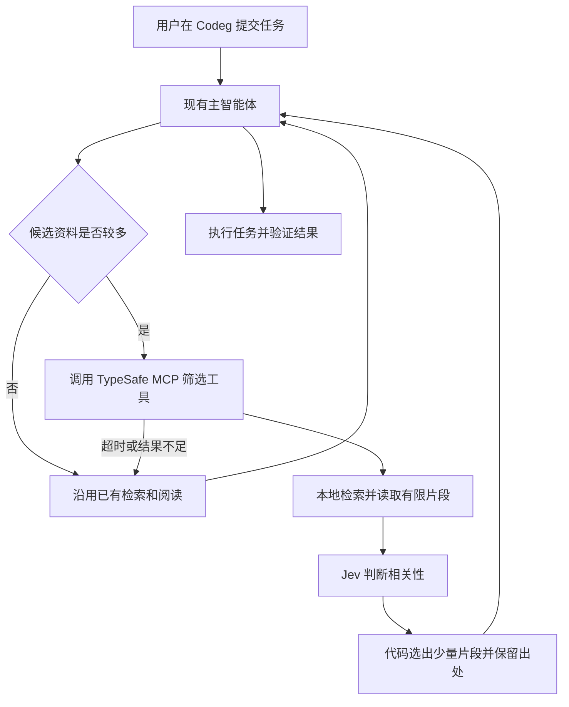

# TypeSafe 接入 home-studio Codeg：分析与试点建议

- 日期：2026-09-19（Asia/Shanghai）
- 对象：用户日常高频使用的 home-studio 开发机 Codeg
- 状态：分析已完成；用户已要求保存分析、更新记忆并提交推送。本文中的实现方案仍是建议，尚未开发、部署或完成 TypeSafe API 联调。
- 结论：建议先把 TypeSafe 接成现有 MCP 链路中的候选资料筛选工具，由主智能体按需调用。先验证能否减少主模型阅读量并保留关键证据，再决定是否扩大使用范围。

## 1. 用户目标与已验证范围

用户先阅读 TypeSafe 文档，在 Playground 配置 `route` 分类问题，把请求分为 `coding`、`web_search`、`conversation`、`unclear`、`other`。截图中的“帮我写一个 Python 脚本，把 CSV 文件转换成 JSON 文件”被归为 `coding`，界面显示概率和 confidence 均为 100%。用户随后试了其他示例，并反馈“基本符合预期”。

这验证了简单中文分类在这些试例上的可用性，没有验证真实开发任务中的长期准确率，也没有证明能提升 Codeg 的任务完成率、速度或费用表现。

用户进一步明确：目标是当前 home-studio 开发机上高频使用的 Codeg。接入价值应落在每天的资料检索、源码阅读和工具选择上，而不是另做一个没有真实下游的分类演示。

当前事实分为三类：

| 类别 | 内容 |
|---|---|
| 用户已经验证 | Playground 简单中文任务分类基本符合预期 |
| 已完成的只读核查 | 本机 Codeg 运行版本、现有 MCP 配置、旧源码接入流程、当前 Web 资产中的 MCP 管理入口 |
| 助手建议，尚未实施 | TypeSafe stdio MCP 适配器、候选片段筛选、使用规则、10 个真实任务的对照验收 |

## 2. 本机与现有接入条件

只读检查确认：

- 主机名为 `hahaxiong-home-studio`。
- `codeg-server --version` 为 **0.30.10**。
- 用户服务 `codeg-server.service` 处于 active；本次检查时 PID 为 `2089052`。PID 是当次运行快照，不应成为实现配置。
- 本机已有 mycc stdio MCP 链路，脚本位于 `~/mycc/.claude/skills/mcp-hub/scripts/`。

现有用户级配置的核查结果：

| 引擎 | 配置位置 | 已发现的 mycc MCP 服务 |
|---|---|---|
| Codex | `~/.codex/config.toml` | `mycc-probe`、`mycc-memory`、`mycc-handoff` |
| Grok | `~/.grok/config.toml` | `mycc-probe`、`mycc-memory`、`mycc-handoff` |
| Claude Code | `~/.claude.json` | 用户级 `mycc-memory` |

“配置存在”与“当前活动会话已经加载全部服务”是两件事。此次没有逐一调用三种引擎的 MCP 服务做运行测试，也不把三种引擎描述为配置完全一致。

密钥检查范围和结果：当前 shell 的 `TYPESAFE_API_KEY` 未设置；所检查的 Codeg 服务进程环境没有 `TYPESAFE` 相关变量；约定的 `~/.mycc-secrets.env` 文件当前不存在。因此本次没有找到可直接用于联调的 TypeSafe API Key。未扫描所有其他位置，也不能据此断言用户没有申请 Key。

## 3. 源码与运行版本的证据边界

本次源码核查使用已有 checkout：

`/home/hahaxiong83/.local/share/codeg/chat-sessions/2026-08-30/972ef5a0158c4e298dd5a1efb29511b4/codeg`

该 checkout 的 HEAD 为 **v0.29.0 / `769610c6`**，提交日期 2026-08-29。已先阅读该仓库 `AGENTS.md`。下表中的源码路径均相对于这个 checkout，行号对应本次检查状态，不能当作运行中 0.30.10 的逐行证明。

| v0.29.0 源码证据 | 说明 |
|---|---|
| `src/app/settings/mcp/page.tsx:1` | 存在 MCP 设置页面，页面路由 `/settings/mcp/` |
| `src/components/settings/mcp-settings.tsx:1152` | 存在“新建 MCP”按钮 |
| `src/components/settings/mcp-settings.tsx:667` | 新建时读取 server ID、JSON spec、目标 agents |
| `src/components/settings/mcp-settings.tsx:664` | 草稿默认勾选全部可选 agents，试点时应主动缩小选择 |
| `src/lib/api.ts:1921` | 调用 `mcp_upsert_local_server`，字段为 `serverId`、`spec`、`apps` |
| `src-tauri/src/web/handlers/mcp.rs:43` | HTTP 参数按 camelCase 反序列化 |
| `src-tauri/src/web/router.rs:552`、`:1658` | 对应 `POST /api/mcp_upsert_local_server` |
| `src-tauri/src/commands/mcp.rs:3006` | 按引擎写入各自用户级原生 MCP 配置 |
| `src-tauri/src/commands/mcp.rs:675`、`:718`、`:1904` | Codex 默认 `~/.codex/config.toml`，支持后端进程的 `CODEX_HOME`，写入 `[mcp_servers.<id>]` |
| `src-tauri/src/commands/mcp.rs:699` | Claude Code 用户级配置为 `~/.claude.json` |
| `src-tauri/src/acp/connection.rs:3880`、`:4903` | 连接建立时按引擎读取 MCP，并按能力过滤传输类型 |
| `src-tauri/src/acp/connection.rs:3728`、`:3743`、`:3764` | MCP 列表随创建、加载或恢复会话请求传递 |
| `src-tauri/src/acp/connection.rs:4339` | stdio 配置映射 `command`、`args`、`env` |
| `src-tauri/src/commands/mcp.rs:387`、`src/components/settings/mcp-settings.tsx:630` | 保存写磁盘、重新扫描列表；这条路径未调用活动会话 MCP 热加载 |

运行中 0.30.10 的 Web 静态资源另有以下证据，补充说明当前前端仍保留 MCP 管理入口和请求字段：

- `~/.local/share/codeg/web/_next/static/chunks/21604ff43af31290.js`：命中 `mcp_upsert_local_server`，参数包含 `serverId`、`spec`、`apps`。
- `~/.local/share/codeg/web/_next/static/chunks/981f97b970b2312a.js`：命中 `/settings/mcp`。
- `~/.local/share/codeg/web/_next/static/chunks/1b4a03cdef86c6ea.js`：包含简体中文“新建 MCP”。

静态资源命中不等于后端写入成功，也不能证明当前会话支持热加载。本次未通过接口写配置、未重连会话、未重启服务。

## 4. Jev 的定位和限制

TypeSafe 的 Jev 是处理局部语义判断的模型。请求由待判断的 `state` 和有明确类型的 `questions` 组成；代码拿到结构化答案后决定下一步。

| primitive | 适用问题 | 返回值 |
|---|---|---|
| Choice | 从有限候选中选择一个，例如哪项技能最匹配 | `choice`、`probabilities`、`confidence` |
| Score | 按明确等级评估相关性或质量 | `score`、`probabilities`、`confidence` |
| Noul | 某个陈述是否成立，例如候选资料是否包含所需证据 | `noul`，0 到 1；没有独立的 `confidence` 字段 |

多个问题可以针对同一 state 并行评估；它们彼此独立，不会自动组合成多步规划。Choice 每次选择一个候选；返回的分布可用于相对排序，但即使全部候选都不相关，也总有候选排第一。需要“没有合适候选”的处理，或单独的相关性/证据存在性判断。

Jev 适合辅助现有智能体。完整智能体仍需要主模型、记忆、工具执行、结果处理及任务循环。Jev 不负责生成代码、生成长篇回答，也不能把自由文本里的任意参数直接变成可靠的工具调用参数。

本场景尤其需要注意：

- **中文表现需要实测。** 官方说明英语是主要训练语言，包含中文在内的其他语言当前准确率较弱。中文请求、英文代码、混合术语应进入验收集。
- **confidence 不是正确率承诺。** 它由概率分布计算，0.9 不等于这次有 90% 的正确率；Playground 的 100% 也不是上线保证。阈值应从实际样本确定，不机械复制示例。
- **长上下文中无关内容会影响准确率。** 先用文件范围、关键词、路径及去重缩小候选，不把整个仓库和完整会话一股脑送过去。
- **复杂推理、精确计数、数值计算、日期比较交给程序或主模型。** 源码跨多层调用才能证明的结论，不能因一个高相关性评分就宣称已证实。
- **资料可能误导模型。** 候选文本是待评估数据；其中出现的命令或指令不能因此获得执行权限。
- **类型正确不等于事实正确。** Jev 的结果是阅读优先级或检查信号，不能替代编译、测试和主智能体的核查。

文档中的 Agent skill 是帮助已有编码智能体理解并接入 TypeSafe 的说明资料。安装该说明不会自动新增运行时 MCP 工具，也不会自动把 Codeg 改成每条消息先经过 Jev。

## 5. 为什么优先做候选筛选

最初 Playground 的任务分类适合学习接口。不过用户目前已经在 Codeg 里选择主力智能体；如果每个分类最后仍交给同一个模型，并提供同样工具，前置分类会多一次请求，未必带来收益。

更贴近日常工作的机会是：主智能体面对大量搜索结果、候选源码片段、文档段落或技能说明时，让便宜的判断模型先筛选，主模型集中阅读少量有用证据。

| 方向 | 可创造价值的前提 | 当前建议 |
|---|---|---|
| 每条消息前置任务分流 | 不同类别确实通向不同执行器，或部分任务能直接由程序完成 | 暂不作为首版默认入口 |
| 技能推荐 | 有较多技能，且能减少主模型反复阅读说明或选错工具 | 可复用同一筛选能力，后续扩展 |
| 搜索结果、文档及源码候选筛选 | 主模型原本需要阅读大量低相关候选 | **首个试点** |
| 回答检查 | 有完整可追溯的证据材料，能判断具体陈述是否受支持 | 后续按需使用，不作为自动正确性裁判 |

对于少量文件、明确的符号搜索或一步能完成的请求，继续用原流程更简单，不必调用 Jev。

## 6. 建议的 stdio MCP 方案与数据流

建议沿用已有 mycc MCP hub 的结构，增加一个独立服务，例如 `mycc-typesafe`。名称和接口是设计建议，不表示已经创建。首版只注册给主力 Codex，验证有效后再按用户需要扩到 Grok 或 Claude Code。

可以先提供一个候选筛选工具，暂名 `typesafe_select_context`：

1. 主智能体传入当前任务、明确的候选目录或文件范围、检索条件及返回预算。
2. MCP 服务在指定范围内运行确定性检索，读取有限片段，给每段附上稳定 ID、文件路径、行号和版本信息。
3. 服务去重、截断并分批，把必要的候选文本与任务描述发送到 `POST https://api.typesafe.ai/v1/systemone`。
4. Jev 用清楚的相关性等级或逐候选判断进行筛选。首版可采用逐候选 Score 或 Noul；若用 Choice 相对排序，必须额外处理“全部无关”。
5. 服务用代码执行排序、预算限制和结果校验，返回少量选中片段、出处、分数、模型版本及是否建议回退。返回的是原文和结构化判断，不让 Jev 编造分析理由。
6. 主智能体阅读这些片段；需要时继续打开源文件核查，再完成解释、修改、测试或其他任务。

### 真正减少主模型输入的关键

如果主智能体先把所有文件读进对话，再把全文作为 MCP 参数交给 Jev，大部分阅读成本已经发生，筛选很难抵消这部分开销。

因此候选工具应能**自己在指定范围内读取片段**，主模型主要提供任务和检索范围，拿到筛选后的内容。主模型也可以传已有候选 ID 或路径，但不必先读取全部候选正文。

筛选结果必须保留证据出处及未覆盖范围。没有选中的内容只表示在当前筛选中没有优先返回，不代表它不存在问题；需要全量审查的任务不能以筛选代替全量覆盖。

筛选源码时还要控制片段边界，避免只留下调用点而遗漏定义、条件判断或错误处理。主智能体发现上下文不足时应能补读，而不是被 top-k 限死。

## 7. 配置一次、生效范围与使用规则

旧源码及当前 Web 资源均表明，Codeg 已有 MCP 设置入口。拟接入时可通过“设置 → MCP → 新建 MCP”，填入独立服务 ID、stdio 的 `command`/`args` 配置并选择目标引擎；也可使用同一后端 API。具体配置要等适配器存在且经过本地验证后生成。

用户级配置可供该引擎后续新会话复用；因为写的是引擎原生配置，同一用户直接启动对应 CLI 时也可能生效。Codex 路径还受 Codeg 后端进程 `CODEX_HOME` 影响，实施时应确认实际路径，避免误写另一套配置。

实施时需要保留两个细节：

- 新建草稿默认选择多个引擎，应只选择首轮试点目标。
- v0.29.0 的保存实现会把同名 server 从未选中的引擎移除，因此使用新的服务 ID，不复用 `mycc-memory` 等现有名称。

**MCP 不会自动拦截每条用户消息。** 它只新增主智能体可以选择调用的工具。要让日常使用稳定，还需配套一条范围清楚的 skill 或指令，例如“候选片段较多且任务需要语义筛选时，先调用该工具；明确符号定位、资料很少或筛选失败时直接使用现有检索”。调用阈值和具体规则需经试点调整。

根据本次源码核查，不能把 MCP 设置页的“刷新”理解成活动会话工具热加载。首轮应在**新会话**验证工具出现、调用成功、结果格式和故障回退；如要旧会话生效，可在空闲时重新连接，并以实际工具列表为准。本次没有为了验证而中断现有主力会话。

## 8. 实现约束：数据、费用和回退

约束只围绕这个小工具，不扩大成额外平台建设：

1. **密钥留在本机既有 secret 管理方式中。** 不写入仓库、聊天记录、工具结果或调试日志。约定 secret 文件当前不存在，实际接入前需建立可用的读取来源。
2. **读取和外发范围明确。** API 收到的片段会发送给 TypeSafe；首轮使用任务相关、允许发送的资料，默认排除密钥文件、认证配置、数据库及无关个人资料。不要扫描整个 home 来找候选。
3. **控制开销。** 设置单次候选数、文本量、调用超时和最多重试次数，避免每次短问答都触发服务。优先记录总输入量、所用模型和实际耗时，原文日志保持最少。
4. **失败不阻断主任务。** 无 Key、429、网络错误、超时、响应格式错误、候选为空或判断不足时，返回明确状态，由主智能体使用已有检索路径，不把“请求失败”伪装成“没有相关资料”。
5. **评分不授予执行权限。** MCP 首版只读取和筛选；删除、部署、发消息等操作继续走原有工具与授权边界。

截至本次查看，官方列出的 `jev-1.13.0` 价格为每百万输入 token **0.042 美元**，输出免费。费用估算应计入 state 与 questions 的输入，最终以实际 usage 和账单为准。参考量级：若每次总输入 5,000 token，10,000 次调用共 5,000 万 token，对应 Jev 模型费约 2.10 美元；这不包含主模型、基础设施或因重试增加的调用。

低单价不等于整体省钱。要比较“每个成功任务”的总费用及端到端耗时，包含筛选、补读、回退和重试。官方也区分“不用于训练”和企业 ZDR；不能据“不用于训练”推导所有账号请求均零留存。

## 9. 10 个真实任务的首轮验收

下面是建议的验收任务清单，执行时应从用户正在处理的真实仓库、实际文档和已发生的故障中选取材料。它们是待执行的任务，不是本次已经跑过的 10 条记录。首轮规模用于发现明显问题，不足以证明稳定的统计准确率。

| 编号 | 真实任务选取方式 | 重点检查 |
|---|---|---|
| 1 | 在 Codeg 中查一项具体 UI 操作对应的后端实现 | 能否同时保留前端触发点、API 与业务处理，避免只找到同名文案 |
| 2 | 从一次真实编译或测试失败定位相关文件 | 错误附近与真正原因相关的片段能否进入结果 |
| 3 | 排查一次会话连接或恢复问题 | 新建、加载、恢复路径是否被混为一谈，关键分支是否遗漏 |
| 4 | 查一个 MCP 配置字段在所用引擎中的实际生效位置 | 区分 Codeg 统一入口、引擎原生配置与运行时行为 |
| 5 | 为一个小功能变更找需修改的代码和现有测试 | 选中实施入口与有意义的验证位置，避免只返回定义或过时注释 |
| 6 | 回答一个官方文档问题，候选中夹有旧版本内容 | 保留日期和版本，主智能体不能把旧结论当当前行为 |
| 7 | 从一个实际项目的 README、设计记录与源码中查同一概念 | 比较中英文混合材料的召回质量，不只偏向英文关键词 |
| 8 | 为一次日常开发任务从已有技能说明中选择适用技能 | 能识别最相关候选，也允许全部不适用；不因推荐就自动执行 |
| 9 | 提交一个当前候选库确实无法回答的问题 | 返回证据不足并允许扩大检索，不硬选最相似段落当答案 |
| 10 | 选一个正常任务，并模拟无 Key、限流或超时 | 能回到原有检索流程，结果不被误标为“无相关内容” |

每个任务都以同一输入和相同资料快照比较两种流程：原流程与启用筛选的流程。记录任务结果、人工认为不可遗漏的关键证据、选中片段、补读次数、模型版本、输入量、总费用和端到端耗时。尽可能固定主模型及版本，减少其他变量。

三个验收维度：

1. **关键证据召回：** 人工标记的关键资料是否进入返回结果；尤其检查没有返回却会改变结论的证据。出现重要遗漏时先调整检索与分段，不能只调高 confidence 阈值。
2. **任务完成质量：** 正确结论、修改和必要测试至少不低于原流程；失败时能回退完成任务，没有把评分当事实证明。
3. **实际收益：** 主模型输入量是否减少，每个成功任务的总费用和耗时是否改善；若只增加工具调用而没有可见收益，就保留按需调用或停止扩大接入。

首轮通过后，再扩充到更多真实中文任务并校准阈值。若阈值基于某个模型版本调过，应记录并考虑固定版本，不让 `jev-latest` 自动变化后仍沿用旧结论。

## 10. 当前状态与下一步依赖

本次已经做了文档与环境分析，并保存可继续执行的方案。**没有编写 TypeSafe MCP 服务，没有修改任何引擎 MCP 配置，没有修改 Codeg，没有重启服务，也没有完成 TypeSafe API 联调。** 用户本次要求保存分析成果；文中的接口名称、试点顺序和使用规则仍是待实施建议。

下一步实施所需条件：

1. 将首版目标“候选资料筛选”具体化为接口、主力引擎及任务相关的资料范围。
2. 获得本机可读取的 TypeSafe API Key；用户不需要把 Key 明文贴进对话。
3. 在既有 mycc MCP hub 中实现小型 stdio 服务，先完成本地协议、输入边界、返回格式和失败回退验证。
4. 再以一个允许外发的小样本完成真实 API 联调，核对返回模型版本、usage 与实际延迟。
5. 通过现成 MCP 设置注册独立服务，在新会话验收工具发现与调用，随后执行上述 10 个真实任务。

这条路线优先复用已经存在的 Codeg 和 mycc 接口。是否把筛选设为日常默认步骤、是否扩到其他引擎、是否进一步做前置路由，都由实测结果决定。

## 11. 官方资料

本分析依据本次已读取的官方文档及其本地缓存；模型、价格、限额与别名未来可能变化，实施时应再次核对相关页面。

- [Introduction](https://docs.typesafe.ai/introduction)：Jev 定位、state/questions 与三种 primitive。
- [How to build with TypeSafe](https://docs.typesafe.ai/concepts/how-to-build-with-system-one)：局部判断与代码控制流程的分工。
- [API reference](https://docs.typesafe.ai/api)：`POST /v1/systemone`、请求与返回格式。
- [Models](https://docs.typesafe.ai/models)：版本、价格、输入类型、上下文限制、语言支持与数据处理说明。
- [Confidence](https://docs.typesafe.ai/confidence)：confidence 来源与阈值需要场景验证。
- [Jev 1.13 jaggedness](https://docs.typesafe.ai/model-jaggedness/jev-1.13)：长状态、数字、复杂间接推理、对抗输入与生成限制；该页标注最近审阅为 2026-09-17。
- [Skill suggestion](https://docs.typesafe.ai/cookbooks/skill_suggestion)：候选技能的相对选择与适用性判断。
- [Classifying RAG passages](https://docs.typesafe.ai/cookbooks/classifying_rag_passages)：资料片段筛选。
- [Function calling](https://docs.typesafe.ai/cookbooks/function_calling)：有界参数选择与工具执行的分工。
- [Agent skill](https://docs.typesafe.ai/agent-skill)：提供给已有编码智能体的接入说明。
- [Codex MCP（OpenAI Docs）](https://developers.openai.com/codex/mcp/)：Codex 用户级 MCP 配置、stdio 和环境变量支持。
