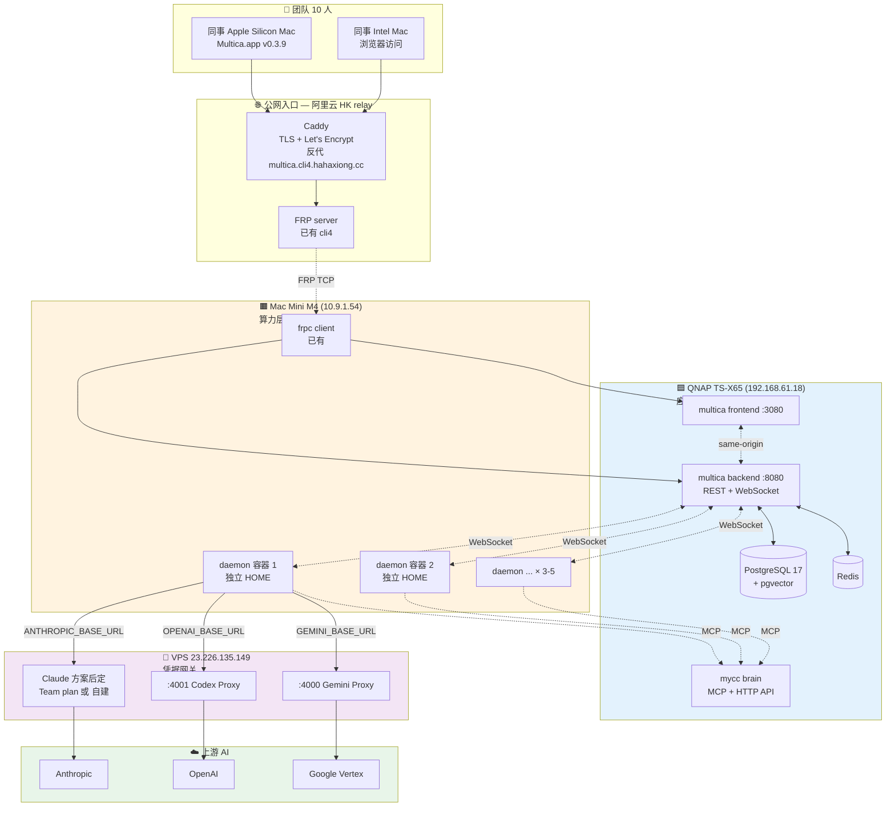

# 部署架构

## 1. 五层架构总览

```
L0 接入层 │ Tailscale VPN (可选) + 同事浏览器/Multica.app
L1 入口层 │ 阿里云 HK relay (cli4.hahaxiong.cc) Caddy TLS + FRP
L2 应用层 │ QNAP TS-X65 — multica server + DB + brain（16GB/8C）
L3 算力层 │ Mac Mini M4 — 3-5 个 daemon 容器（32GB）
L4 凭据层 │ VPS 23.226.135.149 — Gemini/Codex 网关 + Claude 后定
L5 上游   │ Anthropic / OpenAI / Google Vertex AI
```

## 2. 物理拓扑图



## 3. 资源账（实测数据 + 估算）

### QNAP TS-X65（应用层）

| 项 | 已用 | 新增 multica | 总占用 | 余量 |
|----|------|--------------|--------|------|
| 内存 | ~3 GB（1052-os + pairdrop + kspeeder）| 3-5 GB | **6-8 GB / 16 GB** | 8-10 GB |
| CPU | 轻负载 | 1-2 vCPU | 占 2-4 / 8 核 | 50%+ |
| 磁盘 | 19.7 GB / 636 GB | 50-100 GB（pg + uploads）| <200 GB | 415 GB+ |
| Docker | 3 容器在跑 | +5 容器 | 8 容器 | OK |

### Mac Mini M4（算力层）— 前提：停 Ollama + mycc

| 项 | 停 Ollama+mycc 前 | 停后腾出 | daemon 占用 | 总占用 | 余量 |
|----|-------------------|---------|-------------|--------|------|
| 内存 | 6-15 GB | 7-12 GB | 3 daemon × 2 = 6 GB | **10-12 GB / 32 GB** | 20 GB |
| CPU | 中负载 | 30-50% | 2 vCPU × 3 | 占 ~25% | 75% |

### 公网链路（阿里云 HK relay）

- 实际带宽：取决于川哥 FRP 套餐
- 延迟：iBRO ↔ HK 约 50-80ms（同事在国内访问）
- 协议：HTTPS + WSS（必需，因 WebSocket）

## 4. multica 多用户隔离机制（源码实测）

| 层 | 实现位置 | 隔离强度 |
|----|---------|----------|
| Schema | [server/migrations/001_init.up.sql](https://github.com/multica-ai/multica/blob/main/server/migrations/001_init.up.sql) | issue/agent/inbox 全表 `workspace_id NOT NULL`，CASCADE 删除 |
| 中间件 | [server/internal/middleware/workspace.go:53-86](https://github.com/multica-ai/multica/blob/main/server/internal/middleware/workspace.go) | 6 级 workspace 解析优先级，task-token 不可被 agent 提升权限（MUL-2600 修过越权 CVE）|
| WebSocket scope | [server/cmd/server/scope_authorizer.go:31-99](https://github.com/multica-ai/multica/blob/main/server/cmd/server/scope_authorizer.go) | chat session 严格 creator-only，避免水平越权 |
| Member 缓存 | [server/internal/auth/membership_cache.go:14-32](https://github.com/multica-ai/multica/blob/main/server/internal/auth/membership_cache.go) | Redis 5min TTL，踢人最多 10min 失效 |
| 注册控制 | `ALLOW_SIGNUP=false` + `ALLOWED_EMAILS` | self-host 必开 |

## 5. Daemon 隔离方案（关键决策）

❌ **不可行**：一个 daemon 服务 10 人共用 — 因为 daemon 进程读自己 $HOME 的 AI CLI 凭据，跨用户用同一份 claude/codex 凭据是反模式。

✅ **方案**：Mini 上**每个 daemon 独立 Docker 容器**，每容器：
- 独立 HOME（`/home/multica-N`）+ 独立 AI CLI 凭据卷
- 独立 OS user inside container（非 root）
- 通过 `ANTHROPIC_BASE_URL` / `OPENAI_BASE_URL` / `GEMINI_BASE_URL` 走 VPS 网关，凭据由网关分发（不存在每容器）

```
~/multica-daemons/
├── alice/
│   ├── data/        # workspaces, repo cache
│   └── creds/       # 独立 ~/.claude, ~/.codex (gateway-issued tokens)
├── bob/
│   ├── data/
│   └── creds/
└── ...
```

## 6. 客户端运行时配置

**Multica.app 自托管配置位置**：`~/.multica/desktop.json`

```json
{
  "schemaVersion": 1,
  "apiUrl": "https://multica.cli4.hahaxiong.cc",
  "wsUrl": "wss://multica.cli4.hahaxiong.cc/ws",
  "appUrl": "https://multica.cli4.hahaxiong.cc"
}
```

源码逻辑（[apps/desktop/src/main/runtime-config-loader.ts:35](https://github.com/multica-ai/multica/blob/main/apps/desktop/src/main/runtime-config-loader.ts)）：
- 文件不存在 → fallback 到 DEFAULT_RUNTIME_CONFIG（multica.ai 云端）
- 文件存在且 schema OK → 用自定义 URL
- 文件存在但解析失败 → 客户端报错不启动

## 7. mycc 集成（差异化点）

每个 daemon 容器启动时挂载：
- **只读知识库**：`~/mycc/0-System/` + `~/mycc/2-Projects/` → 容器 `/mnt/mycc/`
- **brain MCP**：环境变量 `BRAIN_MCP_URL=http://qnap.local:7800/mcp`
- **agent persona**：mycc CLAUDE.md P0/P1 规则注入到 multica agent template
- **写回 socket**：HTTP API `POST /v1/memory/append`（brain 提供）

集成完成的体感效果：团队每个 agent 默认带：
- BRO-PDCA 四档判断（什么时候直接干 / 什么时候先对齐）
- ASMR 六维度摄入
- task-log 自动追加
- 红线规则（no-guessing 实体锚定）
