# 架构文档 — 通用型实时语音 Agent

> 配套 `PRODUCT-DEFINITION-v3.3.md`。本文用 GitHub 原生 Mermaid 渲染架构、数据流与关键时序。
> 一句话:**体验引擎可插拔(变),记忆内核恒定(不变),两者之间是一份稳定契约。**

---

## 1. 设计原则

1. **关注点分离**:语音体验(延迟/打断/判停)与记忆一致性(真值/审计/召回)是两个独立演进轴,中间用归一化契约解耦。
2. **CQRS + 事件溯源**:Event Log 是 append-only 单一真相源;所有可查询结构(Working Set / Vector)都是可重建的投影。
3. **interrupt-safe 不变量**:写记忆**只在 `user.turn_committed`**;interim 永远是 DRAFT;打断 = 零成本回滚。
4. **热路径/冷路径分离**:对话回包走热路径(低延迟优先);记忆抽取/投影走冷路径(一致性优先),不阻塞说话。
5. **引擎可替换性**:升级体验引擎 = 写一个适配器把引擎事件翻成契约,记忆内核零改动。

---

## 2. 系统上下文

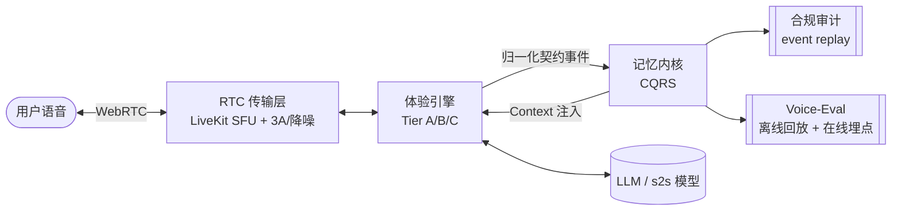

---

## 3. 分层架构

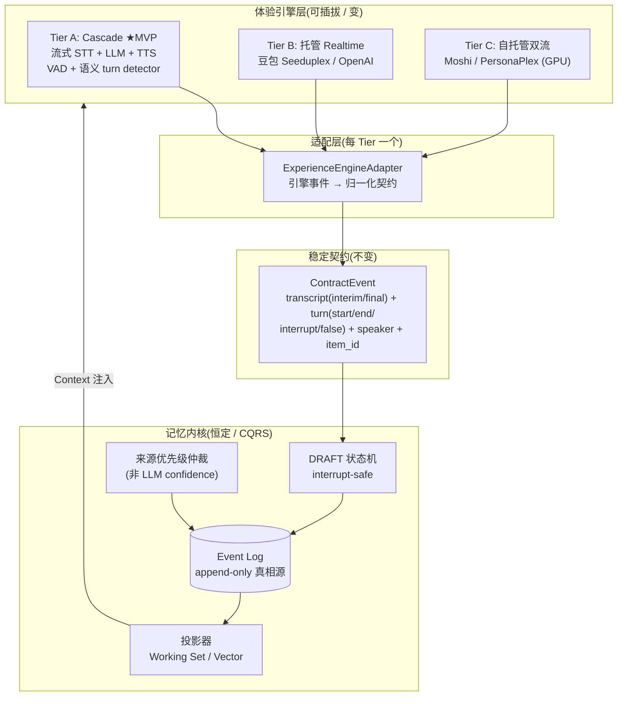

- 三个 Tier 都映射到**同一组契约事件**;Tier B/C turn 边界糊时,旁挂一路 STT + turn detector **合成** `user.turn_committed`(E3:LiveKit turn detector 可与 OpenAI Realtime 并用)。
- 记忆内核**只认契约,不认引擎**——这是引擎可热插、记忆 IP 不重写的根因。
- 🔧 **Tier B 托管落地参考**：火山 RTC AIGC（CustomLLM 模式）的全链路实操见 [`../../../4-Assets/SOP/volc-rtc-realtime-voice-agent-SOP.md`](../../../4-Assets/SOP/volc-rtc-realtime-voice-agent-SOP.md)——它同时是 Tier A 要对标的「RTC 级体验」基准（已验证一手代码，提炼自 P003 小可生产）。

---

## 4. 归一化契约事件模型

| 事件 | 关键字段 | 触发 | 对记忆的作用 |
|---|---|---|---|
| `user.speech_started` | turn_id, ts | VAD 检测开口 | 开一个 turn |
| `user.transcript.interim` | turn_id, text | STT 中间结果 | **仅维持 DRAFT** |
| `user.transcript.final` | turn_id, item_id, text, speaker_id | STT 最终化 | COMMIT 候选 |
| `user.turn_committed` | turn_id, item_id, final_text | 语义 EOU | **唯一提交点** |
| `interruption` | turn_id, is_interruption, heard_ms | 真打断 | 冻结/丢弃 DRAFT(零成本回滚) |
| `false_interruption` | turn_id | 假打断(噪声) | **不动记忆** |
| `agent.speech_started/stopped` | turn_id | agent 开口/收口 | 状态机推进 |
| `agent.transcript.final` | turn_id, item_id, text | agent 输出转录 | 记 agent 回合 |

> 字段约定:`turn_id` 贯穿一个回合;`item_id` 用于排序/对账(采用 OpenAI 对账约定);`is_final` 决定能否触发 COMMIT;`heard_ms` = 用户已听到时长(打断截断语义)。

---

## 5. 数据流:热路径 / 冷路径

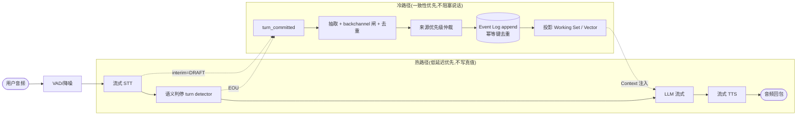

- **热路径**目标是把 ~1s 守住:延迟主要藏在 turn-taking 判停与 LLM TTFT(E2),先打这两处。
- **冷路径**与热路径异步:抽取/仲裁/投影慢一点不影响说话;只有 Context 注入回到热路径。

---

## 6. CQRS:Event Log + 投影

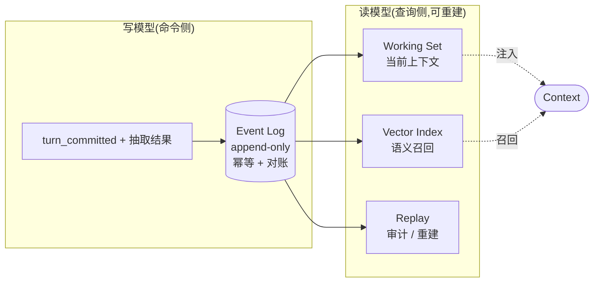

**不变量**:任何投影损坏都能从 Event Log replay 重建;Event Log 本身只追加、不修改、不删除。审计 = 对 Event Log 做文字级 replay(端到端黑盒给不了)。

---

## 7. 关键时序

### 7.1 正常回合提交

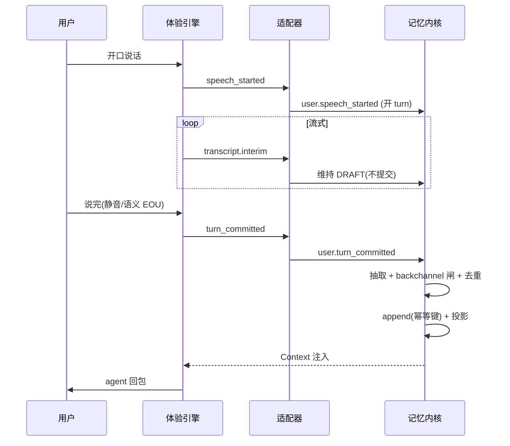

### 7.2 打断 → DRAFT 零成本回滚

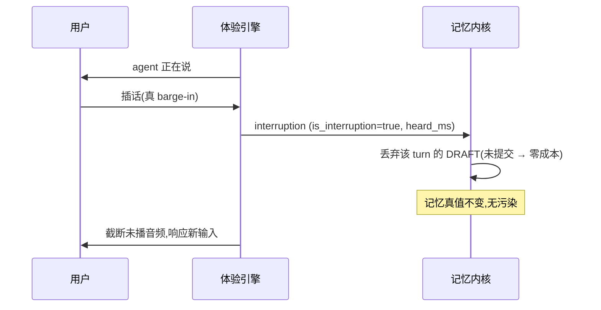

### 7.3 假打断 → 不动记忆

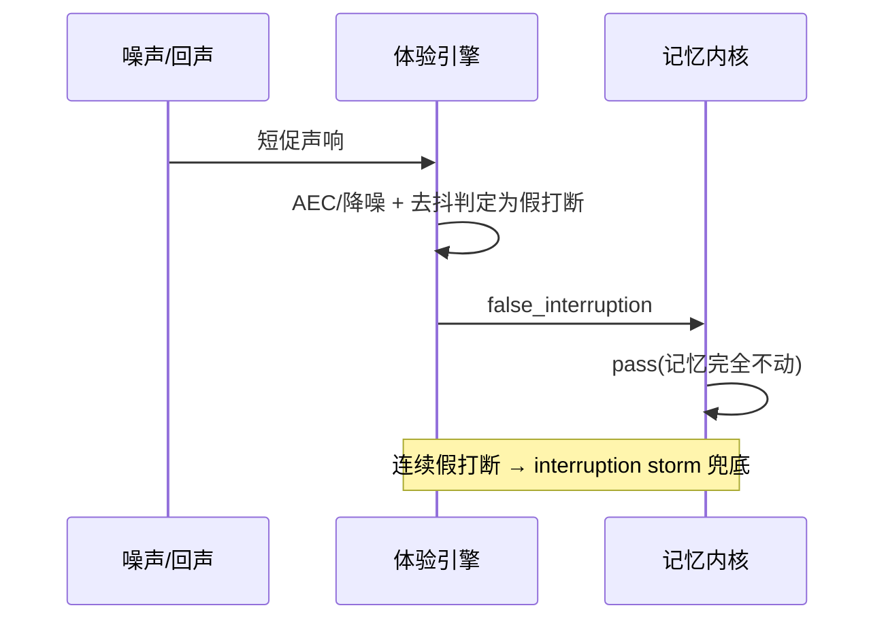

### 7.4 迟到 final 对账

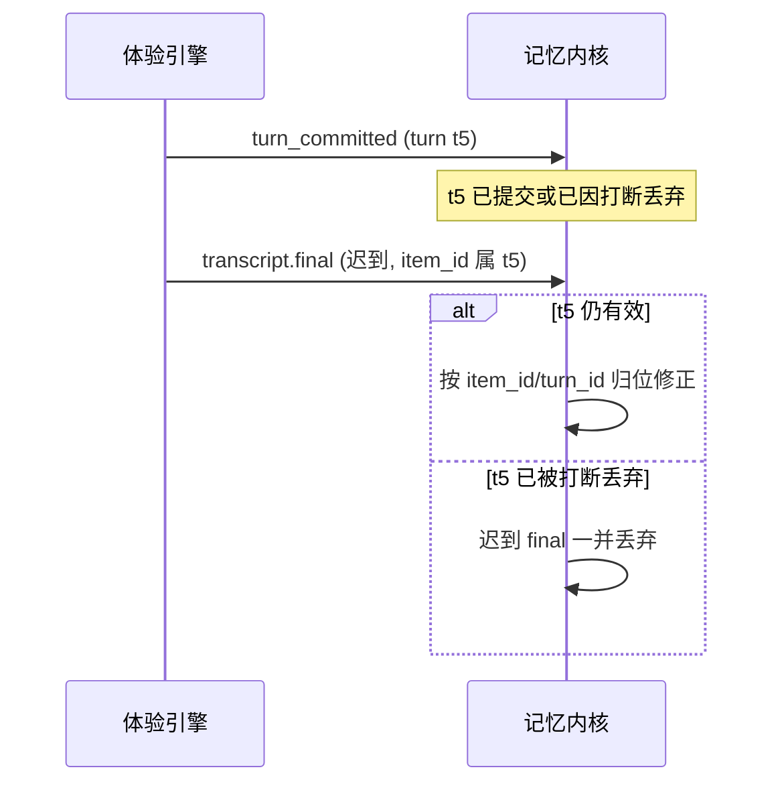

---

## 8. 部署拓扑(按 Tier)

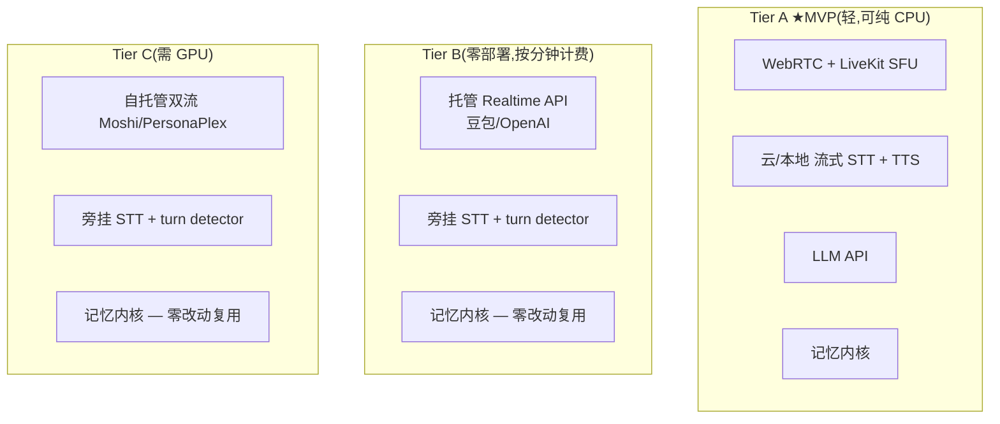

> **记忆内核在三种拓扑下完全相同**——这是"引擎热插、记忆不重写"在部署层的体现。

### 8.1 M0/M1 自托管拓扑(Mini + Studio)

M0/M1 主线部署采用 **Mac mini 做实时入口，Studio M2 Max 做 voice-agent worker / 算力节点**：

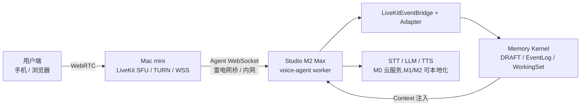

职责边界：
- **Mini**：常驻入口、LiveKit SFU/TURN/WSS、后续公网网关。
- **Studio**：`make run-livekit` worker、契约归一化、记忆内核、Voice-Eval、后续本地模型。
- **HP/dev198**：后续作为评测 / 大模型实验节点，不进入 M0 主链路。

详细部署说明见 `docs/DEPLOYMENT-MINI-STUDIO.md`。

### 8.2 生产三层分离架构(2026-07-16 定稿,OOM 事故催生)

自研链路的生产标准形态是**信令 / worker / 大脑三层分离**——LiveKit 生态天生按此设计,worker 是注册制(连上信令服务即入池,派单自动负载均衡),**加并发 = 加 worker 机,其余两层零改动**:

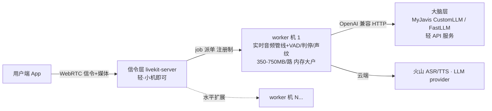

**职责与资源画像**:
- **信令层**(livekit-server):SFU/TURN,内存 ~80M,轻。
- **worker 层**(现场工作):每路通话一个 job 进程,承载实时音频管线(AEC/重采样/缓冲)+本地推理(silero VAD/v1-mini 判停/CAM++ 声纹)——**这是"自建 cascade 把火山机房的角色自己扛了"的那部分**,唯一的内存大户,唯一需要横向扩展的层。
- **大脑层**:轻 API(共脑模式=MyJavis CustomLLM;独立模式=FastLLM 直连 provider)。

**现状与演进路径**(阶段选择,非架构错误):

| 阶段 | 形态 | 并发 |
|---|---|---|
| 现在(单用户+少量体验码) | 三层同机 HK 2c2G + 五道防线(限单并发 load_fnc job 计数/App 重连退避/swappiness/cgroup MemoryMax/RSS 采样) | 自研 1 路(物理约束:单 job 350-750M+基座 1.2G,2G 机 2 路必 OOM——2026-07-16 事故实证) |
| 第一刀 | **仅 worker 搬去 4c8G**(信令+大脑留原机;同区内网 RTT 1-3ms 可忽略) | 自研 2-4 路 |
| 规模化 | worker 池多机横向 | 按机器数线性 |

**触发条件**:自研并发需求 >1 路,或自研转主链路。**代价认知**:自建 worker 池=固定容量(买几台就几路),对比火山托管的弹性计费——"摆脱火山"路线的代价清单之一,用可控性与数据主权换。

---

## 9. 失败模式 → 架构对策映射

| 失败模式 | 架构对策(落在哪一层) |
|---|---|
| STT drift → 记忆污染 | 冷路径:抽取前置置信度门 + 来源优先级仲裁;低置信入 low-confidence state |
| interruption storm | 体验引擎:AEC/降噪 + 打断去抖;假打断走 `false_interruption`,记忆零动 |
| duplicate commit | Event Log:`idempotency_key = f(turn_id, content)` 去重 |
| out-of-order / 迟到 final | 契约层:`item_id`/`turn_id` 对账;已丢弃 turn 的迟到 final 一并丢弃 |
| backchannel 误提交 | 三道闸:VAD(空转写 StopResponse)/ 语义 / 文本 backchannel 过滤 |
| Tier B/C 判停糊 | 适配层:旁挂 STT + turn detector 合成 `turn_committed` |

**统一不变量**:无论哪种失败,写记忆只发生在 `user.turn_committed` + 抽取完成,且经幂等去重——失败模式不破坏 Event Log 的真值一致性。

---

## 10. 演进路径

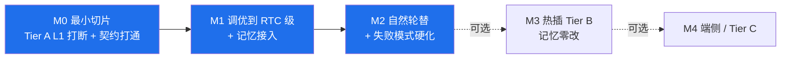

蓝色 = MVP 主线(达成火山 RTC 级体验);虚线 = 可选演进,**不阻塞主线、不重写记忆内核**。每个里程碑的验收门见 `PRODUCT-DEFINITION-v3.3.md` §8。

---

*证据级:契约/事件名/对账约定 E3(三引擎官方核对);延迟预算 E2;对标靶 E3;**本系统端到端运行 E0 → 待 Voice-Eval 实测 E4**。*
