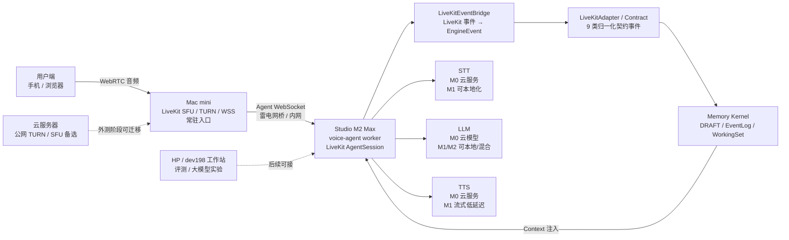
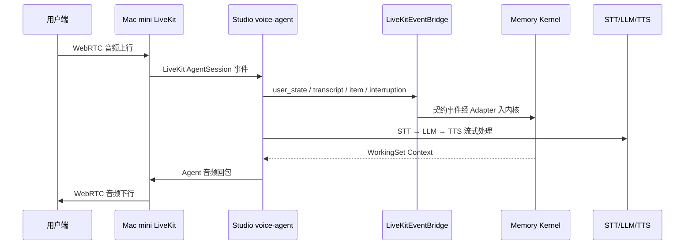

# M0/M1 部署架构 — Mini 入口 + Studio 算力

> 结论：**Mac mini 做实时入口与常驻网络枢纽，Studio M2 Max 做 voice-agent worker 与后续本地模型算力。**
> 这不是把 LiveKit 简单“放到最强机器”，而是按职责拆：SFU/网关重稳定网络，Agent/模型重算力。

---

## 1. 主线拓扑



一句话数据链路：

```text
用户 → Mini(LiveKit 入口) → 雷电网桥 → Studio(Agent + 记忆 + 模型编排) → Mini → 用户
```

---

## 2. 组件分工

| 组件 | 推荐位置 | 职责 | 选择理由 |
|---|---|---|---|
| LiveKit SFU / TURN / WSS | Mac mini | WebRTC 房间、音频转发、局域网/公网入口 | 常驻中枢，网络服务属性强，稳定比算力重要 |
| voice-agent worker | Studio | 连接 LiveKit，消费事件，驱动 STT/LLM/TTS | Agent 与模型插件更吃 CPU/内存/后续本地模型能力 |
| Contract / Adapter | Studio | LiveKit 事件归一化为稳定契约 | 与 worker 同进程，避免跨机状态复杂化 |
| Memory Kernel | Studio | DRAFT/COMMIT、打断回滚、Event Log、Context 注入 | 与 Agent 热路径同地，便于低延迟注入上下文 |
| STT/LLM/TTS | M0 云服务；M1/M2 可迁 Studio/HP | 识别、生成、合成 | 先跑通，再逐步本地化 |
| Voice-Eval | Studio / HP | 延迟、CER、误打断率、回放评测 | 评测与模型实验更适合算力机 |
| 云服务器 | 外测阶段可选 | 公网 SFU/TURN/WSS | 多外网用户或跨地域测试时再迁 |

---

## 3. M0 时序



M0 验收重点：

| 验收项 | 标准 |
|---|---|
| 声音链路 | 用户端能进房、能听到 Agent 回包 |
| 打断 | 用户插话能触发 interruption / false_interruption 事件 |
| 契约覆盖 | `speech_started` / `transcript.*` / `turn_committed` / `interruption` 冒烟全覆盖 |
| 第一批数字 | 记录端到端延迟、判停迟滞、TTS TTFA 的 E0→E4 初始样本 |

---

## 4. 环境变量建议

### 4.1 Mini 上的 LiveKit

M0 本地内测可先用 dev key：

```dotenv
LIVEKIT_URL=ws://10.9.1.54:7880
LIVEKIT_API_KEY=devkey
LIVEKIT_API_SECRET=secret
```

如果后续确认雷电网桥专用 IP，比 Wi-Fi/LAN 更稳定，可把 `LIVEKIT_URL` 改成 Mini 的雷电网桥地址：

```dotenv
LIVEKIT_URL=ws://<mini-thunderbolt-ip>:7880
```

### 4.2 Studio 上的 voice-agent

Studio 只需要主动连 Mini 的 LiveKit：

```dotenv
VOICE_ENGINE=tier_a_cascade
LIVEKIT_URL=ws://10.9.1.54:7880
LIVEKIT_API_KEY=devkey
LIVEKIT_API_SECRET=secret

STT_PROVIDER=<先填云 STT provider/model>
LLM_PROVIDER=<先填云 LLM provider/model>
TTS_PROVIDER=<先填云 TTS provider/model>
```

> 注意：LiveKit 开源自托管仍需要 `API_KEY` / `API_SECRET`，它们用于 Agent 与 SFU 的鉴权和 token 签名；区别只是 key 由自托管 server 配置，而不是官方 Cloud 项目后台生成。

---

## 5. 阶段路线

| 阶段 | 拓扑 | 目标 |
|---|---|---|
| M0 内测 | Mini LiveKit + Studio worker + 云 STT/LLM/TTS | 跑通声音、打断、契约事件、第一批延迟数字 |
| M1 调优 | Mini 增 TURN/WSS；Studio 加 Voice-Eval 与记忆接入 | P95 延迟、EOU 误打断、判停迟滞进入门槛 |
| M2 强化 | Studio/HP 接本地 STT/TTS/LLM 实验 | 降成本、提高隐私与可控性 |
| Beta 外测 | 视公网质量把 SFU/TURN 迁云，Studio 保持 Agent/模型节点 | 支撑外部用户与跨地域测试 |

---

## 6. 为什么不 Studio all-in-one

Studio all-in-one 可以作为 M0 快测，但不建议作为主线：

| 风险 | 说明 |
|---|---|
| 入口和算力耦合 | 模型实验、重启、负载波动会影响用户进房 |
| 常驻性不如 Mini | Mini 已是编排中枢，更适合放长期服务 |
| 公网演进不清晰 | 外测时 SFU/TURN 迟早要独立，早拆职责更少迁移债 |

因此主线保持：**Mini 负责入口稳定，Studio 负责 Agent 智能。**

---

## 7. 当前实际部署（2026-06-24，Studio loopback dev 栈 + launchd 自启）

⚠️ **与上述 Mini 入口规划暂不同**：M0 实测 Air WiFi 笔记本当 server 网络抖动（worker 注册后 ~12s `No route to host`），改 **Studio 本机回环（127.0.0.1）all-in-one** 避坑（server bind 0.0.0.0 仍可外连）。生产拓扑（Mini/云入口）由 ⑦ M2 server 选址决定；当前 loopback 是 dev/验证栈。

**全本地栈（Studio，只 LLM 走云）**：sherpa STT + VoxCPM2-8bit TTS + Gemini-proxy LLM + silero VAD + **v1-mini 语义 turn detector（纯本地音频 EOT）**，over 自建 `livekit-server --dev`。

**launchd 断电自启（⑥，RunAtLoad + KeepAlive 已验证）**：

| 组件 | plist | 启动 |
|---|---|---|
| livekit-server | `~/Library/LaunchAgents/com.mycc.livekit-server.plist` | `livekit-server --dev`，RunAtLoad + KeepAlive |
| voice-agent worker | `~/Library/LaunchAgents/com.mycc.voice-worker.plist` | `run-worker.sh`（start 模式），RunAtLoad + KeepAlive |

- `run-worker.sh`：`cd` 项目 → `source .env` → curl 等 server ready（launchd 不保证启动顺序）→ `python -m voice_agent.app livekit start`。
- 日志：server `~/livekit-server.{log,err.log}`；worker `~/realtime-voice-agent/worker.{log,err.log}`。
- 装/重载：`launchctl load -w <plist>`（改 plist 后 `launchctl unload && load`）。
- **断电自启前提＝自动登录**：LaunchAgent 需 user GUI session；Studio 已设自动登录 fu-121（`com.apple.loginwindow autoLoginUser` + `/etc/kcpassword`），断电重启自动进桌面 → RunAtLoad 生效。无自动登录则 LaunchAgent 卡登录界面不跑。
- 验证：RunAtLoad（load 即起 + probe 端到端契约全覆盖）✅；KeepAlive（kill -9 两进程 11s 内自动拉起新 PID + server 200 + worker 重注册）✅。

**验证工具**：`scripts/rtc_probe.py`（真 RTC client，normal/voiced/lowvol 三注入）+ `scripts/sig_probe.py`（silero×sherpa 信号响应基准）。
