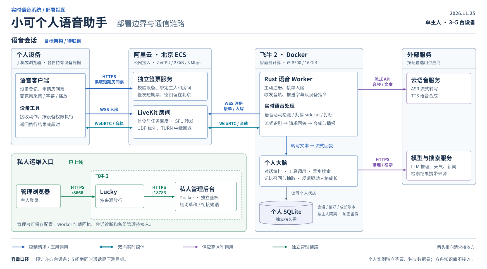

# 小可个人语音助手 · 产品架构

2026-11-25 · 使用对象为一位主人，预计 3–5 台设备。本次交付包括飞牛内网管理入口、交互设计和后续实施架构。

## 1. 一天怎么用

早上在手机上问“今天出门要带伞吗”，小可先说明查的是哪个城市、哪一天，再给简短建议。手机显示预报来源。说到一半可以插话；说“帮我查查深……”时，小可留时间听下半句，超时再问“你想查哪里？”。天气源故障时说明这次没有查到。

下午在电脑上续聊，同一个主人能看到手机上的那次对话。说“以后回答我短一点”，助手可以记录偏好；下次回答旁边能看到引用了哪条偏好，并可以改正。临时会话在开始前选定，不写入长期记忆。换设备不会把手机的麦克风权限或可执行动作一起带过去。

晚上发现一次回答很慢，进私人后台按设备和时间打开那一轮，看用户何时停说、何时转写完成、搜索是否排队、第一段声音何时开始播放。若只保存了草稿，后台显示草稿；收到 worker 加载回执后才显示已生效。这样可以在一次真实通话里定位问题，而不用逐台登录机器找日志。

## 2. 三种界面分工

| 入口 | 打开后最常做的事 | 异常时给什么出路 |
|---|---|---|
| 手机使用端 | 开始说、插话、静音、结束；离开时回到同一条文字稿。正在查资料时可继续说或取消 | 麦克风权限被拒可切文字；断线显示重连与结束。麦克风静音与停止助手播报分成两个动作 |
| Web 使用端 | 语音与打字共用时间线。看搜索卡片、来源、工具结果和记忆出处；选中一条做纠正 | 拒绝工具授权只结束这一步；无需重开聊天。迟到的结果不会插回已取消的轮次 |
| Web 管理端 | 先看是否接入、哪个设备在通话、是否适合变更；再进入词表、语音配置、历史诊断和备份 | 数据源断开显示“未接入”或最后采样时间。单次模拟、真实执行、已经保存、已经生效分别标示 |

手机第一阶段可先用响应式网页验证按键进房、字幕和搜索交互。锁屏长时间通话、后台麦克风、蓝牙耳机切换要在目标操作系统上验证；若浏览器不满足，再加原生外壳。多设备首版采用“谁点开始，谁应答”；主动转移会话要由主人选目标设备。多台同时检测同一唤醒词的仲裁属于后续能力。

## 3. 东西放在哪里

| 地点 | 职责 | 保存什么 |
|---|---|---|
| 北京 ECS | 独立设备登记和签票；LiveKit 负责信令和双向音频转发；支持 UDP 和受限网络的回退 | 设备公钥或凭据摘要、撤销状态、短时会话授权。签名密钥留在北京 |
| 飞牛 2 · 语音 worker | 主动到北京注册，接单入房；处理收音、判停、字幕、打断、语音合成和播放。封装 Rust worker、判停 sidecar 及所需模型和运行库 | 挂载模型、配置版本、必要的短期诊断数据 |
| 飞牛 2 · 个人大脑 | 组织回答、调工具、管理搜索任务；读写用户记忆和人格状态；后台做抽取和成长更新 | 个人独立 SQLite 数据卷、迁移版本、加密备份。音频默认不长期保存 |
| 飞牛 2 · 私人后台 | 登录、配置、诊断、备份与受限维护；通过受限接口获取状态或请求变更 | 管理员会话、配置草稿、操作与加载回执。浏览器不拿云端签名密钥 |
| 设备与外部服务 | 设备执行自己支持的动作并回执。按已选择的供应商调用识别、模型、合成、搜索 | 客户端只保管自己的凭据。云识别会接收相应音频，模型会接收完成本次请求所需的文本；本地保存数据库不等于全程离线 |

一条正常请求的顺序为 **设备申请北京房间票 → 设备和飞牛 worker 进入同一房间 → 飞牛识别并调用个人大脑 → 需要时调工具 → 飞牛把语音发回北京 → 设备播放**。搜索可以慢，前台收音与取消必须能继续工作。设备断线后按会话和轮次校验迟到结果，避免把旧答复播给下一次通话。

### 一个主人，多台设备

设备凭据用于证明“哪台机器”，个人账号用于确定“为谁读写记忆”。服务端从可信会话记录取得主人身份；凭设备提交的一段房间名，不能决定读取谁的档案。单设备撤销后停止发新票；若要求立即踢下线，还要关闭它的活动房间。管理登录独立于设备凭据。管理台的能力不能通过普通语音工具调用。

## 4. 从小可继承哪些能力

| 能力 | 复用与改造 | 交付时怎样证明 |
|---|---|---|
| 普通对话、语音引导、倾听 | 取相应发布线的 worker 行为、状态机、语音引导和倾听策略。组织成个人发布清单，逐个核对普通、搜索、倾听三条线的差异 | 正常结束、插话、退出、失联重连各走一轮。倾听有明确进入、退出、到期与麦克风状态 |
| 快工具与设备动作 | 保留确定性时间查询、设备意图、设备能力清单、下发与回执。影响较大的动作要求明确授权；不支持的硬件动作在此设备上隐藏或解释原因 | 同一句在支持和不支持的设备各测一次。设备离线或回执超时要显示失败，不能由模型宣称完成 |
| 异步搜索 | 保留查询澄清、提交、取消、接续、天气与新闻等既有来源、结果引用和播报。优先验证“帮我查查深”的提前提交问题 | 半句不误发；完整短词及时提交；查到一半取消，再问新题，旧结果不能串轮 |
| 记忆 | 复用对话记录、抽取调度、安全过滤、画像、偏好召回。区分原始对话、已保存偏好和推断；分别提供查看、纠正与删除语义 | A 设备记住偏好，B 设备复述并能标出来源。执行忘记后再查召回，并防止旧抽取任务把它写回来 |
| 人格成长 | 保留风格、关系状态、特质、反馈与成长账本。展示“哪次反馈导致了什么变化”，允许纠正或回退。成长状态需真正参与下一次提示词组装 | 可从一次对话追到状态变化，再看到下一轮确有采用。只有日志新增不能算通过 |
| 日常维护 | 分开保存期望配置、发布版本和 worker 实际加载版本；发布失败可回到上一版，重启前可等待通话清空 | 运行中改草稿不影响当前通话；灰度新会话验证后再切；回滚时查实际版本并发起一次通话 |
| 范围边界 | 排除方舟知识库、方舟事实注入及其后台任务。保留小可自身设定、普通工具和个人记忆。初装创建新的个人实例 | 空数据库可启动，正常功能无须连接 P003 签票、生产数据库或方舟服务 |

已有源码入口包括 [Rust 语音 worker](../rust-worker/src/worker.rs)、[P003 大脑回调](../../P003GameDemo20260513/apps/server/src/routes/custom-llm.ts)、[搜索执行器](../../P003GameDemo20260513/apps/server/src/tools/search-executor.ts) 和[成长账本](../../P003GameDemo20260513/apps/server/src/growth-ledger-store.ts)。现有大脑依赖设备身份和房间映射，迁移时必须替换这一段。裸模型兜底只能视为基础对话降级。

## 5. 容量和发布节奏

11 月 25 日只读核查，北京 ECS 为 2 核、2 GiB、3 Mbps 公网出带宽。之前 24 小时里 1,440 个分钟样本，最高一分钟平均出站约 14.5 Kbps。飞牛 2 为 i5-8500 六核、16 GiB，采样时约 9.9 GiB 可用；飞牛至北京 8 次 TCP 建连约 7.2–11.0 ms。这是试点依据，WebRTC 丢包和语音首响要另测。

按一对一纯音频、每条出站音轨 50–100 Kbps 的预算估算，5 间房同时双向发声为 5 × 2 × 50–100 Kbps，即 0.5–1 Mbps；按两倍余量约 1–2 Mbps。保留现有 ECS。上线判断用真机数据，包含手机流量、家宽晚高峰、有重传或 TURN 回退的会话。北京的 CPU、可用内存、出口，飞牛的 CPU、判停和云模型耗时分别看。

| 次序 | 交付物 | 放行条件 |
|---|---|---|
| 1 · 内网管理入口 | 私人管理员登录、热词草稿和衔接短语配置保存。服务分别显示接入状态 | 局域网浏览器登录、保存、重新载入成功；匿名访问配置拒绝；容器和数据独立 |
| 2 · 一台设备真通话 | 北京独立签票和音频转发、飞牛 worker、个人大脑、手机/Web 基础入口 | 票只进指定房间；听说、字幕、打断、退出有真实结果；P003 生产零依赖 |
| 3 · 能力齐备 | 工具、搜索、倾听、记忆、人格、后台诊断与配置发布 | 完成上一节的能力对照；两台设备验证共享记忆与不同权限；做一次备份恢复与版本回滚 |
| 4 · 五路验收 | 1、3、5 路同时发声，含移动网络与晚高峰 | 建议 5 路持续 30 分钟无掉房、无持续断音；北京出口 P95 <2.1 Mbps；五路首音 P95 相对单路增加不超过 300 ms。记录每档样本数与原始指标 |

后台单独上线时，只给出真实可用的本机配置功能。第二阶段接上 worker 后再显示加载版本、在线设备与并发；第三阶段接上大脑后再显示会话和成长。后台不可用时，已建立的语音房间应能继续；飞牛断线时，北京签票应提示服务暂不可用或超时退出，不能无限等待。

## 6. Grok 的调研怎样影响设计

| 参考 | 可借鉴的做法 | 在本项目中的决定 |
|---|---|---|
| Gemini Live 的会话控制 | 暂停、静音、结束有不同后果 | 手机用文字和图标区分三个动作；结束后回到这一通的文字稿。[Google 官方说明](https://support.google.com/gemini/answer/15274899) |
| Apple 的多设备响应 | 同一声呼叫需要明确哪台设备负责回答 | 当前应答设备始终可见；个人首版先用手动接听与转移。[Apple 多设备说明](https://support.apple.com/en-us/105077) |
| ChatGPT 的记忆管理 | 聊天记录和已保存记忆有不同生命周期 | Web 端可查记忆来源；明确区分从本次回答排除、纠正和彻底忘记。[记忆说明](https://help.openai.com/en/articles/8590148-memory-faq) |
| Home Assistant Assist 调试 | 逐次查看输入、解析、动作与失败阶段，区分预览和实际执行 | 后台按真实通话回看，模拟与真执行分开。诊断录音只有显式打开才留存。[Assist 排障](https://www.home-assistant.io/voice_control/troubleshooting/) |

人格成长采用本项目自己的反馈、特质与成长记录。设计中用可读的变化和来源解释人格，不以虚构的亲密值代替。

## 7. UI Designer 的三套可选方案

三套方案都覆盖手机、Web 对话和后台。设计稿中的设备、对话、指标和按钮使用演示数据。可从上文的内网管理台登录后点“三套设计预览”，也可在本机直接打开[离线交互原型](personal-voice-design/index.html)。

| 方案 | 手机上是什么感觉 | Web 使用面 | 后台维护面 | 适用取舍 |
|---|---|---|---|---|
| A · 暖纸静听 | 暖纸底、深墨文字，字幕和口播内容优先，像跟助手共写一本手记 | 用时间线读长回答，记忆来源像旁注，可以顺手纠正 | 用清楚的列表回看一次对话与变更历史 | 阅读、记忆和人格成长最自然；繁忙时需要额外突出异常 |
| B · 飞牛声学台 | 深色高对比，用短状态词区分在听、播报、打断与等待工具 | 同时观察文字、任务与工具回执 | 将转写、搜索、合成、播放放在可追踪的阶段视图 | 最适合初期联调和日常维护；手机首页要控制指标的数量 |
| C · 柔雾伴生 | 柔和层次与呼吸动效，主控件突出陪伴感 | 轻卡片把状态和来源收进次级层 | 异常点和趋势先呈现，深入后看详情 | 更适合强调陪伴感的使用端；低性能设备和减少动态效果模式需要静态替代 |

**已选方案 C · 柔雾伴生（2026-11-25）。** 手机、Web 对话和飞牛私人管理台共用同一套视觉语言。当前说话者、麦克风状态、工具执行结果用文字说明。用户启用减少动态效果时采用静态外观。A、B 原型保留供历史对照。

[架构图 PNG、SVG 与飞书画板节点源文件（本机）](/data/home-studio/artifacts/realtime-voice-agent/20261125-architecture/) · [方案 C 三端原型原图（本机）](/data/home-studio/artifacts/realtime-voice-agent/20261125-ux/05-glass.png)

私人后台通过 Lucky 的 HTTPS 入口访问。家庭内网、EasyTier 和已核实的公司 Air 出口可访问登录页，读取配置仍需主人鉴权。上游为飞牛 HTTPS 18783。运行组件和验收结果按发布记录更新。

## 8. 当前可交付和下一步

**已经上线**的是[飞牛个人管理实例](../ops/personal-admin/README.md)。内网首版交付管理员登录、五类热词草稿、四种风格的衔接短语概率和三套交互预览。配置保存与 worker 生效分开显示。原型中的模拟诊断、审批、记忆、成长和联网通话依第 5 节分期接入。

下一次实施先让一部手机取得独立北京票，建立到飞牛 worker 的双向通话，将首条真实会话的状态与阶段耗时接入后台；随后以第二台设备验证共享记忆。Lucky 由主人手动配置。
