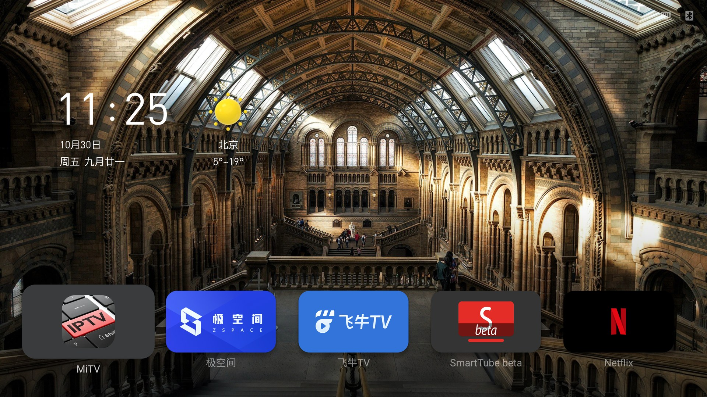

# 电视启动与联网浮窗复盘（2026-10-30）

已部署并完成软件重启验收：网络完整就绪由204.19秒逐步降到45～47秒；当贝桌面右下角自动提示联网状态，成功后约两秒消失。最终版本的物理拔电、SmartTube实际影片、长期稳定性与播放中主出口故障迁移仍未验。本轮只整理归档、共享记忆与技能，不再次操作电视。

## 结果与证据

| 阶段 | 完整网络就绪（同boot uptime） | 结论 |
|---|---:|---|
| 新双栈首次启动 | 204.19秒 | DNS安装抢锁误失败，引发重试 |
| 先验规则再互斥修复 | 77.30秒 | 消除健康规则下的误停和等待 |
| 只优化事务/主代理扫描 | 51.15秒 | 尚未达到40～50秒目标 |
| 再优化worker跨boot扫描 | 46.60 / 45.07秒 | 两次同版本软件重启通过 |
| 安装联网浮窗后实际重启 | 46.91秒 | 独立审计48.80秒完成 |

启动实现与测试细节见[优化结果](2026-10-30-电视启动40至50秒优化结果.md)；
浮窗[首次安装验收](smarttube-tv/tv-network-status/ACCEPTANCE-20261030.json)与
[后续真实重启验收](smarttube-tv/tv-network-status/ACCEPTANCE-20261030-REBOOT.json)分开保留，不把早先“未重启”当成最新结论。

真实重启boot：`2714f7ac-4b17-4e60-86a2-ae54c375f673`。

| 事件 | 启动后秒数 | 自动/人工 |
|---|---:|---|
| watcher开始 | 10.49 | 自动 |
| 桌面等待窗显示 | 25.879 | 自动 |
| DIYP前台，浮窗隐藏 | 35.955 | 自动 |
| HOME回桌面，等待窗重现 | 37.870 | 人工HOME用于验收 |
| 真实ready文件匹配当前boot | 46.91 | 自动 |
| 成功态实际绘制 | 47.215 | 自动 |
| 成功窗移除 | 49.296 | 自动，显示2081ms |
| service完成 | 49.308 | 自动 |
| watcher结束 | 50.02 | 自动 |

后续无窗口/service残留，ready、done与当前boot匹配，代理release/manifest及事务外资产SHA保持，5354真实DNS通过。
中途主动返回桌面才能看到成功态，所以不能说成功画面展示“全程无人操作”。

## 经验与教训

1. **先解释每个时间戳属于哪一层。** 旧53.57秒是脚本检查点，不是Android启动耗时。优化后Android完成门约24秒、DNS查询约33秒；系统/应用缓存门仍到45～47秒。不能提前写ready，也不能用墙钟跨校时比较进程先后。
2. **提速保留安全语义。** 高频shell全/proc扫描改为native完整扫描，继续验exe/完整argv/PID/startticks、锁前锁后与摘要。异常退回旧shell。worker仍串行，校时、防护、业务配置不删不改。微基准不相加承诺收益，限速1MiB载荷不当测速。
3. **部署对象包含启动事务和回退入口。** v2现在恰16文件，v1为15、legacy为9；以live stage/profile/manifest为准。回滚后固定入口认`rolled_back_preserved`避免重装坏包；外部资产以`boot-assets-current.json`为准。
4. **浮窗独立、只读真实状态。** APK无INTERNET，不读私密代理目录；root watcher只传非敏感阶段，服务受DUMP权限保护，普通应用调用实测被拒。仅当贝桌面显示，不收焦点/触摸，切播放隐藏；订阅实测前台事件，低频快照校验，成功后彻底退出。
5. **两秒从实际绘制算。** 重复ready心跳不得延长，计时用monotonic。私有屏可验真实WindowManager和flags，但不能代替真实开机桌面。4K截图传输6～8秒，首两张超时漏拍等待态；时长靠同boot日志与实际画面互证，不能改生产时长或伪造ready来补图。
6. **恢复应用走正常入口。** 一次root直接拉起DIYP内部PlayerActivity跳过ForceTV native初始化，造成UnsatisfiedLinkError；shell直接启还会被non-exported拒绝。已从当贝MiTV图标恢复1080p，连续帧425→1080，drop/软硬解码错误0。以后不要用内部Activity替代正常初始化；这不是代理或浮窗故障，不改播放器数据。
7. **按应用与版本写验收范围。** DIYP实播不代表SmartTube影片通过；旧版10-24断电通过不继承给10-30新版。只读审查、隔离回放、软件重启、物理拔电各自标明，历史失败和人工步骤不删。

## 截图

下面是当时真实物理桌面截图的1920×1080缩放副本，再压缩为JPEG归档；没有添加或重绘提示。PNG和原始4K图的SHA见[截图清单](smarttube-tv/SCREENSHOTS-20261030.json)。截图返回时间不能用来测提示持续时间。

原始证据位于本机`/tmp/tv-net-reboot-20261030/`，属于临时工作证据；可长期复查的脱敏时序、两张截图和验收JSON已随本报告归档。

## 源码、技能与发布

- 实现真源：`~/home-lan`，commit `c15f0b693f919caa0ee2870102cc722d22f21445`。该仓没有远端，沿用现有私有mycc归档方式。
- [源码快照](smarttube-tv/README.md)：原56文件保持，加独立浮窗15文件，共71文件；[清单](smarttube-tv/SOURCE-MANIFEST.json)记录已提交blob的SHA、大小和Git模式。签名、生产配置、节点URI、账号、原始日志及二进制不入仓。
- 更新[xray技能](../../.claude/skills/xray/SKILL.md)及多引擎入口；新增[启动与浮窗参考](../../.claude/skills/xray/references/tv-startup-status.md)，修正[冷启动参考](../../.claude/skills/xray/references/tv-dns-coldboot.md)的旧事务现状。
- 更新`0-System/RECENT_EVENTS.md`、`memory-items.md`、`task-log.md`；共享状态在仓外，另保留[可追踪记忆增量](smarttube-tv/MEMORY-20261030-STARTUP-STATUS.md)。
- Grok经Codeg只读复核既有证据（task `52badeb0-6229-47d0-b512-178605596c7a` / 会话309），提出五条教训并识别九文件旧描述；没有连接电视或复跑生产验收。
- 本次在基于远端main的隔离worktree归档，连同此前三个同任务本地提交普通push；提交前核来源、链接、JSON、技能结构、差异和敏感信息，不混入主目录其他任务修改。最终提交ID与远端回读收据追加到共享记忆。

署名：codex（OpenAI）| 2026-10-30
