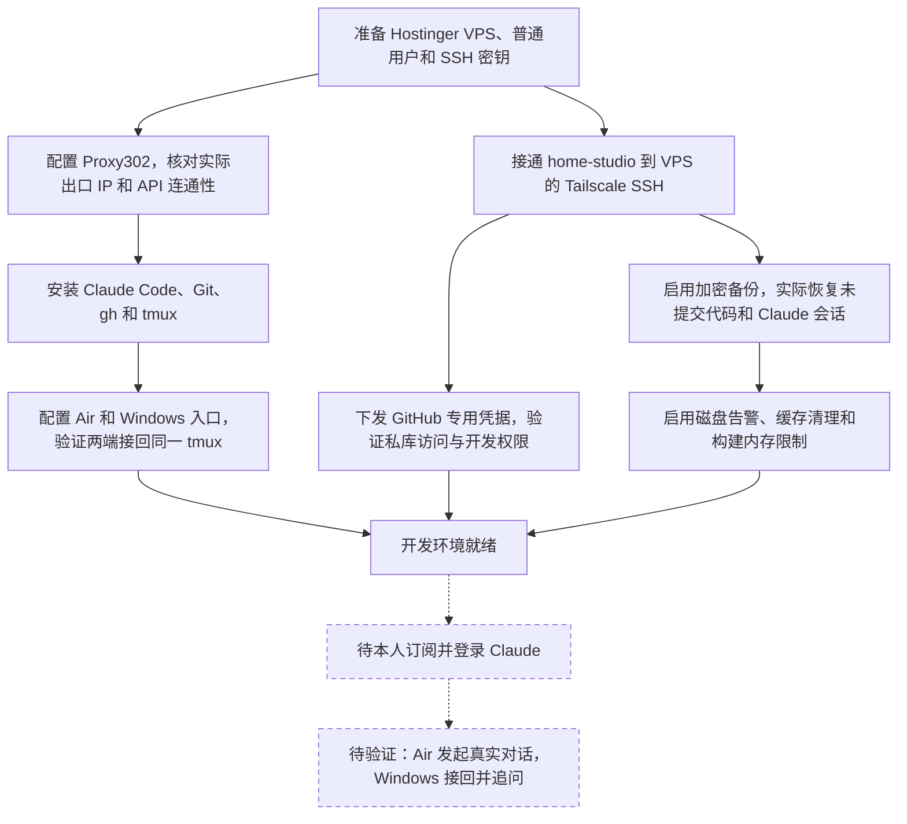
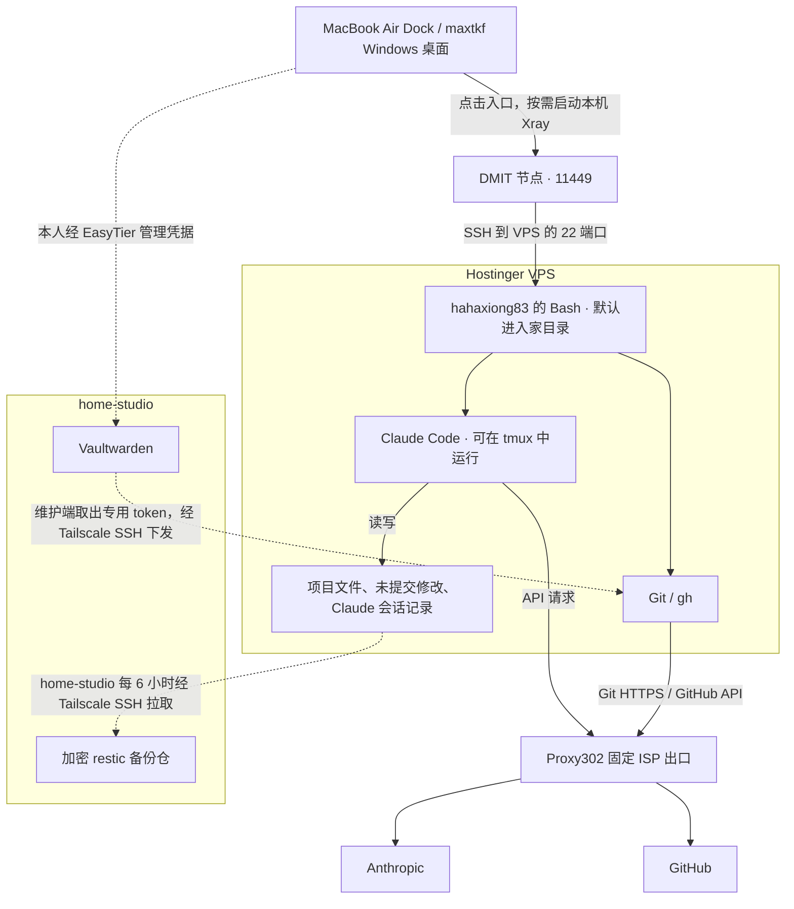

# Hostinger VPS + 固定家宽出口部署 Claude Code

**定稿日期：2026-11-26**

适用对象：川哥在 MacBook Air 和 maxtkf Windows 上使用的「Hostinger Claude」开发环境。

## 一、先看这套环境解决什么问题

你可以在两台电脑上点同一个名字的入口，操作同一台长期在线的 Linux 开发机。Claude Code、代码、Git 凭据和会话都放在 Hostinger。你换电脑，变的是键盘和屏幕；项目和历史仍在原处。Hostinger 上的 Claude Code 通过指定的 Proxy302 家宽/ISP 代理访问服务，日常不必在两台电脑上分别安装、配置和登录 Claude Code。

这里大家习惯说的“防封”，工程上能做到的是**使用可核验的固定出口，减少意外切换，并在出问题时查明是哪一段故障**。本次实测能证明公网请求从指定 IP 发出；“住宅/ISP”是供应商对线路的描述，单凭 IP 检测无法证明地址的物理接入类型。账号资格、支持地区、订阅和平台审核仍由 Anthropic 决定。已有账号封禁应走官方申诉；更换出口或解除 GitHub 授权均不能证明旧记录已消除。[Anthropic 支持地区](https://www.anthropic.com/supported-countries) · [账号限制与申诉](https://support.claude.com/en/articles/8241253-safeguards-warnings-and-appeals)

**当前状态：开发环境和配套运维已部署。** 两台电脑进入同一 VPS、指定出口、GitHub 开发权限、异机备份和离线会话恢复都有验收记录。Claude 订阅后的首次登录、真实模型答复和跨电脑追问尚待验收。

## 二、部署流程与运行架构

### 图 1　从空机到首次在线验收

实线步骤已完成。末尾两个虚线框是订阅就绪后才做的在线验收。



### 图 2　日常使用时，连接和数据怎么走



- **DMIT 解决打字回显。** 远端看到 SSH 从 DMIT 进来是预期结果。11449 是两台电脑所用的 DMIT 节点端口，VPS 的 SSH 服务端口是 22。
- **Proxy302 决定应用的 HTTPS 出口。** 它配置在 VPS 的开发用户环境里。SSH 走哪条路，和新启动的 Claude 进程使用哪个代理，是两件可以分别验证的事。
- **Tailscale 用于维护。** home-studio 通过它下发指定凭据、拉备份。你在 Air 或 Windows 上访问密码库时可沿用 EasyTier；正常运行 Claude 不需要 VPS 登录密码库。

## 三、准备清单

| 需要什么 | 本次使用的配置 |
|---|---|
| 一台持续在线的 Linux VPS | Hostinger，Ubuntu 26.04.1 LTS；内存约 7.7 GiB，根盘约 96 GiB。机器用于交互开发和轻量构建。 |
| 一个普通开发用户 | `hahaxiong83`，默认目录 `/home/hahaxiong83`。项目建议放 `~/mycc/2-Projects/`。 |
| 一条允许该 VPS 使用的固定 ISP 出口 | Proxy302 提供代理主机、端口、认证方式和预期出口地址。这几项从私有渠道取得。代理连接地址和最终对外显示的 IP 可以不同。 |
| SSH 接入 | Air、Windows 各自一把私钥；VPS 保存对应公钥。两端都校验 VPS 主机密钥。DMIT 是现有的交互加速选项。 |
| 开发工具 | VPS 安装 Git、GitHub CLI（gh）、tmux、Claude Code。Air 和 Windows 提供终端即可。 |
| 运维端 | home-studio 的 Vaultwarden、Tailscale、已挂载的数据盘和 restic。GitHub token、代理口令、SSH 私钥及备份仓密码均不写入本文。 |

## 四、从空机部署的顺序

### 1. 先把 VPS 的普通用户和 SSH 配好

在 Hostinger 面板保留一个可用的控制台恢复入口。创建开发用户和工作目录，把每台已授权电脑的**公钥**加入该用户的 `~/.ssh/authorized_keys`。权限分别设为 `700`（.ssh 目录）和 `600`（authorized_keys）。通过面板控制台或已信任的管理连接核对 SSH 主机公钥指纹，再让客户端信任它。

先从新终端用密钥登录，跑 `id -un`、`hostname` 和 `pwd`。本机预期分别是 `hahaxiong83`、`hahaxiong-dev` 和 `/home/hahaxiong83`。确认应急入口和密钥都能独立使用，再安排 sshd 加固。

**当前实机还有一项待加固。** 有效配置允许 root 登录和密码认证，开发用户可免密 sudo。已下发的 GitHub 凭据也对该开发用户下运行的 Claude Code 可用，这是川哥确认的权限安排。公网登录策略应另开变更，在保有控制台和第二条已验 SSH 连接的条件下处理。

### 2. 把固定出口配置给真正运行 Claude 的用户

本机采用登录环境变量。实际生效位置如下：

| 位置 | 用途 |
|---|---|
| `~/.config/proxy302.env` | 由开发用户持有，实测权限为 `600`。保存代理配置。 |
| `/etc/profile.d/proxy302.sh` 和 `~/.bashrc` | 按相应 shell 启动方式读取用户配置。登录 Bash 已实测拿到代理变量。 |
| `~/.claude/settings.json` | 当前只含主题、更新通道。Claude CLI 继承启动它的 shell 环境。 |
| Git 配置 | 当前未另设 Git 专属 http.proxy；GitHub remotes 使用 HTTPS，gh 为 Git 提供凭据。 |

重建时，先通过私有 SSH 通道配置用户环境文件，使用供应商交付的**真实协议和认证信息**。下面只展示字段形状。尖括号是占位符，含凭据的实际 URL 不要粘贴进聊天、Git 或命令历史。

```bash
# ~/.config/proxy302.env 的结构示例
export HTTPS_PROXY='<供应商交付的完整代理 URL>'
export HTTP_PROXY="$HTTPS_PROXY"
export https_proxy="$HTTPS_PROXY"
export http_proxy="$HTTP_PROXY"
export NO_PROXY='localhost,127.0.0.1,::1'
export no_proxy="$NO_PROXY"
```

在登录脚本里只引用文件：`[ ! -r "$HOME/.config/proxy302.env" ] || . "$HOME/.config/proxy302.env"`。本次代理上游协议实际是 `http://`。目标网站的 HTTPS 仍可使用 TLS，但 VPS 到代理之间的代理认证信息缺少这一跳的 TLS 保护。如果供应商提供受支持的 HTTPS 代理地址，可单独验证再迁移。不要仅把原地址的协议字符串改成 https。

新开一个「Hostinger Claude」终端做以下验收。第一条只看代理是否已设置，不输出代理值；第二条只在自己的终端显示本次出口；第三条不携带 Claude 凭据。

```bash
test -n "${HTTPS_PROXY:-}" && echo 'HTTPS 代理已加载'
curl -fsS --max-time 15 https://api.ipify.org && printf '\n'
curl -sS --max-time 15 -o /dev/null -w '%{http_code}\n' https://api.anthropic.com/v1/models
```

2026-11-26 在 VPS 的新登录 shell 复测：出口与此前记录的 Proxy302 固定 IP 一致，Anthropic 返回 **401**。这验证了当时的代理路径和未认证 API 连通性。旧 tmux 中已经运行的进程可能继承了旧环境；修改代理后应在新 shell 中启动需要复验的程序。此部署按应用使用代理，未部署整机透明代理或全机断网保护。[Claude Code 官方网络配置](https://code.claude.com/docs/en/network-config)

### 3. 安装 Claude Code，先验安装，再验账号

用系统包管理器安装依赖，例如 `sudo apt-get install git gh tmux curl ca-certificates`。在已加载代理的普通用户 shell 中，按官方原生安装方式安装 Claude Code。本机采用 stable 通道，可执行文件在 `~/.local/bin/claude`。若需重建，官方安装方式和下载地址以当时文档为准。[Claude Code 安装说明](https://code.claude.com/docs/en/setup)

```bash
command -v claude git gh tmux
claude --version
mkdir -p ~/mycc/2-Projects/claude-workspace
```

历史验收版本为 **Claude Code 2.1.326**。桌面入口默认停在 Bash，你可以先运行 Git 或其他命令。以后准备好订阅并决定登录时，再从目标项目目录运行 `claude`。浏览器打开授权页属于浏览器自己的网络请求，终端的代理环境不会自动传给 Air 或 Windows 的浏览器。若终端里的授权链接太长，使用终端复制功能，核对整条链接；授权链接和验证码应只用于本人登录。

### 4. 配两台电脑的桌面入口

| 电脑 | 用户看到的入口 | 它实际执行的动作 |
|---|---|---|
| MacBook Air | Dock 中的「Hostinger Claude」 | 桌面启动器调用 `~/.ssh/hostinger-11449/launch.py`，按需拉起客户端转发，再用 Air 自己的 SSH 密钥连 VPS。 |
| maxtkf Windows | 桌面的「Hostinger Claude」快捷方式 | 调用 `%LOCALAPPDATA%\HostingerClaude\launch.py`，使用 Windows 本机的转发进程和 SSH 密钥。 |

VPS 的共同入口是 `~/.local/bin/hostinger-claude`。目前实际行为等价于：

```sh
#!/bin/sh
set -eu
cd "$HOME"
exec /bin/bash --login -i
```

所以日常只需点图标，本地启动器会自行拉起这次 SSH 所需的 Xray，无需先手工打开系统 v2ray 代理。每个窗口都有自己的 shell。新建客户端时，应从受信任的私有配置恢复节点参数、客户端程序和主机指纹，给新机单独授权 SSH 公钥，再创建桌面快捷方式。本文和代码仓中的运维脚本不含节点认证材料。

**为什么桌面端选 DMIT 11449？** maxtkf 对同一 VPS 实测，11449 的打字回显中位数为 272 ms，P90 为 283 ms；同批经丽萨为 279/291 ms。另一批测试中，Tailscale 直连为 534/662 ms，公网直连为 596/1094 ms。11449 的 SFTP 上传约 13.2–13.9 Mbps，下载约 9.3–11.6 Mbps。这些是当时 Windows 线路的样本。Air 已验实际入口和接续，未独立做这组测速。旧记录中的 **11448 已绑定 Proxy302，11443 经丽萨，当前桌面 SSH 用 11449**。[双端入口与测速记录](2026-11-26-Hostinger-Claude-远程开发交接.md)

### 5. 配好换电脑继续工作的方式

要让任务在关掉电脑后继续，先在 VPS 的 tmux 会话里启动它。本机已有名为 `hostinger-claude` 的会话。日常可这样接入：

```bash
tmux new-session -A -s hostinger-claude
```

如果接回的是已有程序，会看到它原来的画面；如果新建后出现 shell 提示符，先 `cd` 到项目再运行 `claude`。离开时按 **Ctrl+B**，松开后再按 **D**。换到另一台电脑，点入口后执行同一条 tmux 命令。这样接回的是同一个正在运行的终端。VPS 重启后要找回保存过的对话，可从原项目目录使用 `claude --resume`；内存中尚未落盘的进程状态不能靠它恢复。

已有两种实证：两台电脑接回过同一 tmux/CLI；真实 Claude CLI 也已在离线演练中从恢复文件按原会话 ID 续接。**最终在线验收**可用一句简单的问题：在 Air 上让 Claude 读取测试文件中的一句话，分离 tmux，再从 Windows 接回并追问那句话。等本人登录后再做。

### 6. 配 GitHub 和其他开发凭据

GitHub 用专门签发给 Hostinger 的 fine-grained token。要读写个人账号的全部代码仓和创建、更新 PR，在个人账号名下选择 All repositories，授予 Contents 和 Pull requests 的读写权限。组织仓按组织单独授权；分支保护照常生效。[GitHub token 权限说明](https://docs.github.com/en/authentication/keeping-your-account-and-data-secure/managing-your-personal-access-tokens)

你通过 EasyTier 在 home-studio 的 Vaultwarden 保存 token，提供条目名和用途即可。维护端通过 Tailscale SSH 将这一枚 token 交给 VPS 上的 gh，再用 `gh auth setup-git` 接好 Git。其他脚本凭据也只按需下发；密码库的主密码和解锁会话留在 home-studio。GitHub CLI 登录与 Claude 网站上的 GitHub 连接器各自授权。

实测 gh 身份是 `Hahaxiong838383`，曾列出 28 个未归档的个人私库，并抽查私库读取 HEAD、推送 dry-run 和 PR 写接口校验。没有为了测试创建正式 PR。新终端可自行执行 `gh api user --jq .login`，再对一个已知**私库**执行 `git ls-remote <私库HTTPS地址> HEAD`。公开仓读取无法验证私库凭据。

### 7. 配备份、告警和资源保护

从零重建时，先配好 home-studio 与 VPS 的 Tailscale SSH 和可信主机密钥，再运行配套安装程序：VPS 端 `hostinger-protection/install-vps`；home-studio 端准备好数据盘、原仓密码和私有 SSH 配置后运行 `hostinger-protection/install-studio`。只有新建备份仓才使用 `--init`。安装前提、文件位置、恢复和退回步骤都已落在[完整备份与容量部署手册](hostinger-protection/README.md)。

| 日常事项 | 已部署的行为 |
|---|---|
| 备份与恢复 | home-studio 每 6 小时拉取工作区、.git、未提交文件和 Claude 会话到数据盘上的加密 restic 仓。保留近 48 小时全部快照、7 个日点、4 个周点。超过 12 小时无成功备份会告警。 |
| 防磁盘写满 | 剩余 20/10/5 GiB 分级处置，并监视 inode。低空间仅自动清理 APT 缓存和归档日志；严重时挡住新的受管构建。源码和会话不做自动清理。 |
| 限制重任务 | make、gmake、常规 git clone 已接入；安装依赖、大型测试用 `hostinger-build 命令`。受管任务单项及合计内存软限 4 GiB、硬限 5 GiB。 |
| 实际做过的恢复 | 从生产快照恢复已修改文件、未跟踪文件和 Claude JSONL，三份 SHA-256 均与源端一致；用真实 CLI 在断网副本上打开原会话，成功追加第二条用户消息。整机恢复点及从 NAS 再回读新仓库尚未验证。 |

## 五、出问题时先看哪一段

| 看到的现象 | 第一项检查 |
|---|---|
| 点图标连不上，或打字慢 | 检查本机启动器、DMIT 11449 和 SSH。home-studio 可走 Tailscale 交叉验证 VPS 是否在线。 |
| SSH 很快，但 Claude 或 gh 请求失败 | 在同一远端登录 shell 核对代理是否加载、实测出口是否一致，再看服务响应。不要把含认证信息的环境变量整份打印出来。 |
| API 返回 401 | 用无凭据探针时这是预期结果。实际登录后仍收到 401，转查应用认证。账号提示订阅、地区或审核问题，应按平台提示处理。 |
| 换电脑看到空白命令行 | 这是桌面入口的正常默认画面。用 `tmux ls` 查看，再接回相应会话。 |
| 代码或历史不见了 | 先确认 VPS 用户和项目目录。再到 home-studio 选出事前的快照，恢复到新目录比对，避免覆盖当前工作。 |

## 六、部署记录与验收依据

- [Codeg 原会话 550](codeg://session/550) 用来还原初始需求、代理方案，以及终端和桌面方案的取舍。会话中讨论过的透明代理、全机改路由、Claude Desktop SSH 和 settings.json 注入代理，没有作为当前实装写入。
- 后续会话、共享记忆 `project/Hostinger-Claude`、近期事件和双端交接记录，用来核对 DMIT 端口分工、启动目录、GitHub 授权等变更。出现早晚记载冲突时，以后续实测为准。
- 定稿前只读核对了 VPS 的登录环境、代理文件权限、出口、未认证 API 响应、gh 身份、tmux 会话及 sshd 生效配置。端口测速和备份恢复沿用已记录的实测，未重复制造测试流量或改动服务器。

重建一台全新机器仍需通过私有渠道取得本方基础设施参数和对应授权。
