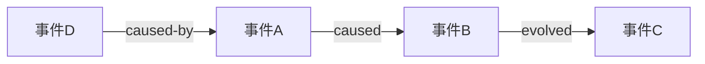

# 意识理论与 mycc 认知架构映射

> 六大意识理论对 AI Agent 系统设计的指导框架
> 沉淀时间：2026-03-31
> 理论来源：Butlin et al. (2023) AI 意识评估框架 + Anthropic 内省觉察研究 (2025)

---

## 一、为什么意识理论与 Agent 设计有关

意识理论不是在讨论「AI 有没有感觉」，而是提供了一套**信息处理架构的设计指南**：
- 什么信息需要全局共享（GWT）
- 什么时候系统需要自我监控（HOT）
- 信息如何整合才不会碎片化（IIT）
- 反馈循环是必要的还是可选的（RPT）
- 需不需要对注意力本身建模（AST）
- 预测和误差修正如何驱动学习（PP）

每个理论对应一种**可工程化的设计模式**，对减少幻觉、提高自主性、降低摩擦有直接价值。

---

## 二、六大理论速查

| 理论 | 核心主张 | cc 中的对应机制 | 评分 |
|------|---------|---------------|------|
| **GWT**（全局工作空间） | 信息广播到全局，多模块并行访问 | context window + RECENT_EVENTS + 三引擎共享 | ★★★★ |
| **HOT**（高阶理论） | 对自身状态的二阶表征 | evolution-log + friction-patterns + 置信度自评 | ★★★☆ |
| **IIT**（整合信息） | 信息的因果整合度决定意识量 | memory-items 双命名空间 + RRF 融合（缺因果图） | ★★★☆ |
| **RPT**（循环处理） | 循环反馈产生意识处理 | BRO-PDCA 多层循环 + failure-escalation 递归 | ★★★★ |
| **AST**（注意力图式） | 大脑建模自身注意力 | blackboard 实时注意力状态 + 社会注意力路由 + 负载自动计算 + 认知镜子 | ★★★★ |
| **PP**（预测处理） | 持续预测 + 误差最小化 | 双时间戳预测 + friction 误差检测 + PP 协议 | ★★★☆ |

---

## 三、已实施的改进（2026-03-31）

### P0 级（立即生效，改 prompt/模板）

| 改进 | 理论 | 文件 | 内容 |
|------|------|------|------|
| 预测-修正循环 | PP | `3-Thinking/01-BRO-PDCA方法论.md` | D 阶段增加「预期结果声明」+ 惊讶度量表 |
| 置信度自评 | HOT | `CLAUDE.md` | 关键决策标注高/中/低置信度，低置信先确认 |
| 持续验证循环 | RPT | `CLAUDE.md` | 普通/完整档里程碑执行验证循环，与 failure-escalation 衔接 |

### P1 级（已实施 2026-03-31）

| 改进 | 理论 | 文件 | 内容 |
|------|------|------|------|
| 因果关联链引擎 | IIT | `context-loader.ts` | `resolveCausalChains()` — 解析 `→caused:` / `←caused-by:` / `→evolved:`，命中时沿因果链扩展召回（0.5x boost） |
| 注意力图式 | AST | `status-updater.ts` + `0-System/blackboard.md` | status.md 新增「注意力图式」section，从 blackboard.md 读取聚焦/负载/选择原因 |
| 因果关联标记规范 | IIT | `docs/memory-system.md` | v6 因果标记写入规范 |

### P2 级（已实施 2026-03-31）

| 改进 | 理论 | 文件 | 内容 |
|------|------|------|------|
| 多引擎信息黑板 | GWT | `0-System/blackboard.md` + `multi-agent/RULES.md` | 三引擎共享状态面板：引擎状态/共享上下文/待接力任务 |

### P0 级（已实施 2026-04-01，AI 史纲启发）

> 来源：飞书知识库《经典AI：符号主义、连接主义与统计学习（1943–2011）》读后启发

| 改进 | 启发来源 | 文件 | 内容 |
|------|---------|------|------|
| 记忆实时写入门 | LSTM 输入门 | `CLAUDE.md` | 关键事件发生时立即追加 RECENT_EVENTS，不等 Session 结束 |
| 历史摩擦预查 | Dyna 架构"在想象中预演" | `3-Thinking/01-BRO-PDCA方法论.md` | P1 阶段检索 trajectories/Bug-Fix/friction 历史，提前规避已知坑 |
| 探索温度 × 档位映射 | 玻尔兹曼机温度参数 | `3-Thinking/01-BRO-PDCA方法论.md` | 简洁=低温直接执行，完整P=高温广泛探索，D/C=降温收敛 |

### P1 级（已实施 2026-04-01，代码改动）

| 改进 | 启发来源 | 文件 | 内容 |
|------|---------|------|------|
| Hebbian 免疫遗忘 | LSTM 遗忘门 + Hebbian 学习 | `dream-consolidation.ts` | access_count ≥3 的 item 免于时间衰减归档 |
| Hopfield 串扰检测 | Hopfield 网络串扰 | `dream-consolidation.ts` | Dream Step 3.5: Jaccard 相似度检测同 category 内冲突对 |
| 检索迭代收敛 | Hopfield 多步状态更新 | `context-loader.ts` | RRF top-1 score < 0.025 时触发二轮 TF-IDF 检索 |

### P2 级（已实施 2026-04-01，规则/文档改动）

| 改进 | 启发来源 | 文件 | 内容 |
|------|---------|------|------|
| HOT 元认知触发器 | 专家系统确定性因子 + HOT 升级 | `CLAUDE.md` | 4 种自动触发信号（方案振荡/用户纠正/惊讶连续高/摩擦累积）→ 元认知反思 |
| PP 惊讶度累积学习 | 玻尔兹曼机正相-负相对比 | `01-BRO-PDCA方法论.md` | 高惊讶度记入 evolution-log 热力图，月度分析识别预测盲区 |
| 规则复杂度管控 | 专家系统"规则爆炸"教训 | `skills/metaclaw/SKILL.md` | Step 4.5: 四维阈值监控（CLAUDE.md/skills/memory-items/friction-patterns） |

### IIT 因果链可视化规范（2026-04-01 定义，待首次生成）

> 启发来源：IIT（整合信息理论）—— 信息的因果整合度决定系统"意识"水平。
> memory-items 中已有因果标记（`→caused:` / `←caused-by:` / `→evolved:`），但缺可视化。

**生成规则**（由 MetaClaw report 模式触发）：

1. 扫描 `memory-items.md` 中所有因果标记
2. 构建有向图：`A →caused: B` 表示 A 导致了 B
3. 输出 Mermaid 格式到 `0-System/causal-graph.md`



**可视化目标**：
- 识别因果链的**枢纽节点**（被最多条目引用的事件/决策）
- 识别**孤立节点**（无因果连接的 item → 可能是信息碎片，需合并或删除）
- 度量因果整合度 Φ 的近似值：`Φ ≈ 有因果连接的节点数 / 总节点数`

**触发条件**：MetaClaw report 模式 / 月度自省时自动执行。

### 未来方向

| 改进 | 理论/启发 | 说明 |
|------|----------|------|
| 执行过程持续验证泛化 | RPT | 不仅失败时循环，正常执行也做轻量验证 |
| 注意力负载自动计算 | AST | 根据 context window 使用率和活跃任务数自动估算负载 |
| 因果链自动代码生成 | IIT | context-loader 中的 `resolveCausalChains()` 自动输出 Mermaid（需改代码） |
| Engram U 形配比实验 | DeepSeek Engram（知识/推理分离） | context window 中记忆注入 vs 推理空间的最优占比 A/B 实验（待触发：下次 context-loader 调优时） |

---

## 四、注意力图式框架（AST）

> 当前 mycc 最弱的维度。以下为设计规范，渐进实施。

### 注意力状态模型

cc 在处理任务时，内部维护一个隐式的注意力状态：

```
当前聚焦：[任务/主题]
注意力负载：[1-5]（1=空闲，5=过载）
被抑制的：[其他待处理但暂时搁置的任务]
选择原因：[为什么选择当前焦点而非其他]
```

### 实施方式

**短期**（prompt 层面）：
- 在完整档任务的 P1 阶段，显式说明「为什么优先处理这个而非其他」
- 在多任务并行时，向用户说明注意力分配策略

**中期**（系统层面）：
- status.md 的「当前焦点」扩展为包含注意力负载和选择原因
- 多智能体协同时，为每个 agent 维护注意力图式

**长期**（架构层面）：
- 引入显式的 priority arbiter，自动评估和分配注意力
- 当注意力过载时自动触发任务降级或排队

---

## 五、理论间的关系

六大理论不是互斥的，它们描述了认知系统的不同侧面：

```
         PP（预测引擎）
            ↕
GWT（全局广播）←→ HOT（元认知监控）
            ↕              ↕
RPT（循环反馈）    AST（注意力建模）
            ↕
     IIT（因果整合）
```

- PP 提供预测信号 → GWT 决定哪些信号广播到全局
- HOT 监控 GWT 中的信息质量 → AST 建模注意力本身
- RPT 在各层之间建立反馈循环
- IIT 衡量整个系统的信息整合程度

**实践启示**：不要孤立地实施某个理论的改进，应该考虑它们的协同效应。

---

## 六、评估与迭代

### 如何验证改进有效

| 指标 | 测量方式 | 目标 |
|------|---------|------|
| 摩擦频率 | task-log 中 friction_skill 非「—」的比例 | 降低 |
| 自主决策质量 | 🔴🟡 级自进化的成功率 | 提高 |
| 预测准确度 | PP 协议中「惊讶度=高」的频率 | 降低 |
| 首次正确率 | 任务不需要返工的比例 | 提高 |

### 迭代节奏

- 每 2 周回顾一次本文档，对照实际摩擦数据调整评分
- 新理论研究出来后（theory-radar 抓取），评估是否需要更新框架
- P1/P2 级改进根据实际需要渐进实施，不急于一次全部上线

---

*参考文献：*
- *Butlin et al. (2023) "Consciousness in AI: Insights from the Science of Consciousness"*
- *Anthropic (2025) "Emergent Introspective Awareness in Large Language Models"*
- *Steyvers & Peters (2025) "Metacognition and Uncertainty Communication in Humans and LLMs"*
