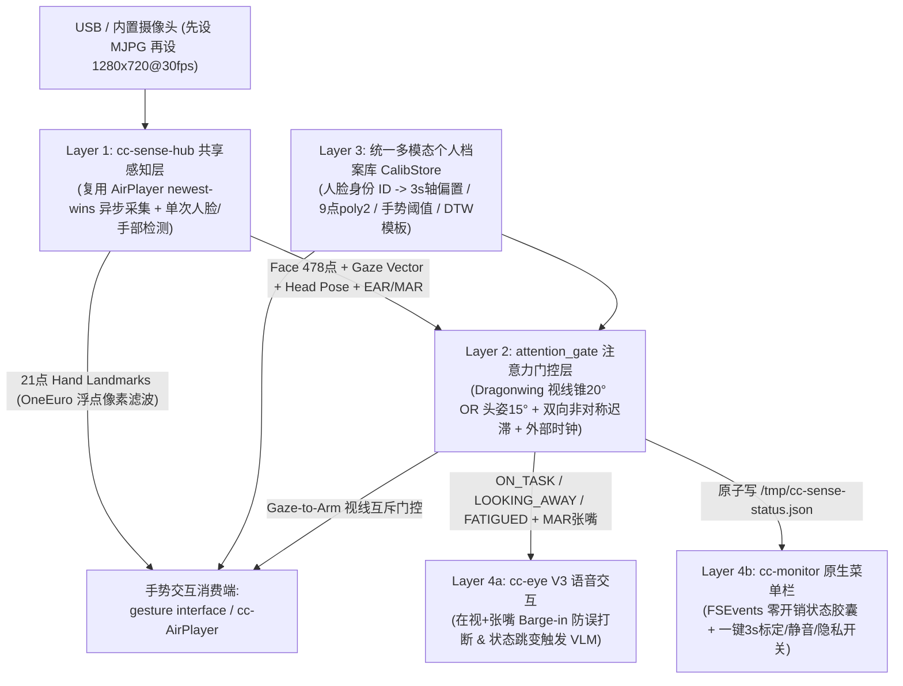

# Dragonwing IQ-9075 视线注意力监控源码分析与多模态项目整合方案

> 日期：2026-11-28  
> 外部对标：[Eye Gaze Attention Monitoring on the Dragonwing IQ-9075](https://www.hackster.io/s4muela/eye-gaze-attention-monitoring-on-the-dragonwing-iq-9075-67ec1c)（作者 Samuel Alexander / `s4muela`，源码仓 `SamuelAlexander/dragonwing-gaze-attention`）  
> 本仓对标项目：`2-Projects/gesture interface/`（v3.9.2）、`cc-AirPlayer`（v4.18）、`2-Projects/cc-eye/`（V3.6 Jarvis）、`2-Projects/cc-monitor/`  
> 用途：沉淀边缘级联视觉管线工程真值，指导四项目跨模态感知底座、防误触门控、菜单栏可观测性与 RK3588 NPU 移植收敛。

---

## 一句话结论

**判断**：`dragonwing-gaze-attention` 并非高精度眼动追踪器，而是一份**把 15° 粗精度边缘小模型做出工业级稳定注意力状态判定的实战范本**。

对比本仓四个多模态相关项目：
1. **单点上限已领先**：`gesture interface` 的信号源（ETH-XGaze ResNet18 + 二阶多项式 + `FixationGate` + 捏取隐式校准 + `OneEuroFilter`）精度远高于该文的 `EyeGaze`；`cc-AirPlayer` 的 4 线程 `newest-wins` 异步架构、4 态运动学分段、DTW 个人模板匹配与 HaGRID 130 万手离线回放 CI 更是成熟产品级资产。
2. **系统协同存在断层**：四个项目各自直连 `cv2.VideoCapture(0)` 互斥抢占摄像头；`gesture interface` 卡在单线程同步 I/O（19 FPS）与双重人脸检测；`cc-AirPlayer` 缺“看屏幕才解锁手势（Gaze-to-Arm）”的跨模态总闸门；`cc-eye` 的 `state_fusion.py` 未接入 V3 主循环且仅靠 `yaw` 判专注（低头看手机极易假阳性）；`cc-monitor` 具备零开销 `FSEvents` 菜单栏壳却尚未接入物理感知态。
3. **最优整合路线**：不合并成臃肿大单体，而是抽离极薄的**共享感知层（`cc-sense-hub`）+ 轻量注意力门控模块（`attention_gate.py`）**，让四个项目双向复用彼此与 Dragonwing 项目的最佳工程范式。

---

## 一、外部项目源码与实测事实拆解（Dragonwing IQ-9075）

> 以下数据均核自 `SamuelAlexander/dragonwing-gaze-attention` 源码（`scripts/gaze_common.py`、`scripts/attention.py`、`scripts/check_fusion.py`、`scripts/eval_mpiigaze.py`、`scripts/sched_cost.py`）及实机测试结果（`results/*.csv`）。

### 1.1 硬件与三模型级联管线（事实）

硬件平台为 Qualcomm Dragonwing IQ-9075 EVK（100 dense TOPS NPU），通过 LiteRT `libQnnTFLiteDelegate.so`（`backend_type="htp"`）在 NPU 上串联三个 Qualcomm AI Hub 预导出 TFLite 模型（每帧共 4 次 NPU 调用）：

| 阶段 | 模型 / 脚本位置 | 输入契约 | 输出契约 | CPU 8核中位耗时 | NPU HTP 中位耗时 |
|---|---|---|---|---:|---:|
| Stage 1 人脸检测 | `face_det_lite.tflite`（`face_input` / `detect_faces`） | `(1, 480, 640, 1)` float32，4:3 `letterbox` 补黑边 + `skimage` 灰度权重 `[0.2125, 0.7154, 0.0721]` | `heatmap` + `bbox` + 5 粗关键点 | 11.68 ms | **7.31 ms** |
| Stage 2 3DMM 关键点与头姿 | `facemap_3dmm.tflite`（`FaceMesh.decode3d`，5.42M 参数） | `(1, 128, 128, 3)` RGB float32 | 265 维参数 → NumPy 解码 68 点 iBUG 坐标 + `pitch/yaw/roll` | 2.37 ms | **1.01 ms** |
| Stage 3/4 双眼视线估计 | `eyegaze.tflite`（`eye_patch` / `gaze_vector`，2.58M 参数，左右眼各跑 1 次） | `(1, 96, 160)` **无通道维** float32；眼角连线中点对齐 `(80, 48)`、宽度 `1.5×` 眼角距 `warpAffine` + `equalizeHist`；右眼镜像输入、输出 `yaw` 取反 | 34 眼部关键点 + `gaze_pitchyaw`（弧度）+ 1.57MB `heatmaps` | 15.83 ms × 2 | **4.78 ms × 2** |
| **4 次推理合计** | `bench_log.csv` (`all-4-invokes`) | — | — | 45.71 ms (21.9 FPS) | **17.88 ms (55.9 FPS)** |
| **端到端全管线** | `bench_log.csv` (`full-pipeline`，含解码/裁剪/仿射) | 1280×720 MJPG | 3D 平均视线向量 + 头部前向向量 + 虹膜圆环 | 54.60 ms (18.3 FPS) | **25.02 ms (40.0 FPS)** |

### 1.2 五条反直觉工程真值（事实）

1. **NPU 性能瓶颈在片上缓存（VTCM）溢出，而非参数量**：
   - `facemap_3dmm`（5.42M 参数）仅需 **1.01 ms**，而参数少一半的 `eyegaze`（2.58M 参数）却耗时 **4.78 ms**。根因是 `eyegaze` 为 3-stack Hourglass 结构，维持 `48×80` 高分辨率特征图超出 NPU 片上 VTCM，每次推理向 DDR 溢出读写约 **12 MB**（`spill_bytes`）。
   - 裁掉无用的 1.57 MB `heatmaps` 输出张量虽使 VTCM spill 从 5.91 MB 降至 3.95 MB，但因写内存流量与计算重叠（overlap），端到端延迟几乎不变。
   - NPU 将模型耗时压缩 15.6× 后，CPU 侧 `crop / warpAffine / equalizeHist` 从单核总耗时的 **3% 暴涨至端到端的 29%**（约 7.1 ms）。
2. **外观法眼动输出天然是相机坐标系（Camera-relative），严禁再乘头部旋转矩阵**：
   - `scripts/check_fusion.py` 在 MPIIGaze 原图真值（2924 只眼睛，含 ground-truth 头姿与注视点）上实测：
     - 仅用双眼平均视线向量：平均角误差 **15.5°**；
     - 叠加数据集真值头姿旋转（`r_true @ e`）：误差恶化至 **23.4°**，在转头最大的 25% 样本上恶化至 **32.5°**。
   - 最小二乘回归 `pred = a * true_gaze + b * true_head + c` 显示：`b` 接近 0（pitch `-0.07`，yaw `-0.09`），证明眼部图像切片已包含相机视角下的头部转动；同时 `a` 仅为 **`0.44 ~ 0.54`**，实锤模型对大角度偏转**欠读约一半**（真实偏转 40° 仅输出 ~20°）。
3. **视线锥与头部姿态必须做 `OR` 盲区互补**：
   - 低头看腿上手机时，上眼睑遮挡虹膜且模型欠读大角度，单靠 `gaze` 会把大部分低头玩手机帧误判为在看屏幕；而此时头部俯仰/偏转必越界。
   - 实测设定 `cone_deg = 20.0°` **或** `head_limit_deg = 15.0°` 越界即判脱离任务，完美覆盖“头不动眼乱瞟”与“眼下垂低头看手机”双向盲区。
4. **个人固定偏置占总误差近 1/3，但精度物理上限决定了交互范式**：
   - `eval_mpiigaze.py` 跨 15 名受试者（576 样本）实测：原始 MAE **14.67°**（在 60 cm 视距下覆盖 **31 cm** 宽区域）；减去每人 3 秒校准均值残差（个人偏置跨度 `3.38° ~ 18.31°`）后，MAE 降至 **10.20°**（改善 **31%**，60 cm 处约 **22 cm**）。
   - **单模型对齐 ≠ 级联对齐**：单模型 CPU vs NPU 误差仅 `0.028°`（gaze）和 `0.4 px`（检测框），但 `0.4 px` 的框偏移改变 Stage 2 裁剪、进而移动 Stage 3 眼角中点，导致级联末端在部分图像上相差 **5°**。平滑后再进状态机，133 秒测试视频上 CPU（1581 告警帧）与 NPU（1550 告警帧）才高度一致。
5. **状态机防崩三件套（`AttentionState`）**：
   - **阈值前平滑 3D 方向向量**：对单位向量做球面归一化 EMA（`smoothing=0.35`），避免 15° 噪声帧帧穿透锥面。
   - **双向非对称迟滞（Asymmetric Hysteresis）**：离开锥体宽限 `grace=0.3s` 进 `OFF`、满 `alert_after=2.0s` 进 `ALERT`；但从脱离态重回 `ON` 时，阈值内缩 `exit_margin=5.0°`（即需回到 `15°` 视线锥与 `10°` 头姿内）**且连续满足 `clear_frames=3` 帧**。在桌前打瞌睡片段上，该修复将有效告警从 **5 帧提升到 93 帧**（防止单帧噪声偶发跳回锥内瞬间清零驻留计时）。丢脸（`direction is None`）时保持计时器继续累计，不把丢脸当成专注。
   - **时钟外部注入**：实时摄像头传 `time.time()`，离线视频传媒体时钟 `frame_idx / media_fps`，否则推理快慢会直接改变判定结果。
   - **检测器跳帧与部署场景强绑定（`sched_cost.py`）**：桌前办公视频上 `detect_every=3` 帧率提升 **1.40× ~ 1.53×**（26.5→40.2 FPS），平均视线附加误差仅 **1.37° ~ 1.93°**；但在手持近景快动视频上，同样跳帧代价放大 3~4 倍。

---

## 二、本仓四大项目源码级横向对标（事实 + 诊断）

| 维度 | Dragonwing IQ-9075 | `gesture interface` (v3.9.2) | `cc-AirPlayer` (v4.18) | `cc-eye` (V3.6 Jarvis) | `cc-monitor` |
|---|---|---|---|---|---|
| **源码位置** | 外部参考仓 | `2-Projects/gesture interface/gesture_drag_demo/` | 独立桌面包 / 历史归档 | `2-Projects/cc-eye/` (子模块) | `2-Projects/cc-monitor/` |
| **核心定位** | 边缘 NPU 屏幕注意力离岗告警 | 注视预选候选卡片/气泡 + Pinch 拖拽 | 远距离隔空手势播放器（抗误触标杆） | 全双工语音助手 + 视觉场景/人脸/情感融合 | macOS 原生菜单栏常驻状态面板 |
| **视觉信号源** | `face_det_lite` + `facemap_3dmm` + `EyeGaze` (TFLite) | MediaPipe FaceMesh (478点) + `ptgaze` (ETH-XGaze ResNet18@MPS) + MP Hands | MediaPipe Hands (720p) + ONNX 小模型复核 + DTW | Haar Cascade + LBPH 人脸 + DeepFace 表情 + YOLO + Qwen2/2.5-VL (MLX) | `cc-status.sh --json` + `FSEvents` |
| **校准与个性化** | 按 `c` 键 3s 均值单轴消偏置 + `spread_deg` 校验 | **最强**：9 点外扩 + `FixationGate`（到位+稳定解耦）+ poly2 + `ImplicitCalibrator` + `CalibStore` | 5 点舒适区 `PerspectiveMapper` + 个人手势张合阈值注册 + 5 样本 DTW | LBPH 自动采样本重训（无视线/头姿标定） | N/A |
| **时序滤波与状态机** | 3D 向量 EMA + **双向非对称迟滞** + 媒体时钟注入 | `OneEuroFilter` + 眨眼冻结（15帧）+ 进度衰减不清零 + 布局几何垂直门控 | **最强手势态**：`IDLE/ARMED/TRACKING/COOLDOWN` + 相对中立区 + 起点回溯 | 5s 滑窗统计（`state_fusion.py`），无非对称迟滞，**且未接入 V3 主循环** | 面板可见 3s 轮询 + 0.4s 防抖 `FSEvents` |
| **并发架构与帧率** | 单线程 NPU ~38-40 FPS（Host 占 29%） | **瓶颈**：单线程串行锁定 **19 FPS**（gaze 11.5ms + imshow 13.5ms + hands 11.2ms） | **标杆**：主线程纯渲染 **60+ FPS** + 4 后台线程 `newest-wins` | `camera_daemon` 1 FPS 分频 + MLX `trylock(0.1s)` | 关窗后台 0% CPU，开窗原生渲染 |
| **评测护栏** | MPIIGaze 真值回归 + 级联对撞 + 跳帧损耗 CSV | `probe_ab_gaze.py` (垂直 SNR 0.52→11.43) + `--profile` + `--verify-backend` | HaGRID 130 万手离线回放 CI + M5 170min 无人挂机遥测 | 缺定量离线评测集 | JSON 解析自检 |

### 源码审查定位的四大结构性痛点

1. **`gesture interface` 存在双重人脸检测与同步 I/O 硬锁**：
   - `gaze_estimator.py` 每帧先跑 `mp.solutions.face_mesh` 拿 478 点供 `face_tracker.py` 算 EAR/眨眼，随后 `_ptgaze_infer()` 调用 `self._ptgaze.detect_faces(frame)` 内部又跑第二遍人脸检测与关键点提取。
   - `app.py` 主循环单线程串行执行 `read_frame` → `hands.detect` → `gaze_est.update` → `cv2.imshow`，总耗时 37.9 ms 跨过 33.3 ms 摄像头曝光周期，触发 `cc-AirPlayer` 曾踩过的 vsync/I/O 硬锁。
   - `one_euro.py` 与 `gaze_estimator.py` 内部硬编码 `time.monotonic()`，无法用固定测试视频做跨设备（Air MPS vs RK3588 NPU）确定性回归。
2. **`cc-AirPlayer` 缺少跨模态“视线在场门控（Gaze-to-Arm）”**：
   - `cc-AirPlayer` 在手部单模态内已做到极致（运动学 7 层防误触 + DTW + 列表区模式互斥），但用户在沙发或车内转头与旁人交谈比划、拿水杯时，手进入镜头仍需靠手部阈值硬拦。引入粗粒度“看没看屏幕”作为架构层总开关，可降维消除日常非交互态误触。
3. **`cc-eye` 的人脸/表情底座偏旧，且专注度判定存在“低头盲区”**：
   - `cc_face.py` 仍使用 OpenCV Haar Cascade + LBPH（侧脸/低头漏检率高），`expression.py` 依赖重型 `DeepFace`。
   - `state_fusion.py` 第 209 行仅用 `focus_confidence = 1.0 - abs(latest.yaw) / 90.0` 判定 `FOCUSED`，且 `ARCHITECTURE.md` 第 15 节明确记录该状态融合模块尚未接入 `cc_jarvis_v3.py` 主循环。用户正头低眼刷手机时，`yaw ≈ 0` 会被持续误判为高度专注。
4. **单机摄像头物理独占冲突**：
   - `cc-eye`（`camera_daemon.py` / `cc_vision_mlx.py`）、`cc-AirPlayer`、`gesture interface`（`hand_tracker.py`）全部直接打开 `cv2.VideoCapture(0)`，后台开着 Jarvis 视觉守护时无法同时打开手势交互或播放器。

---

## 三、五层整合架构设计（判断与方案）

遵循“职责单一、先跑起来再迭代、不造臃肿大单体”原则，采用**“薄共享底座 + 标准状态契约 + 可插拔门控模块”**实现四项目协同升级：

### 3.1 Layer 1：采集与推理层整合（消除重复检测 + 突破帧率硬锁 + 共享相机）

1. **移植 `cc-AirPlayer` 异步快照架构到 `gesture interface`**：
   - 将 `gesture_drag_demo/app.py` 拆分为 `CameraThread`（30 Hz 采集，UVC 先设 `MJPG` 再设分辨率）+ `PerceptionThread`（`newest-wins` 消费最新帧跑 Face + Gaze + Hands）+ 主线程纯 UI 渲染（60 FPS）。
   - **消除双重人脸检测**：直接用 MediaPipe FaceMesh 已检出的眼角/面部关键点做标准化仿射 `warpAffine`（严格对齐训练几何中心与尺度，借鉴 Dragonwing `eye_patch` 契约）送入 ETH-XGaze ResNet18 骨干网，绕开 `ptgaze.detect_faces()` 二次检测，单帧立省 **6~8 ms**。
2. **跨进程单摄像头零拷贝共享（`cc-sense-hub`）**：
   - 当 `cc-eye` 与手势应用需同机共存时，由单一采集守护进程持有 `VideoCapture(0)`，通过 Python `multiprocessing.shared_memory` 暴露最新 BGR 帧（720p 约 2.7 MB，读取 `<0.1 ms`，仅原子切换 `frame_id` 元数据），并将低频语义特征（`on_task`、`gaze_xy`、`head_pyr`、`ear`、`mar`、`identity`）写入 `/tmp/cc-sense-status.json`。

### 3.2 Layer 2：抽离通用 `attention_gate.py` 模块（双向赋能三项目）

将 Dragonwing 实证有效的判定逻辑与 `gesture interface` 的眨眼保护结合，封装为零重依赖纯 NumPy 状态机 `attention_gate.py`：
- **双线索盲区互补**：`off_task = (gaze_angle > cone_deg) or (head_angle > head_limit_deg)`（默认 `20°` / `15°`）。
- **双向非对称迟滞 + 眨眼冻结**：
  - 眨眼期间（复用 `face_tracker.py` 的 `is_blinking`，上限 15 帧）冻结方向更新，防止眼睑闭合引发瞬时大角度跳变；
  - 离开阈值超 `0.3s` 进入 `LOOKING_AWAY`、超 `2.0s` 进入 `AWAY`；
  - 重回 `ON_TASK` 要求视线与头姿同时回到内缩边界（`cone_deg - 5°`、`head_limit_deg - 5°`）且连续稳定 `3` 帧；丢脸期间保持离线计时不重置。
- **三大落点**：
  1. **赋能 `cc-AirPlayer`（Gaze-to-Arm 跨模态防误触）**：延续 `feedback_mode_mutual_exclusion` 架构互斥原则，当 `state != ON_TASK` 且当前不在 `DRAGGING` 拖拽中时，向 `fist_det / swipe_dtw / pinch_det` 传入 `None` 并同步置灰 HUD 光标，彻底根治聊天挥手导致的幽灵切歌/切片。
  2. **赋能 `cc-eye` V3（真实注意力状态 + 视觉辅助 Barge-in）**：替换 `state_fusion.py` 的 `1 - |yaw|/90` 逻辑并正式接入 `cc_jarvis_v3.py`：① 当 `state == ON_TASK` 且 `MAR > MAR_OPEN_THRESHOLD`（检测到正看设备且张嘴说话）时动态降低语音打断能量门槛，反之在 `AWAY` 态大幅收紧门槛防旁人/电视杂音误打断；② 用 `AWAY → ON_TASK` 状态跳变事件触发 Qwen2.5-VL 精扫，替代固定周期盲扫抢占 MLX 锁。
  3. **赋能 `gesture interface`（冷启动与边缘增益）**：在未完成 9 点标定的降级态下，提供 3 秒单轴快速校准与大角度线性增益补偿。

### 3.3 Layer 3：分级校准与身份联动（`CalibStore` 统一档案）

| 校准层级 | 交互成本 | 精度边界 | 适用项目与场景 |
|---|---|---|---|
| **Tier 0：按键 3s 单轴标定**（借鉴 Dragonwing） | 看着屏幕按 `c` 保持 3s（校验 `spread_deg < 15°`） | ~10°（消除约 31% 个人固定偏置） | `cc-eye` 在岗/专注监控、`cc-AirPlayer` 的 Gaze-to-Arm 解锁开关 |
| **Tier 1：启动 3 点快验 + 捏取隐式校准**（复用 `gesture interface` v3.9） | 启动 3s 快验，日常捏取自动微调 | 区域/卡片级（跨会话 7 天保鲜） | `gesture interface` 日常复开、车载 HUD 分区预选 |
| **Tier 2：9 点外扩 `FixationGate` + DTW 5 样本录制** | ~60s 一次性建档 | 插值区高精度 + 千人千面动态手势 | 新用户首次建档（绑定人脸身份 ID 自动切换眼动系数与手势模板） |

### 3.4 Layer 4：接入 `cc-monitor` 原生菜单栏控制中心

复用 `2-Projects/cc-monitor/cc-monitor-menubar.swift` 现成的 `FSEvents` 监听 + 0.4s 防抖能力：
- 在 `StatusStore` 监听路径中加入 `/tmp/cc-sense-status.json`（面板关闭时自动停监听，保持后台零开销）；
- 菜单栏状态灯同步显示多模态感知态（在屏专注 / 视线离开 / 疲劳提醒 / 手势解锁态），下拉面板提供**一键 3s 视线标定**、**手势误触硬锁开关**与**摄像头隐私挂起**。

### 3.5 Layer 5：评测体系与 RK3588 NPU 移植护栏

针对 `2-Projects/gesture interface/rk3588-deploy-plan.html` 与 `research-embedded-deploy-2026-08.md` 的路线 B（三模型上 RK3588 NPU），增补四条硬性验收门：
1. **全链路时钟参数化（`now_s`）**：改造 `one_euro.py`、`gaze_estimator.py`、`attention_selector.py`，支持传入外部时间戳 `frame_idx / media_fps`，确保同一段测试录像在 Air M5 MPS 与 RK3588 RKNN INT8 上逐帧可复现对撞。
2. **级联末端决策一致性验收**：借鉴 Dragonwing“单模型仅差 0.028° 但级联裁剪差 5°”的教训，RKNN INT8 量化验收不止测单模型余弦相似度，必须对比**完整裁剪链后的候选卡片锁定序列与驻留告警帧数**。
3. **部署同分布视频跳帧评测（`sched_cost` 范式）**：在真实桌面/座舱机位录制测试集量化 `detect_every=1,2,3,5` 的 p95 角度漂移与丢帧率，用实测数据定调度比，不在手持近景视频上拍脑袋定参。
4. **NPU 模型选型避开大尺寸 Hourglass**：替换 MediaPipe 组件上 NPU 时，优先选 `facemap_3dmm` / MobileNet / Blaze 类窄特征图回归模型，规避高分辨率多堆栈特征图溢出片上 SRAM 导致的带宽瓶颈。

---

## 四、分阶段实施路线图（按 ROI 排序）

| 优先级 | 阶段目标 | 目标仓库 / 核心文件 | 验收标准 |
|---|---|---|---|
| **P0（1 天）** | 突破 `gesture interface` 19 FPS 瓶颈 + 统一外部时钟 | `2-Projects/gesture interface/gesture_drag_demo/{app.py,gaze_estimator.py,one_euro.py}` | 移植 `newest-wins` 异步线程 + 复用单次人脸框裁图喂 ResNet18；UI 渲染达 **60 FPS**、感知达 **25~30 FPS**；支持离线视频媒体时钟确定性回放，原 7 套单测全绿 |
| **P1（1~2 天）** | 落地通用 `attention_gate.py` 并接通 `cc-eye` V3 主循环 | `2-Projects/cc-eye/{state_fusion.py,cc_jarvis_v3.py}` | `Gaze Cone (20°) OR Head Limit (15°)` + 双向非对称迟滞生效；正头低眼看手机不再误判 `FOCUSED`；`ON_TASK + MAR` 视觉辅助语音打断门控跑通 |
| **P2（1~2 天）** | `cc-AirPlayer` 接入 `Gaze-to-Arm` + `cc-monitor` 菜单栏联动 | `cc-AirPlayer/main.py`、`2-Projects/cc-monitor/cc-monitor-menubar.swift` | 转头不看屏幕时挥手/握拳零误触（拖拽中途不中断）；`cc-monitor` 实时显示感知状态并支持快捷标定 |
| **P3（随硬件推进）** | `cc-sense-hub` 共享内存帧总线 + RK3588 级联对撞评测集 | 独立守护脚本 + `2-Projects/gesture interface/rk3588-deploy-plan.html` | `cc-eye` 与手势应用可同时无冲突共享单摄像头；RK3588 INT8 移植具备级联精度与跳帧损耗自动化基准 |
